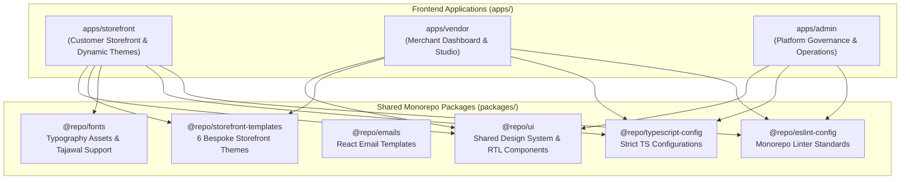

# Zaydak – Multi-Tenant E-Commerce Frontend Ecosystem

[](https://nextjs.org/)
[](https://react.dev/)
[](https://www.typescriptlang.org/)
[](https://turbo.build/repo)
[](https://tailwindcss.com/)
[](https://www.apollographql.com/)

An enterprise-grade, high-performance frontend monorepo powering **Zaydak** — a multi-tenant e-commerce platform architected for modern retail. Built with **Next.js 16 App Router**, **React 19**, **Turborepo**, and a custom **Arabic (RTL) / English (LTR)** shared design system.

---

## 🏛 Architecture Overview

Zaydak decouples customer shopping experiences, vendor operations, and central platform administration into dedicated Next.js applications sharing a unified foundation of design tokens, UI components, and templates:



---

## 🚀 Workspaces & Applications

### 1. `apps/storefront` — Customer Experience Engine
* **Purpose**: Ultra-fast, SEO-optimized e-commerce storefront for end shoppers with multi-tenant domain resolution.
* **Key Capabilities**:
  * **Dynamic Multi-Theme System**: Seamlessly swaps between 6 bespoke storefront templates based on merchant branding.
  * **Performance & Core Web Vitals**: Optimized LCP, INP, and CLS with `@number-flow/react`, smooth inertial scrolling (`Lenis`), and spring physics (`Motion 12`).
  * **GraphQL Data Layer**: Powered by `@apollo/client` v4 with `@apollo/client-integration-nextjs` for zero-waterfall server-component fetching.
  * **Internationalization**: First-class Arabic (RTL) and English (LTR) rendering using `next-intl`.

### 2. `apps/vendor` — Merchant Dashboard & Studio
* **Purpose**: High-utility workstation for merchants to manage catalog, inventory, orders, marketing, and store customizer.
* **Key Capabilities**:
  * **Interactive Rich Text Engine**: Full-featured product description builder powered by `Tiptap` extensions.
  * **Real-time Analytics & Tables**: Data grids utilizing `@tanstack/react-table` v8 and data visualization with `Recharts`.
  * **Visual Customizer**: Interactive 3D visualizers and shader effects using `@react-three/fiber`, `@react-three/drei`, and `@paper-design/shaders-react`.
  * **Developer & Power-User Tools**: Integrated CodeMirror 6 code editor and keyboard shortcuts with `react-hotkeys-hook`.

### 3. `apps/admin` — Central Platform Administration
* **Purpose**: Command center for platform super-admins to oversee tenant onboarding, financial audits, security policies, and dispute resolution.
* **Key Capabilities**:
  * Clean, distraction-free control panels built on accessible primitive components.
  * Robust form validation with `react-hook-form` and `zod`.
  * Real-time notifications and resilient state handling using `zustand` and `sileo`.

---

## 📦 Shared Packages Ecosystem

| Package | Role | Key Highlights |
| :--- | :--- | :--- |
| **`@repo/ui`** | Core Design System | 40+ accessible UI primitives built with `@base-ui/react`, `@shadcn/react`, Tailwind CSS v4, Lucide icons, and bidirectional (LTR/RTL) styling. |
| **`@repo/storefront-templates`** | Modular Theme Engine | Houses 6 distinct customer-facing store experiences: `Doughn`, `Drip`, `Rail`, `Hullo`, `Personne`, and `Jurat`. |
| **`@repo/emails`** | Transactional Communications | Beautiful, type-safe HTML and text email templates built with React Email. |
| **`@repo/fonts`** | Brand Typography | Webfont management with Tajawal for modern Arabic and native system font stacks for Latin. |
| **`@repo/typescript-config`** | Type Safety | Base TSConfigs enforcing strict type-checking, composite project references, and modern module resolution. |
| **`@repo/eslint-config`** | Code Quality | Unified ESLint rules with Next.js, React, and React Compiler linting best practices. |

---

## 🎨 Theme Architecture (`@repo/storefront-templates`)

The storefront architecture supports hot-swappable storefront presentations without altering business logic or cart state:

* **`Doughn`**: Warm, artisanal aesthetic tailored for bakeries, specialty cafes, and handcrafted goods.
* **`Drip`**: High-contrast, dynamic street-culture look featuring bold typography and drop mechanics.
* **`Rail`**: Minimalist grid layout optimized for catalogs with high SKU density and rapid filtering.
* **`Hullo`**: Playful, vibrant consumer retail theme with interactive micro-animations.
* **`Personne`**: Luxury fashion and editorial lifestyle showcase with generous whitespace and subtle transitions.
* **`Jurat`**: Contemporary electronics and technical apparel layout emphasizing specifications and reviews.

---

## 🛠 Tech Stack & Engineering Decisions

* **Framework**: [Next.js 16](https://nextjs.org/) (App Router, Server Components, Server Actions)
* **Runtime / Core**: [React 19](https://react.dev/) + [TypeScript 5](https://www.typescriptlang.org/)
* **Build System**: [Turborepo 2](https://turbo.build/) with topological pipeline caching
* **Styling**: [Tailwind CSS v4](https://tailwindcss.com/) + CSS Variables design tokens
* **Component Primitives**: [Base UI](https://base-ui.com/) & [Radix UI](https://www.radix-ui.com/) via `@repo/ui`
* **Animations**: [Motion 12](https://motion.dev/) & [GSAP](https://gsap.com/)
* **Smooth Scrolling**: [Lenis](https://lenis.darkroom.engineering/)
* **Data Fetching & API**: [Apollo Client 4](https://www.apollographql.com/) + [GraphQL Code Generator](https://the-guild.dev/graphql/codegen)
* **Form Management**: [React Hook Form](https://react-hook-form.com/) + [Zod](https://zod.dev/)
* **Testing**: [Vitest](https://vitest.dev/) + [Testing Library](https://testing-library.com/)

---

## 📂 Monorepo Structure

```text
zaydak/
├── apps/
│   ├── admin/                 # Central platform management portal (Next.js 16)
│   ├── storefront/            # Multi-tenant customer storefront (Next.js 16)
│   └── vendor/                # Merchant management dashboard & studio (Next.js 16)
├── packages/
│   ├── emails/                # React Email transactional templates
│   ├── eslint-config/         # Shared ESLint configs
│   ├── fonts/                 # Typography definitions (Tajawal & Latin)
│   ├── storefront-templates/  # 6 interchangeable storefront themes
│   ├── typescript-config/     # Shared strict tsconfig files
│   └── ui/                    # Shared design system (RTL-first UI primitives)
├── scripts/
│   └── smoke-routes.mjs       # Smoke testing runner for Next.js routes
├── package.json               # Root monorepo workspace definition
├── turbo.json                 # Turborepo task pipeline configuration
└── .gitignore                 # Monorepo git ignore hygiene
```

---

## ⚡ Getting Started

### Prerequisites
* **Node.js**: `>= 20.x`
* **Package Manager**: `npm >= 10.x` (or `pnpm` / `bun`)

### Installation

Clone the repository and install dependencies across all workspaces:

```bash
npm install
```

### Development

Run all applications in parallel using Turborepo:

```bash
npm run dev
```

Or run individual apps:

```bash
# Customer Storefront (Port 3003)
npm run dev --workspace=storefront

# Merchant Vendor Portal (Port 3001)
npm run dev --workspace=vendor

# Admin Console (Port 3002)
npm run dev --workspace=admin
```

### Build & Typecheck

```bash
# Typecheck across all apps and packages
npm run typecheck

# Production build with Turborepo caching
npm run build

# Run unit tests
npm run test
```

---

## 👤 Author & Architecture Credits

**Mohammed AlKahlout**  
*Senior Frontend Engineer & Architect*  

* 💼 **LinkedIn**: [linkedin.com/in/mohammed-alkahlout](https://www.linkedin.com/in/mohammed-alkahlout)
* 🐙 **GitHub**: [github.com/mohammedalkahlout](https://github.com/mohammedalkahlout)

---

## 📄 License

This repository is maintained as a proprietary showcase of modern multi-tenant frontend architecture. All rights reserved.
