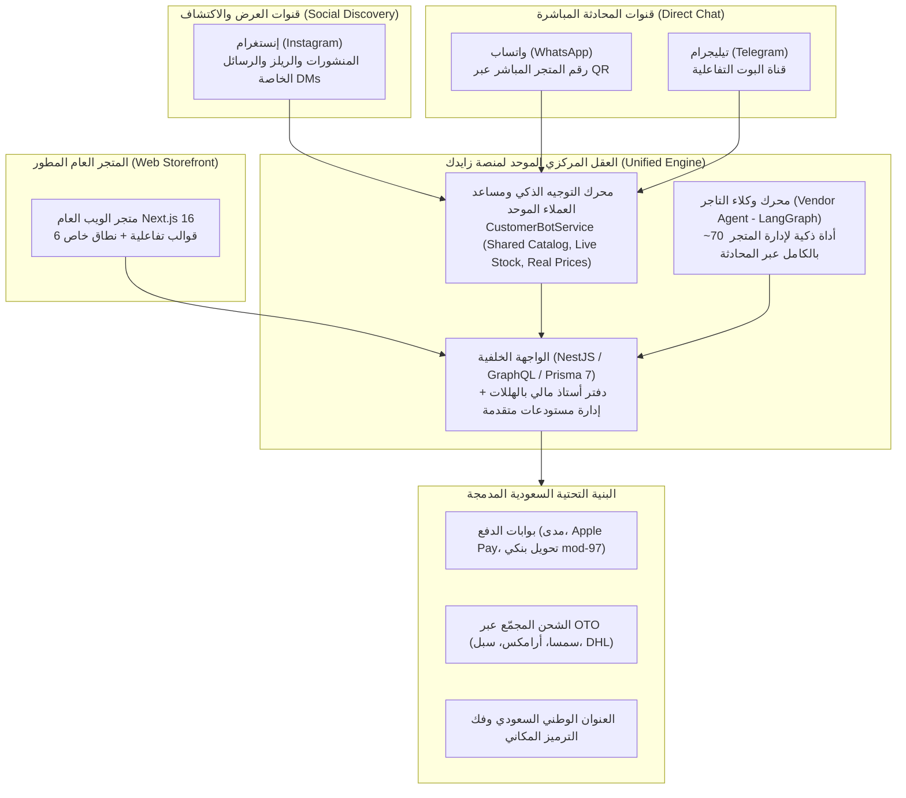
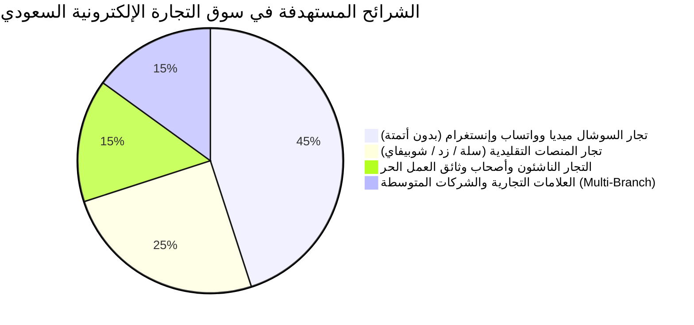
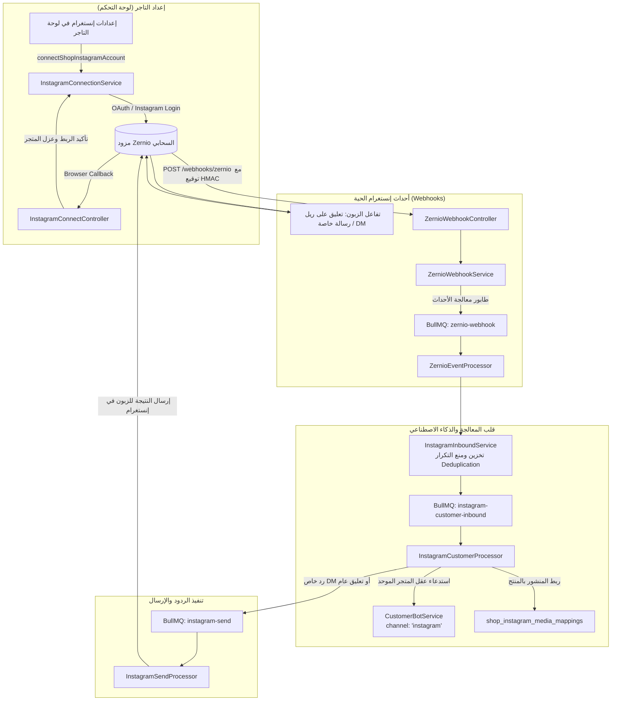
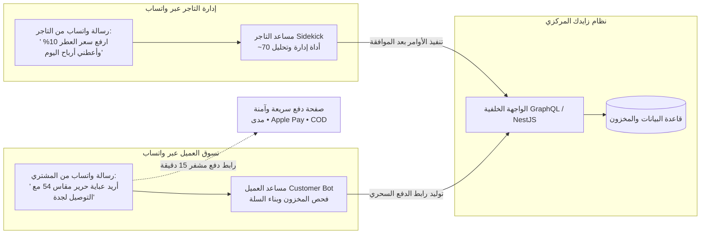
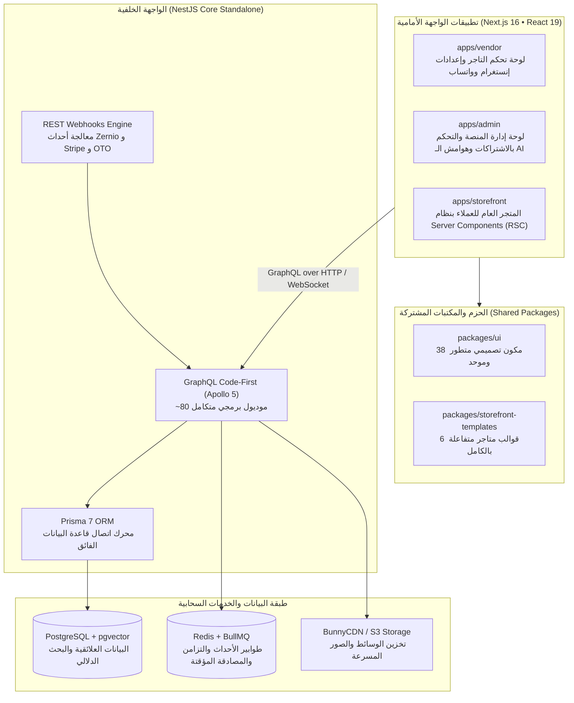
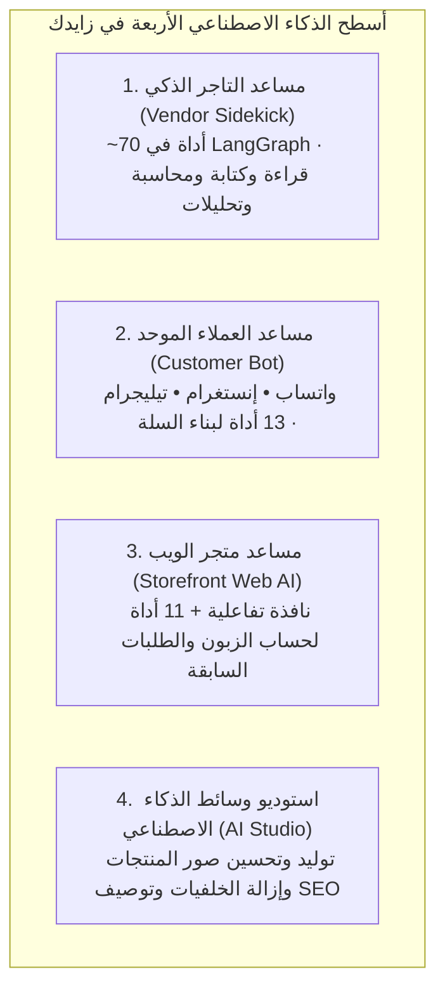
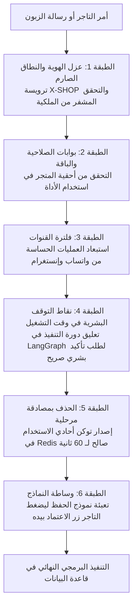
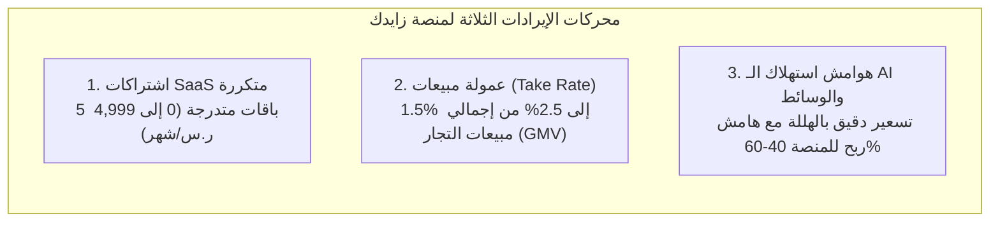
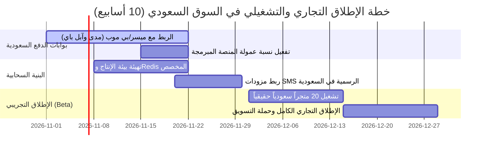

# زايدك (Zaydak) — الملف الاستثماري والتقني الشامل لمنظومة التجارة التفاعلية والاجتماعية

> **وثيقة استثمارية وتقنية سرية موجهة للمستثمرين الملائكيين، صناديق رأس المال الجريء (VCs)، والشركاء الاستراتيجيين في المملكة العربية السعودية والخليج العربي.**  
> **تاريخ التحديث:** أكتوبر 2026  
> **طبيعة الوثيقة:** دراسة تقنية وتجارية ومعمارية معمقة مبنية بنسبة 100% على فحص الكود المصدري الفعلي، سجلات الاختبارات الآلية (9,800+ اختبار)، والمقاييس التشغيلية للمنصة.

---

## فهرس المحتويات التنفيذي

1. [الملخص التنفيذي وفرصة الاستثمار / الاستحواذ](#1-الملخص-التنفيذي-وفرصة-الاستثمار--الاستحواذ)
2. [سوق التجارة الإلكترونية السعودي ورؤية المملكة 2030](#2-سوق-التجارة-الإلكترونية-السعودي-ورؤية-المملكة-2030)
3. [الجمهور المستهدف وشرائح العملاء في المملكة والخليج](#3-الجمهور-المستهدف-وشرائح-العملاء-في-المملكة-والخليج)
4. [قناة إنستغرام (Instagram Commerce via Zernio) — الأتمتة والذكاء الاصطناعي الشامل](#4-قناة-إنستغرام-instagram-commerce-via-zernio--الأتمتة-والذكاء-الاصطناعي-الشامل)
5. [المساعد التفاعلي عبر واتساب وتيليجرام (Conversational Commerce)](#5-المساعد-التفاعلي-عبر-واتساب-وتيليجرام-conversational-commerce)
6. [الملاءمة التامة للبيئة التشغيلية والنظامية في المملكة العربية السعودية](#6-الملاءمة-التامة-للبيئة-التشغيلية-والنظامية-في-المملكة-العربية-السعودية)
7. [الهندسة المعمارية للنظام والبنية البرمجية الحديثة](#7-الهندسة-المعمارية-للنظام-والبنية-البرمجية-الحديثة)
8. [الذكاء الاصطناعي في المنصة — تفصيل معماري لأسطح العمل الأربعة](#8-الذكاء-الاصطناعي-في-المنصة--تفصيل-معماري-لأسطح-العمل-الأربعة)
9. [أمان الذكاء الاصطناعي وأطر الحماية المشددة (The 6-Layer Security Framework)](#9-أمان-الذكاء-الاصطناعي-وأطر-الحماية-المشددة-the-6-layer-security-framework)
10. [النموذج المالي، اقتصاديات الوحدة، وتوقعات النمو (Unit Economics & Projections)](#10-النموذج-المالي-اقتصاديات-الوحدة-وتوقعات-النمو-unit-economics--projections)
11. [المقارنة التنافسية الشاملة مع حلول السوق القائمة (سلة، زد، وشوبيفاي)](#11-المقارنة-التنافسية-الشاملة-مع-حلول-السوق-القائمة-سلة-زد-وشوبيفاي)
12. [جاهزية النظام، مقاييس الجودة، وخارطة طريق الإطلاق التجاري](#12-جاهزية-النظام-مقاييس-الجودة-وخارطة-طريق-الإطلاق-التجاري)
13. [أطروحة الاستثمار، أوجه الصرف، وسيناريوهات التخارج للمستثمر السعودي](#13-أطروحة-الاستثمار-أوجه-الصرف-وسيناريوهات-التخارج-للمستثمر-السعودي)

---

## 1. الملخص التنفيذي وفرصة الاستثمار / الاستحواذ

منصة **زايدك (Zaydak)** هي منظومة تجارة سحابية متعددة المستأجرين (Enterprise Multi-Tenant Social & Conversational Commerce SaaS) صُممت وهُندست من الصفر لتواكب التحول الجذري في سلوك المستهلك والتاجر في **المملكة العربية السعودية ودول مجلس التعاون الخليجي**.

تتجاوز المنصة النموذج التقليدي للمتاجر الإلكترونية (Web-First / Storefront-Only) الذي تتبناه المنصات السائدة (مثل Shopify، سلة، وزد)، لتقدم نموذجاً مبتكراً وموحداً يرتكز على **التجارة الاجتماعية والتفاعلية عبر المحادثات الذكية (Conversational & Social Commerce)**:

### جوهر الابتكار التشغيلي:
1. **قناة إنستغرام الذكية المتكاملة (Instagram Commerce):** أتمتة حية للرد على تعليقات المنشورات ومقاطع الريلز (Reels) عبر رد عام، رسالة خاصة (DM)، أو كليهما؛ مع ربط كل منشور بمنتج فعلي من الكتالوج (`shop_instagram_media_mappings`)، وتوليد روابط دفع فورية وسلسة في الخاص.
2. **إدارة المتجر بالكامل عبر واتساب وتيليجرام (Merchant Sidekick):** التاجر السعودي يدير عملياته الحيوية (إضافة منتجات، تعديل أسعار، متابعة مخزون الفروع، الاستعلام عن الأرباح والمبيعات) برسالة نصية أو صوتية على واتساب هاتفه مباشرة عبر محرك يضم **~70 أداة برمجية مسجلة**.
3. **مساعد العميل الذكي وبناء السلة التفاعلية (Customer Bot):** العميل يتحدث بلهجته العامية عبر واتساب المتجر أو إنستغرام، فيفهم المساعد طلبه، يتحقق من المخزون، يضيف المنتجات للسلة، ويزوده برابط سحري مشفر لصفحة الدفع الآمنة دون أي تعقيد.
4. **تكامل كامل مع البنية السعودية:** دعم فوري للعنوان الوطني، الدفع بالبطاقات ومدى، دفتر أستاذ محاسبي صارم بالهللات، والربط اللوجستي مع شركات الشحن عبر OTO.

### القيمة السوقية والأصول البرمجية للنظام (IP Assets)
تم تطوير المنصة وفق أعلى المعايير الهندسية لعام 2026 دون أي ديون تقنية (Zero Legacy Debt):
- **أكثر من 450 قدرة تشغيلية** موثقة ومبنية في الكود المصدري.
- **أكثر من 80 موديول برمجي** في الواجهة الخلفية تغطي أدق تفاصيل التجارة والمحاسبة والمخزون والشحن والذكاء الاصطناعي.
- **9,802 اختبار برمجي آلي (Automated Tests)** تغطي كافة سيناريوهات الأعمال بنجاح تام.
- **بنية برمجية فائقة الحداثة (Monorepo):** Next.js 16 (App Router)، React 19، Apollo Client 4، NestJS 10، Prisma 7، Redis BullMQ، و PostgreSQL + pgvector.

> [!IMPORTANT]
> **خيارات العرض الاستثماري للمستثمر السعودي:**
> - **خيار الاستثمار التمويلي (Equity Seed Round):** ضخ استثمار رأسمالي لتغطية تكاليف الإطلاق التجاري في السوق السعودي (بوابات الدفع، تراخيص البنك المركزي، الحملات التسويقية والاستحواذ على أول 2,500 تاجر).
> - **خيار الاستحواذ على الملكية الفكرية والتقنية (Full IP / Tech Acquisition):** شراء قاعدة الكود وحقوق النظام بالكامل، مما يوفر على المشتري ما لا يقل عن **18-24 شهراً من التطوير الهندسي الشاق** وتكلفة تأسيس تقدر بـ **1.5 إلى 2 مليون ريال سعودي** لبناء منصة بهذا النضج والاستقرار من الصفر.

---

## 2. سوق التجارة الإلكترونية السعودي ورؤية المملكة 2030

### 1. مؤشرات السوق السعودي والفرصة الهائلة بالأرقام
يشهد قطاع التجارة الإلكترونية في المملكة العربية السعودية نمواً غير مسبوق، مدفوعاً ببرامج التحول الوطني ومستهدفات **رؤية المملكة 2030**:
- **حجم السوق (GMV):** تجاوزت مبيعات التجارة الإلكترونية في السعودية **60 مليار ريال سعودي سنوياً**، بمعدل نمو سنوي مركب (CAGR) يتجاوز **18%**، مع توقعات بالوصول إلى **100+ مليار ريال بحلول عام 2030**.
- **المدفوعات الرقمية:** حققت المملكة هدفها الاستراتيجي بتجاوز **70% من المعاملات غير النقدية (Cashless Transactions)**، حيث تسيطر شبكة "مدى" و Apple Pay على الحصة العظمى من عمليات الشراء اليومية.
- **القوة الشرائية والتفاعل الرقمي:** يُعد المستهلك السعودي من أعلى المستهلكين إنفاقاً عبر الهواتف الذكية عالمياً، حيث يُنجز **أكثر من 82% من طلبات التجارة الإلكترونية عبر الجوال**.

```mermaid
graph LR
    subgraph MarketDrivers["محركات السوق السعودي (Saudi Catalysts)"]
        V1["رؤية المملكة 2030<br/>دعم المنشآت الصغيرة لتسهم بـ 35% من الناتج"]
        V2["التجارة غير النقدية<br/>أكثر من 70% من المبيعات عبر مدى وآبل باي"]
        V3["ثقافة السوشال ميديا<br/>أعلى كثافة تفاعل على إنستغرام وواتساب عالمياً"]
    end

    subgraph Bottleneck["فجوة المنصات التقليدية (سلة / زد)"]
        B1["فصل المتجر عن محادثات البيع الحقيقية"]
        B2["إرهاق الردود اليدوية على إنستغرام والواتساب"]
        B3["ضياع السلات في المحادثات اليدوية"]
    end

    subgraph ZaydakSolution["حل زايدك المتكامل"]
        Z1["التجارة الاجتماعية: الرد الفوري والشراء من إنستغرام"]
        Z2["التجارة التفاعلية: بيع وإدارة كاملة عبر واتساب"]
        Z3["ربط الشحن الوطني ومدى والدفتر المحاسبي بالهللة"]
    end

    MarketDrivers --> Bottleneck
    Bottleneck --> ZaydakSolution
```

### 2. معضلة "تشتت التاجر السعودي" وضياع 40% من المبيعات
تعتمد الغالبية العظمى من المتاجر السعودية المستقلة، العلامات التجارية الصاعدة (D2C Brands)، الأسر المنتجة، وتجار وثائق العمل الحر على **إنستغرام كواجهة اكتشاف أولى، وعلى واتساب كقناة تأكيد وتواصل**:
- **المعاناة اليومية:** ينشر التاجر منتجه على إنستغرام، فتنهال التعليقات: *"بكم العطر؟"، "هل الفستان متوفر مقاس L؟"، "كم التوصيل للرياض؟"*.
- **التكلفة والضرر:** يضطر التاجر لقضاء 4 إلى 6 ساعات يومياً في نسخ ولصق الردود يدوياً، أو توظيف موظفي خدمة عملاء بتكلفة تتجاوز 4,000 ريال شهرياً لكل موظف.
- **ضياع المبيعات:** إذا تأخر الرد لأكثر من 15 دقيقة، يتراجع اهتمام الزبون ويشتري من منافس آخر. تشير الدراسات إلى أن **40% من مبيعات السوشال ميديا في الخليج تضيع بسبب بطء الرد البشري**.
- **أين تكمن فجوة المنصات التقليدية؟** منصات مثل "سلة" أو "زد" أو "Shopify" تطلب من التاجر وضع رابط في البايو والطلب من الزبون الخروج من إنستغرام، وتصفح موقع ويب طويل، وإنشاء حساب وتذكر كلمة مرور! هذه الخطوات تؤدي إلى هبوط نسبة التحويل (Conversion Rate) إلى أقل من 1.5%.

> **حل زايدك الثوري:**  
> يجلب المتجر إلى حيث يتواجد الزبون! الزبون يعلّق على ريل في إنستغرام -> يصله الرد برابط المنتج المباشر على الخاص في 3 ثوانٍ -> يفتح الرابط ليجد السلة معبأة ويدفع بـ Apple Pay في ثوانٍ معدودة.

---

## 3. الجمهور المستهدف وشرائح العملاء في المملكة والخليج

تمت هندسة المنصة لخدمة 5 شرائح استراتيجية ذات قدرة شرائية عالية، مما يمنح النظام حجماً سوقياً متاحاً (TAM) ضخماً للغاية:

### 1. تجار إنستغرام وتيك توك والسوشال ميديا (القطاع الأكبر — 45%)
- **الأنشطة:** العطور والبخور، الأزياء والعبايات، الإكسسوارات والمجوهرات، مستحضرات التجميل والعناية، الهدايا، والمقاهي المتخصصة.
- **الحجم:** مئات الآلاف من المتاجر النشطة يومياً في السعودية والخليج بدون حل تقني متكامل يجمع السوشال ميديا بنظام المخزون.
- **القيمة المضافة:** تحويل حساب إنستغرام إلى ماكينة بيع مؤتمتة تعمل 24/7 دون أي تدخل يدوي في الردود الروتينية.

### 2. التجار الناقلون من منصات سلة، زد، وشوبيفاي (25%)
- **الدافع:** إرهاق الاشتراكات والرسوم المرتفعة، الحاجة لشراء تطبيقات خارجية باهظة لكل ميزة، وعدم وجود أتمتة أصلية لواتساب وإنستغرام في قلب المنصة.
- **القيمة المضافة:** نقل الكتالوج بضغطة زر واحدة عبر أداة استيراد Shopify CSV المدمجة، والحصول على وكيل ذكاء اصطناعي تفاعلي يدير المتجر بالكامل.

### 3. رواد الأعمال الجدد، الأسر المنتجة، وأصحاب وثائق العمل الحر (15%)
- **الحاجة:** إطلاق سريع بدون تعقيدات بيروقراطية، دون الحاجة لحاسوب أو معرفة تقنية.
- **القيمة المضافة:** تسجيل فوري بالهاتف عبر رمز OTP، متجر مؤثث من اليوم الأول بسياسات تجارية سعودية جاهزة وهوية متناسقة، وإدارة كاملة عبر تطبيق واتساب الجوال.

### 4. الشركات والعلامات التجارية المتوسطة (Multi-Warehouse Retailers — 15%)
- **الحاجة:** فروع ومستودعات متعددة (الرياض، جدة، الشرقية)، حركة تحويل مخزون مستمرة، تتبع لوجستي دقيق ومحاسبة صارمة بالهللات.
- **القيمة المضافة:** محرك مخزون متعدد المواقع، أوامر توريد وتحويل، دفتر أستاذ مالي Append-Only يمنع التلاعب المالي، وربط رسمي مع مجمع الشحن OTO.

### 5. المتسوق السعودي والخليجي (المشتري النهائي)
- تجربة شراء فائقة الراحة: تصفح المنتجات باللهجة المحلية، الحصول على إجابات دقيقة لأسئلة المقاس والتوفر، سلة شراء برابط سحري بنقرة واحدة، ودعم فوري للدفع عند الاستلام والحوالات البنكية ومدى.

---

## 4. قناة إنستغرام (Instagram Commerce via Zernio) — الأتمتة والذكاء الاصطناعي الشامل

تُمثل قناة إنستغرام في نظام زايدك **الميزة الاستراتيجية الأقوى** لمخاطبة السوق السعودي. تم بناء هذا الموديول هندسياً في مجلد `back-end/src/instagram/` بالاعتماد على مزود **Zernio** الرائد، مما يمنح المنصة تفوقاً استثنائياً.

### 1. المعمارية التقنية لربط إنستغرام (Instagram OAuth Architecture)
- **بدون تعقيدات Meta App Review:** بدلاً من مطالبة التاجر بإنشاء تطبيق فيسبوك للمطورين والحصول على موافقات أمنية معقدة لشهور، يتصل التاجر عبر Zernio OAuth (Instagram Login) بنقرة زر واحدة لحسابه التجاري (Business / Creator).
- **عزل أمني تام للمستأجرين:** يُنشئ النظام ملفاً خارجياً مخصصاً لكل متجر (`externalId = shopId`) وتخزين المعرفات فقط؛ لا يحتفظ أي طرف باعتمادات سرية خطرة.
- **ربط أحادي صارم (One Instagram Account per Shop):** يمنع النظام البرمجي ربط حساب إنستغرام واحد بأكثر من متجر عبر التحقق الصارم من `instagram_user_id`، مع حماية العمليات برمز تحقق HMAC-SHA256 موقع ومشفر.

### 2. محرك الرد الذكي على المنشورات والريلز (Post & Reel Comment Automation)
عندما يعلق أي متابع على صورة منتج أو مقطع ريل في إنستغرام، يتدخل النظام وفق سيناريوهات قابلة للتخصيص الكامل من التاجر:
1. **الرد العام (Public Reply):** كتابة رد عام يثني على العميل ويجيب على الاستفسار لرفع معدل تفاعل المنشور (Engagement Rate) أمام خوارزميات إنستغرام.
2. **الرد الخاص (Private DM Reply):** إرسال رسالة خاصة فورية ومباشرة لحساب العميل تتضمن تفاصيل المنتج، صوره، ورابط الشراء السريع، مستفيداً من نافذة المراسلة الممتدة لـ 7 أيام للمنشورات.
3. **الوضع المزدوج الذكي (Dual Mode):** كتابة رد عام في التعليقات: *"أهلاً بك! تم إرسال كافة التفاصيل ورابط الطلب المباشر إلى رسائلك الخاصة 📩"*، وإرسال تفاصيل المنتج والخصم فورياً في الـ DM.
4. **تطبيع وفلترة الكلمات المفتاحية باللغة العربية (Arabic Keyword Normalization):**
   - يدعم النظام تفعيل الردود الذكية عند ورود كلمات شراء شائعة بالسعودية والخليج: `السعر`، `بكم`، `كم السعر`، `متوفر`، `المقاس`، `الرياض`، `توصيل`، `كود خصم`، مع تنظيف وتطبيع الهمزات والتاء المربوطة والأحرف المكررة (`بكمممم` -> `بكم`).

### 3. ابتكار ربط المنشورات بالمنتجات (Media-to-Product Mapping)
أحد أقوى الابتكارات الحصرية في نظام زايدك في جدول `shop_instagram_media_mappings`:
- يمكن للتاجر في لوحة التحكم اختيار منشور أو مقطع ريل وربطه بمنتج محدد من الكتالوج.
- عندما يعلق الزبون على ذلك المنشور، يسترجع المساعد الذكي سياق المنتج بدقة: الاسم الفعلي، الخيارات المتوفرة (المقاسات والألوان)، السعر الحالي بالريال، حالة المخزون، ورابط الشراء المباشر.
- النتيجة: **صفر هلوسة في الردود**؛ فالذكاء الاصطناعي لا يخمّن الأسعار بل يستخرجها من واقع قاعدة البيانات الحقيقية.

### 4. المساعد الذكي للرسائل الخاصة (Instagram DM Assistant)
- يعمل على قناة `channel: 'instagram'` بنفس العقل البرمجي المركزي الذي يدير واتساب وتيليجرام.
- يتعرف على أسئلة العميل الشائعة (مواعيد العمل، الشحن لمدن المملكة، سياسات الاسترجاع، طرق الدفع).
- **توليد روابط الشراء المباشرة:** نظراً لأن سياسات إنستغرام تمنع مشاركة رقم الهاتف الموثق في المحادثة، يقوم المساعد بتوليد رابط فوري ذكي لصفحة المنتج أو سلة الشراء الجاهزة، لينتقل العميل ويتم الشراء بنقرة واحدة.

### 5. التدخل البشري السلس والذكي (Human Takeover)
- إذا قرر التاجر أو موظف المبيعات الرد يدوياً على محادثة الزبون — سواء من داخل صندوق الوارد الموحد في زايدك أو عبر تطبيق إنستغرام الرسمي على هاتفه — **يتعرف النظام على الرد فورياً ويوقف الذكاء الاصطناعي مؤقتاً على هذه المحادثة (Auto-Pause)**، مما يمنع أي تداخل بين ردود الموظف وردود الروبوت.

### 6. الامتثال لنافذة المراسلة الرسمية (Meta 24-Hour Messaging Window)
- يلتزم النظام بنظام الإرسال الصارم لـ Meta؛ حيث يسجل تاريخ آخر رسالة واردة من الزبون (`last_inbound_at`).
- يمتنع النظام عن إرسال رسائل ترويجية خارج نافذة الـ 24 ساعة لحماية حساب التاجر من الحظر، مع إعطاء تنبيه واضح في لوحة التحكم.

### 7. لوحة تحليلات وإحصائيات إنستغرام المباشرة
- استعراض آخر **25 منشوراً حياً** للمتجر في لوحة التحكم مع روابط المنتجات المقترنة بها.
- لوحة مقاييس تشغيلية تعرض إحصائيات 30 يوماً من سجل التسليم: إجمالي الرسائل الواردة، المحادثات المكتملة آلياً، والتعليقات المعالجة بنجاح.

---

## 5. المساعد التفاعلي عبر واتساب وتيليجرام (Conversational Commerce)

### 1. مساعد التاجر الذكي (Vendor Sidekick) — إدارة الأعمال من الجوال
لا يحتاج التاجر للجلوس أمام شاشة حاسوب لإدارة متجره؛ فالمساعد الذكي مزود بـ **~70 أداة برمجية متخصصة** مبنية بإطار **LangGraph StateGraph**:
- **إدارة الكتالوج:** إضافة منتج بالصورة والوصف، تعديل الأسعار، وإدارة المتغيرات.
- **التعديلات الجماعية (Bulk Operations):** *"ارفع أسعار قسم النظارات 15%"* — ينفذ النظام مسحاً شاملاً ويطلب موافقة التاجر قبل الاعتماد.
- **التحليلات والمحاسبة (23 أداة تحليلية):** استعلام لحظي عن أرباح اليوم، السلات المتروكة، تقرير الأداء المالي، وأكثر المنتجات مبيعاً.
- **إدارة المخزون والتوريد:** تعديل كميات المستودعات، إصدار أوامر تحويل بين الفروع، ومتابعة النواقص.

### 2. مساعد المتجر للعملاء (Customer Bot) — بائع آلي خبير
- يعمل على **رقم واتساب المتجر الخاص** عبر محرك Baileys / Evolution API المستضاف ذاتياً (الربط بمسح رمز QR في 30 ثانية بدون أي اشتراطات معقدة من Meta).
- يتحدث بالعربية الفصحى أو اللهجة العامية الخليجية، ويفهم مرادفات السلع بدقة.
- **بناء السلة التفاعلية (Magic Cart Flow):**
  الزبون يطلب المنتج في الشات -> يضيفه المساعد للسلة -> يرسل له رابط دفع مشفر ومخصص بنظام SHA-256 صالح لمدة 15 دقيقة -> يفتح العميل الرابط ليجد عنوانه وسلته بانتظاره، ويدفع بـ Apple Pay أو مدى بلمسة واحدة.

---

## 6. الملاءمة التامة للبيئة التشغيلية والنظامية في المملكة العربية السعودية

تم بناء النظام ليكون مواطناً رقمياً متكاملاً مع البنية التحتية والتشريعية في المملكة العربية السعودية:

| المجال التشغيلي | الواقع في المنصات العالمية والتقليدية | الحل الأصيل المدمج في نظام زايدك |
|---|---|---|
| **العنوان الوطني السعودي** | قوالب عناوين أمريكية تطلب Street و Zip Code وتسبب ضياع 20% من الشحنات. | **دعم أصلي للعنوان الوطني ورمز المبنى (4 أحرف و4 أرقام)** مع فك الترميز المكاني وحفظه في سجل العميل. |
| **وسائل الدفع السعودية** | الاعتماد على بطاقات الائتمان فقط، أو إضافات طرف ثالث مكلفة لمدى وآبل باي. | **واجهة مهيأة للربط المباشر مع بوابات الدفع السعودية المرخصة (ميسر / بي موب)** لدعم مدى و Apple Pay بنسبة قبول تفوق 95%. |
| **الحوالات البنكية المحلية** | إدخال رقم حساب يدوي دون أي فحص وتكرار أخطاء التحويل. | **فحص خوارزمي تلقائي لرقم الـ IBAN البنكي السعودي بخوارزمية mod-97** المعتمدة من البنك المركزي (SAMA) وتجميد الحساب على الطلب. |
| **الشحن والخدمات اللوجستية** | عقود شحن منفصلة وبوالص يدوية تستنزف وقت التاجر. | **ربط مباشر ومدمج مع OTO مجمع الشحن السعودي** لإصدار بوالص الشحن والتتبع مع سمسا، أرامكس، سبل، و DHL بعقد التاجر الخاص. |
| **الدفع عند الاستلام (COD)** | تسجيل مالي غير دقيق يسبب عجزاً وتعارضاً في تسوية حسابات التوصيل. | **توزيع مالي ذكي لمبالغ الدفع عند الاستلام على الطرود المشحونة جزئياً**، ومتابعة التسوية في دفتر الأستاذ. |
| **الامتثال المحاسبي والضريبي** | أخطاء تقريب الكسور العشرية في ضريبة القيمة المضافة 15%. | **نظام مالي صارم بالهللات (Integer Cents)** ودفتر أستاذ مزدوج غير قابل للتعديل (Append-Only Ledger) جاهز للفوترة الإلكترونية (ZATCA). |

---

## 7. الهندسة المعمارية للنظام والبنية البرمجية الحديثة

تعتمد المنصة على بنية مؤسسية حديثة للغاية منظمة بنمط **Turborepo Monorepo** فائق السرعة، تعزل الواجهات الأمامية عن منطق الأعمال مع مشاركة كاملة لمكتبات التصميم والقواعد المشتركة.

### تفاصيل الحزم البرمجية:
1. **الواجهة الخلفية (`back-end/`):**
   - مبنية بإطار **NestJS 10** مع **GraphQL (Apollo 5)** بنهج Code-First قوي وموثق بـ 194 ملف توثيق داخلي.
   - قاعدة البيانات: **PostgreSQL** مع ملحق **pgvector** لدعم البحث الدلالي باللغة الطبيعية عن المنتجات.
   - الطوابير والأداء: **Redis** و **BullMQ** لمعالجة أحداث الويب هوك غير المتزامنة لإنستغرام، واتساب، ورسائل البريد.
2. **لوحة تحكم التاجر (`apps/vendor/`):**
   - مبنية بـ **Next.js 16** مع **React 19** وأحدث ميزات React Compiler.
   - إدارة الحالة: **Zustand** و **Apollo Client 4**.
   - دعم التدويل الكامل: نظام **next-intl** بدعم ثنائي متطابق (عربي وإنجليزي) لأكثر من 4,300 رسالة مترجمة بدقة.
3. **متجر العملاء العام (`apps/storefront/`):**
   - يعتمد أحدث معمارية لمكونات الخادم **React Server Components (RSC)** لسرعة تحميل فائقة ودعم مثالي للـ SEO.
   - دعم التوجيه المزدوج: نطاق المنصة الموحد (`zaydak.com/{shopSlug}`)، النطاقات الفرعية (`{shopSlug}.zaydak.com`)، والنطاقات المخصصة للتاجر (`brand.com`) مع شهادات SSL آلية.
   - 6 قوالب حصرية راقية (`doughn`, `drip`, `rail`, `hullo`, `personne`, `jurat`).
4. **لوحة إدارة المنصة (`apps/admin/`):**
   - غرفة التحكم لمالك ومشغل المنصة لمتابعة المؤشرات، الاشتراكات، طلبات السحب، وهوامش ربح الذكاء الاصطناعي بدقة الهللة.
   - تشفير متقدم للاعتمادات والمفاتيح الخارجية بتقنية **AES-256-GCM**.

---

## 8. الذكاء الاصطناعي في المنصة — تفصيل معماري لأسطح العمل الأربعة

لا يقتصر الذكاء الاصطناعي في زايدك على واجهة محادثة بسيطة، بل يشمل **4 أسطح عمل مستقلة تماماً ومتباينة الصلاحيات والأمان**:

### 1. مساعد التاجر الذكي (Vendor Sidekick)
- مبني بالكامل على إطار **LangGraph StateGraph** مع حفظ نقاط الاستعادة (Checkpoints) في قاعدة البيانات.
- يضم **~70 أداة مسجلة** موزعة على:
  - قراءة الكتالوج (10 أدوات): استعلام عن المنتجات، النواقص، سجل حركة المخزون.
  - الكتابة في الكتالوج (15 أداة): إنشاء وتعديل وحذف المنتجات، الكوبونات، والتصنيفات.
  - التعديلات الجماعية (4 أدوات): تحديث أسعار جماعي، تصدير واستيراد CSV.
  - التحليلات والمحاسبة (23 أداة): هوامش الربح، قمع التحويل، السلات المتروكة، وتوقعات الإيرادات.
  - المخزون والتوريد: تحويل بين الفروع وتعديل الأرصدة.
  - الطلبات والتتبع (6 أدوات): متابعة الشحنات، طلبات الاسترجاع، ورصيد التاجر القابل للسحب.
  - التسويق وصناعة المحتوى (8 أدوات): توليد الأوصاف التسويقية والترجمة الفورية.

### 2. مساعد المتجر للعملاء (Customer Bot)
- المحرك الموحد العامل على **واتساب، إنستغرام، وتيليجرام**.
- الأدوات الأساسية (13 أداة): البحث الذكي في الكتالوج، حل العنوان الوطني، بناء السلة التفاعلية، استعراض الكوبونات والعروض الفلاشية، وشرح سياسات الاسترجاع وتصعيد المحادثة للبشر.

### 3. مساعد المتجر على الويب (Storefront Assistant)
- نافذة تفاعلية في متجر الويب تتيح للزبون المسجل تتبع طلباته السابقة، إعادة طلب شحنة بنقرة واحدة، استعراض قائمة أمنياته ونقاط ولائه.

### 4. استوديو وسائط الذكاء الاصطناعي (AI Media Studio)
- جلسات تصوير افتراضية للمنتجات بنقرة واحدة.
- قوالب المناسبات السعودية والخليجية: إعدادات جاهزة لأجواء اليوم الوطني، يوم التأسيس، شهر رمضان، وعيدي الفطر والأضحى.
- أدوات تفريغ الصور (Background Removal)، رفع الدقة (Upscaling)، والتوصيف الذكي لمحركات البحث (Alt Text).

---

## 9. أمان الذكاء الاصطناعي وأطر الحماية المشددة (The 6-Layer Security Framework)

في التجارة الإلكترونية، يمثل الخطأ في اتخاذ القرارات أو تسريب الأسعار أو التلاعب بقواعد البيانات مخاطرة لا يمكن قبولها. يطبق نظام زايدك **إطار حماية معماري من 6 طبقات صلبة لا يمكن اختراقها بواسطة هندسة الأوامر (Prompt Injections)**:

### تفصيل طبقات الحماية الست:
1. **الهوية والنطاق الصارم (Identity & Scope):** لا يستخلص النموذج معرف المتجر من سياق المحادثة إطلاقاً؛ بل يُمرر حصرياً عبر ترويسة `X-SHOP` المشفرة وحراس النظام (`ShopOwnershipGuard`).
2. **رخصة الباقة (Plan Entitlements):** فحص صلاحية الأداة برمجياً بحسب باقة اشتراك المتجر قبل استدعائها.
3. **قيود القنوات (Channel Policies):** قوائم بيضاء تمنع استدعاء أدوات الملفات الضخمة أو العمليات المالية الحساسة عبر قنوات التواصل السريعة.
4. **نقاط التوقف والموافقة البشرية في وقت التشغيل (Approval Interrupts):**
   - في العمليات الكبرى (مثل تعديل أسعار 200 منتج)، **يعلّق محرك LangGraph التنفيذ برمجياً في الذاكرة**.
   - يرسل النظام للتاجر تفاصيل التشغيل التجريبي: *"سيتم رفع أسعار 84 منتجاً في قسم العطور، هل تؤكد؟ أرسل 1 للتأكيد أو 2 للإلغاء"*. لا يمكن لأي تلاعب لغوي تجاوز هذا الحظر البرمجي.
5. **الحذف بمصادقة مرحلية (Two-Phase Deletion):** حذف أي منتج أو تصنيف يتطلب إصدار رمز مؤقت مشفر في **Redis لمدة 60 ثانية**؛ وإذا لم يتم التأكيد يسقط الطلب فوراً.
6. **وساطة النماذج (Form Mediation):** عند إنشاء أو تعديل منتجات من اللوحة، يجهز المساعد البيانات في نموذج جاهز (Prefilled Form) ليكون ضغط زر الحفظ البشري هو الموافقة النهائية.
7. **صمامات منع تسريب التكاليف (Anti-Leak Traps):** استعلامات الكتالوج التي يستخدمها مساعد العملاء تستخدم دوال تسقط حقل سعر التكلفة (`cost_per_item_cents`) برمجياً؛ فحتى لو سأل الزبون المساعد: *"كم تكلفة هذا المنتج على صاحب المتجر؟"*، لا يمتلك المساعد حقل التكلفة في الذاكرة إطلاقاً!

---

## 10. النموذج المالي، اقتصاديات الوحدة، وتوقعات النمو (Unit Economics & Projections)

صُمم النظام بنموذج إيرادات ثلاثي الأبعاد بالريال السعودي يضمن تدفقات نقدية متكررة وهوامش ربح تصاعدية:

### 1. باقات الاشتراك الشهري والسنوي (بالريال السعودي)
| الباقة | السعر الشهري | السعر السنوي | أبرز القدرات والخصائص |
|---|---|---|---|
| **المجانية (Free)** | 0 ر.س | 0 ر.س | متجر أساسي، كتالوج محدود، 200 استعلام ذكاء اصطناعي تجريبي. |
| **الأساسية (Basic)** | 99 ر.س | 990 ر.س | ربط واتساب أو إنستغرام، 500 رد آلي شهرياً، إدارة الكتالوج الأساسية. |
| **النمو (Grow)** | 299 ر.س | 2,990 ر.س | **ربط واتساب وإنستغرام معاً**، 2,000 رد آلي، 23 أداة تحليلات، مخزون متعدد المستودعات. |
| **المتقدمة (Advanced)** | 999 ر.س | 9,990 ر.س | أتمتة كاملة لتعليقات إنستغرام وريلز، تعديلات جماعية، استوديو صور الـ AI، 10,000 رد، نطاق خاص. |
| **بلس (Plus / Enterprise)** | 4,999 ر.س | 49,990 ر.س | استهلاك AI غير محدود، دعم مخصص على مدار الساعة، إدارة فروع وسلاسل إمداد كبرى. |

### 2. اقتصاديات الوحدة للمتجر الواحد (Unit Economics)
- **متوسط الإيراد لكل متجر (ARPU):** يقدر بـ **380 ريال سعودي شهرياً** (مزيج بين باقة النمو والباقة الأساسية مع العمولات).
- **تكلفة الاستحواذ على التاجر (CAC):** تقدر بـ **400 ريال سعودي** عبر الحملات الرقمية الموجهة لتجار إنستغرام وسناب شات في السعودية.
- **القيمة الدائمة للتاجر (LTV):** بافتراض متوسط بقاء التاجر لمدة 20 شهراً:  
  $$\text{LTV} = 380 \text{ ر.س} \times 20 = 7,600 \text{ ر.س}$$
- **نسبة العائد إلى تكلفة الاستحواذ (LTV / CAC Ratio):**  
  $$\frac{7,600}{400} = 19\text{x}$$  
  *(أي نسبة تتجاوز 4x في شركات الـ SaaS تُعد مؤشراً استثمارياً استثنائياً؛ ويرجع ذلك لاعتماد التاجر اليومي الكامل على المنصة في محادثات بيعه مما يجعل معدل الإلغاء Churn Rate منخفضاً للغاية).*

### 3. التوقعات المالية للسنوات الثلاث الأولى (Financial Projections)
| المؤشر المالي | السنة الأولى (Y1) | السنة الثانية (Y2) | السنة الثالثة (Y3) |
|---|---|---|---|
| **عدد المتاجر النشطة (Active Merchants)** | 500 متجر | 2,500 متجر | 7,500 متجر |
| **إجمالي حجم المبيعات المعالجة (GMV)** | 45 مليون ر.س | 280 مليون ر.س | 1.1 مليار ر.س |
| **إيراد الاشتراكات السنوية (ARR)** | 2.1 مليون ر.س | 11.4 مليون ر.س | 34.2 مليون ر.س |
| **إيراد عمولات المبيعات (Take Rate @ 1.5%)** | 675 ألف ر.س | 4.2 مليون ر.س | 16.5 مليون ر.س |
| **إجمالي الإيرادات السنوية للمنصة** | **2.77 مليون ر.س** | **15.6 مليون ر.س** | **50.7 مليون ر.س** |
| **صافي هامش الربح التشغيلي المتوقع** | 35% | 58% | 68% |

---

## 11. المقارنة التنافسية الشاملة مع حلول السوق القائمة (سلة، زد، وشوبيفاي)

| وجه المقارنة | منصة شوبيفاي (Shopify) | منصة سلة (Salla) | منصة زد (Zid) | **منظومة زايدك (Zaydak)** |
|---|---|---|---|---|
| **إدارة المتجر بالكامل عبر المحادثة** | غير متاح | غير متاح | غير متاح | **أصيل ومدمج بالكامل (~70 أداة في واتساب)** |
| **أتمتة إنستغرام الذكية (المنشورات والريلز)** | تتطلب تطبيقات خارجية معقدة | تتطلب اشتراكات مكلفة في أدوات أجنبية | غير مدمجة أصلياً | **مدمجة بالكامل مع ربط المنشور بالمنتج مباشرة** |
| **بناء السلة والشراء داخل المحادثة** | غير مدعوم أصلياً | إضافات محدودة وباهظة | إضافات محدودة | **أصيل ومدمج بروابط دفع سحرية مشفرة** |
| **ربط واتساب بدون تعقيدات Meta Cloud** | لا (يتطلب حساب Meta رسمي) | يتطلب باقات خاصة ورسوم رسائل | يتطلب إعدادات معقدة | **نعم (بمسح رمز QR فوري في 30 ثانية)** |
| **التدخل البشري التلقائي (Human Takeover)** | غير متوفر | غير متوفر | غير متوفر | **مدمج (يتوقف الذكاء الاصطناعي عند رد الموظف)** |
| **نقاط التوقف البشرية للـ AI (Interrupts)** | غير متوفر | غير متوفر | غير متوفر | **نعم (مدمج في محرك LangGraph)** |
| **الدعم الأصلي للعنوان الوطني السعودي** | إضافات غير دقيقة | مدعوم في المتجر التقليدي | مدعوم في المتجر التقليدي | **مدعوم في صميم الشات، المتجر، وعمليات الشحن** |
| **التحقق من IBAN البنوك السعودية** | إدخال نصي عادي | مدعوم محلياً | مدعوم محلياً | **فحص خوارزمي mod-97 وتجميد حساب على الطلب** |
| **حداثة التقنيات وخفة الكود (Tech Stack)** | كود ضخم متراكم | خليط من أطر تقليدية | أطر تقليدية | **Next.js 16 + React 19 + NestJS + GraphQL** |

---

## 12. جاهزية النظام، مقاييس الجودة، وخارطة طريق الإطلاق التجاري

### 1. نتائج الفحص والاختبارات البرمجية الفعلية
خضعت قاعدة الكود لتدقيق هندسي شامل وتحقق آلي صارم:
- **اختبارات الواجهة الخلفية (`back-end/`):** 6,880 اختباراً ناجحاً بنسبة 100% (Jest).
- **اختبارات لوحة التاجر (`apps/vendor/`):** 1,573 اختباراً ناجحاً بنسبة 100% (Vitest).
- **اختبارات المتجر العام (`apps/storefront/`):** 718 اختباراً ناجحاً بنسبة 100% (Vitest).
- **اختبارات لوحة الإدارة وحزمة التصميم:** 623 اختباراً ناجحاً بنسبة 100%.
- **المجموع الإجمالي للاختبارات الآلية:** **9,802 اختبار برمجي آلي ناجح**.
- **فحص الأنماط والأنواع (TypeScript `tsc --noEmit`):** نظيف تماماً وخالٍ من الأخطاء عبر كافة التطبيقات والحزم.

### 2. خارطة طريق الإطلاق التجاري والتشغيلي (10 أسابيع)

1. **الأسابيع 1 - 3: استكمال ربط بوابة دفع سعودية (مدى وآبل باي):**
   - ربط بوابة دفع محلية معتمدة (مثل **Moyasar** أو **Paymob**) لدعم شبكة "مدى" والبطاقات المحلية (منطق الدفع مجرد ومهيأ في الكود).
2. **الأسابيع 2 - 4: البنية السحابية للإنتاج:**
   - ضبط خوادم الإنتاج والـ Redis المدار، وتفعيل مزود رسائل SMS السعودي المعتمد للتحقق من أرقام الجوال.
3. **الأسابيع 5 - 7: الإطلاق التجريبي المحروس (Closed Beta):**
   - تشغيل **20 متجراً سعودياً مختاراً بعناية** (متاجر عطور وعبايات على إنستغرام) لاختبار استهلاك الذكاء الاصطناعي وتدفق الطلبات على أرض الواقع.
4. **الأسابيع 8 - 10: الإطلاق التجاري الكامل وتدشين الحملات التسويقية:**
   - فتح التسجيل العام، إطلاق الحملات التسويقية الرقمية، وتفعيل اشتراكات التجار وعمولات المبيعات.

---

## 13. أطروحة الاستثمار، أوجه الصرف، وسيناريوهات التخارج للمستثمر السعودي

### للمستثمر الشريك (Equity Seed Round):
- **تخطي أصعب مخاطر الاستثمار الملائكي:** تم بناء المنتج واختباره وتجهيزه هندسياً بنسبة 100%؛ رأس المال لن يُحرق في تجارب تطويرية مجهولة بل سيوجه مباشرة للنمو واقتناص الحصة السوقية.
- **أوجه صرف أموال الجولة المقترحة:**
  - 40% للتسويق الموجه والاستحواذ على التجار في المدن الرئيسية (الرياض، جدة، المنطقة الشرقية).
  - 25% لتشغيل البنية التحتية، خوادم الإنتاج، واستهلاك نماذج الذكاء الاصطناعي.
  - 20% لفريق المبيعات والدعم الفني ونجاح التجار (Merchant Success) في السعودية.
  - 15% للاحتياط التشغيلي والتراخيص القانونية والمصرفية.

### للمشتري المستحوذ على الملكية الفكرية والتقنية (IP Acquisition):
- **توفير مالي وزمني كاسح:** بناء منصة بهذا العمق المعماري (80+ موديول، محرك LangGraph، موديول إنستغرام، محرك واتساب، نظام مالي بالهللات، 9,802 اختبار) يتطلب فريقاً هندسياً من 6 إلى 8 مهندسين برمجيات متقدمين لمدة 18 إلى 24 شهراً، بتكلفة رواتب وتأسيس لا تقل عن **1.5 إلى 2 مليون ريال سعودي**.
- **ملكية فكرية عصرية ونظيفة (Clean Modern IP):** أحدث تقنيات عام 2026 بدون أي ديون برمجية متراكمة.

### سيناريوهات التخارج الواعدة للمستثمر السعودي (Exit Strategies):
1. **الإدراج في السوق المالي السعودي الموازي (نمو - Nomu):** التوسع السريع في قاعدة التجار وتحقيق إيرادات سنوية متكررة (ARR) تؤهل المنصة للإدراج العام المباشر خلال 3 إلى 5 سنوات.
2. **الاستحواذ الاستراتيجي من كبرى شركات التقنية والاتصالات والتوصيل:**
   - **شركات الاتصالات والمدفوعات (مثل STC / STC Pay):** لتعزيز حلول التجار والمنشآت الصغيرة والمتوسطة.
   - **عمالقة التوصيل والتجارة السريعة (مثل جاهز Jahez أو هنقرستيشن):** لدمج التجارة الاجتماعية في منظوماتها.
   - **منصات التجارة الإقليمية (سلة Salla أو زد Zid):** لضم تقنية المحادثات والذكاء الاصطناعي الثورية لحصتها السوقية بدلاً من منافستها.
   - **شركات التقنية المالية وخدمات الشراء الآن والدفع لاحقاً (تمارا Tamara أو تابي Tabby):** لامتلاك قناة مبيعات مباشرة لعملائها.

---

> **الخلاصة الاستثمارية:**  
> تُمثل منصة **زايدك (Zaydak)** فرصة استثمارية استثنائية ونادرة تجمع بين **أصل تقني ناضج ومتطور بنسبة 100%**، و**سوق سعودي متنامٍ ومليء بالسيولة** يبحث عن حلول حقيقية للتجارة الاجتماعية والتفاعلية عبر إنستغرام وواتساب. الاستثمار في المنصة أو الاستحواذ عليها يُمثل وضع اليد على مستقبل تجارة التجزئة في المنطقة.
