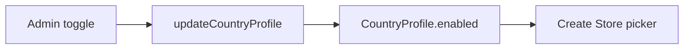

# Country profiles (admin)

**Last updated:** 2026-10-07 — **Feature:** `apps/admin/src/features/country-profiles/`

## Overview

Platform markets for Create Store. Admins toggle `CountryProfile.enabled` so a country appears in the vendor country picker. Payment/delivery/shipping-match/bank caps are read-only here (seed-managed).

## Screens/routes

| Route | Role |
|---|---|
| `/settings/country-profiles` | List profiles; switch open/closed for new shops |

## How it works

## GraphQL operations

`countryProfiles`, `updateCountryProfile` — `manage_all_shops`, no X-SHOP.

## Main files

- `features/country-profiles/api.ts`
- `features/country-profiles/components/country-profiles-form.tsx`
- `app/settings/country-profiles/page.tsx`

## Notes

Enabling SA is a deliberate launch step — verify OTO/IBAN paths after flipping.
