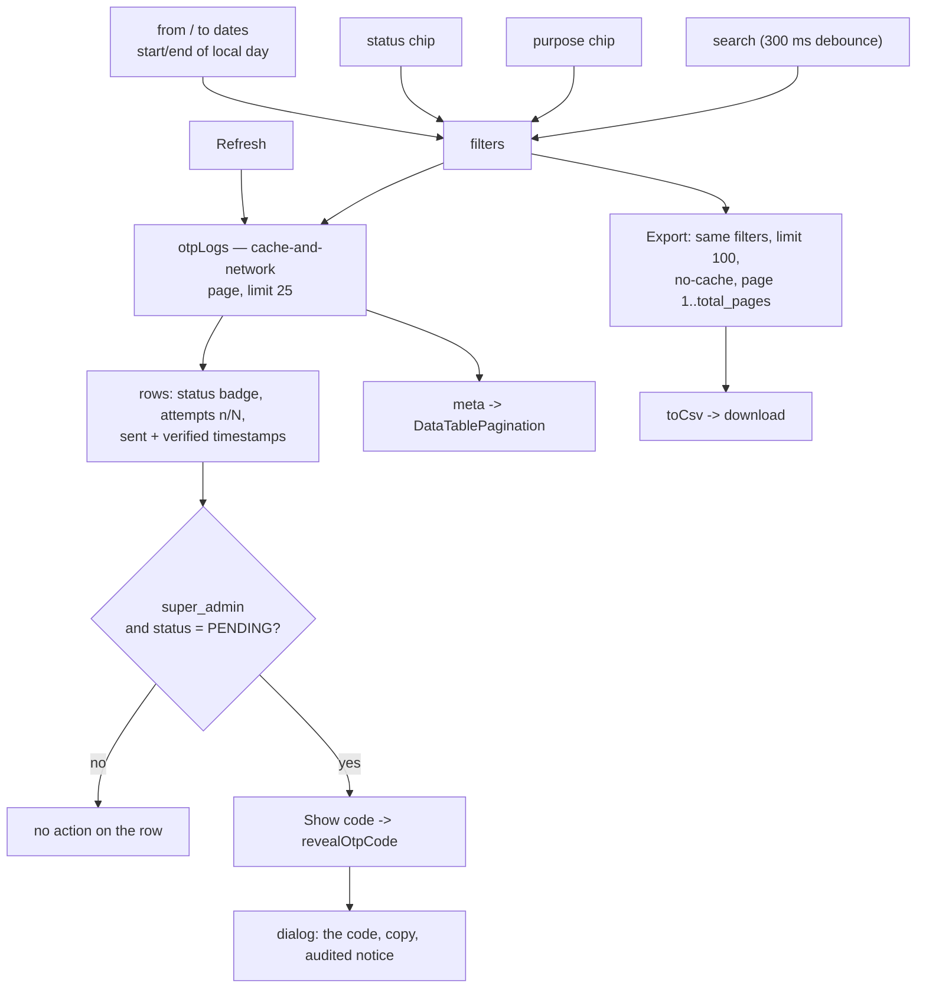

# OTP log

**Last updated:** 2026-10-01 — **Feature:** `src/features/otp-logs/`

**Purpose and status move to the segmented filter bar (2026-09-13).** The two `<Select>` boxes are now chips on the shared `FilterBar` (`shared/components/filter-bar`), one per field, each reading "Purpose is Sign-in". An unfiltered log shows no chips at all, where the selects had to read "All purposes" / "All statuses" — two boxes that looked like choices somebody had made. The dates, the search box and Export are untouched; the wire is unchanged, since a chip still sends one `OtpPurpose` and one `OtpLogStatus`.

**Date range and CSV export (2026-08-14).** Two `<input type="date">` bounds in the toolbar, sent as inclusive `from` / `to` on `otpLogs`, and an **Export** button that writes the whole filtered set to CSV. Both exist for the same reason the screen does: chasing one delivery complaint. See Notes for the export's scope and the 14-day floor on the pickers.

**Delivery column (2026-08-12).** Between Sent and Verified: a destructive **Failed** badge carrying the gateway's refusal in its title, an outline **Delivered** badge carrying the acceptance time, or muted **Pending** while the send is still queued (and on rows issued before the columns existed). Backed by `delivered_at`/`delivery_error` on `otpLogs` — written by the email queue worker / SMS caller, so the log now answers "was it actually sent" rather than only "was it issued".

## Overview

`/otp-logs` — every one-time code the platform has issued, newest first: who it went to, what it was for, how many wrong guesses it took, and how it ended.

It answers the question support actually gets — *"they say the code never arrived"* / *"they say it kept saying wrong code"* — which needs the codes themselves, not the settings that shaped them. It covers vendor signup too: those codes are issued before the account exists, carry no `user_id`, and therefore never appear in `activityLogs`.

**One action, and it is the reason the screen earns its place: a `super_admin` can show a live code.** That is the answer to the support call the log is opened for. Nothing else is offered — revoking a sent code would mean deleting the row the log exists to show.

## Screens / routes

| Route | Purpose |
|---|---|
| `/otp-logs` | The list. |

Rendered through `DashboardShell` (with the app sidebar), like `/users` — this is a record list, not a settings form, and a seven-column table does not fit the `max-w-3xl` column of the `SettingsShell` that holds `/settings/otp`. Reached from the sidebar's **OTP log** entry, directly above **OTP settings**. The route is in `proxy.ts`'s matcher.

## How it works

## Components

| Component | Role |
|---|---|
| `OtpLogsTable` | The whole screen: filters, table, pagination, refresh. |
| `FilterBar` | The shared segmented bar (`shared/components/filter-bar`), carrying the purpose and status chips. |

Table chrome is the shared `shared/components/data-table` set, same as every other admin list.

## State & forms

No form. `useState` for page, search, the two date bounds, and the bar's own `Filter[]`. That array is the source of truth for purpose and status rather than something derived from a pair of enums each render — a chip that has just been added holds no value yet, and a derived array would drop it the instant it appeared. `toOtpLogQuery` (`lib/filters.ts`) turns the chips into the query variables, `toOtpLogFilters` goes back the other way, and `oneChipPerField` keeps the newest chip when a field is picked twice, since only one `purpose` can go on the wire and the loser would name a filter the server was never asked for. A date change resets the page outright; a chip edit resets it only when the derived query actually moves, because adding a chip or reopening its menu narrows nothing until a value is picked. Search is debounced 300 ms because it is a server round trip with a `contains` scan behind it. `now` is anchored in state rather than read during render — it bounds the pickers on every keystroke, and `new Date()` in a render body is impure.

`fetchPolicy: "cache-and-network"`: this is a log, and a cached page from two minutes ago is exactly the wrong answer to "did the code they just asked for go out".

The reveal keeps its own `revealingId`, because the recovery can take a second or two and only the clicked row should spin — Apollo's mutation result does not carry the variables it was called with.

## GraphQL operations

| Operation | Purpose |
|---|---|
| `otpLogs` | Paged list with `search` (identifier), `purpose`, `status` and inclusive `from` / `to` bounds on `created_at`. Also drives the export, re-run page by page at `limit: 100` with `fetchPolicy: "no-cache"`. |
| `revealOtpCode` | Returns the code for one live row. `super_admin` only; audited server-side. |

Both are gated on `manage_users`, not the `manage_integrations` behind the settings screen — these rows carry the addresses and numbers codes were sent to.

## Validation

A `Filter` holds plain strings, so `toOtpLogQuery` checks each chip's value against `OTP_PURPOSES` / `OTP_LOG_STATUSES` before sending it — that is what keeps the generated-enum guarantee the two `<Select>`s used to give for free, and an id the server would reject cannot leave the screen.

The date pair is the one thing checked client-side. `isValidRange` (`range.ts`) refuses only an inverted pair — either bound is valid on its own — and while it is inverted the query is not sent and the export is disabled. The server would answer an inverted range with an empty list, which reads as "no codes were sent" rather than "you typed it backwards". Both pickers carry `min = now - 14 days` and `max = today`.

The reveal button is offered only when `isRevealable(row)` (status `PENDING` and no `verifier`) and the caller's `me.role` is `super_admin`. A row with a `verifier` was issued by the SMS provider itself (Twilio Verify, or Msegat's OTP API): the code never existed on the server, so instead of the button the delivery cell carries a badge naming the issuer (`verifierLabel`: "Twilio Verify", "Msegat OTP", else the raw slug), whose tooltip says why there is nothing to reveal. A code Verify *refused* to send is not such a row: the back-end replaces it with a platform code and clears `verifier`, so it arrives here as an ordinary live row with the button and a **Failed** delivery badge carrying Twilio's refusal. Both are **UX mirrors** of rules `OtpLogsService.reveal` enforces; a row that changes state between the render and the click is refused by the server and surfaces as a toast.

## Main files

- `components/otp-logs-table.tsx` — the screen
- `types.ts` — the filter order, the badge mapping, `attemptsLabel`
- `lib/filters.ts` — the bar's fields and the chip ↔ query round trip
- `range.ts` — the retention mirror, the picker bounds, the local-day widening
- `export.ts` — the CSV column shape and the filename
- `api.ts` — the query
- `app/otp-logs/page.tsx`, `app/otp-logs/layout.tsx`

## Notes

- **Export covers the whole filtered set, not the page**, and the button says so: it is labelled from `meta.total` ("Export all 4,132 rows"). A button that silently exported 25 of 4,132 rows would be worse than no button. It is implemented as `total_pages` round trips at the server's `limit` ceiling of 100, capped at 50 pages / 5,000 rows; past the cap the file still downloads and a toast says it was cut short and to narrow the dates.
- **The date pickers stop at 14 days back**, mirroring `OTP_ROW_RETENTION_DAYS`: the cleanup job deletes `otps` rows older than that, so a wider window returns the same rows under a misleading label. A muted line under the toolbar says this rather than leaving a disabled date to explain itself.
- A date-only input means the whole of that day **in the admin's own timezone** — `startOfDayIso` / `endOfDayIso` widen it before it is sent. Midnight UTC would clip or overreach by however far the browser sits from Greenwich.
- **The list never carries a code.** `OtpLogEntry` has no code or hash field, and the back-end does not even select `code_hash` for that query. `revealOtpCode` is the single exception, one row at a time, on request.
- The dialog says out loud that the reveal was recorded. Leaving that to the audit table would make it a trap rather than a tool — whoever opens it should know their name is on it.
- `attempts` is shown against the row's own `max_attempts` — the budget stamped when the code was sent, not today's setting, so a code issued under an older policy still reads correctly.
- `SUPERSEDED` is the routine case, not a failure: it means a newer code replaced this one, which is what every resend does. `LOCKED` is the one status painted as a fault — attempts spent, and the account locked with it.
- Codes verified before the `verified_at` column existed (2026-08-11) read as `SUPERSEDED`; the log does not invent a timestamp for them.
- Back-end counterpart: [back-end/docs/features/otp.md](../../../../../back-end/docs/features/otp.md).
