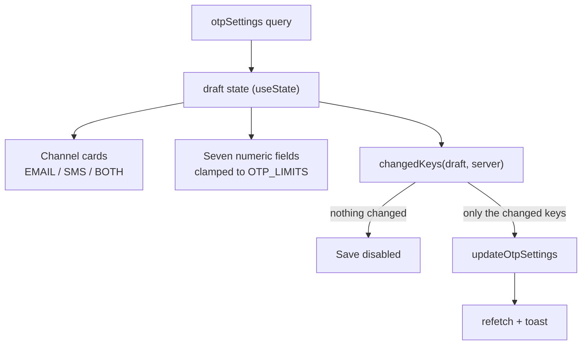

# OTP settings

**Last updated:** 2026-09-27 — **Feature:** `src/features/otp-settings/`

## Overview

`/settings/otp` — the platform's one-time-code policy: how long a code is, how long it lives, how often one can be asked for, how many wrong guesses it survives, and **where it is delivered**.

What is saved here reaches every flow that issues a code — vendor signup, OTP sign-in, password reset — because they all pass through `OtpService`, which reads the record on every send and verify. One field is the storefront's alone: **storefront sign-in codes per shop per hour** (`shop_hourly_limit`, 1 to 1000, 30 until saved), the ceiling that bounds SMS pumping across every number a shop is asked to text.

**One form, one Save.** The values are read together and mean little apart, and a per-field autosave on a security control is a way to half-apply a policy. Only the fields that actually changed are sent, so two admins editing different halves of the screen do not overwrite each other.

## Screens / routes

| Route | Purpose |
|---|---|
| `/settings/otp` | The form. |
| `/settings` | Redirects to `/settings/otp` — a branch, not a screen. |

Rendered through `SettingsShell` (no app sidebar, closed with X or Escape), the same shell as `/integrations`. Reached from the sidebar's **OTP settings** entry. Both routes are in `proxy.ts`'s matcher.

## How it works

## Components

| Component | Role |
|---|---|
| `OtpSettingsForm` | The whole screen: query, draft, dirty calculation, save and discard. |
| `NumericField` | One bounded integer input, clamped on change so the field can never hold a value the mutation would reject. |

## State & forms

Plain `useState` draft rather than react-hook-form — seven scalars with no cross-field rules. The draft resyncs from the server only when the query answers, so a refetch cannot land on top of what the admin is typing. Dirty is value-based (`changedKeys`), so typing a value and typing it back collapses the change.

## GraphQL operations

| Operation | Purpose |
|---|---|
| `otpSettings` | Reads the record, plus `is_customized` — false until an admin saves once, meaning the values shown are defaults rather than anyone's decision. |
| `updateOtpSettings` | Saves only the changed keys. Absent fields are left alone server-side. |

Both are gated on `manage_integrations`.

## Validation

`OTP_LIMITS` in `types.ts` mirrors the bounds `UpdateOtpSettingsInput` enforces — 4-8 digits, 60-3600s lifetime, 0-600s cooldown, 1-10 attempts, 1-100 per day, 0-1440 minutes lockout. **The server's copy is the real one**; these exist so the admin gets immediate feedback, not as the guard.

Code length has a second rule that is a warning rather than a bound. `isRevealSupported` (`RECOVERABLE_CODE_LENGTHS = [4, 5, 6]`, mirroring `RECOVERABLE_OTP_LENGTHS` in `back-end/src/otp/otp.utils.ts`) is false for 7 and 8, and the section then renders a warning panel. Seven and eight are still savable — a longer code is a legitimate policy — but the panel is keyed off the **draft**, so it appears while the admin is choosing the value rather than after they have saved it.

## Main files

- `components/otp-settings-form.tsx` — the screen
- `types.ts` — the bounds, the clamp, the dirty calculation
- `api.ts` — the two operations
- `app/settings/otp/page.tsx`, `app/settings/layout.tsx`

## Notes

- **A code longer than six digits switches off the support path on `/otp-logs`.** `revealOtpCode` has no stored plaintext — it walks the keyspace until a candidate matches the hash — so seven digits is ten million candidates and eight a hundred million, and the server refuses both with `OTP_UNRECOVERABLE`. Nothing else on the console would explain the Show code button going quiet, so the form says it before Save.
- The channel decides **vendor signup only**. Sign-in and password reset send to whatever identifier the user typed, and the screen says so rather than letting an admin expect otherwise.
- **Credentials are not here.** Which provider actually delivers — Resend, SMTP, Twilio — and its keys live in `/integrations`. This screen picks the channel; that one picks the account.
- Back-end counterpart: [back-end/docs/features/otp.md](../../../../../back-end/docs/features/otp.md).
