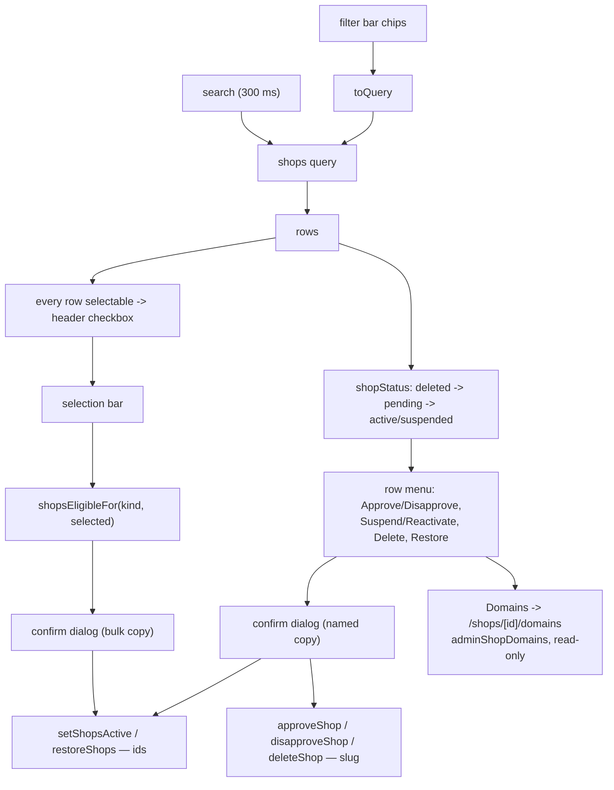

# Shops

**Last updated:** 2026-09-17 — **Feature:** `src/features/shops/`

## Overview

`/shops` — every storefront on the platform and the account that owns it. It lists, searches, creates, approves, suspends, deletes and restores. It sits next to `/users` because a shop is an account's other half.

What makes it more than `/users` with different columns is that a shop has **three** independent columns, not two. `shopStatus()` collapses them in a fixed precedence: `deleted_at` first, because deleting also clears `is_active`; then `is_approved`, because a shop awaiting review has never been live and calling it "suspended" would suggest somebody took it down; and only then `is_active` decides active from suspended.

The two flags gate different things. `is_approved` gates the public directory (`shops`, `shop(slug)`); `ShopHeaderGuard`, product resolution and the cart all read `is_active`. That is why `approveShop` sets both and `disapproveShop` clears both. A vendor soft-delete from the vendor dashboard uses the same `deleteShop` mutation and lands here under status **Deleted** for `restoreShops` (comes back suspended).

## Screens / routes

| Route | Purpose |
|---|---|
| `/shops` | The list, its filters, the create dialog and the row actions. |
| `/shops/[shopId]/domains` | Every address one shop answers at. Read-only. |

Rendered through `DashboardShell` (the `app/shops/layout.tsx` one covers the nested route too). Reached from the sidebar's **Shops** entry, and the domains view from that list's row menu. `proxy.ts`'s matcher lists `/shops/:path*`, so the nested route needs no entry of its own — `__tests__/domains-route.test.ts` pins that rather than leaving it assumed, because a route the matcher misses renders for a logged-out visitor with nothing on screen to show it. There is no `adminUpdateShop`, so the screen has no Edit action — a shop's own settings are edited by its owner in the vendor dashboard.

## How it works

## Components

| Component | Role |
|---|---|
| `ShopsTable` | The whole screen: filters, selection, table, row menu, confirm dialog. |
| `FilterBar` | The shared segmented bar, given one field (`lib/filters.tsx`) and the search input as its `leading` slot. |
| `ShopFormDialog` | Create. Its owner picker reuses the `USERS` query. |
| `ShopDomains` | One shop's addresses. Header, then the table; no controls at all. |

Table chrome is the shared `shared/components/data-table` set, selection included.

## State & forms

`useState` for page, search, the applied filters, the pending action and the selection.

**The chips are the state and the query is derived from them**, never the reverse: a chip is added before it has a value, so a `value` prop read back out of the query would drop it in the frame it appeared in and the add-then-pick flow would never reach the pick. `toQuery(filters)` (`lib/filters.tsx`) turns the chips into the one variable the resolver takes, and `toFilters` seeds the bar from a query it did not build.

A filter change resets the page and clears the selection — but only when the query behind the bar actually moved. Every chip edit comes through one handler, and adding a chip or changing its field narrows nothing on its own; resetting there would throw an admin back to page one for opening a menu.

The status filter is **one field with one operator**, because `shops` takes a single `ShopStatusFilter` and not a list — the bar draws a lone operator as plain text rather than as a menu whose only entry is already chosen. The unfiltered view is having **no chip on the bar**: that omits `status`, which is what returns active, pending and suspended. There is deliberately no `all` option, which would drag deleted shops into what reads as the default view.

The selection is narrowed during render with `keepVisible(selected, visibleIds)` rather than stored narrowed, so a refetch or a page change cannot leave the bar acting on rows nobody can see. Every row is selectable here — unlike `/users` there is no "your own account" rule and no privileged row a plain admin may not touch.

`PendingAction` carries `shops: ShopRow[]` either way; the optional `shop` is what selects the named confirm copy over the counted one, and it is also where the slug-keyed mutations get their single slug.

## GraphQL operations

| Operation | Purpose |
|---|---|
| `shops` | Paged list with `search` and `status`. |
| `adminCreateShop` | The dialog. Names `owner_id` and promotes a `customer` owner to `vendor` in the same transaction. |
| `setShopsActive` / `restoreShops` | Take `ids: [ID!]!` — the only two the selection bar wires. |
| `approveShop` / `disapproveShop` / `deleteShop` | Take `slug: String!` — row actions only. |
| `adminShopDomains` | The domains view. Takes `shop_id`, returns the merchant's own payload plus the shop it belongs to. |

`setShopsActive` and `restoreShops` are gated on `manage_all_shops` **alone**; a second permission beside it would open them to every vendor, since `PermissionsGuard` matches with `.some()`.

## Domains — and why it only looks

`/shops/[shopId]/domains` answers one support question: is that shop's address live, and if not, what is it waiting on. It lists the platform subdomain and every custom domain with its status, which one is primary, when it was last verified, and the DNS records the merchant has still to set.

**It is read-only, and the back-end agrees — there is no admin mutation to pair with `adminShopDomains`.** A domain is the merchant's property and its DNS lives in their registrar; an admin promoting, detaching or re-verifying one would move where somebody else's shop answers with nothing on the merchant's own screen to say why. Connecting, promoting and removing stay in the vendor dashboard.

Two things the screen states in words, because a reader gets both wrong otherwise:

- **The platform subdomain's status is derived, not checked.** The back-end synthesises `<slug>.<root>` from the handle and reports `ACTIVE` only while the shop is both approved and active. So `PENDING` there is a statement about the shop, not about an address someone forgot to configure — approving it or switching it back on from `/shops` is what fixes it, and no DNS is involved.
- **`custom_domains_enabled: false` is a deployment fact.** With no DNS target configured there is nothing to point a custom domain at, so the platform subdomain is the only address any shop can have — otherwise an empty list reads as "this merchant never connected one".

`last_error` on a row that is still `ACTIVE` is not stale noise. The nightly sweep demotes on the *second* consecutive failure, so an error against a serving address means it is one strike from `VERIFYING`.

## Validation

`shopsEligibleFor(kind, rows)` decides what each bulk button acts on and what count it names. It reads `is_active` rather than the status label, for the same reason the row menu does: a shop awaiting review reads "pending" whichever way its switch is set, so the label cannot answer suspend-or-activate. Deleted rows are excluded from both, since deleting clears `is_active` and a switch-only rule would offer Reactivate on a deleted shop.

## Main files

- `components/shops-table.tsx` — the screen
- `lib/filters.tsx` — the bar's one field, and `toQuery` / `toFilters` between the chips and the `shops` variables
- `components/shop-form-dialog.tsx` — create, with the owner picker
- `components/shop-domains.tsx` — the read-only domains view
- `types.ts` — `shopStatus`, `statusBadgeVariant`, `shopsEligibleFor`, `domainStatusVariant`
- `api.ts` — the operations
- `__tests__/`, `lib/__tests__/` — the precedence and eligibility rules, the chip-to-query mapping, the domains view (read-only included), the matcher

## Notes

- **Approve, disapprove and delete are not bulk actions.** They take a single `slug`, not an id list, so a bulk button behind them would be a loop of mutations with no transaction and a half-applied outcome the moment one fails. Only `setShopsActive` and `restoreShops` are genuinely plural, and only those are on the bar.
- Deleting is refused while the shop still has unfinished orders, and restoring brings it back suspended rather than live.
- Back-end counterpart: [back-end/docs/features/shops.md](../../../../../back-end/docs/features/shops.md).
