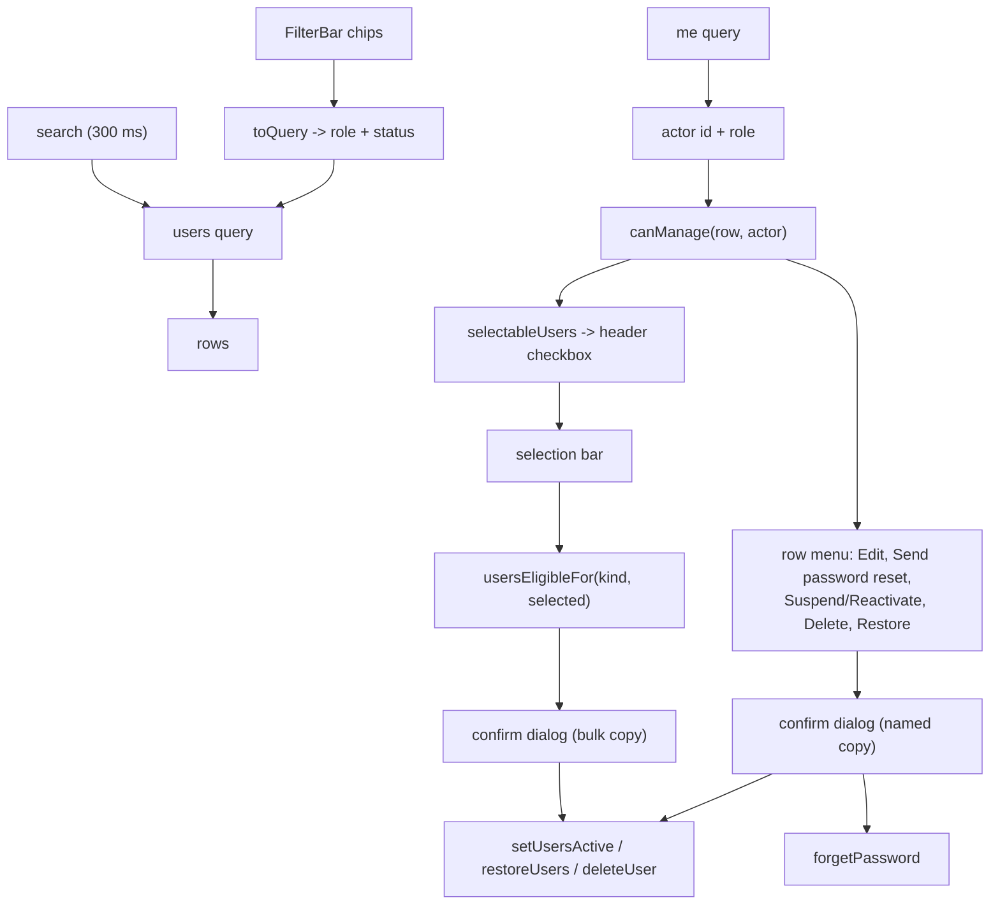

# Users

**Last updated:** 2026-09-28 — **Feature:** `src/features/users/`

## Overview

`/users` — every account on the platform, and the place they are created, edited, suspended, deleted and restored.

Suspension (`is_active: false`) and soft deletion (`deleted_at`) are separate states of the same row and the screen shows both: a suspended account that vanished from the list could never be reactivated. `accountStatus()` reads `deleted_at` first, because deleting also clears `is_active`.

Two server rules are mirrored in `canManage()`: nobody acts on their own account, and only a `super_admin` acts on — or creates — an `admin` / `super_admin`. That mirror is UX only; `UsersService`'s `assertNotSelf` / `assertMayTarget` / `assertMayAssignRole` are the boundary. The caller's own id and role come from the `me` query, since the auth store holds tokens and nothing else.

## Screens / routes

| Route | Purpose |
|---|---|
| `/users` | The list, its filters, the create/edit dialog and the row actions. |

Rendered through `DashboardShell`. Reached from the sidebar's **Users** entry. The route is in `proxy.ts`'s matcher.

## How it works

## Components

| Component | Role |
|---|---|
| `UsersTable` | The whole screen: filters, selection, table, row menu, confirm dialog. |
| `UserFormDialog` | Create and edit. Passwords are set only on create. |
| `FilterBar` | The shared segmented bar (`shared/components/filter-bar`), fed by `lib/filters.tsx`. Role and status are chips; free-text search stays its own input beside it. |

Table chrome is the shared `shared/components/data-table` set, selection included (`DataTableSelectionBar`, `DataTableSelectHead`, `DataTableSelectCell`).

## State & forms

`useState` for page, search, the applied `Filter[]`, the pending action and the selection. Every filter change resets the page and clears the selection.

**The chips are the state; the query arguments are derived from them.** `toQuery(filters)` runs in a `useMemo` and feeds `role` and `status` straight into the `users` variables — the reverse (rebuilding the array from `role`/`status`) would drop a freshly added chip on the render that introduced it, because a chip carries no value until one is picked, and the add-then-pick flow would never reach a value menu.

Both arguments are single-valued on the server, so each field carries one non-`multi` operator. An empty bar sends neither, which is the `users` query's own default: active and suspended accounts, deleted ones hidden. That is what the removed "Active and suspended" select option stood for. `UserStatusFilter.All` is deliberately not offered.

The bar sits *beside* the search input rather than in its `leading` slot: it owns ArrowLeft/ArrowRight to rove between chip segments and calls `preventDefault()` on them, which would take the caret keys away from an input nested under it.

**The selection is narrowed during render, not stored narrowed.** `keepVisible(selected, visibleIds)` runs on each pass, because a refetch or a page change can replace every row while the selection still holds the old ids — a bar acting on rows nobody can see is how a bulk action hits the wrong accounts.

`PendingAction` carries `users: UserRow[]` either way, so `runPending` builds the same `ids` list for a row action and for a bulk one; the optional `user` is what selects the named confirm copy over the counted one.

## GraphQL operations

| Operation | Purpose |
|---|---|
| `users` | Paged list with `search`, `role` and `status` filters. |
| `createUser` / `adminUpdateUser` | The dialog. `AdminUpdateUserInput` carries no password, deliberately. |
| `setUsersActive` / `restoreUsers` / `deleteUser` | All take `ids: [ID!]!`, so the row menu and the selection bar call the same mutations. |
| `forgetPassword` | Borrowed from `features/auth/api` — the account's own reset flow, triggered on its behalf. |

All but the last are gated on `manage_users`. `forgetPassword` is public and throttled per IP (2/60s, 5/900s), so a run of resets from one console starts failing; the server's message rides in the error toast.

## Validation

`canManage` gates every action. `canSendPasswordReset` adds two more conditions, and the first is the non-obvious one: **the account must be active**. `AuthService.forgetPassword` looks the user up with `is_active: true` plus the soft-delete filter and returns `{ success: true }` when nothing matches — deliberate anti-enumeration on a public mutation, but from this console it would mean a success toast for a code that was never sent. The second is that the row has an email or a phone (`resetIdentifier`), since one of them is what the mutation is given.

`usersEligibleFor(kind, rows)` decides what each bulk button acts on and what count it names: Suspend takes active rows, Reactivate suspended ones, Restore deleted ones, Delete anything not already deleted. A kind with nothing to do is not rendered, so a selection can never offer an action the server would refuse.

## Main files

- `components/users-table.tsx` — the screen
- `components/user-form-dialog.tsx` — create / edit
- `lib/filters.tsx` — `usersFilterFields`, `toQuery`, `toFilters`, `NO_USERS_FILTER`
- `types.ts` — `accountStatus`, `canManage`, `resetIdentifier`, `canSendPasswordReset`, `selectableUsers`, `usersEligibleFor`
- `api.ts` — the operations
- `__tests__/types.test.ts` — the rules above
- `app/users/page.tsx`

## Notes

- **Blanking the phone on an account that had one removes it.** The dialog sends `""` in that one case (every other empty field is sent as `undefined`), and `adminUpdateUser` clears the number along with its proof. It is the support path for a number somebody else typed onto an account, which the unique column otherwise holds against its real owner. The server refuses a clear that leaves no email either.
- **The reset action never shows a credential.** The operator triggers it; a one-time code goes to the address already on the account, and the account chooses its own new password. Their current password keeps working until they do, which the confirm dialog says.
- The reset code is delivered as a code, not a link (`MailService.sendOtp` queues a code), so there is no `FRONTEND_URL` mismatch between the vendor app and this console.
- Deletion is soft and refused while the account still owns an active shop. On a bulk delete the whole request fails with the one row the server refuses — the bulk confirm copy says so.
- Back-end counterpart: [back-end/docs/features/users.md](../../../../../back-end/docs/features/users.md).
