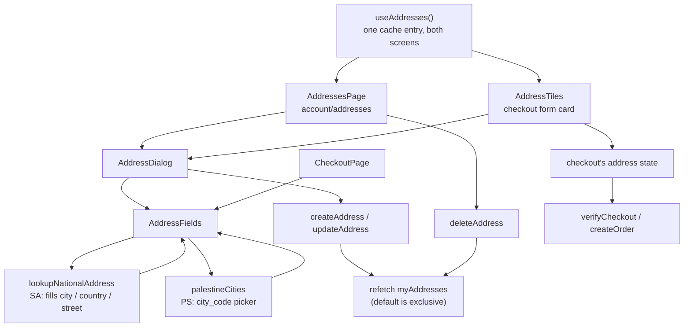

# addresses

**Last updated:** 2026-10-07 - **Feature:** `apps/storefront/src/features/addresses/`

## Overview

The customer's address book, and the tiles checkout uses to choose from it.

It adds **no back-end**: `AddressesResolver` already had the full CRUD. Two
server rules shape both screens. `default` is **exclusive** — saving a row as
default clears the flag on every other row of that customer in the same call, so
the UI never unsets the old one itself. And delete is a **soft delete**, so an
order already placed against a removed address keeps its own copy of the blob.

This feature also owns the address *shape*. `shipping_address` is `JSON` on both
checkout mutations, so the keys inside it are a contract between this app and
whatever reads the order later (the vendor's order screen, the shipping-rule
matcher, the invoice) rather than anything the API enforces.

## Screens / routes

| Route | Screen |
|-------|--------|
| `/[shopSlug]/account/addresses` | `AddressesPage`. List, add, edit, set default, delete. Behind the route guard — `account` is a private segment. |
| `/[shopSlug]/checkout` | `AddressTiles` above `AddressFields` in the form card. Selects and adds; it does not edit or delete. |

## Diagram

## Components

- **`AddressesPage`** — the account screen: cards in a two-column grid with
  edit / make-default / delete, the last behind a confirm dialog.
- **`AddressTiles`** — the checkout selector: saved addresses as pastel tiles,
  each with an abstract mark, plus an Add-new tile. Adds; never edits or
  deletes. A tile's ground comes from `--shop-tile-*` in `globals.css`, assigned
  by position, so one address is recognised by colour before its label is read.
- **`AddressDialog`** — create *and* edit; same fields, only the mutation
  differs. `entry === null` means create.
- **`AddressFields`** — the address form, shared by the dialog and the checkout
  so the two cannot ask for different fields. Saudi shops: National Address
  code (manual fallback). Palestine (`home_country=PS`): `palestineCities`
  select writes `city_code` for zone matching. `inputClassName` is threaded
  down rather than styled from outside.
- **`NationalAddressField`** — the input and the lookup. Reports the registry's
  answer up through `onResolve`, which is what fills the rest of the address.

## State & forms

`useAddresses` wraps the query and all three mutations. Both screens call it
with identical variables, so Apollo serves one cache entry — the checkout page
calls it too (it owns the address state that gets submitted) at no extra request.

Every mutation is `awaitRefetchQueries` on `MY_ADDRESSES` rather than a
hand-written cache update, **because `default` is exclusive**: saving one row as
default clears the flag on rows no single-entry cache write can know about.

`AddressDialog` seeds with **adjust-state-during-render** against a `seededFrom`
key of `open` + row id. Seeding in an effect commits one frame showing the
previous row's values — open Home, close, open Work, and the first paint says
"Home". The checkout seeds its address from `preferred` the same way.

Selection in the tiles is tracked **by value, not by id** (`sameAddress`): the
form holds its own copy of whichever tile was clicked, so the moment a character
is edited the tile stops looking selected. What ships is what is in the form.

## GraphQL operations

| Operation | Type | Notes |
|-----------|------|-------|
| `myAddresses(page, limit)` | Query | `JwtAuthGuard`. One page of 50 — see `ADDRESS_PAGE_SIZE`. |
| `createAddress(input)` | Mutation | `default: true` clears every other row server-side. |
| `updateAddress(input)` | Mutation | Every field but `id` optional; only present keys are written, so `setDefault` sends `{ id, default: true }` alone. |
| `deleteAddress(id)` | Mutation | Soft delete. Returns `BaseResponse` — the one mutation the cache cannot repaint from its own result. |

## National address

**The code is the whole address form.** The customer types eight characters; the
city, country, street and postcode all come back from the official registry and
are what the order ships against. The resolved line is shown underneath because
eight characters cannot be checked by eye, and the parts are spelled out beneath
that — a customer who reads a city they did not expect corrects the code before
paying rather than after.

It used to be an optional extra beside five free-text fields, and that
arrangement was actively wrong. Two independent answers to "where does this go"
reached the carrier: a typed city, and a code resolving to a different one. The
quote is priced on the typed string while the courier navigates by the code, so
a real checkout was pricing Riyadh→Jeddah for an address the registry places in
Riyadh. Two sources of truth cannot be reconciled — one of them has to win, and
the registry is the one a courier obeys.

The typed fields are **gone rather than disabled**: a greyed-out input still
reads as something the customer failed to fill in, and they are not theirs to
fill.

The trade is stated rather than hidden: **only addresses in the Saudi registry
can be entered.** That is the market this platform prices, books and ships in
today. Serving a destination outside it means giving this form a second, manual
mode; nothing downstream has to change, since the blob it writes is unchanged.

Two consequences of the lookup becoming load-bearing. Typing a different code
**clears everything the previous one resolved to** — otherwise a corrected code
keeps the old city until the new lookup returns, and forever if the new code
resolves to nothing. And an unrecognised code now **blocks checkout** where it
used to be a soft note, because there is no street address left to fall back to.

Status is **derived** from comparing the stored answer's code to what is
currently typed, so a corrected code can never inherit the previous one's
verdict, and no state is set synchronously inside an effect.
`LOOKUP_NATIONAL_ADDRESS` is `JwtAuthGuard` and throttled at 30/min per caller —
which every address screen already satisfies, since checkout requires a session
before the address form.

## Validation

`addressSchema` (zod) requires the `national_address_code` (four letters then
four digits) **and** the `city`/`country` it resolved to — the second half is the
proof the lookup succeeded, since a code of the right shape that matches nothing
leaves them empty and would price an order against a destination nobody
confirmed. `street_address`, `state` and `zip` stay optional: the registry does
not return every part for every address. `AddressDialog` also requires a
non-empty title, because both cards are labelled by it.

`type` is normalised through `isAddressType` before being sent, since
`CreateAddressInput.type` is `@IsIn(['shipping', 'billing'])`. `readAddress` is
tolerant on the way in: rows written before this app existed carry `street` or
`postal_code`, and dropping them would show an empty form beside an address the
customer can see is saved.

## Main files

- `use-addresses.ts` — the query, the three mutations, and the sort that floats
  the default to the top.
- `lib/address.ts` — the shape, `readAddress`, `isAddressComplete`,
  `applyNationalAddress`, `clearResolved`, `formatAddressLines`, `sameAddress`.
- `components/address-fields.tsx` — the form: one input and the resolved panel.
- `components/national-address-field.tsx` — the input, the debounced lookup and
  the four states it can be in.
- `components/addresses-page.tsx` — the account screen.
- `components/address-tiles.tsx` — the checkout selector.
- `components/address-dialog.tsx` — create and edit.
- `api.ts` — the four operations.

## Notes

- **Identity (2026-09-14).** Account cards and the dialog use the Day 1 type
  scale and Teal CTAs. Checkout tiles still use `--shop-tile-*` (a separate
  semantic system from buy/sale). Selection remains by value (`sameAddress`).
- **The first address is forced to default.** A book whose only row is not the
  default gives checkout nothing to preselect.
- **The tiles add but do not edit or delete.** Sending a customer to the
  account screen mid-checkout means abandoning the page; a Delete button one
  stray click from Confirm order is the opposite trade.
- Saving a one-off checkout address is **offered, not automatic** — a delivery
  to a friend is real, and quietly keeping it grows the book unasked.
- One page of 50, no pager. A pager on the *checkout* would lose an address
  behind a page-2 button at the moment it is needed; the account screen shows
  the count so a truncated list stays visible.
