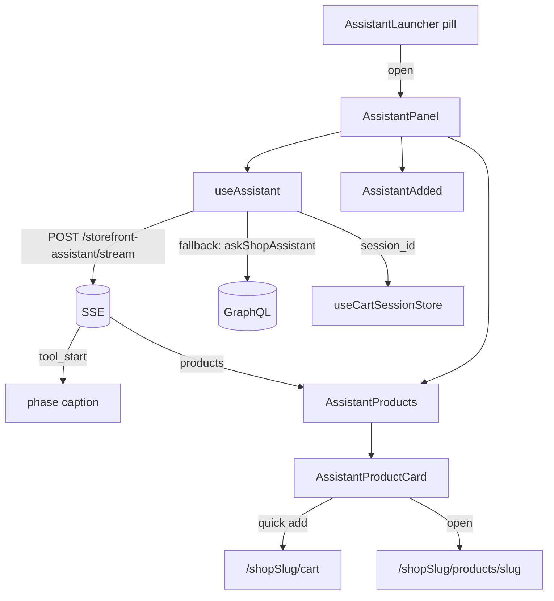

# assistant

**Last updated:** 2026-10-08

## Overview

The shop's assistant, as a pill at the foot of every storefront page and a panel over the shop. A Shein share link is imported into the session cart before the model, and the reply is the calculated lines plus the existing checkout. The panel does not place the order.

**An overlay rather than a route, and that is the whole point.** Somebody asking "what goes with this" is looking at a product; navigating them away to ask is the failure the feature exists to remove. Closing the panel returns them exactly where they were, because they never left.

It answers in prose and, where the turn's tools produced something, in **cards**: a titled, pageable row of products it surfaced, and a receipt for anything it put in the cart. Those come from the back-end's record of what the tools returned — the panel never parses product names out of the reply.

**The cards are real product cards.** They price through `ProductPrice`, decide their stock note through `stockState` and add to the cart through the same mutation a catalogue tile does, because the API now sends the catalogue's own fields — cents, the image blob, the four inventory flags — instead of a pre-rendered price string. Before that the panel drew a hand-rolled lookalike that could not be bought from and showed prices with no currency on them.

**The turn is streamed.** `tool_start` and `products` frames arrive over SSE while the turn runs, so the panel can say *Looking for jackets* and draw the cards several seconds before the sentence above them exists. The reply text is not streamed and that is a server-side security decision, not a limitation here — see the back-end doc.

## Screens / routes

No routes. `AssistantLauncher` is mounted once in `ShopShell`, beside the cart drawer and the flight layer, for the same reason all three live there: they are overlays over the whole shop rather than parts of any one screen. It sits **below** `ShopClosed`'s early return — a storefront that is not open has no catalogue to answer from.

## Diagram

## Components

| Component | Role |
|---|---|
| `AssistantLauncher` | The pill, where the panel sits, and the open/close motion. Identity pass: card pill, hairline, Teal hover. Mount-on-open and `mode="wait"` are unchanged. |
| `AssistantPanel` | The header controls, the conversation, the history list and the composer. Identity pass restyled the **chrome** (frame, header, composer send well) only — `send()`, SSE, product cards and transcript append are unchanged. |
| `AssistantProducts` | The titled, pageable row of what the turn surfaced. |
| `AssistantProductCard` | One product: photo, name, `ProductPrice`, quick add. |
| `lib/stream.ts` | The SSE transport, and the identity headers it carries. The server's `error` frame becomes an `AssistantTurnError` (`code`, `retryAfterSeconds`). |
| `lib/refusal.ts` | `refusalOf` (a refusal from either transport), `waitOf` and `failureLabel` — what a failed bubble says. |
| `AssistantAdded` | The "Added ✓ / View cart" receipt. |
| `store.ts` | Mode and transcript, outside the panel so both survive it closing. |

**Three header controls, each earning its place.** *History* is the only one
that needed something behind it: nothing is stored server-side, so it means
*this tab* — a shopper who asks about a jacket then starts again about shoes can
get the jacket back. It doubles as the way to start fresh, which is the commoner
intent, so "New conversation" sits above the list rather than under a fourth
icon. *Expand* grows the card for an answer that has outgrown a corner.
*Minimise* closes, and is named for the promise it makes — the transcript
survives it.

A fourth, *dock*, pinned the panel to a full-height rail at the inline edge. It
was built to match a reference and removed on the merchant's own reading: a
storefront assistant is consulted **beside** the page, not given a column of it.
Nothing replaced it.

**The panel is not rendered while closed**, which matters more than it looks: it holds the transcript in state, and mounting it eagerly on every page would keep one alive across navigations, so a shopper would find yesterday's conversation waiting. Mounting on open makes "closed" mean closed.

## State & forms

**No save bar and nothing staged** — this is a conversation, not an editing screen.

The transcript and the mode live in `useAssistantStore`, not in the panel: the
panel unmounts every time the pill closes, and state inside it would take the
conversation with it — which is exactly what a shopper minimising mid-question
does not expect. Deliberately not `sessionStorage`: reading it back would
resurrect a conversation after a reload somebody may have done to be rid of it. Nothing is stored server-side: the WhatsApp thread is a merchant's record and belongs in their inbox, but a shopper asking about a tote is not correspondence, and filing every idle question would build a support archive nobody asked for. The cost is that closing the tab ends the conversation, which is the right trade for a browsing aid.

The customer's bubble is appended **before** the request, because a turn takes seconds — a model call with tool rounds inside it — and a panel that swallows your message until the answer arrives reads as broken. A failed turn renders as a visible failure rather than an empty bubble, which is the opposite of the WhatsApp choice and deliberately: there an apology would go out in the merchant's name, here somebody is watching a spinner they started. **A refused turn says when to come back (2026-10-01).** Every ceiling in front of the panel answers `TOO_MANY_REQUESTS`; when the refusal names its window (`retry_after_seconds`, from the stream's `error` frame or the mutation's `detail`), the bubble reads "Try again in 9 minutes" (seconds, minutes, hours or days, rounded up, plural rules in the message), and "Try again later" when it names none — never "try asking again", which is the wrong advice until the window rolls.

`session_id` comes from `useCartSessionStore.adopt()` — the same guest cart `addToCart` writes to, so anything the assistant adds is counted by the header badge. `adopt()` is idempotent, so calling it per turn costs nothing.

**The panel can see the page it is over.** Every turn carries `page_product_slug` — `productSlugFromPath(shopRelativePath(pathname, tenant))`, or the sticky `subjectProductSlug` a caller set through `openWithPrompt`. A floating window over a product page that could not see the page was asking shoppers which item they meant, and taking a URL slug pasted by hand as the answer. Sent on every turn, not only a negotiating one: "is this in blue?" is the same kind of sentence, and the back-end decides what to do with it. Beside a subject product the panel also sends `page_variation_option_id` (2026-09-27): the option selected when "negotiate" was pressed, kept as `subjectVariationId` with the product and cleared with it.

## GraphQL operations

| Operation | Type | Notes |
|---|---|---|
| `askShopAssistant` | Mutation | One turn, in one response. Optional auth; `X-SHOP` required. Returns text, `searched_for`, the product cards and any cart additions. **The fallback**, used when the stream will not open. |
| `POST /storefront-assistant/stream` | SSE | The same turn, reported as it happens: `tool_start`, `products`, then `answer`. Same guards, same quota, same service. |

`searched_for` is what the row of cards is titled with — the terms the model
actually passed to `search_products`, recorded server-side as it passed them. It
is never read out of the reply, for the same reason the products are not.

The client sends the last **10** turns of its own transcript; the back-end caps it again on its own side and sanitizes every replayed turn, because a caller can send anything.

## Validation

Only that the draft is non-empty, and the composer is disabled while a turn is in flight. Everything else is the API's: a 1000-character message, 2000 per replayed turn, and the throttle.

## Main files

- `src/features/assistant/use-assistant.ts` — the transcript, and why it is not stored.
- `src/features/assistant/components/assistant-panel.tsx` — the conversation and the openers.
- `src/features/assistant/components/assistant-products.tsx` — the cards, and why a browser gets them and a phone does not.
- `src/features/assistant/components/assistant-added.tsx` — the receipt.
- `src/features/shop/components/shop-shell.tsx` — where the launcher is mounted.

## Notes

- The identity pass restyles the pill and panel **chrome** only — `send()`,
  SSE, product cards and transcript append are unchanged.
- **One `AnimatePresence` in `mode="wait"`**, so the pill and the panel are
  never both on screen. The first version gave each its own, as siblings in a
  flex column, and the column's height changed under them mid-flight — the
  panel arrived with a jump that read as a layout break rather than as
  something opening. The pill now leaves fast and linearly (0.12s), the panel
  arrives on a spring from `origin-bottom`, which is the direction it would
  grow if it really were the button expanding.
- **The panel is sized by CSS, never by the animation library**, and it was the
  other way round for one revision — which produced two bugs. `animate` on
  width and height with no `initial` makes motion animate *from what the element
  measures on its first paint*, so the panel appeared at its content's full
  width and shrank. And switching mode with `animate={{}}` did not clear the
  inline size motion had already written, so the other mode inherited it. Two
  classes and a CSS transition have neither failure mode.
- `LazyMotion` + `m`, matching `CartFlightLayer` — this is furniture on every
  storefront page and the full `motion` bundle is ~34KB. That rules out
  `layout`/`layoutId`, which need `domMax`, so the open is a tuned scale rather
  than a measured morph.
- The empty panel shows three **openers** rather than a greeting: stock, gift help, and negotiate — they teach what it can do in less space than a sentence explaining it, and they disappear once a conversation exists. PDP **Negotiate price** opens this same panel with a seed prompt (no separate offer drawer).
- The product row is its own `overflow-x-auto` container, so a long row never widens the panel — the house rule for wide content in this repo.
- The assistant can fill a cart and save an address but **cannot place an order**: `createOrder` is `JwtAuthGuard` and there is no order tool. The shopper finishes at checkout, with the cart and address already theirs.
- **The stream is an enhancement over a path that still works.** SSE is the first thing an over-eager proxy breaks — buffering the whole response, stripping the content type, refusing a long-lived connection — and none of that is distinguishable from here beyond "the request did not open". So a failure to *start* falls back to the mutation and the shopper gets the same answer a beat later. A failure *mid-stream* is deliberately not retried: the turn has already run and already been billed against the shop's plan. Nor is the server's own `error` frame, even as the first frame: that is a verdict, not a transport that failed to open. **Nor is an HTTP 429 on the stream route (2026-10-04)**: that is the route's own throttle refusing before the stream opens, and the mutation has a separate bucket, so falling back doubled the per-address ceiling and lost the wait. `lib/stream.ts` throws `AssistantTurnError("TOO_MANY_REQUESTS", wait)` for it, reading the wait from the body's `detail` (`retry_after_seconds=<n>`) and from the `Retry-After` header when the body does not say. `parseFrame` used to drop it, so a turn refused up front re-ran through the mutation, was refused again, and showed the generic failure.
- **The phase caption is an allow-list, not a lookup.** Only `search_products` and `add_to_cart` are named. A tool added later is silent rather than captioning the panel with its own internal name, and most tools finish in milliseconds and would flash a caption nobody can read.
- The live cards are held **outside** the transcript until the turn finishes. Folding them into a half-built message would put an empty bubble in the transcript, and the transcript is what gets replayed as history on the next turn.
- The row's paging arrows repeat `ProductRail`'s two RTL rules rather than rediscovering them: `scrollLeft` is negative under `dir="rtl"`, so position is read through `Math.abs` and `scrollBy`'s sign is flipped. It does not reuse `ProductRail` itself, which draws 15rem catalogue tiles — two of them fill this panel.
- Not yet implemented: token-level streaming of the reply text (see the back-end doc for why it is not simply an oversight), feedback on a reply, and any persistence across a reload.
