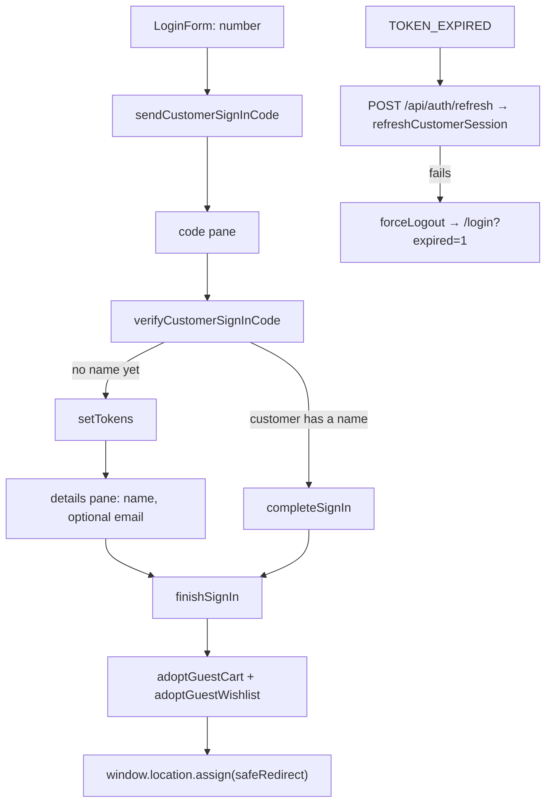

# auth

**Last updated:** 2026-10-05 (a client-side visit to `/login` or `/register` opens the popup and returns; a cold load still renders the page)

## Overview

Customer sign-in, the account hub, and sign-out.

**A customer signs in with a phone number and a code texted to it — and in no
other way.** There is no password, no email sign-in, no Google or Apple, and
no separate sign-up: a number the code proves is this shop's customer, signed
in if the shop has one on it, made if not. A new customer (or one the shop
knows by number alone) is then asked for a name, with an optional email for
receipts. The session is the **shop's customer's own** (`typ: customer`),
never a platform account's, so vendors and admins never sign in here; a
number that also sits on a merchant's account is simply a customer of this
shop. See `back-end/docs/features/customer-auth.md`.

**Signing in happens in a popup, over the page the shopper is on.** The
header's account control, the header panel, checkout's bank-transfer block and
— through `useSignInGate` — every Checkout button and Buy now open
`AuthDialog` instead of navigating. The routes below render the same form:
`proxy.ts` guards `/checkout` and `/account` on the server and can only answer
with a redirect. A click inside the shop to `/login` or `/register` is
intercepted (`(.)login`, `(.)register`): the popup opens over the page just
left and the navigation goes back. A cold load, including the route guard's
redirect, still renders the standalone page.

**A session belongs to one shop.** Signing in at `/acme` is not signing in at
`/beta`: each shop has its own customer on the number, and each session is
obtained by signing in there.

It mirrors the consoles' token architecture — refresh httpOnly, access readable
and short-lived, both via `/api/auth/*` — and differs in three ways: the
session is a customer's, sign-out lands on the shop home, and **every cookie /
store slice / guard is per shop**. `useAuthStore` + `useCurrentUserSync` (in
`ShopShell`) own who is signed in.

## Screens / routes

| Route | Screen | Session |
|-------|--------|---------|
| `/[shopSlug]/login` | `LoginForm` — number, code, then a name for a new customer | guests **of this shop** only |
| `/[shopSlug]/register`, `/forgot-password`, `/reset-password` | The same `LoginForm`: signing up is signing in, and there is no password to reset | guests **of this shop** only |
| `/[shopSlug]/account` | `AccountPage` — details (number, name, email), orders, saved items, addresses | required |
| any route | `AuthDialog` — the same form in a popup | opened for guests |

## Diagram

## Components

- **`AuthCard`** — the frame the form sits in, `variant="page"` on a route and
  `variant="dialog"` in the popup (not console `AuthShell`).
- **`AuthDialog`** — mounted once by `ShopShell`; renders nothing until
  `useAuthDialogStore` is opened. One card: there is nothing to stack on it.
  It opens with `@repo/ui`'s `scroll="viewport"`.
- **`LoginForm`** — three panes: the number (`type="tel"`, `dir="ltr"`), the
  code (as many boxes as `code_length`, auto-submit, resend with the server's
  cooldown), and — only for a customer with no name — the details pane.
- **`AccountPage`** — the customer's details form (the number read-only; name
  and optional email editable) above the three destinations.
- **`useCurrentUser` / `useCurrentUserSync`** — `myCustomerProfile`, once.

## State & forms

`useAuthStore` holds **a slice per shop**; its `user` is the customer
(`id`, `name`, `phone_e164`, `email`). `completeSignIn` is the handover:
`setTokens` → `finishSignIn` (`adoptGuestCart` → `adoptGuestWishlist` → hard
navigate). A new customer's session is stored first, so the name is saved
with it, and `finishSignIn` runs after the details pane. A local resend
cooldown (`lib/cooldown.ts`) follows the server's `resend_after_seconds`.
Sign-in mutations clear `authorization` so a stale bearer cannot reject them;
`x-shop` names the shop whose customer the number is.

## GraphQL operations

| Operation | Type | Notes |
|-----------|------|-------|
| `sendCustomerSignInCode(input: { phone })` | Mutation | The number as typed; the server reads a local number in the shop's country and answers the E.164 it texted, `code_length`, `resend_after_seconds`, `expires_in_seconds`. Sent whether or not the number is a customer yet. A shop that has had its hourly share of codes texted answers `CUSTOMER_SIGN_IN_RATE_LIMITED`, shown as `auth.shopSignInBusy` (come back in a few minutes — it is about the shop, not the number). |
| `verifyCustomerSignInCode(input: { phone, code })` | Mutation | `phone` is the E.164 the send answered. Returns the tokens, `created` and the `customer`. |
| `myCustomerProfile` | Query | Once, via `useCurrentUserSync`. |
| `updateMyCustomerProfile(input: { name, email })` | Mutation | The details pane and the account page. The number is not editable. |
| `refreshCustomerSession(token)` / `endCustomerSession(token)` | Mutation | Server-side only, from `/api/auth/refresh` and `/api/auth/session` (DELETE). |

## Validation

Number: 3 to 32 characters here; the server decides whether it is a number.
Code: exactly `code_length` digits. A number still inside its cooldown gets
`OTP_COOLDOWN` and no new code, so the pane opens for the code already sent at
the length the last send announced — this screen's, else the one
`rememberCodeLength` kept in `localStorage` — and 6 only when neither exists.
Name: 2 to 80 characters (the server also
refuses `@`, links and phone numbers). Email: empty, or a valid address.

## Main files

- `components/login-form.tsx`, `auth-card.tsx`, `auth-dialog.tsx`
- `components/account-page.tsx`
- `lib/complete-sign-in.ts`, `lib/cooldown.ts`, `lib/redirect.ts`
- `api.ts`; `../../shared/stores/auth.ts`, `../../shared/auth/*`

## Notes

- **Every new session path must end in `finishSignIn`** — through
  `completeSignIn`, or directly after the details pane. Skipping it orphans the
  guest cart and wishlist.
- The popup captures the current URL as its redirect, so the hard navigation
  reloads that page with the session applied. `useSignInGate` returns `false`
  before hydration and lets the link navigate.
- A session minted before customers signed in as themselves (an account's) is
  no customer: its refresh fails at `refreshCustomerSession`, the cookies are
  cleared, and the visitor signs in with their number.
- There is no debug bypass for the code; in development, the admin console's
  OTP log reveals a pending code.
- **There is no chat claim link any more.** The `/[shopSlug]/claim/[token]`
  route, `ClaimCart` and the `redeemCartClaim` / `claimChatThread` /
  `cartClaimDestination` operations were removed on 2026-09-30: a chat takes
  the order in the conversation and sends nobody here to sign in, so the phone
  code is the only way into a session. An old claim URL now answers 404; every
  one had already expired. `SIGN_IN_REQUIRED` is gone from both ends.
