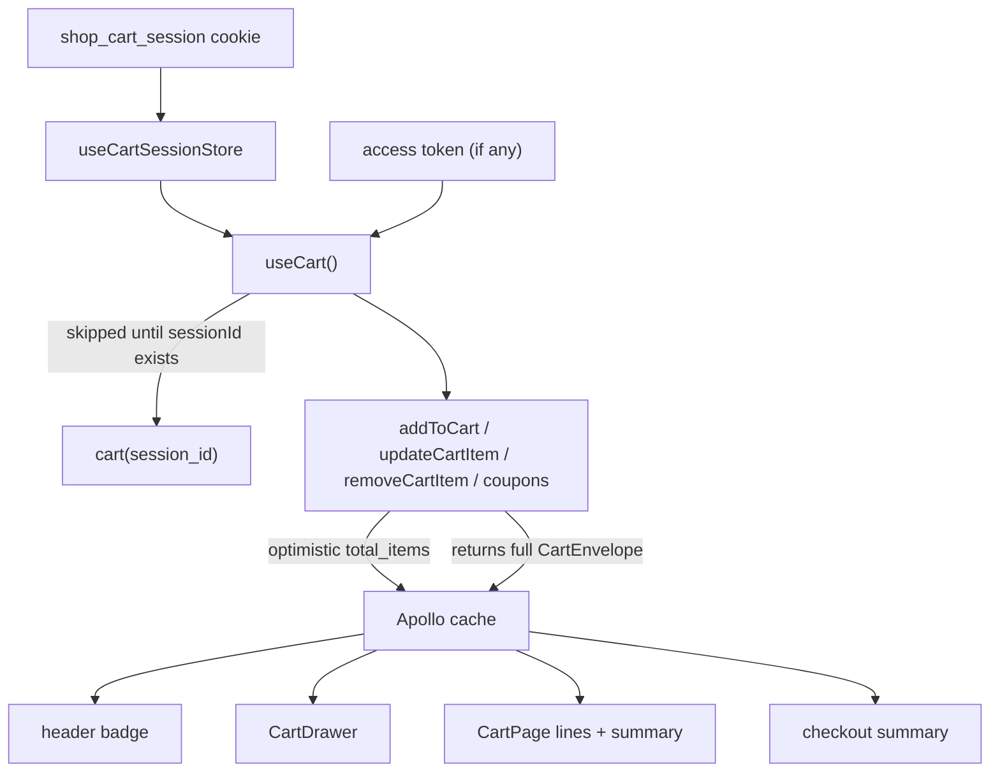

# cart

**Last updated:** 2026-10-08 (the hullo tray is a client of this cart) - **Feature:** `apps/storefront/src/features/cart/`

## Overview

The cart, and it works **without an account**. `CartResolver` runs behind
`OptionalJwtGuard` and keys the cart on `user_id` when there is one and on a
caller-supplied `session_id` when there is not, so a visitor with no account
still gets a real server-side cart that survives a reload.

Signing in **hands that cart over**. Once a token exists,
`CartRepository.getOrCreateCart` resolves on `user_id` and stops reading
`session_id` at all, so the guest cart is not merged by default — it becomes
unreachable. `adoptGuestCart` is the explicit call that moves it; see
"Guest to user" below.

A Shein line is one cart row on the shop's hidden container product. Its charge is `frozen_unit_price_cents`, set when the link was imported. Checkout does not add the merchant's markup again.

Nothing in this feature computes money. Every mutation returns the whole
`CartEnvelope`, and the `summary` on it — subtotal, discount, tax, total — is
what the server charged itself with computing.

## Screens / routes

| Route | Screen |
|-------|--------|
| `/[shopSlug]/cart` | `CartPage` — lines, quantity steppers, discount codes, summary. |
| `/[shopSlug]/cart/view` | `SheinCartView` — the link a Shein chat sends. Reads `sheinCartView` with `?t=`. |
| everywhere | `CartDrawer` — the side panel the header's bag button opens. |
| everywhere | `CartPanel` — the same cart hung off the bag button instead. One of the two is mounted, never both. |
| everywhere | `CartFlightLayer` — the photo that flies into the bag on an add. |
| everywhere | The header's cart badge reads `itemCount` from the same hook. |

The drawer is the **review** surface, the page the **editing** one. The two
decisions worth a page — discount codes, emptying the cart — live only on
`/cart`.

**There are two review surfaces and one state.** `CartDrawer` is the inset
sheet that arrives from the page edge; `CartPanel` is the bag hanging straight
off the header button. They share `useCart`, the quantity queue, the line row
and the `open` flag, so which one a shop wears is one field —
`useCartDrawerStore.surface`, `"drawer" | "panel"` — and everything that opens
the cart is written once. `ShopShell` mounts the drawer only on its surface and
the header's bag becomes a popover trigger only on the other, so exactly one is
ever in the tree.

**A catalogue tile does not open the drawer.** A grid is where a basket gets
filled several tiles at a time, and a panel over the page after each add has to
be dismissed before the next tile can be reached, so three adds cost six
clicks. There the flying photo and the moving badge are the confirmation, and a
toast covers the case where neither happens (reduced motion, or no bag mounted
to fly to). The drawer still opens for the deliberate adds — the product page's
buy bar, a saved item — where the shopper has finished choosing.

## Diagram

## Components

- **`CartPage`** — the lines, the sticky summary panel, and the empty state.
  The empty cart is the same card-on-Sand + Sky Mint wash as `HomeEmpty`, with
  the existing illustration. Heading is `text-shop-title`. Quantity, coupons
  and every `summary.*_cents` field are unchanged.
- **`CartDrawer`** — mounted once by `ShopShell`, opened from
  `useCartDrawerStore`. Opens from the edge the writing direction puts it on.
  Count pill is Sky Mint; checkout/view-cart are rounded-full Teal/outline.
  Slide, overlay, RTL side and unsettled-money dimming are unchanged.
- **`CartPanel`** — the other surface, rendered inside the header's bag popover.
  It draws the first four lines and links to `/cart` for the rest: a popover is
  bounded by the viewport, not by the cart, and scrolling twelve lines inside
  something floating over the page is worse than counting them. Title uses the
  same mono/accent tracking as catalogue filter groups; `PANEL_LINES` is
  unchanged.
- **`CartMiniLine`** / **`CartLineRow`** — image, name, variation, unavailable
  notice, stepper, line total (read from `total_price_cents`, not multiplied).
  The line's money dims while its quantity is ahead of the server. The first is
  shared by the drawer and the panel (`dense` shrinks the photo for the panel);
  the second is `/cart`'s own wider row. Photos are rounded-xl with a hairline
  ring; remove sits on an accent well. Quantity queue and line totals are
  unchanged.
- **`CouponBox`** — apply a code, and a ticket for each applied one.
- **`CouponTicket`** — an applied code drawn as a torn stub: accent slab,
  dithered field, notched tear line. The remove control *is* the stub, so
  dropping a discount is tearing it off. Shared with the checkout summary.
  The identity pass retuned type (`font-mono` label, `font-heading` code) and
  `rounded-xl`; `TEAR`/`NOTCH`, `DitherField` and `onRemove` are unchanged.
- **`QuantityStepper`** — shared with the product page.
- **The empty state** — `public/empty-cart.png`, the same illustration in the
  drawer and on the page (sized down in the drawer), mirrored under `rtl:` so
  the cart faces the way the page reads.
- **`CartFlightLayer`** — also mounted once by `ShopShell`. Renders nothing
  until something is in the air.

## State & forms

`useCart()` is the whole feature's state. It owns:

- **No refetching.** Every mutation returns the envelope, so the cache updates
  itself and the header badge, the drawer, the cart page and the checkout
  summary stay in step. `clearCart` is the exception — it returns only
  `{ success }`, so it is the one call followed by a refetch.
- **An optimistic item count, and nothing else.** `addToCart` predicts
  `summary.total_items` so the badge moves on the click; every money field is
  passed through untouched and no line is fabricated. A count is a sum of
  quantities, which this app may compute; a price is not — so the drawer dims
  the subtotal while a mutation is in flight instead of presenting a stale
  total as current.

**`useQuantityQueue`** sits between the steppers and `updateCartItem`, and is
called once per list (the page, the drawer) rather than once per line. See
"The quantity queue" below.

Two stores sit beside it, both in `shared/stores/`:

- **`useCartSessionStore`** owns the anonymous session id. Still adopted in an
  effect (these screens are server-rendered, so reading `document` during
  render is a hydration mismatch) but adopted **once for the app**: a catalogue
  page mounts one `useCart` per tile, and the previous per-hook `useState`
  meant 24 copies of the same string all starting from `null`.
- **`useCartDrawerStore`** is the cart's open flag, *the timer behind a delayed
  open* (`openDrawerAfter`) and *which surface is mounted* (`surface`,
  `setSurface`). The things that open it — a catalogue tile, the product buy
  bar, the header — are nowhere near the thing that renders it, and one of them
  does not outlive the wait; see below. `setSurface` closes the cart on the way
  through: the two live in different subtrees, so swapping while open unmounts
  one mid-animation and mounts the other already open.

There is no form state; the coupon box is a single controlled input.

## The quantity queue

`updateCartItem` reprices the whole cart, so a shopper walking a line from 1 to
5 on `+` used to fire five of them — and each one flipped `useCart().mutating`,
which disabled **every** stepper on screen for the round trip, so the fourth tap
landed on a dead button and the count stopped moving under their finger.

`useQuantityQueue` separates the taps from the write. Each tap updates a local
number immediately and the write goes out 450ms after the last one, carrying the
final quantity. Quantity is sent as an absolute value, not a delta, which is what
makes collapsing taps safe. Three things beyond the timer:

- **Writes for one line never overlap.** A second write is held until the first
  settles. Both return the whole envelope and Apollo writes whichever lands
  last, so two in flight means the cart can end up one tap out of date.
- **The local number survives its own write.** It is cleared only when what came
  back is what was last asked for. Every failure falls back to the server's
  number, so a refused quantity leaves the line showing what the shop has.
- **Leaving flushes.** The drawer's lines unmount with the panel and the page's
  on navigation; a tap followed straight away by a close would otherwise be
  accepted on screen and never sent.

`useCart` exposes `updating` (the quantity write alone) beside `mutating` (any
cart mutation) so a list can subtract it: `mutating && !updating` is "busy with
something that is not this", and only that disables a stepper. Money — the line
total and the summary — dims from the first tap rather than from the request,
because it is stale for that whole span. `__tests__/quantity-queue.test.ts`
pins the collapsing, the serialisation, the failure fallback and the flush.

## The add gesture

Every add-to-cart control calls **`useAddToCartGesture`**; none choreograph the
click themselves.

`useCartFlightStore.launch` measures the nearest `[data-flight-source]` photo
around the clicked control and the header's `[data-cart-anchor]` bag **on the
click** — the header is sticky and the page scrolls under it, so a position
cached on mount is wrong by the time a shopper reaches the tile they want.
Viewport coordinates make RTL free.

`reveal: false` — what `QuickAddButton` passes — stops there: the flight plays,
the badge moves, and no panel appears. The gesture returns whether a flight
began so a caller that suppressed the drawer can fall back to a toast when
nothing moved.

Otherwise the gesture **holds the drawer back for the flight's 620ms**: the
drawer covers the corner the photo is flying to, so opening it on the click
would land the photo behind it. For that span the flight *is* the
confirmation.

`launch` returns whether a flight began, and **when none does the drawer opens
immediately** — the behaviour before any of this, and the reduced-motion path.
Nothing is delayed for an animation that is not playing.

**The wait belongs to the store, not to the hook, and that is a fix.** It was a
`setTimeout` id in a ref inside `useAddToCartGesture`, cleared on unmount — and
the hook is called from a catalogue tile, so the pending open died with the tile
that armed it. `ProductGrid` swaps every tile for skeletons whenever the product
list reloads (`loading && products.length === 0`), which is what a filter, a
sort or a page change does, so an ordinary click was accepted and then silently
dropped with no error. Only the tiles were affected: the header's bag opens with
no delay and so has nothing to lose, which is exactly how it was reported — the
bag works, the tile does not. Tiles no longer open the drawer at all, but the
same trap is still there for the product page and the saved-items list.
`openDrawerAfter` holds the one pending open there
can be (one drawer per document), and `setOpen`/`openDrawer`/`closeDrawer` each
cancel it first, so a dismissal inside the delay is not undone a moment later by
a timer the shopper cannot see. `__tests__/quick-add-drawer.render.test.tsx`
pins both.

Motion is `motion/react` behind `LazyMotion`/`domAnimation`/`strict`, and only
`transform`/`opacity` animate: the element is pinned at the measured rectangle
with inline `top`/`left`/`width`/`height` and never re-laid-out.

## GraphQL operations

| Operation | Type | Notes |
|-----------|------|-------|
| `cart(session_id)` | Query | `cache-and-network`; **skipped until `sessionId` exists**. |
| `addToCart(input, session_id)` | Mutation | Optimistic on `summary.total_items`. |
| `updateCartItem(input, session_id)` | Mutation | Debounced 450ms per line and never overlapped; see `useQuantityQueue`. |
| `removeCartItem(item_id, session_id)` | Mutation | |
| `clearCart(session_id)` | Mutation | Returns no envelope; followed by a refetch. |
| `applyCartCoupon(code, session_id)` | Mutation | |
| `removeCartCoupon(coupon_id, session_id)` | Mutation | |
| `syncCart(input)` | Mutation | The only one behind `JwtAuthGuard`. Called once per sign-in by `adoptGuestCart`, never from a screen. |
| `recordCartLinkOpen(token)` | Mutation | Fired once by `useReminderLinkOpen` when `/cart` lands with a recovery reminder's `?rc=` token. No `session_id`; the token is the authorization. Returns `{ success, recorded }`, not an envelope. |

`CartFields` is a fragment shared by every operation that returns the envelope.

## Guest to user

`adoptGuestCart(client)` runs between `setTokens` and the post-login navigation
in **both** `LoginForm` and `RegisterForm`. It must be in that gap: before
`setTokens` there is no token for `syncCart`, and after the navigation the guest
cart is already unaddressable.

Three rules it exists to hold:

- **It never sends an empty item list.** `CartSyncService` is destructive on the
  user's side — it soft-deletes the account's items and replaces them with the
  ones sent, which is the "the cart you were composing logged-out wins"
  decision. Handed `items: []` it would carry that out with nothing to put back,
  wiping a cart the customer left on a previous visit. No guest items means no
  call.
- **It reads the guest cart with `authorization: ""` and `no-cache`.** The
  session cookie is already written by then, so an ordinary read returns the
  *account's* cart and the merge would sync it onto itself. `no-cache` keeps the
  guest snapshot out of the store, where it shares a key with the authenticated
  cart query.
- **It never throws.** The sign-in has already succeeded; turning a failed merge
  into a failed login is strictly worse. It returns a boolean instead.

`session_id` goes in the input so the back-end can release the guest cart's
stock reservations and soft-delete it. Without it the merge leaves a live
duplicate holding inventory until the reaper expires it.

**A merge is no longer silent, and a failed one is not the last word.** The
handover records its outcome in two `sessionStorage` flags rather than a store,
because it sits either side of a document load (the auth forms navigate with
`window.location.assign`):

- **`cart.merge.notice`** — set when the merge *succeeds*. The merge replaces
  the account's cart, so `CartPage` reads-and-clears it on mount and shows a
  "we moved your cart" line beside the replaced cart. Consumed exactly once.
- **`cart.merge.pending`** — set when the merge *fails* (most often the 5/60s
  `syncCart` throttle refusing a merge that follows an ordinary write too
  closely). `ShopShell` mounts `useAdoptRetry` once, which retries the handover
  on the next **signed-in** page load — the gate reads the access cookie, not
  the auth store, because the effect can run before the store has hydrated and
  the cookie is exactly what the Apollo link will send. A retry that succeeds
  clears the pending flag and arms the notice; a retry that finds the guest cart
  empty (the reaper expired it) clears the flag too; a still-throttled retry
  re-arms it for the next load.

A chat's cart never goes through that merge either. When a chat makes or finds
the shop's customer, the back-end hands the chat's cart over with
`CartSyncService.adoptGuestCart`, which does not empty the customer's own cart
and keeps negotiated prices — see the back-end's `cart.md`, "Chat cart
adoption". (The claim link that once brought such a cart to this app was
retired on 2026-09-30.)

## Reminder links

Both recovery senders — a merchant's manual reminder and the automatic cadence email — link to `/cart?rc=<token>` on the shop's own address (path mode or host mode, whichever the back-end resolved). The token is signed by the back-end over cart and shop; this app only carries it back.

`useReminderLinkOpen`, called at the top of `CartPage`, reads `rc` in an effect, **removes it from the address bar first** with `window.history.replaceState` (other parameters and the hash are kept), then sends `recordCartLinkOpen` once. Stripping first is what makes it fire once: Strict Mode's double mount, a remount or a reload finds nothing left to send, and a bookmark or a shared link does not carry the token on. It runs in an effect rather than during render so the server never records a click and a link preview that fetches the HTML without running scripts does not count as one. A refused token (an old link, a rotated secret) is logged by the error link and otherwise ignored — the shopper came for their cart and sees nothing. When arriving with `?rc=` while signed out, it prompts the shopper to sign in so their account's abandoned cart is loaded instead of an empty guest cart. `__tests__/use-reminder-link-open.test.tsx` pins the once-only send, the strip, the swallowed refusal, and the signed-out sign-in prompt.

## Validation

None client-side. A discount code is trimmed and sent; the back-end decides
whether it applies and the error message is surfaced verbatim, because "this
code expired" is more use than a generic failure.

## Main files

- `use-cart.ts` — the hook every screen and the header call.
- `use-quantity-queue.ts` — one write per decision instead of one per tap.
- `use-reminder-link-open.ts` — reports a click on a reminder's `?rc=` link, once, and strips it from the URL.
- `api.ts` — the nine operations and the `CartFields` fragment.
- `adopt-guest-cart.ts` — the guest-to-user handover, called from both auth
  forms; arms the merge notice and the failed-merge retry.
- `use-adopt-retry.ts` — the one retry a failed merge gets on the next signed-in
  page load, mounted once by `ShopShell`.
- `components/cart-page.tsx` — the page, its rows and the coupon box.
- `components/coupon-ticket.tsx` — the applied-code stub, used here and by
  the checkout summary.
- `components/cart-drawer.tsx` — the side panel.
- `components/cart-panel.tsx` — the header-anchored surface, and
  `components/cart-mini-line.tsx`, the line both compact surfaces draw.
- `use-add-gesture.ts`, `components/cart-flight-layer.tsx` — the add
  choreography and the flying photo.
- `../../shared/stores/cart-session.ts`, `../../shared/stores/cart-drawer.ts`,
  `../../shared/stores/cart-flight.ts`.
- `../../shared/lib/cart-session.ts` — minting and reading the anonymous id.

## Notes

- **The drip template bag is this cart.** Add, quantity and remove on
  `/drip` call `addToCart`, `updateCartItem` and `removeCartItem` with the
  same `session_id`. The sheet is painted from `cart`. A composed line is
  `{ parts: { <flavour group>: [product id, …], <crown group>?: […] }, vessel: "cone" | "cup" }`.
  The theme preview's demo bag (`localStorage` key `drip.bag`) is not this.
- **The hullo template tray is this cart.** Add, quantity and remove on a
  hullo home call the same three mutations with the same `session_id`, and
  the receipt is painted from `cart`. Checkout opens that cart. The theme
  preview keeps an in-memory list for the visit; it is not this cart, and
  the shop does not write one.
- The identity pass restyles type, pills and empty states only — quantity
  queue, remove, coupons and every `summary.*_cents` field are unchanged.
- The cart's own `summary.currency` wins over the shop's on the cart page. They
  differ only while a shop is mid-currency-migration — exactly when showing the
  stale one would be wrong.
- An item whose `status` is not `AVAILABLE` stays visible, dimmed, with the
  back-end's `unavailable_reason`. Silently dropping it would leave a shopper
  wondering where it went; checkout excludes it from the order.
- Each line carries `requires_shipping` and `is_digital`, added to
  `CartItemEntry` for this app on 2026-08-19 — what lets checkout skip the
  shipping address on a digital-only order.
- **The query is skipped until the session id exists, and that is a
  correctness fix rather than a tuning one.** `CartRepository.getOrCreateCart`
  throws when handed neither a user nor a session id, so the first render's
  `session_id: null` was a guaranteed failed round trip on every page load,
  followed a paint later by the real one.
- **A pending flag on an add button must be local to that button.**
  `useCart().mutating` is true for any cart mutation and every tile holds its
  own copy of the hook, so it disabled the whole grid because one tile was
  clicked. `QuickAddButton` and the wishlist rows keep their own `useState`.
- **The badge's digits roll** (`@number-flow/react`, 300ms), capped at 99 with
  a `suffix` rather than the string `"99+"` — handing `NumberFlow` text drops it
  back to a plain swap at exactly the point the cart is busiest. The bag's
  landing pulse is a separate empty element re-keyed on the landing count:
  remounting is the only way to replay a CSS animation, and it cannot be the
  badge, which has to survive the change it is animating.
- **The drawer is a floating panel, not a wall.** It is inset 0.75rem from all
  four edges with every corner rounded, so the shop stays visible around it. The
  overrides are all `data-[side=*]:`-prefixed to match the shared sheet's own
  geometry variants: those carry an attribute selector, so a bare utility both
  outranks nothing and hides from tailwind-merge, leaving two rules to fight.
  The slide is width **plus** the inset, since a plain 100% parks the near edge
  where the gutter begins and leaves a sliver on screen.
- **The drawer travels its full width, 500ms in and 300ms out.** The shared
  `SheetContent` nudges 2.5rem, right for a console's settings sheet; a cart is
  the shop's other room, and a dismissal that takes as long as an arrival feels
  stuck. Its warm gradient backdrop comes through a new `overlayClassName` prop
  on the shared sheet — the overlay is rendered inside `SheetContent`, so the
  only alternative was a global selector catching every other sheet.
- **The panel is the header's to render, and that is the trade it makes.** The
  drawer is mounted by `ShopShell` because a panel nested in the fixed,
  backdrop-blurred header inherits that stacking context; the popover surface
  accepts exactly that in exchange for being anchored to the bag it came out of.
  The bag keeps `data-cart-anchor` on either surface, so the flying photo still
  finds it.
- The session cookie is **not httpOnly** by necessity — it is a GraphQL
  argument, so client JS must read it. It is an opaque random id that authorizes
  nothing.
