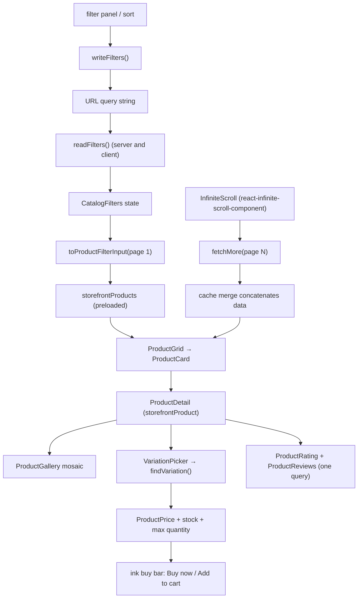

# catalog

**Last updated:** 2026-10-07 - **Feature:** `apps/storefront/src/features/catalog/` (infinite scroll via `react-infinite-scroll-component`)

## Overview

Browsing and reading products: the grid with its URL-driven filters and
infinite scroll, and the product page — gallery mosaic, picker, buy bar, facts,
specs and reviews.

Everything here uses the `storefront*` queries — the **public** code path, not
the `products` query the vendor dashboard calls. `PublicProduct` omits
`cost_per_item_cents`, `sold_quantity`, bid floors and `ai_keywords`, so no shape
of this feature can leak them by over-selecting.

Both routes are **server-rendered**. The pages preload their queries and the
components read them back with `useSuspenseQuery`, so a product's name, price,
description and photos are in the HTML the crawler and the shopper both
receive. The product page also owns the app's only per-product
`generateMetadata`, and answers a real **404** for a slug that is not a product.

## Screens / routes

| Route | Screen |
|-------|--------|
| `/[shopSlug]/products` | `CatalogPage` — search, filters, sort, infinite scroll. |
| `/[shopSlug]/products/[slug]` | `ProductDetail` — gallery mosaic, then the product on the left and the purchase on the right, then related. |

## Diagram

## Components

- **`ProductCard`** — the photograph *is* the card: the image fills a fixed
  frame (`PRODUCT_CARD_FRAME`, `5/8` on a phone and `3/4` from `sm`) and the
  caption — name, price chip, one tag, a stock note and a white pill button —
  sits over its lower third on a scrim, with two lines of description waiting
  closed under the name. The title
  carries the link and stretches it across the whole tile with `after:inset-0`,
  so a click anywhere opens the product while a screen reader gets one link
  named by the product; the heart, the add button and the gallery dots sit above
  that overlay and outside it in the DOM, because an anchor cannot contain a
  button. Caption padding is airier than the frame (the identity pass kept the
  photo-as-card structure and only opened the type). The scrim is painted on the **caption box**, not on the frame, so its
  height is the caption's: a product with no description keeps more of its
  picture instead of carrying the same wall of ink as one with four lines.
  That is also what animates. The **excerpt is a zero-height grid row at rest**
  (`grid-rows-[0fr]` -> `[1fr]`, so the row resolves to the paragraph's real
  height rather than a `max-height` guess) and opens on hover; because the tile
  is `justify-end`, the caption can only grow upward, so the gradient it
  carries **floods up the photo with it** and there is no second scrim layer to
  keep in step. The caption has no flex `gap` for the same reason — a collapsed
  reveal is still a flex item, so a gap either side of it held a 10px hole open
  on every closed tile; each row carries its own `mt-2.5` and the reveal's sits
  inside the clipped box. `group-focus-within` opens it for a keyboard, and
  `(hover: none)` leaves it open on touch, where `group-hover` never fires and
  the excerpt would otherwise be a desktop-only field. It is never removed from
  the DOM, so the server-rendered grid still carries it for a crawler.
  The **last line is the price beside the button**, and it stacks below a
  `15rem` **container** query rather than a screen one: the grid gives the tile
  half a phone while the rail gives it a fixed `15rem`, so a viewport
  breakpoint would be wrong for one of them. The price never shrinks, because
  a truncated price is a wrong price; the button truncates its label instead.
- **`CardPhotos`** — the picture, plus a small gallery from the same `gallery`
  blob the PDP reads. A mouse **scrubs** (pointer position maps onto the photo
  list, so the frame is the control and no timer moves the tile under someone
  reading it); touch taps the dots, which are real buttons there. Nothing past
  the first photo is fetched until the first hover or dot press, because a grid
  eagerly loading three photos a tile triples catalogue image traffic for
  pictures most visits never open, and the first row is usually the LCP. Capped
  at four, mirrored under RTL. It also owns two states: an image-less product
  gets a colour from `cardTint` rather than a void. A sold-out product keeps
  its colours: the photo is never desaturated, because an imported catalogue is
  out of stock end to end until quantities are entered and a grid of grey tiles
  reads as broken images rather than as a state. Sold out is said by the chip
  and the disabled add button instead. Tiles render `image.original` and let
  `sizes` pick the width - the stored 368x232 derivative is a media-library row
  thumb and upscales past 2.5x in this frame. `data-flight-source` is on its
  frame.
- **`ProductGrid`** — grid, skeleton in the same tile geometry, empty state. Gap
  matches the homepage rail (`gap-5` / `sm:gap-6`). The empty panel is the same
  card-on-Sand + Sky Mint wash as `HomeEmpty`. `ProductCardSkeleton` imports
  `PRODUCT_CARD_FRAME` rather than retyping it, and is exported, so the page-level
  fallbacks (`CatalogSkeleton`, `HomeSkeleton`) and `ProductRail`'s slot all draw
  the real tile geometry rather than their own copies of it.
- **`CatalogPage`** — heading on `text-shop-title`, filter rail as a sticky
  card-on-Sand (`w-64`, hairline ring). Sort and the mobile filter sheet write
  the URL with `replace`. The first page is the suspense/preload read; later
  pages append through `fetchMore` without clearing the grid. The grid is
  wrapped in **`InfiniteScroll`** from `react-infinite-scroll-component`
  (`dataLength` = accumulated products, `next` = `fetchMore`, `hasMore` from
  `catalogHasMore`). The loader spinner renders only while a page is in flight
  and `hasMore` is still true; when the list is exhausted it shows
  `catalog.endOfList` instead.
- **`CatalogFilters`** — availability, price range, collections, tags. Group
  labels use the same mono/accent tracking as section indices. Apply-on-change
  and blur/Enter price commit are unchanged.
- **`CatalogSkeleton`** — Suspense fallback matching `CatalogPage`'s heading,
  `w-64` filter card and `lg:grid-cols-3` grid (not a fourth column the live
  page never paints).
- **`ProductPrice` / `SaleBadge`** — the one place a price is rendered. Three
  tones: `default`, `inverse` (the PDP ink buy bar) and `photoBare` (white ink
  on the tile's scrim), so nothing recolours a price from outside. A tone
  marked **tight** shares its line with something else — on the tile, the
  add-to-cart button — so it takes the locale's shortest currency marker and
  drops the strikethrough "was", which the `-N%` badge on the picture already
  says. The roomy tones keep both numbers. PDP sizes (`lg` / `xl`) use the
  shop heading face; conversion, strikethrough and `SaleBadge` math are
  unchanged.
- **`ProductGallery`** — the PDP mosaic: one large frame, up to three tiles, a
  `+N` count and a strip past four photos. A tile click promotes it and the
  outgoing photo takes its place; `MAIN_SPAN`/`TILE_SPAN` place every count.
  An empty mosaic is a Sky Mint wash; tile hover is Teal. Promote/overflow
  behaviour is unchanged.
- **`VariationPicker`** — swatches for a colour option, chips otherwise;
  unreachable values stay visible and struck through. Chosen chips and swatch
  rings use `--shop-accent`; `reachableValues` is unchanged.
- **`DetailSection`** / **`ProductFacts`** — the foldable blocks (`text-shop-title`
  triggers), and the 2×2 grid inside "Shipping & returns" with accent icon
  wells. Filter/`slice(0, 4)` and `defaultOpen` are unchanged.
- **`ProductReviews` / `ProductRating`** — the card and the rating line beside
  the title, both from the same query. The list heading is `text-shop-title`
  with an accent avatar well; `See more`, paging, and the gold star fill
  (`--shop-low-stock`) are unchanged.
- **`QuantityStepper`**, **`QuickAddButton`**. The stepper is a card pill like
  the homepage rail controls. The tile's image frame and the gallery's main
  frame both carry `data-flight-source`, which is what the add-to-cart flight
  measures — see `cart.md`. The tile's button stays a `--shop-photo-*` white
  pill (`reveal: false`): the photo flies and the badge moves, but no cart
  panel opens over a grid a shopper is still working through. The product
  page's buy bar keeps the panel.

## State & forms

**Filter and sort state is the URL; page number is not.** `readFilters` is the
only source for filters and every control writes back through `router.replace`.
A leftover `?page=` from an old numbered-pagination link is ignored so the list
always starts at the top. Later pages never touch the address bar.

That is also what lets the server render a *filtered* link: the page reads the
same query string through the same `readFilters` + `toProductFilterInput(…, 1)`
pair and preloads the first page. "The same" has to be literal —
`useSuspenseQuery` pairs a preload by query *and variables* — which is why
`toSearchParams` funnels Next's `searchParams` through the one parser.

**Infinite scroll uses `react-infinite-scroll-component` plus the Apollo
cache.** `storefrontProducts` keys on every filter field except `page`
(`shared/apollo/storefront-products-policy.ts`). `fetchMore` with page 2+
merges into the same entry and concatenates `data`; page 1 replaces, so a
filter or shop change does not append across lists. `catalogHasMore` is false
when `meta.page >= meta.total_pages` **or** when `loadedCount >= meta.total`,
so a short catalogue (everything on page 1) never keeps requesting page 2.
A local `exhausted` latch also trips when a `fetchMore` adds no rows. An
in-flight ref plus `loadingMore` stop duplicate fetches. The home rails that
share this field slice to their requested `limit` so a long catalogue visit
cannot inflate them.

**The grid no longer collapses between filter changes.** Changing a filter
navigates, an App Router navigation is a React transition, and React keeps the
previous page on screen while the new variables suspend.

Both suspense reads here set `errorPolicy: "all"`. The grid has always needed
it — it renders its own `catalog.loadError` panel, and an empty shop is not an
error boundary's business — and `CatalogFilters` needs it for the reason every
preloaded read does: a throw during the RSC pass costs the whole subtree its
server rendering, so a facet list that cannot load would take the products
beside it down with it. A panel with no tags in it is the right failure.

The filter panel commits checkboxes immediately and price inputs on blur/Enter —
a box that does nothing until you find an Apply button is the pattern people
abandon; a price field that refetches per keystroke hammers the API.

The PDP seeds its variation selection with **adjust-state-during-render** keyed
on the product id, so the picker opens on a real, in-stock variation instead of
committing one frame of the parent row's price.

Its two columns are **placed explicitly** (`lg:col-start` / `lg:row-start`):
on a phone the buy bar comes first, under the photos, with the description
after it; on a desktop the description is the left column and the buy bar sits
top-right. Auto-flow gives one of those orders, not both.

## GraphQL operations

| Operation | Type | Notes |
|-----------|------|-------|
| `storefrontProducts(filters)` | Query | The grid, the home page strips, and the related-products row. Its `ProductCardFields` fragment carries `description`, `tags` and `gallery` because the tile's caption shows an excerpt and one tag and its frame holds a small gallery; all three come off the row `publicProductSelect` already reads, so the cost is payload, not a query. Catalogue listing preloads page 1 and `fetchMore`s later pages. |
| `storefrontProduct(slug)` | Query | The PDP. Preloaded by the page. |
| `storefrontRecommendations(product_id, limit)` | Query | The "you might also like" rail, and the shop home's trending rail. Returns `PublicProduct` rows, so it reuses `ProductCardFields` and `ProductGrid` unchanged — `aiRecommendations` returns a thinner shape that would need its own card. Not preloaded on the PDP: it needs the loaded product's id. |
| `STOREFRONT_PRODUCT_META` → `storefrontProduct(slug)` | Query | Seven fields, server-only. Feeds `generateMetadata` and the `notFound()` check, through the React-`cache()`d `lib/product-server.ts` so both share one call. |
| `reviews(product_id, page, limit)` | Query | `OptionalJwtGuard`, so it works signed-out. `meta.average_rating` is the mean over every review, not the page. |
| `viewProduct(slug)` | Mutation | Fire-and-forget view counter; failures swallowed. |
| `tags` + `collections` | Query | Filter facets, scoped to the shop by `X-SHOP`. |

`ProductCardFields` is a **fragment**, not a template string — see the app README.

## Validation

Price bounds are parsed defensively in `readFilters`: `Number("")` is 0 and
`Number("abc")` is NaN, and either would go out as a real bound. An unknown
`sort` falls back to `NEWEST` rather than reaching the API.

## Main files

- `lib/filters.ts` — URL ↔ `ProductFilterInput` (no `page` in the URL);
  also `catalogHasMore` for InfiniteScroll's `hasMore`.
- `lib/product.ts` — `priceDisplay`, `stockState`, `maxOrderableQuantity`,
  `cardExcerpt`, `cardTint`.
- `components/product-card.tsx` — the photo tile and `PRODUCT_CARD_FRAME`.
- `components/card-photos.tsx` — the tile's hover gallery and tinted ground.
- `lib/variations.ts` — `findVariation`, `reachableValues`, `defaultVariation`.
- `lib/colors.ts` — `swatchColor`, `isColorOption`, `swatchNeedsBorder`.
- `components/catalog-page.tsx`, `components/product-detail.tsx`.
- `components/catalog-skeleton.tsx` — the catalogue's Suspense fallback.
- `lib/product-server.ts` — `fetchProductMeta`, the server-side read behind
  `generateMetadata` and the 404.
- `api.ts` — the six operations above.
- `shared/apollo/storefront-products-policy.ts` — cache `keyArgs` + merge.

## Notes

- **The tile's caption is coloured against the photo, not against the page.**
  The `--shop-photo-*` tokens have no `.dark` counterpart on purpose: a
  photograph is the same in both themes, so a caption that flipped with the
  page would be wrong in exactly one of them. `--shop-photo-ground` is the
  fill behind a product with no image, and it stays dark so the same white
  caption still reads on it.
- **Only the price chip is made of ink; the tag chips are made of light.** A
  white-alpha chip vanishes into a pale product, which is survivable for a tag
  and not for a price.
- The product page's identity pass restyles layout, chips and type only —
  gallery promote/swipe, variation reachability, quantity caps and price math
  are unchanged.
- The reviews card's identity pass restyles type and wells only — paging,
  author-less rows, and the gold star fill are unchanged.
- A product with **inventory not tracked** (`track_quantity` false) is in stock. `in_stock` is not consulted first: that flag is whatever the rollup wrote the last time tracking was on, so a product saved at quantity 0 and then switched to untracked stayed "Out of stock" on the tile and the add button. Checkout already skipped the stock check for that flag.
- A `VARIABLE` product shows a **price range** and cannot be quick-added from a
  tile: the API wants a `variation_option_id` and a grid has no honest way to
  pick one, so the button becomes a link to the product page.
- `reachableValues` greys out combinations the shop never made rather than
  hiding them — a list that silently changes length reads as a glitch.
- Related products come from the product's first **collection**, not
  `storefrontProductRelations`: those rows carry only a `target_product_id` and
  no public query takes a list of ids, so cards from it would be one round trip
  each. It is also the one query on this page still fetched from the browser:
  the collection id comes from the product, so the server cannot start it
  without waiting for the product query to finish first, and a second serial
  round trip before first paint costs more than a below-the-fold rail is worth.
- **A missing product is a 404, not a 200 with an apology on it.** The page
  establishes the product exists before rendering, using the same cached read
  `generateMetadata` already made. A soft 404 is a page search engines keep in
  the index and keep sending people to.
- **Every product used to share the shop's share card.** The only
  `generateMetadata` in the app was the shop layout's, so a product link pasted
  into a chat showed the storefront's name and cover whatever it pointed at.
  None of those crawlers run JavaScript, so no amount of client rendering could
  have fixed it. `seo_title` / `seo_description` win where the vendor filled
  them in; otherwise the product's own name and description stand in.
- The rating beside the title is `reviews.meta.average_rating`, the mean over
  **every** review, added for this screen: averaging the page would move the
  number each time "See more" grew the list, and `shopReviewsSummary` (same
  figure) is vendor-only. A review row shows **no author** for the mirror-image
  reason — `ReviewEntry` carries `user_id` and nothing else.
- **Swatches are inferred, so they fail closed.** The API gives the picker
  labels only, so `isColorOption` requires the option to be *named* a colour
  and every value to resolve; one unknown value and the option renders as
  chips. A circle in the wrong colour is worse than the word it replaced.
- The shipping panel quotes **no delivery window**: nothing on a product or a
  shop carries one, and an invented "3–5 working days" is the one thing here a
  customer would hold the shop to.
- **Buy now is add-to-cart plus a redirect** — `createOrder` places the cart,
  so anything skipping it would have to build one. A signed-out shopper meets
  the login screen because `/checkout` is guarded.
- **The search box now ranks, and the change was entirely server-side.** The
  header form still writes `?search=` and `toProductFilterInput` still passes it
  as `filters.search`; what changed is that `findAllStorefront` runs it through
  the semantic pipeline merged with a weighted keyword ranker instead of
  matching it as a substring of the name JSON or the slug. A shop selling a
  "MacBook Air M3" used to answer "laptop" with an empty grid. Two behaviours
  worth knowing here: with a search term and no explicit `sort`, results arrive
  in **relevance** order rather than newest-first (any `?sort=` the shopper
  picks still wins), and a search is capped at 200 candidates, so `meta.total`
  on a searched view is the ranked set rather than every possible match — past
  which people re-type rather than scroll forever.
- **The related rail ranks by similarity now, not by the vendor's grouping.**
  It used to ask for the newest members of the product's first collection — a
  reasonable heuristic, wrong in two common shapes: a product in no collection
  got the shop's newest products (related to nothing), and a shop whose one
  collection is "All products" got the same four tiles under everything it
  sells. `storefrontRecommendations` answers from pgvector similarity over the
  product's own embedding, and when that is short the **server** tops it up from
  the same taxonomy category — so the fallback is still about this product
  rather than about the shop. It stays a `useQuery` rather than a preload
  because it depends on an id the server pass does not have until the product
  resolves. The `currentId` filter here is a second line only; the server
  already excludes the product being viewed.
