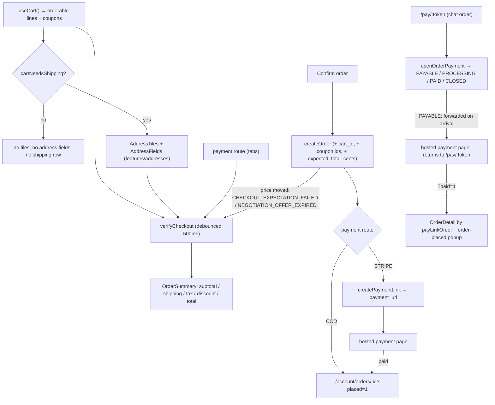

# checkout

**Last updated:** 2026-10-07 (template frames live in `@repo/storefront-templates`) — **Feature:** `apps/storefront/src/features/checkout/`

## Overview

Contact details, delivery address, payment route, order note — and placing the
order.

The feature is built around one rule: **the client never computes money.**
`verifyCheckout` prices the order against the address and the summary renders
what comes back.

**Never more than the total on screen (2026-09-27).** `createOrder` prices the
order again inside its own transaction, so it is sent `expected_total_cents`: the
total beside the button when it was pressed (the quote's, else the cart's). An
order that would cost more is refused with `CHECKOUT_EXPECTATION_FAILED` — a
negotiated price that ran out between the quote and the press, a sale that ended,
a price edited — and so is a lapsed negotiated line with no confirmed total
(`NEGOTIATION_OFFER_EXPIRED`). Either one orders nothing; the page says the total
changed (`checkout.priceChanged`) and quotes again (`needsRequote`, a bump of
`requoteCount` in the verify effect's dependencies), so the next press is against
the real total. It used to charge the catalogue price with no word.

Payment tabs and footer badges now come from `shopPaymentOptions`. Each store
controls cash on delivery, card payment and bank transfer. Checkout blocks order
placement while payment settings are unavailable. Bank transfer loads account
details only for a signed-in buyer and passes `bank_account_id` to order creation;
the order page then shows frozen instructions and receives a private receipt.
See [bank transfers](bank-transfers.md) for the full flow.

The screen is a **form card beside a summary column**, both inside one sunken
block, and it is a single page rather than a wizard: nothing is behind a Next
button, so the step rail reads how far the order has got rather than controlling
what is visible. A stored step would be a second source of truth able to
disagree with the fields under it.

**A carrier option prices the parcels the plan expects.** `checkout.verify` already computes a read-only allocation (`planForLines`, no lock) from the same engine order creation uses; every planned parcel is quoted from its own warehouse and the fee is their **sum**. `package_count` says how many, and the picker states it beside the price — a customer told one number who receives two boxes was not told the truth about their order.

An option no carrier can cover across every parcel is dropped rather than shown, and a warehouse with no city suppresses carrier options for that cart entirely: quoting the rest would undercharge by exactly the parcel it skipped.

## Delivery channels

The shipping picker shows two kinds of option and groups them when both are
present: **the shop's own delivery**, priced by its zones, and **shipping
companies**, priced live by the carrier and charged exactly as quoted. A
carrier option carries the company's name and logo — the logo is what tells a
customer "this is a company you know" faster than reading does.

Grouping only kicks in when both channels are offered. A shop with one channel
renders a flat list, because a heading over a single group contrasts with
nothing.

The logo degrades in both directions: no logo renders nothing at all rather
than an empty frame, and a URL that 404s hides itself. The name beside it is
what identifies the carrier; the logo only makes it faster to find.

**The picker renders when there is something to say, which includes having no
options.** It used to be gated on `shipping_options.length > 0`, so the server's
explanation for an empty carrier list had nowhere to appear — a customer saw an
address form, no methods and no reason. `carrier_unavailable_reason` is now
passed in and read, and the split is by **who can act on it**, not by what went
wrong. `destination_not_covered` gets its own line — it is the one the CUSTOMER
can act on, by shipping somewhere else. Every setup fault behind the counter
shares a second line, because they read identically from the customer's side:
`location_has_no_city` and `no_location` (the shop's warehouses),
`not_connected` (no carrier integration on the platform) and
`no_carriers_enabled` (the merchant turned every company off). `carrier_unavailable`
is deliberately silent — it is transient, and telling someone mid-checkout that a
third party is slow invites them to wait rather than to order; so are
`no_destination` and `nothing_to_quote`, which mean the address is not finished
yet rather than that anything failed.

Keeping those apart matters here because the server used to send
`destination_not_covered` for all of them, so a shopper with a perfectly
deliverable address was told their address was the problem.

## Screens / routes

| Route | Screen |
|-------|--------|
| `/[shopSlug]/checkout` | `CheckoutPage`, or that shop's template checkout when `storefront_template` is `doughn`, `drip`, `rail`, `hullo`, `personne` or `jurat`. Behind the route guard — `createOrder` is `JwtAuthGuard`, so guest checkout is refused by the back-end on purpose. |
| `/[shopSlug]/pay/[token]` | `OrderPayment` — the pay link a card order placed in a WhatsApp chat is sent. Public: `pay` is in neither `PRIVATE_SEGMENTS` nor `GUEST_ONLY_SEGMENTS`, because the token is the permission and the payer may never have signed in on this browser. `robots: noindex, nofollow` — every URL here is a credential. |

## Diagram

## Components

- **`CheckoutPage`** — the form card: shop mark and account chip, the heading
  (`text-shop-title`) with its Teal secure note, the payment tabs (selected
  underline is `--shop-accent`), the tile column beside the fields, and the
  Confirm order / Cancel row. Plus the mobile action bar. Confirm is a Teal
  pill. `verifyCheckout` / `createOrder` / Stripe are unchanged.
- **`MethodTab`** — one payment route as a tab; the selected route's
  consequence is printed under the row rather than discovered after ordering.
- **`OrderSummary`** — the whole right column: the step rail (still the
  `--shop-tile-*` pastels), the collapsible panels, and the total. Money still
  comes from `verifyCheckout`; nothing here adds a fee.
- **`SummaryPanel`** — one collapsible card. Collapsed, its header still carries
  its own answer, so nothing has to be opened to be checked.
- **`StepRail`** — Delivery → Payment → Review, entirely derived.
- **`DiscountPanel`** — discount codes, here as well as on the cart, calling the
  same `applyCartCoupon`. Applied codes render as `CouponTicket`, which lives
  in `features/cart/` because the coupon does.
- **`OrderPayment`** — the chat pay page. Calls `openOrderPayment` once on
  arrival and shows: working; `PAYABLE` → **forwarded straight to the
  provider** (2026-09-26) with `location.replace`, so "back" from the
  provider's page leaves instead of landing here to be forwarded again — the
  card says so and keeps a fallback button; under `?cancelled` (the provider
  sent them back unpaid) no forward, the **Pay by card** button and a "payment
  was not completed" note; `PROCESSING` → **Check again**; `CLOSED`; an
  invalid link. A `CLOSED` answer that carries `closed_reason` is the whole
  story: `refunded` says the payment was sent back, and any other reason is
  the plain closed card, with no second request (2026-10-05). An answer that
  still omits the reason reads the order behind the link with the same token
  (`payLinkOrder`) before it leaves "working": when its payment is
  `payment-refunded` the card says the payment was refunded, with the order
  number and the total (2026-10-04), instead of "it may have been cancelled
  or expired". A failed read shows the plain closed card. **Paid, it becomes the order**: `?paid=1` (read once, at
  arrival, so closing the popup does not turn the page back into a payment)
  renders `OrderDetail` in its pay-link mode with the checkout's "order
  placed" popup open — the ending the storefront's own card checkout has — and
  a `PAID` answer renders the same screen without the popup. Copy under
  `pay.*` (`pay.redirecting.*` for the forward).

The address UI is **not** in this feature: `AddressTiles`, `AddressFields` and
the address shape live in `features/addresses/`, shared with the account screen.

## State & forms

Local `useState` for address, contact, note and payment route — no
react-hook-form: Confirm order is disabled until `isAddressComplete` passes and
the back-end owns every other rule.

Contact and address are seeded with **adjust-state-during-render** from the
customer's profile (the number first, else the email; the name) and
`useAddresses().preferred`, so the form never commits a frame of empty inputs.
The address state lives here rather than in `AddressTiles` because it is what
both mutations send; `useAddresses()` at both levels serves one cache entry.

Verification is **debounced 500ms** — firing per keystroke would be one request
per letter of the street name, each re-running the shop's shipping rules.

## GraphQL operations

| Operation | Type | Notes |
|-----------|------|-------|
| `verifyCheckout(input)` | Mutation | Prices the order. Writes nothing. Sends `coupon_codes` (all cart codes) plus `coupon_code` (first) and `cart_id`. `OptionalJwtGuard`. |
| `createOrder(input)` | Mutation | Commits it. `JwtAuthGuard` + `X-SHOP` + throttled 10/min. Sends `expected_total_cents` (the total on screen); a higher order total is refused and re-quoted rather than charged. |
| `createPaymentLink(order_id, payment_gateway)` | Mutation | Card route only, *after* the order exists. Only the order's own customer; the back-end sets where Stripe returns them. |
| `openOrderPayment(token)` | Mutation | The chat pay page (`OPEN_ORDER_PAYMENT`). No session: the token is the permission. Answers a `state` plus the order's number, total and currency, and `payment_url` when `PAYABLE`. |
| `myCustomerProfile` | Query | Seeds the contact fields and names the account chip. |

`myAddresses` lives in `features/addresses/api.ts` with the tiles.

## Validation

`addressSchema` (zod, in `features/addresses/lib/address.ts`) requires street,
city and country; state and postcode are optional. **A digital-only order skips
the check entirely** (`addressReady` is true by definition) and sends no address
to either mutation.

`cartNeedsShipping` decides that, and mirrors the server's own fee gate: a
line ships when `product_type !== "DIGITAL"` and `requires_shipping !== false`
(the cart query now fetches `product_type`). Deliberately NOT keyed on
`is_digital` — `SIMPLE` + `is_digital` is boxed software, a physical parcel,
and the old predicate hid the address form for it while the server rightly
charged to ship it. `requires_shipping` still defaults `true` server-side and
is not cleared when a vendor marks a product `DIGITAL`. The "digital only"
copy uses `isDigitalOnlyOrder`: at least one *orderable* line and none of them
ship. An empty orderable list (blocked / out-of-stock lines) is not digital —
that is what mis-labelled a physical café product when inventory tracking was
off and the line was wrongly unavailable.

## Main files

- `components/checkout-page.tsx` — the form card and the orchestration.
- `components/order-payment.tsx`, `../../app/[shopSlug]/pay/[token]/page.tsx` — the chat pay page.
- `components/order-summary.tsx` — the summary column.
- `../cart/components/coupon-ticket.tsx` — an applied code, as a torn stub.
- `lib/shipping.ts` — `cartNeedsShipping`, `isDigitalOnlyOrder`.
- `lib/blocked-lines.ts` — which lines the quote refuses, and their names.
- `lib/requote.ts` — `needsRequote`: the refusals that mean the price moved.
- `api.ts` — the four operations of this feature (the customer's profile comes from `features/auth`).
- `use-checkout.ts` — the shared session. Template checkouts and `CheckoutPage` both read it.
- `components/themed-checkout.tsx` — the shared frame props. The route renders one of `doughn-themed-checkout.tsx`, `drip-themed-checkout.tsx`, `rail-themed-checkout.tsx`, `hullo-themed-checkout.tsx`, `personne-themed-checkout.tsx`, `jurat-themed-checkout.tsx`.
- `lib/ledger.ts` — which quote rows to show, including when a zero fee may say free.

## Notes

- **A templated shop checks out in that template.** `storefront_template`
  of `doughn`, `drip`, `rail`, `hullo`, `personne` or `jurat` renders that frame
  and the shell drops its header and footer on the
  checkout path, the same way those four own the home.
  The frames live in `@repo/storefront-templates` (`doughn/checkout`,
  `drip/checkout`, `rail/checkout`, `hullo/checkout`, `personne/checkout`, `jurat/checkout`) and reuse each
  template's type, colour and motion (shutter, scoop, rail spring, printed
  ticket). `useCheckout` passes `lang`. `verifyCheckout`, `createOrder` and every `*_cents` field are the
  same session the default page uses. A drip bag writes its lines with
  `addToCart` before this page opens, so the frame and the bag are one cart:
  leaving checkout and opening the bag again reads `cart`. Vendor preview of the same frames is
  `/theme-preview/[templateId]/checkout`.
- The identity pass restyles type, pills and the empty card only —
  `verifyCheckout`, `createOrder`, Stripe, shipping radios and every `*_cents`
  field are unchanged.
- **The customer picks the shipping method.** `verifyCheckout` returns every
  rate the shop offers for the address, priced for this cart
  (`shipping_options`), and the form renders them as radio tiles between the
  address and the warnings. The pick re-verifies with `shipping_rule_id`; the
  quote echoes `selected_shipping_rule_id`, and a pick that stops resolving
  (rate deleted, zone changed by the new address) snaps back to the default
  via adjust-state-during-render rather than quoting a ghost. `createOrder`
  is sent the quote's echoed id — never the raw pick — so the charge is
  pinned to the method the customer last saw; a stale id makes the server
  refuse rather than silently substitute.
- **An excluded destination blocks; an unconfigured shop warns.** The quote now says WHICH cause `shipping_available: false` has: `destination_excluded` (the shop’s zones deliberately skip this address — the button disables with a red note, because `createOrder` would refuse anyway) vs `not_configured` (the soft amber warning stays; the back-end accepts with fee 0).
- **Options carry the delivery promise.** `min/max_delivery_days` render under the method name (“3–5 days”); null means no promise and nothing is shown.
- **The quote's `unavailable_products` blocks the order, and names the items.**
  The cart and the quote refuse different sets: `CartItem.status` checks
  `product.quantity`, a shop-wide total, while `verifyCheckout` runs the
  allocation engine over the shop's locations and can reject a line the cart
  called `AVAILABLE` — `unfulfillable_online`, for units that exist in the
  aggregate but sit at no location fulfilling online orders. The screen
  selected that list and read none of it, so the line was submitted anyway and
  `createOrder` refused with `VALIDATION_ERROR` / `ORDER_NOT_ALLOCATABLE` under
  a generic toast naming nothing. Confirm order is now disabled while the list
  is non-empty and the existing "Some items are unavailable" notice lists the
  blocked items by name. The list is deliberately NOT subtracted from the next
  verify request: a line dropped from the input is not reported unavailable,
  so the set would empty, the line would return, and the two states would
  alternate every round trip.
- **`cart_id` rides on `verifyCheckout`** so the feasibility engine leaves this cart’s own stock holds out of its subtraction — other carts’ holds now make a line `unfulfillable_online` at verify instead of surprising the shopper at order time.
- **"Free" is gated on `shipping_available`.** An unpriced destination also
  arrives as fee 0, and it used to render as "Free" (badge included) beside
  the very warning saying no rate was found.
- **`requires_split` is rendered.** When the quote's fulfillment plan says the
  order ships from more than one location, a note under the picker tells the
  customer it arrives in more than one delivery.

- **Cart coupons ride on `coupon_codes`.** They live on the cart row (`CartCoupon`). The page memos every applied code and sends `coupon_codes` plus the first as `coupon_code`; the server unions those with coupons on `cart_id` and stacks them SEQUENTIAL through CouponEngine (D30). `createOrder` still takes coupon ids.
- **No card form here, deliberately.** The tabs switch the payment *route*; the
  fields beside them are the order's. The card route hands the customer to a
  hosted payment page, so a number/expiry/CVV trio would either go nowhere or
  put this app in PCI scope for a value the back-end cannot receive.
- **`createOrder` before `createPaymentLink`, always.** An abandoned payment
  leaves a real pending order the shop can chase rather than a charge with
  nothing behind it, and a link that fails to return still lands the customer
  on their order. After paying, Stripe returns them to
  `/account/orders/<id>?placed=1`, and on cancel to the same page without the
  flag — URLs the back-end sets, which until 2026-09-25 pointed at the vendor
  dashboard.
- `cart_id` lets `OrdersService` release the cart's stock reservations and mark
  it converted in the same transaction; without it the units stay held.
- **`shipping_available: false` is a warning, not a block.** `createOrder` does
  not refuse either — it charges 0 and creates the order — so blocking would
  invent an enforcement the API does not have.
- The mobile action bar is the *only* Confirm-order button under `lg`.
