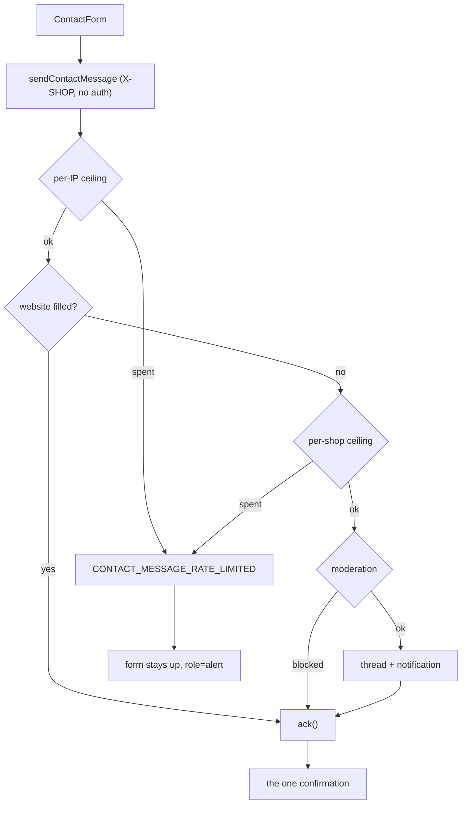

# contact

**Last updated:** 2026-10-01 - **Feature:** `apps/storefront/src/features/contact/`

## Overview

One screen: a stranger writing to a shop. No account, no session, no cart — the
visitor types a name, an address, a message and an optional order number, and it
lands in the merchant's customer inbox as a `CONTACT_FORM` thread.

**The whole feature is arranged around one property: this screen must not be an
email-enumeration oracle.** `ContactFormService` answers a known address, an
unknown address, a tripped honeypot and a body its moderator blocked with
byte-for-byte the same acknowledgement. That is built on the server and spent
here — a client that said "we could not send that" for one of them, or left the
form standing for another, would hand the difference straight back. So every
outcome except `CONTACT_MESSAGE_RATE_LIMITED` renders the same confirmation, out
of the same branch, replacing the form with the same DOM.

A transport failure takes that branch too: from the browser a dropped connection
and a server that chose to drop the message are the same event, and a third
state for the one case that cannot be distinguished is the signal an oracle
needs. The real error is logged in development only.

## Screens / routes

| Route | Session | Notes |
|-------|---------|-------|
| `/[shopSlug]/contact` | none | Public and crawlable. `robots.ts` derives its disallow list from `PRIVATE_SEGMENTS` / `GUEST_ONLY_SEGMENTS` plus `cart` and `wishlist`; `contact` is in none of them, so nothing had to be done to keep it indexable. |

Reached from the footer's **Contact us** column, written `` `${base}/contact` ``.

## Diagram

## Components

| Component | Notes |
|-----------|-------|
| `ContactPage` | Route body: breadcrumb, heading, the form, and an aside listing whatever the shop published. Client-fetched — its only operation is a mutation nobody has submitted yet, so there is nothing for `<PreloadQuery>` to start. |
| `ContactForm` | The form, the honeypot, the counter and the two outcomes. |

## State & forms

No store. Two booleans of local state: `acknowledged` (the confirmation
replaces the form) and `rateLimited` (the form stays with the visitor's words
in it and an inline `role="alert"`).

**The honeypot.** `website` is rendered off-screen rather than with
`display: none` — the cheap form fillers skip inputs hidden that way, having
learned they are decoys — with `aria-hidden` on the wrapper and `tabIndex={-1}`
plus `autoComplete="off"` on the field, so nobody who could see it can reach it.
The label is real and hidden with it, because a bot reads names and labels and
`website` is the plausible thing it is looking for. **The client never inspects
it:** the back-end spends its per-IP ceiling before it looks at the trap, so a
submission short-circuited here would be the one caller on the platform with no
rate limit at all.

**The counter** reads through `watch("message")` so the number and the box
cannot disagree, and is attached to the textarea with `aria-describedby` rather
than announced from a live region that would talk over the typing.

## GraphQL operations

| Operation | Type | Notes |
|-----------|------|-------|
| `sendContactMessage` | Mutation | No auth guard at all — not even `OptionalJwtGuard`, so a signed-in visitor takes the same path as a stranger. Shop comes from `X-SHOP`; the input carries no `shop_id`. Only `success` is selected: `BaseResponse.message` is a server-authored string, and one rendered here could one day differ between "filed" and "dropped". |

## Validation

`validation.ts` mirrors the DTO's caps — message 2000, name 120, email 254,
order number 64 — because there is no shared package between the API and this
app and two spellings of 2000 is how a counter saying "150 characters left"
starts submitting into a `Validation failed`. Email uses `isEmail` from
`shared/lib/contact-validation.ts` rather than a second regex.

`website` is `z.string().optional()` and nothing more. A length or shape refusal
would be a *distinguishable answer*, and a bot that can tell a rejection from an
acceptance simply stops filling the field in.

## Main files

- `api.ts` — the mutation, and why only `success` is selected.
- `validation.ts` — the schema, and the caps mirrored from the DTO.
- `components/contact-form.tsx` — the two outcomes, the honeypot, the counter.
- `components/contact-page.tsx` — the route body and the published-details aside.
- `components/__tests__/contact-form.render.test.tsx` — renders five outcomes and asserts one string.
- `app/[shopSlug]/contact/page.tsx` — metadata and the canonical URL.

## Notes

The form **sits beside** the footer's published `mailto:` and `tel:` rows rather
than replacing them; the reasoning is in `features/shop/lib/contact.ts`. Short
version: the form exists for every shop and those rows only for a shop that
filled the field in, a printed address is evidence a shopper reads before
clicking, and a `mailto:` leaves the sender a copy the form cannot.

The back-end half — the two interleaved ceilings, why the honeypot check sits
between them, and why this is a `CONTACT_FORM` thread rather than a `WEB` one —
is in
[`back-end/docs/features/conversations.md`](../../../../back-end/docs/features/conversations.md).

The merchant's answer arrives **by email**, from the platform's own address
with the display name "<shop> via Zaydak" and the shop's sender email as
Reply-To (2026-10-01). The email links back to this page, and a message sent
from here with the same address joins the same inbox thread, because the thread
is keyed on that address. Answering the email itself goes to the merchant's
mailbox, not to the thread. See
[`back-end/docs/features/api/customer-bot.md`](../../../../back-end/docs/features/api/customer-bot.md).
