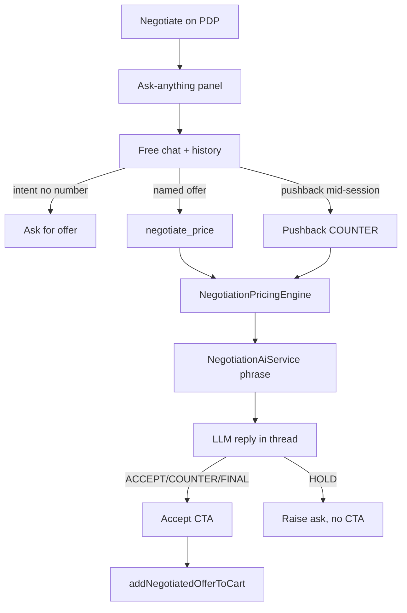

# Negotiation (storefront)

**Last updated:** 2026-10-01

## Overview

On a product page, when `negotiationAvailable` is true (policy `enabled` + usable floor), **Negotiate price** opens the existing **Ask anything** assistant (not a separate offer form). **The panel knows which product it is over**: every turn carries `page_product_slug`, derived from the path with `productSlugFromPath(shopRelativePath(...))`, and the PDP button passes the product as `subjectProductSlug` on the store rather than writing it into the shopper's own message — the seed prompt used to render "(slug: bydh-fakhr-30-hbh-2)" into their chat bubble because the tool had no other way to be told. The shopper chats freely (“السعر مش عاجبني”, “أعطيك 75”); the panel’s `negotiate_price` tool calls the Nest engine when there is an offer (or a free-chat turn with no number). The PDP seed only opens the chat — it does not imply a deal; the first turn without a numeric bid asks for their offer (أعطيني سعرك) and does **not** ACCEPT at list, invent a soft/preferred “available” price, or show “Add negotiated offer to cart”. Re-opening negotiate cancels any stuck ACTIVE session for that product so a prior FINAL cannot poison the next chat. After a seller counter, soft rejection without a new number (“لا ما بناسبني”) continues bargaining with a small COUNTER (capped), not abandon copy. Replies are **LLM-phrased** from `toLlmSafeView` only — never the floor. On ACCEPT / COUNTER / FINAL_OFFER the panel shows an accept → `addNegotiatedOfferToCart` CTA — **not** on HOLD — and **only on the latest message per session**. Seller concessions follow customer raises; verbal pushback may earn a limited free step down.

## Screens/routes

PDP under `/[shopSlug]/products/[slug]`; assistant overlay from `ShopShell`; cart drawer/page line chrome for negotiated lines.

## Diagram

## Components

- `features/negotiation/components/negotiate-panel.tsx` — `NegotiateButton` only (opens assistant)
- `features/assistant/` — chat UX, seed prompt, `AssistantNegotiationCta`
- `features/negotiation/api.ts` — availability + accept + add-to-cart ops
- Cart fragment fields `is_ai_negotiated`, `negotiated_expires_at` in `features/cart/api.ts`

## State & forms

Assistant transcript in `useAssistantStore` (tab-lifetime). Seed prompt and subject product via `openWithPrompt(prompt, subjectProductSlug, subjectVariationId)`; the subject is sticky for the conversation (a haggle is a run of bare numbers, each about the product the panel was opened on) and cleared by **New chat**. **The option goes with it (2026-09-27):** a price is agreed per option, so the PDP button passes the option selected on the page, sent as `page_variation_option_id` beside the subject product only — never beside a product read off the path. The button itself is shown per option (`negotiationAvailable(product, option)`), so an option the merchant kept at a fixed price has none. `guest_key` / cart `session_id` = `shop_cart_session` cookie — the same value for accept and for add, which is what the back-end's guest ownership check compares.

## GraphQL operations

`negotiationAvailable`, `askShopAssistant` / SSE (with `negotiation_offers`), `acceptNegotiation`, `addNegotiatedOfferToCart`

## Validation

Offers are cents from the engine; the client never recomputes discounts. Pure chat without a number does not invent a price. **A negotiated price covers the units it was bargained for** — raising a negotiated cart line past `offer.quantity` is refused by the API with `negotiated_quantity`, and the cart badge's countdown (`NegotiatedOfferBadge`) is the shopper's warning that the deal is time-boxed.

## Main files

- `apps/storefront/src/features/negotiation/`
- `apps/storefront/src/features/assistant/`
- Cart fragment in `features/cart/api.ts`

## Notes

Floor is never queried from the storefront. The app does not call `startNegotiation` or `sendNegotiationMessage`: the shop negotiates inside the assistant panel, and the two unused documents were removed from `api.ts` (2026-10-01). The panel answers in the thread's language when a turn carries none of its own — a bare "13.5" no longer flips an Arabic haggle into English. Cart badge i18n polish still open (TODO.md).
