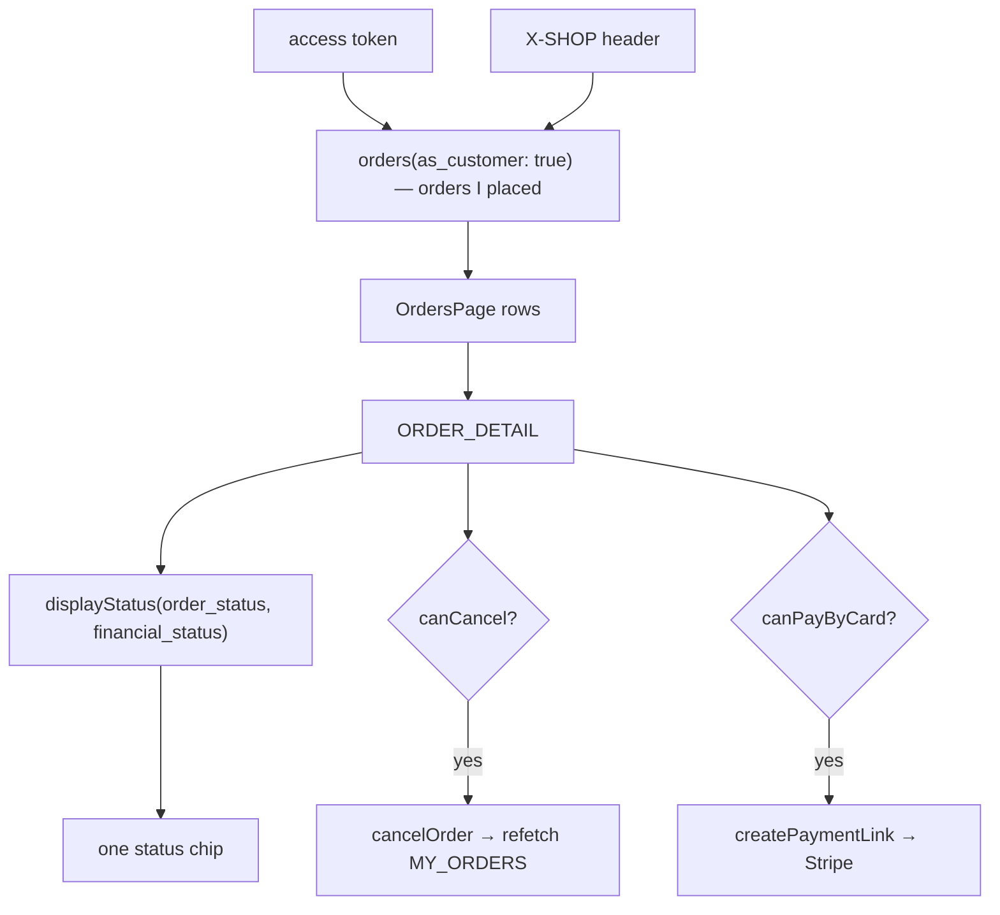

# orders

**Last updated:** 2026-10-05 (a `payment-mismatch` timeline step says the shop is checking the payment) — 2026-10-04 (a refunded payment reads "Refunded" on the payment line, the timeline and the list) - **Feature:** `apps/storefront/src/features/orders/`

## Overview

The customer's own order history, one order's detail, cancelling, and paying a card order again.

The detail screen **doubles as the order-confirmation screen**: checkout
redirects to it with `?placed=1`, which opens `OrderPlacedDialog` over it. One
screen rather than two, because dismissing the confirmation should leave the
customer on their order rather than on an empty "thanks" page — and a separate
route would mean "view your order" led somewhere already seen.

## Screens / routes

| Route | Screen |
|-------|--------|
| `/[shopSlug]/account/orders` | `OrdersPage` — the history list. |
| `/[shopSlug]/account/orders/[id]` | `OrderDetail` — lines, address, summary, payment, pay again, cancel. |
| `…/[id]?placed=1` | The same screen with the confirmation popup over it. |

Both are behind the route guard.

## Diagram

## Components

- **`OrdersPage`** — one card per order: tracking number, date, item count,
  status chip, a thumbnail strip capped at five, total, and a detail link.
- **`OrderDetail` has a pay-link mode** (`payToken`, 2026-09-26): the chat
  pay page renders it once the customer is back from paying, reading the order
  with `PAY_LINK_ORDER` (`payLinkOrder(token)`) instead of `ORDER_DETAIL` —
  the payer has usually never signed in on that browser — and opening
  `OrderPlacedDialog` when the page says so (`placed`). Both queries spread
  one fragment, `StorefrontOrderDetailFields`, so they cannot drift. It is
  read-only: no cancel, no transfer receipt, no Telegram updates card, and
  its not-found state links to the shop rather than to an account.
- **`OrderDetail`** — the line items, the shipping address, the note, and the
  summary panel with payment and fulfilment state. Owns the confirmation gate.
  **"Pay by card" (2026-09-28)**: a card checkout cancelled on Stripe returns
  here, which used to offer no way to retry. `canPayByCard` shows it for a
  `STRIPE` order whose payment is pending or failed and whose lifecycle is
  not cancelled, failed or refunded; it calls `createPaymentLink` and goes to
  the URL it returns. The back-end asks the order's recent sessions first, so
  a customer back before the settling webhook is refused `ALREADY_PAID` (or
  handed the session still open) rather than charged twice, and a closed
  order is refused `ORDER_CLOSED`. Not offered in pay-link mode, whose pay
  page already does this, nor while `?placed=1` is on the URL: that is
  Stripe's return after paying, when the order can read unpaid for the
  seconds before its webhook lands.
- **`OrderPlacedDialog`** — the confirmation popup: the order pass on ink,
  with title/description `sr-only` and unpaid-copy under the card.
- **`OrderPass`** — the order rendered on `@repo/ui`'s `BoardingPass`. The
  app-local wrapper that package's one rule asks for: everything about orders,
  money, locales and the shop lives here, and the card itself stays store-free.

## State & forms

`?placed=1` is read from `useSearchParams`, which is why the route wraps the
component in `Suspense`. Dismissing the popup sets a local `passDismissed` flag
**and** `router.replace`s the pathname without the parameter, so a reload or a
back-navigation does not reopen a confirmation already dismissed.

`cancelOrder` refetches `MY_ORDERS` so the list behind reflects the change.

## GraphQL operations

| Operation | Type | Notes |
|-----------|------|-------|
| `orders(filters)` | Query | `JwtAuthGuard`. Sends **`as_customer: true`** and no `customer_id` — the scope is the caller's id off the token. |
| `order(id)` | Query | `JwtAuthGuard`. Resolves for the buyer of the order as well as its seller. |
| `cancelOrder(id)` | Mutation | Refuses anything already shipped or completed. Scoped to the caller's own purchases. |
| `createPaymentLink(order_id, payment_gateway)` | Mutation | `CREATE_PAYMENT_LINK`, borrowed from `features/checkout/api`. The order's own customer only; `STRIPE`. |

`OrderSummaryFields` is a fragment shared by the list and the detail.
`ORDER_DETAIL` also selects `invoices { id invoice_number status due_date paid_at }`.

## Validation

None — both mutations take ids the UI holds. The cancel action is behind a
`window.confirm`.

## Main files

- `lib/status.ts` — `displayStatus`, `canCancel`, `canPayByCard`, `paymentGatewayLabel`,
  `orderPaymentDueDate`, `isPaymentRefunded`, `moneyRefunded`, and the label/chip maps.
- `components/orders-page.tsx` — the list.
- `components/order-detail.tsx` — the detail screen and the confirmation gate.
- `components/order-placed-dialog.tsx` — the confirmation popup.
- `components/order-pass.tsx` — the order-to-`BoardingPass` mapping.
- `api.ts` — the three operations.

## Notes

- **Identity (2026-09-14).** List, detail, empty states and chrome use the
  Day 1 type scale and Sand/Charcoal/Teal tokens. Status chips,
  `displayStatus` / `canCancel`, money fields, and the boarding-pass mapping
  are unchanged.
- **The confirmation never claims the order is paid.** A card order that
  succeeds now returns from Stripe to `?placed=1` as well, and may land before
  the webhook has marked it paid. The copy follows `financial_status`:
  unpaid orders read "You'll pay on delivery" rather than showing a tick,
  except bank transfer, card and `INVOICE`, which each get their own pending
  sentence (`invoicePaymentPending` says the invoice is due later).
- **The payment row names the method and, for an unpaid invoice, the due
  date.** `paymentGatewayLabel` gives a localized label for `BANK_TRANSFER`,
  `CASH_ON_DELIVERY`, `STRIPE`, `CASH`, `INVOICE` and `FULL_WALLET_PAYMENT`
  (checkout's `payment*` keys) and the raw string for anything else. While
  payment is `payment-pending`, `orderPaymentDueDate` picks the earliest
  invoice `due_date` and the row adds "Payment due <date>"; only an `INVOICE`
  order carries one, so every other order shows nothing extra.
- **`showPass` gates on the status, not only on the query parameter.**
  `?placed=1` is a link like any other and survives being shared or
  bookmarked, so a cancelled or refunded order suppresses the popup — a
  forward-looking confirmation floating over an order cancelled months ago is
  the worst thing this screen could do.
- **The pass maps to a shipment, not to a flight.** It carries **one**
  endpoint — where the parcel is going. The origin is the shop, and the shop is
  already the pass's brand line, so a second copy of it only cost both ends the
  width they needed: at 320px the two 30px slots truncated to "Ahmed Elect…"
  and "Riy…". The carrier band is left empty so the component drops it, because
  an order has no airline and inventing one would be cosplay; and the stop
  omits `time`, because an order has no departure clock — the date is in the
  detail band and the estimate in the pill, which is 9px and can hold a phrase.
- **The tracking number is text, not only bars.** The stub is `aria-hidden`,
  so the number prints under the bars as `stubCaption`, `select-all` and
  `dir="ltr"` so it copies cleanly in Arabic.
- **The popup is the card and almost nothing else.** It began as a 2xl headline
  over a subtitle over an order number over the pass — four stacked blocks,
  three repeating the fourth. Title and description are now `sr-only` (the
  dialog still needs an accessible name), and the only thing beside the card is
  the one fact it cannot carry: whether money still has to change hands.
- **`ring-0` on `DialogContent` is load-bearing.** The dialog paints its box
  with `ring-1 ring-foreground/10`, not a border, so `border-none` left a
  rounded outline framing the card — and `sm:max-w-sm` made that outline wider
  than the card inside it. The content is sized to the pass (`w-80`) with
  nothing painted, so the card *is* the popup.
- **The close lives in the striped header.** That band is the one part of the
  card that is pure decoration, so dismissing costs no vertical space and no
  second slab competes with the object the popup exists to show. It is an icon,
  so the label survives as its accessible name.
- **Shipments are shown to the buyer.** `ORDER_DETAIL` selects the order's
  customer-safe `shipments` (status, carrier name, tracking number, tracking
  link — never costs or provider internals) and the detail page renders them
  as a "Shipments" panel with per-shipment status labels
  (`SHIPMENT_LABEL_KEY` in `lib/status.ts`) and an external "Track shipment"
  link when the carrier gave one. Before this, tracking reached the customer
  only by email.
- **The shipping row names its method.** `shipping_method` is the order's
  frozen pricing-method snapshot, so the summary reads "Shipping · Express"
  even after the shop edits its rates. Orders predating the snapshot just
  show "Shipping".

- **The API sends three orthogonal statuses and a shopper does not think in
  three.** `order_status` (lifecycle), `financial_status` (money) and
  `fulfillment_status` (shipping) are collapsed by `displayStatus`, and the
  precedence is what makes it honest: cancelled and refunded outrank everything,
  because a refunded order is not "completed" whatever the lifecycle column says.
- **A refunded payment says so everywhere (2026-10-04).** `payment-refunded` is
  a card payment that could not be applied to its order — it arrived after the
  order had closed — and was sent back. The API writes it only on a closed order
  and derives `financial_status: refunded` from it. The payment line reads
  "Refunded" (`PAYMENT_LABEL_KEY`, which also maps the API's `payment-reversal`;
  that row was keyed `payment-reversed`, which nothing sends, so a reversed
  payment read "Payment pending"). The timeline's payment step reads "The
  payment was refunded" rather than "Awaiting payment or transfer review", and a
  cancelled order's banner says the payment was refunded. Cancelled still
  outranks refunded, so the list adds a quieter "Refunded" chip beside
  "Cancelled" (`moneyRefunded`, from `financial_status`, since the list selects
  no `payment`). `canPayByCard` never offers such an order. The chat's
  `track_my_orders` and the pay link's closed page use the same word.
- **Every payment status the API can send has a label (2026-10-04).** The
  payment line falls back to "Payment pending" for a status with no row in
  `PAYMENT_LABEL_KEY`, and half of them had none: `payment-processing`, a cash
  sale, a wallet payment, cash on delivery ("Due on delivery") and
  `payment-mismatch` all read as unpaid. `payment-mismatch` is worded for the
  shopper — "Payment being checked by the shop" — not with the merchant's
  "Refund needed". The timeline step beside that line says "The shop is
  checking your payment" (`stepPaymentChecking`), not "Awaiting payment or
  transfer review". `status.test.ts` reads the values of the back-end's
  `PaymentStatus` enum from its source file (plus `PAYMENT_MISMATCH`), so a
  status added there fails the test instead of falling back silently.
- Those fields are typed `String!` in the schema even though the enums are
  registered, so what arrives is `"pending"` / `"paid"` / `"unfulfilled"` — hence
  the lowercase string comparisons and the `.toLowerCase()` calls.
- `canCancel` mirrors the service's rule so the button is hidden rather than
  shown-and-rejected. It is UX only; the back-end is the boundary.
- `formatAddressLines` reads a known set of keys out of the frozen
  `OrderAddresses.shipping` snapshot and skips blanks, so an order placed before
  this app existed renders as an address rather than `[object Object]`.
- **`as_customer: true` is not optional on the list.** The back-end answers one
  of two different questions — "orders I placed" or "orders my shops received" —
  and it cannot pick from the role, because the same account is a seller in the
  vendor dashboard and a buyer here (`createOrder` has no permission check, so a
  vendor shopping in another shop's storefront is an ordinary customer). Without
  the flag a vendor-role shopper saw their own shop's sales here, and their own
  receipt was `RESOURCE_NOT_FOUND` on the confirmation screen right after
  checkout succeeded.
