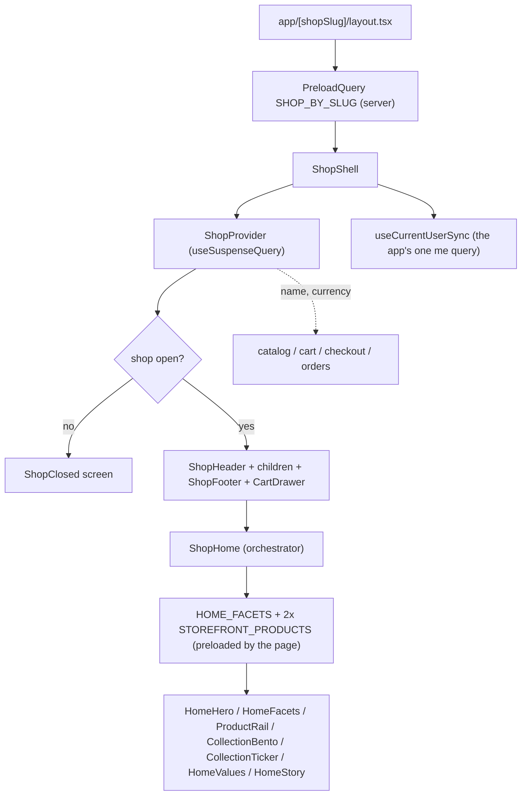

# shop

**Last updated:** 2026-10-08 (hullo tray is the shop cart) — **Feature:** `apps/storefront/src/features/shop/`

## Overview

Shop identity for the whole app. It owns the one query every other feature reads
the shop's name and currency from, the chrome that wraps every shop-scoped
route, the shop home page, and the directory at `/`.

When `storefront_template` is `doughn`, `drip`, `rail`, `hullo`, `personne` or `jurat`, the home
renders that template from `@repo/storefront-templates` and the shell drops
its header and footer on that route only. The package is presentation. This
feature maps the catalogue and the cart onto its props. Checkout does the same for those four.
`storefront_theme` supplies the doughn street copy and photos (night and
daylight plates, window frame, both doors, shutter, interior, story lines); an
empty field keeps the bundled sample. The shop name, store address and time
zone replace the sample wordmark, visit line and clock when the shop has
them. Opening hours stay the sample. A drip home reads
`storefrontProductComposition` on the `drip-gelato` product when that product
has assembly rules. The welcome loader stays on its cream ground while that
read is in flight, and the cone boots once from the assembly — the bundled
sample when the shop has no builder. The bag is that shop cart: add calls
`addToCart`, the steppers call `updateCartItem` and `removeCartItem`, and
the sheet is painted from `cart`, all with `session_id`. Checkout opens
that cart and does not copy the lines again. The theme preview still keeps
a demo bag in `localStorage` (`drip.bag`); the shop removes that key and
does not write it. A rail home hangs the shop's products that
have a photo, and keeps the drawn sample when none do. A hullo home paints
`storefrontProducts` on the window cards (name, selling price, photo, tags,
stock). The tray is that shop cart: add calls `addToCart`, the steppers
call `updateCartItem` and `removeCartItem`, and the receipt is painted
from `cart`, all with `session_id`. Checkout opens that cart and does not
copy the lines again. A built cup is not a catalogue row, so it never
enters the cart. The theme preview of hullo still uses `content.ts` and
its own in-memory list. A shop whose `business_model` is `SHOPPING_AGENT` and whose home is the default catalogue shows a Shein link drop instead of an empty grid. `HYBRID` shows that drop above the catalogue. Scene templates keep their scene; a Shein link there goes through the assistant.

A personne home is the coat: scroll fills it out, and the six pieces on the
rail are the template's mesh art, not catalogue rows. Its bag stays in memory
for the visit. A jurat home is the oud workshop: scroll builds one rib by rib,
then the wall, strings, and bench — also bundled art, not catalogue rows.
Checkout follows the template when one of these is set. No template keeps today's home. The local shop
`hullo` is a Postgres row with `storefront_template = hullo`, created the
same way `drip` was: inserted in the local database, not in `prisma/seed.ts`.

It also owns the **closed-shop screen**. `ShopsService.findBySlug` answers
NOT_FOUND for a shop that is missing, unapproved, suspended or soft-deleted —
all four mean "this storefront is not open" — so the shell handles it once and no
page can forget to.

The home page is **composed from what the shop actually has**. Every section
below the hero removes itself when there is nothing to put in it, and the
section numbers are derived from the sections that survived, so one component
serves a shop with four products and a shop with six hundred. The hero itself is
a centred identity block over a product marquee built from those same rails.

Every query on this feature's public routes is **started on the server**. The
layout preloads `SHOP_BY_SLUG`, the home page preloads its three, the landing
page preloads the directory, and the components read them back with
`useSuspenseQuery` — so the shop's name, currency, products and prices are in
the HTML rather than arriving after hydration. See the app README's
"Server rendering" section for the mechanism.

## Screens / routes

| Route | Screen |
|-------|--------|
| `/` | `ShopDirectory` — every approved shop, searchable. The only route with no shop scope. |
| `/[shopSlug]` | `ShopHome` — hero, facet strip, product rail, collection bento, ticker, markdowns, new arrivals, value notes, shop panel. |
| `/[shopSlug]/*` | `ShopShell` supplies header + footer to every other feature's screens. |

## Diagram

## Components

- **`ShopShell`** — chooses between the closed-shop screen and the chrome. The
  header is `fixed` notch slabs with their own white ground on every route
  (including the shop home — `HomeHero` is paper + marquee, not artwork the bar
  has to float over). It also renders `MaintenanceNotice`, mounts the app's
  single `CartDrawer` and `CartFlightLayer`, and runs `useCurrentUserSync` —
  the one `me` query the whole app shares.
- **`ShopHeader`** — shop identity as a link home, nav, search box, locale
  switcher, wishlist button, the account control, and the cart button with its
  item badge. The cart button **opens the drawer** rather than navigating;
  `/cart` is still a real page, reachable from inside it. It also carries
  `data-cart-anchor` — what the add-to-cart flight aims at — and its badge rolls
  its digits through `NumberFlow`. It renders through `NotchNav`, so it is three
  slabs rather than a bar. Every control reads `--shop-notch-ink` against the
  slab's own ground.
- **`NotchNav`** (`shared/components/notch-nav.tsx`) — the bar itself. Brand,
  menu and action slabs hang off the top edge, joined to it by **fillet wings**:
  a 20px SVG beside each slab painting the slab colour everywhere except a
  quarter circle, which is the whole illusion. The white slab needs a
  silhouette against the paper ground, and it is drawn in two halves that
  share one curve (`--shop-notch-edge`): the wing strokes its own arc, and
  the slab's hairline lives on an overlay inset by the fillet's height — a
  border on the slab itself would run a vertical rule through the wing's fill. Above `xl` the menu slab is pills
  with one shared `layoutId` sliding between them; below it, a trigger and a
  dropdown panel that also carries the search box, the wishlist link, the locale
  picker and sign in/out. The panel is a quiet ring + `shadow-lg` rather than a
  heavy drop shadow, so the slabs stay the loudest shape on the bar. The three slabs stay apart at *every* width — the
  source component merged them into one island on a phone, which would render
  the cart button twice, and there can only be one `[data-cart-anchor]` and one
  `NumberFlow` badge. Wings and radii are logical (`start-full`, `rounded-ee-*`,
  `rtl:-scale-x-100`), so RTL costs nothing.
- **`isShopHome`** (`lib/home-route.ts`) — the single answer to "is the bar
  over the hero". `ShopHeader` reads it to decide the skin and `ShopShell` to
  decide the height reservation, and it is a module rather than a line in each
  because those two must never disagree. It takes `base`, not a slug: on a
  shop's own hostname `base` is the empty string and the front page is a bare
  `"/"`, so an equality test against `base` would never fire there.
  `home-route.test.ts` pins that case and the `/acme-outlet` vs `/acme` one.
- **`useScrolled`** (`shared/lib/use-scrolled.ts`) — whether the page has moved
  past 8px, on `useSyncExternalStore` rather than a `scroll` effect (the
  compiler's `set-state-in-effect` rule, and an effect would also commit one
  frame of the wrong skin on every client navigation). The server snapshot is
  `false`, which is truthful — a document is delivered at the top.
- **`AccountControl`** (in `shop-header.tsx`) — a neutral link until `hydrated`,
  then a sign-in link or a menu (account, orders, addresses, saved, language,
  sign out). The neutral first state is what keeps the server and first-client
  renders identical. The trigger is always the plain glyph: the slab already
  carries the shop's own mark, and a second image on it competes with the one
  that says where you are.
- **`UserAvatar`** (in `shop-header.tsx`) — the customer's face, at the head of
  the menu only. `profile.avatar.thumbnail`, else the initials of the first and
  last word of the name, else the same neutral glyph — a proven session whose
  `me` has not landed has no name to take initials from. Built on `@repo/ui`'s
  `Avatar`, so a stored URL that no longer resolves falls back to initials
  rather than a broken-image glyph.
- **`LocaleSegmented`** (`shared/components/locale-switcher.tsx`) — the language
  choice as a segmented control. It is the **only** language control on a
  storefront: the globe came off the action slab, so the two places it lives are
  the account menu and the notch panel. Both are popups, so the dropdown `LocaleSwitcher` would have been
  a menu inside a menu; with two locales a segmented control also shows both
  options and switches in one press. Each segment carries its own `lang`, so
  العربية renders in the Arabic face while the interface is still English. The
  thumb is `100% / n` wide and travels in whole multiples of itself, multiplied
  by a `--seg-dir` variable that `rtl:` flips — `translateX` is rightward in
  both scripts, so without it the highlight lands on the wrong word in Arabic.
- **`ShopFooter`** — three bands on a white slab. Five columns (Contact us,
  Shop, Account, About, newsletter), then a record row (language, the shop's
  lockup, the payment routes), then the legal line. The columns are plain and
  always open: they were `Collapsible`s with a chevron, matching the reference,
  and a column of four short links is not worth a press to reveal. Every block
  is gated on the shop data existing, and the grid closes up rather than leaving
  a hole — the contact column is the one that disappears entirely, so the row's
  `grid-template-columns` has a four-column variant beside its five-column one.
- **`ShopHome`** — the orchestrator. It is the only component here that calls a
  query; every section takes props. It has **no loading branch**: the page
  preloads all three queries, so by the time it renders the rows exist and
  section visibility can be decided from what the shop actually has rather than
  from "still loading, assume yes".
- **`home/SectionHeading`** — zero-padded index, `text-shop-title`, and the
  hairline rule that runs to the gutter. The page's spine. The optional "view
  all" chip sits on `--card` so it reads as a control on Sand.
- **`home/HomeHero`** — centred shop identity over a slow **product marquee**.
  Type sits on the page ground (accent wash + soft bottom fade), so contrast no
  longer depends on a vendor cover's exposure. The band under the copy is built
  by `buildHeroShowcase` from the popular-then-newest rails this page already
  fetched: real catalogue frames, each a link into that product, deduped by
  image URL. Since 2026-10-02 that list is **re-ranked before the frames are
  taken** (`rankShowcaseCandidates`): buyable products (`isPurchasable`, so a
  backorder counts) come before sold-out ones, and a buyable product carrying a
  markdown (`markdownPercent`, the same rule as the deals row and the `-N%`
  badge) is ranked as if it stood four places earlier, behind whatever already
  stands there. Order inside each group is the rails' own, so a shop whose
  products are all buyable at full price sees no change, and a shop with few
  products sees only its sold-out items go last. Deterministic by construction
  — no randomness — because the band is server-rendered and must hydrate to
  the same frames; sold-out products are not dropped, they still beat the cover
  pad. Below three photographed products the band is padded with the
  shop's cover (or the bundled `public/45b2…9975fc.jpg`) as silent, unlinked
  frames so a thin catalogue still opens finished. Motion is CSS only
  (`hero-marquee-track` in `globals.css`) — same contract as `CollectionTicker`:
  two tracks translated by `-50%`, pause on hover/focus-within, reverse under
  RTL, and a static centred strip under `prefers-reduced-motion`. The headline
  itself is deliberately **not** entrance-animated: this is still the LCP
  region. Primary CTA is the accent pill into `/products`; secondary opens
  newest. Stats still use `storefrontProducts.meta.total`, not
  `Shop.products_count`.
- **`home/lib/hero-showcase.ts`** — pure helper that turns product rows (+ cover
  fallback) into marquee frames, and `rankShowcaseCandidates`, the stable
  re-rank above. Kept out of the hero so the orchestrator owns the data and the
  hero stays presentational. It reads stock and sale from the card fragment the
  rails already carry (`in_stock`, `quantity`, `track_quantity`,
  `continue_selling_when_out_of_stock`, `selling_price_cents`,
  `compare_at_price_cents`), so the preloaded queries are unchanged.
- **`home/lib/deals.ts`** — the markdown row's selection, and `markdownPercent`,
  which the hero re-rank shares so "on sale" means one thing on this page.
- **`home/HomeFacets`** — search box plus chips built from this shop's own
  collections and tags.
- **`home/ProductRail`** — RTL-safe scroll-snap shelf with paging buttons and a
  progress hairline. The buttons sit on `--card` so they read as controls on
  Sand; `scrollBy` RTL rules are unchanged.
- **`home/CollectionBento`** — photo tiles whose spans are computed by
  `spanFor` so every row is full at any collection count. Caption type sits on
  `--shop-photo-*` over a photo and on page ink when there is none.
- **`home/CollectionTicker`** — the one moving element; a looping band of
  collection and tag links. Hover is the only teal on the band; separators stay
  muted so the commerce accent is not a repeating decoration.
- **`home/HomeValues`** — four notes about how buying here works.
- **`home/HomeStory`** — description, address, contact and socials.
- **`lib/shop-server.ts`** — `fetchShopShell(slug)`. A plain server-side `fetch`, cached for an hour under the tag `shop:<slug>`, selecting six fields. It exists for the two things that must be decided before a byte of HTML is written and so cannot wait for a component to render: the document metadata and the brand colours. It is deliberately not the same read as the layout's `PreloadQuery` — that one starts the full `SHOP_BY_SLUG` every screen consumes through `useShop()`.
- **`lib/brand-theme.ts`** — `brandThemeCss(shop)`. Turns the shop's two brand colour pairs into an override of `--shop-accent` / `--shop-accent-foreground` / `--shop-footer-accent` / `--shop-footer-accent-ink`, injected as a `<style>` by `app/[shopSlug]/layout.tsx`. Only the *accent* pair moves: the paper ground, the ink and every state colour (`--shop-sale`, `--shop-in-stock`) carry meaning that is not a vendor's to redefine. `--shop-accent-soft` is derived with `color-mix` rather than taken, so it cannot drift from an overridden accent. **The footer pair falls back to the primary one** when a shop published no secondary colour, which is the common case — without it a red storefront ended in a footer painted in the default ink, and the theme visibly stopped at the bottom of the page. The fallback keeps a pair together: a secondary background is never paired with a primary foreground that was never checked against it. Anything that is not `#RRGGBB` is dropped — the string ends up inside a `<style>` tag.
- **`app/[shopSlug]/layout.tsx`** — also **redirects a retired handle onto the current one**. A vendor can change their store address from `Settings > Domains`; the back-end keeps the old handle resolving (`shop_slug_history`) and returns the shop's current `slug`, and this layout compares the two and redirects when they differ. The whole path is preserved -- `/old/products/mug` lands on `/new/products/mug`, not on the shop home -- which needs the full pathname, and a server layout is handed only its own params; `proxy.ts` forwards it as `x-storefront-pathname`. The redirect is temporary (307) on purpose: a handle can be changed again, or back, and a 308 cached in every visitor's browser would outlive the decision. `fetchShopShell` caches for an hour, so for up to that long after a change the old address serves the right shop without yet redirecting -- never a 404 either way.
- **`app/[shopSlug]/layout.tsx`** — `generateMetadata` gives each storefront its own title, description and favicon. The icon is the **square logo** first (a wide logo rendered at 32px is a smear, which is why the Brand pane asks for a second image), then the default logo; the OG image is the cover image.
- **`app/api/revalidate-shop/route.ts`** — the push half of that hour. The TTL is right for a fact that changes about never and was the wrong *only* mechanism: nothing called `revalidateTag`, so a vendor who published a new brand colour watched their own storefront serve the old one for up to sixty minutes, with nothing on screen to say the save had landed. `updateShop` now pings this route, which purges `shop:<slug>` — **both** handles on a rename, since the old one keeps resolving through `shop_slug_history` and its entry would otherwise go on serving the previous identity at an address that still works. The hour remains underneath as the backstop, so a failed ping costs exactly the behaviour that existed before. **Opt-in on both ends**: without `REVALIDATE_SECRET` the route answers 404 and the back-end with no `STOREFRONT_REVALIDATE_SECRET` sends nothing. Refusing is the only safe default — an open cache-purge URL is a free way to make every request miss and hit the API, with no credentials and no rate limit in front of it. The secret is compared in constant time, and only well-formed handles ever reach `revalidateTag`.
- **`lib/socials.ts`** — `socialLabel(name)`. `ShopSocial.name` is a plain string, and the vendor Brand pane writes a fixed lowercase key per network (`instagram`, `x`, `tiktok`, …); rendered raw those read "tiktok" and "x". The map turns a known key into the way the network writes its own name, and passes anything unknown straight through so rows written before that pane existed still show.
- **`home/HomeEmpty`** — replaces every section for a shop with no products.
  Same card-on-Sand language as the story panel (Sky Mint wash, `text-shop-title`,
  accent icon well). The marketplace link is unchanged.
- **`home/HomeSkeleton`** — Suspense fallback shaped like the live home:
  centred hero copy over a marquee strip of tilted frames, search pill, a rail
  of `ProductCardSkeleton` tiles, then the newest grid. Not a stack of generic
  bars.
- **`ShopDirectory`** — the landing page. Split in two: `ShopDirectory` owns the
  bar, the hero, the community orbit, the heading, the search box and the search
  state, and `ShopList` is the part that suspends on data, behind its own
  boundary. That split is what keeps the chrome painting immediately instead of
  being redrawn as grey boxes by a page-wide fallback.
- **`DirectoryHeader`** — the same notch slabs a storefront wears, on `/`. A
  second caller of `NotchNav` rather than a shared `ShopHeader`: every slab of
  that header is shop-scoped (logo, name, `/{slug}/products`, wishlist, cart,
  account) and `/` has no shop, so coping with a missing one would have put a
  null branch through the screen it is actually for. `NotchNav` is already
  store-free, so dressing it twice is cheaper. Its two entries are **anchors on
  this page** (`#top`, `#shops`) because the directory is one page — which is
  also why the active entry is `NotchNav`'s own state: a hash is not in
  `usePathname()`. `NOTCH_GHOST`, the slab's ghost-control style, moved to
  `notch-nav.tsx` when the second caller appeared.
- **`CloudShaderHeroDemo`** — the Aceternity cloud-shader hero composition on
  `/`: blue sky (`#3876ba` → `#8cbfe8`, clouds `#fbf8f2`), white headline, two
  pill CTAs, a glass social-proof chip (`HeroSocialProof`: shop logo fan
  perched on the top edge of one white/frosted pill with a sky-700 check —
  same language as the hero CTAs, not a mint marketing chrome), and a frosted
  glass product frame. Order under the fixed nav is social proof → `h1` →
  lede → CTAs → frame. Copy is Zaydak / next-intl under `landing.*`; both
  CTAs are live `#shops` anchors (there is no marketplace-level sign-in route
  — shop login is `/{slug}/login`). The demo's own navbar is removed —
  `DirectoryHeader` wears that job, fixed over the sky with `pt-28` clearing
  the headline. It carries the page's `h1`, so the directory title below it is
  an `h2`. The WebGL field itself is `@repo/ui`'s `CloudShader` (on-screen
  mount + CSS sky fallback, same lifecycle idea as `DitherField`). The
  glass-frame shot is still the Aceternity CDN asset; replace when a real
  marketplace screenshot exists. Social-proof logos reuse `PUBLIC_SHOPS` (logo
  first, then varied name initials — no invented brand marks).
- **`CommunityOrbit` / `CommunityOrbitSection`** — white band under the sky
  hero: orbiting shop avatars (logos from `PUBLIC_SHOPS`, initials when none),
  count-up stats from `shops.meta.total` and listed `products_count`, headline
  + tag chips via `landing.orbit*`. Uses the storefront's `motion` package and
  `AppImage`. Does not replace the hero.

## State & forms

`ShopProvider` is a React context over one `useSuspenseQuery`, not a Zustand
store. It exposes no `loading` flag: the layout above it preloads the query, so
the provider either has the shop or has established there is none. `currency`
is still `string | null` and callers still skeleton a null — the contract did
not change, only when it resolves.

`errorPolicy: "all"` is load-bearing there. NOT_FOUND is how the API says "this
storefront is not open", which is a screen this app renders; without it
`useSuspenseQuery` would throw an ordinary closed shop at an error boundary.

Every other suspense read here sets it too, for a second reason: these queries
are preloaded, and a throw during the RSC pass does not fail one component, it
costs the whole subtree its server rendering — the browser gets Apollo's
redacted "Error from event stream" and re-renders the page on the client. So
`ShopHome`'s four reads hand their errors back and each rail removes itself
exactly as it does when the answer is legitimately empty, and `ShopList` renders
`landing.loadError` rather than `landing.empty`: "no shops match that search" is
a statement about the search, and showing it when the API is unreachable reads
as an empty marketplace.

`ShopDirectory` uses `useDeferredValue` rather than a transition: `search`
drives the input so typing stays immediate, the deferred copy drives the query,
and React keeps the previous results on screen while the next set resolves.

`ShopHome` holds no state. Section visibility and the numbering are derived
during render from the query results (`order` / `indexOf`); a counter
incremented down the markup is what the React Compiler's `immutability` rule
refuses. `ProductRail` keeps scroll metrics in state, written from the scroll
handler and from a **ref callback** rather than an effect.

Both search boxes navigate to `/[shopSlug]/products?search=` instead of
filtering in place, so a search is a URL that can be shared and reloaded.

## GraphQL operations

| Operation | Type | Notes |
|-----------|------|-------|
| `shop(slug)` | Query | `OptionalJwtGuard`. Refuses a shop that is not both approved and active. Selects `settings.email` as well as `settings.contact` — see the note on the two contact fields. |
| `shops(page, limit, search, is_approved: true)` | Query | The directory. |
| `HOME_FACETS` → `collections(1, 8)` + `tags(1, 12)` | Query | Both `OptionalJwtGuard + ShopHeaderGuard + RequireShopGuard`, so a signed-out visitor can read them. Separate from `CATALOG_FACETS`: that one asks for 50 of each and never selects `image`. |
| `storefrontProducts(sort_by: MOST_VIEWED, limit: 10)` | Query | The rail. |
| `storefrontProducts(sort_by: NEWEST, limit: 24)` | Query | Serves both the new-arrivals grid (first 8) and the markdown rail, which is selected client-side. |
| `storefrontRecommendations(limit: 10)` | Query | The trending rail — seven days of behaviour events, not the lifetime `MOST_VIEWED` counter. No `product_id`, which is what selects the trending strategy. Preloaded like the other three. Can legitimately return empty, and the section removes itself when it does. |

## Validation

None — every operation is a read. Both search boxes pass unvalidated free text
straight through as `search`.

## Main files

- `shop-context.tsx` — the provider and `useShop()`.
- `api.ts` — `SHOP_BY_SLUG`, `PUBLIC_SHOPS`, `HOME_FACETS`.
- `components/shop-shell.tsx` — chrome, closed-shop screen, maintenance notice.
- `components/shop-home.tsx` — the default home orchestrator.
- `components/drip-home.tsx`, `components/drip-shop-home.tsx` — the drip home.
  The bag reads `useCart`. `lib/drip-order.ts` maps a cone onto `addToCart`'s
  `composition` and a cart row back onto scoop indexes.
- `components/hullo-home.tsx` — the hullo home. Cards come from `lib/hullo-menu.ts`.
- `components/home/` — the section components plus `lib/deals.ts` and
  `lib/hero-showcase.ts`.
- `components/cloud-shader-hero.tsx` — marketplace `/` hero (sky + CTAs + social proof + glass frame).
- `components/hero-social-proof.tsx` — logo fan + frosted “active stores” pill (sky hero chrome).
- `components/community-orbit.tsx` — presentational orbit band (motion arcs, count-up, tags).
- `components/community-orbit-section.tsx` — wires `PUBLIC_SHOPS` + `landing.orbit*` into the orbit.
- `@repo/ui/components/cloud-shader` — the WebGL cloud field the hero draws on.
- `components/shop-directory.tsx` — the `/` landing page and its `ShopList`.
- `components/home/home-skeleton.tsx` — the front page's Suspense fallback (marquee hero + rail + grid).
- `components/shop-footer.tsx` — the three-band footer.
- `../../app/api/revalidate-shop/route.ts` — the authenticated cache purge `updateShop` pings.
- `lib/contact.ts` — `telHref`, and the note on which settings field is which.
- `lib/newsletter.ts` — the `mailto:` a newsletter signup composes.

## Notes

- **Identity (2026-09-14).** Dark mode leftover orange (`#e08b52`) and
  warm-brown ground were replaced with Teal / Deep Teal. `--shop-tile-*`,
  sale/stock, and `--shop-footer-accent*` are unchanged.
- **The storefront is single-currency, and the switch that made it so is one
  flag.** `MULTI_CURRENCY_ENABLED` (`shared/lib/currency/currency-presets.ts`)
  is `false`: the platform trades in SAR alone, so `CurrencySwitcher` returns
  `null` before it mounts anything, its three call sites (the footer's record
  row, the account menu, the notch panel) guard their own padded wrappers so no
  empty box is left behind, and `CurrencyProvider` pins the display currency to
  the shop's base — it does not read the stored preference and `setDisplayCurrency`
  is inert. That last part is the load-bearing one: a visitor who picked USD
  before the control was hidden has nothing left on the page to undo it with, so
  the preference must not outlive the control. Every `isConverted` branch
  downstream (`ProductPrice`, `CheckoutPage`, `OrderSummary`) therefore goes
  quiet on its own. The presets, reference rates and converter are kept intact,
  and the tests for them are `skipIf`-gated rather than deleted, so expanding to
  another market is flipping the flag and sourcing live rates.
- **Counts on this page are the exact public totals, never the join counts.**
  `Shop.products_count` filters only on `deleted_at` and
  `CollectionEntry.product_count` filters on nothing at all, so both include
  DRAFT and unpublished rows. The hero uses `storefrontProducts.meta.total`
  instead, and the collection tiles show no count, because there is no exact
  per-collection public total in the schema.
- **`settings.contact` is a phone number and `settings.email` is an email.**
  Two different fields on `ShopSettings`, labelled "Phone number" and "Store
  contact email" by the vendor dashboard. The footer and `HomeStory` both used
  to `mailto:` the *phone*, so the contact link and the newsletter addressed a
  message to something that cannot receive one — and it looked correct in every
  screenshot of a shop that had published only one of the two. `lib/contact.ts`
  holds `telHref` and the warning; anything reading `settings.contact` wants
  `tel:`.
- **The footer has no newsletter back-end, and says so rather than pretending.**
  The API's only subscribe operation is `subscribeStockNotification`, scoped to
  one product; nothing records an address against a shop for marketing. So the
  field composes a message to `settings.email`, renders only when the shop
  published one, and its toast says the request is not sent until the customer
  sends it. A field that looked like it subscribed them and quietly did nothing
  is the worse failure — they would never find out. When the operation lands,
  only `NewsletterPanel` changes.
- **The footer is a white slab, and it used to be an inverted near-black one.**
  The inversion had one job — telling a shopper the document had ended — and it
  did it by being the loudest surface in the app, at the foot of every route.
  White does the same job with the `--card`-on-`--background` step the app
  already reads as "a surface on the page", plus `--shop-footer-edge` along the
  top. It also buys back contrast: the columns now sit at page-body ratios
  rather than the reduced ones an off-white on ink can safely reach. The
  `--shop-footer-*` tokens kept their names because `brand-theme.ts` writes two
  of them from a vendor's secondary brand colour — that pair is a contract with
  the vendor dashboard, and it paints the social buttons, the
  brand mark's fallback square and the subscribe button. That last one used to
  be `variant="secondary"` — the app's own mint, which followed no shop
  anywhere and was the largest block of colour in the footer, so a branded
  storefront read as unbranded from the newsletter down. The slab no longer draws a `DitherField`; the cart's coupon
  ticket is that component's remaining consumer.
- **Nothing in it links to a page that does not exist.** The reference layout it
  is built to has slots for FAQs, order tracking, returns, press and three legal
  pages, and this app has routes for none of them. Where a slot could not be
  honoured it is filled from a real catalogue view instead —
  `?sort=MOST_VIEWED` and `?stock=in`, the same URLs `catalog/lib/filters.ts`
  writes. `?sort=NEWEST` is deliberately absent: it is the catalogue's default,
  which `writeFilters` omits, so linking it would mint a second URL for a view
  that already has one and split the Apollo cache. `HomeValues` makes the same
  call for the same reason.
- **The payment row names routes, not card schemes.** The checkout offers
  exactly `CASH_ON_DELIVERY` and `STRIPE`, and which schemes a merchant's Stripe
  account accepts is not a fact this codebase holds — so a row of Visa and
  Mastercard marks would be a claim nobody here can stand behind, discovered
  wrong at the one moment it costs the customer something. The strings come from
  the `checkout` namespace so the two screens cannot drift apart.
- **Social marks come from `react-icons/fa6`,** the same faces the vendor's
  Brand pane renders, so a shop's mark does not change shape between the screen
  where it was set and the storefront where it is shown. lucide dropped its
  brand glyphs in v1. `socialIcon` returns null for an unrecognised key and the
  button falls back to the first letter of its label — `ShopSocial.name` is a
  plain string and rows predating the Brand pane hold whatever a vendor typed.
- **The contact column is why `created_at` and `settings.location` are in the
  query.** On a marketplace the shopper does not know the vendor, and a real
  place plus a real date does the job a "trusted seller" badge only claims to.
  Both render only when published, and neither is inferred — the label reads
  "On Zaydak since", not "established", because `created_at` is when the shop
  joined this platform and nothing more. The year is passed as a *string* so
  next-intl inserts it verbatim; as a number it would render Arabic-Indic digits
  under `ar` while the copyright year beside it stayed Latin. The phone and the
  email carry `dir="ltr"`, so a leading `+` does not jump to the wrong end of
  the number in Arabic.
- **Its small caps go through `.footer-caps`, never inline `tracking-*`** — a
  named utility is the only thing the `html[lang="ar"]` reset can target, and
  letter-spacing is how a Latin-first design silently breaks Arabic: the script
  joins its letters, and spacing them apart turns a word into a row of
  disconnected shapes. `.footer-mark` went with the inverted slab, and
  `.footer-link` now draws the record row alone — the four columns are
  underlined at rest instead, so the hover darkens the rule rather than growing
  one.
- **The account menu wraps its label and items in `DropdownMenuGroup`, and has
  to.** `DropdownMenuLabel` is base-ui's `Menu.GroupLabel`, which *throws*
  outside a `Menu.Group` — in production too, as a minified invariant. Radix's
  equivalent did not, so the shape shadcn generates against Radix is a crash
  here, and nothing catches it until a signed-in customer opens the menu: no
  build step renders a menu panel.
- **Header links to guarded routes carry `prefetch={false}`.** `proxy.ts`
  answers a signed-out prefetch of `/account` or `/wishlist` with a redirect to
  `/login`, and the App Router caches that against the URL — which is what made
  a post-sign-in `router.replace` bounce back to the form. See `features/auth`.
- **The markdown rail is selected on the client.** `ProductFilterInput` has no
  "on sale" predicate — its `sale_types` field filters the sale *mechanism*, not
  whether a price was cut — so `lib/deals.ts` takes a wide page and keeps the
  rows carrying a real markdown. It therefore finds markdowns within that page,
  not across the catalogue, and hides itself below `MIN_DEALS`.
- **The ticker is navigation, not decoration.** Every word links into the
  catalogue. It pauses on hover and on focus-within, and
  `prefers-reduced-motion` drops the animation entirely rather than slowing it.
- `HomeValues` describes platform behaviour, not vendor policy. There is no
  field holding a shop's delivery or returns terms, so the section says what the
  code actually guarantees instead of inventing a promise on a shop's behalf.
- `isShopUnderMaintenance` renders a **notice, not a block** — the back-end does
  not act on the flag.
- **The dropdown panel floats below the menu slab rather than expanding it.**
  In the component this was adapted from the two shared a column, which means a
  collapsed island is permanently as wide as its widest menu row — fine for a
  full-width island, impossible for a slab centred between two others on a
  360px edge. It is also always mounted and hidden with `aria-hidden` plus
  opacity, never unmounted, and `aria-hidden={!open || undefined}`: React writes
  a `false` here as the string `"false"`, which re-exposes a subtree instead of
  saying nothing.
- **The trending rail and "most looked at" are two rails because they answer
  two questions.** `MOST_VIEWED` is a lifetime counter on the product row, so a
  product that did well a year ago outranks one everybody is opening today,
  forever. `storefrontRecommendations` with no `product_id` reads seven days of
  behaviour events, so it moves. Trending sits **above** most-looked-at because
  it is the more perishable of the two, and it carries no "view all" link —
  there is no catalogue sort that reproduces it, and an action landing on
  something else is worse than no action. It is also the one home rail the
  server refuses to top up: a shop with no traffic in the window has nothing
  trending, and filling it from the newest products would put a second copy of
  the new-arrivals row on the page under a heading claiming otherwise. So it
  can be empty, and `showTrending` removes the section exactly like every other
  one here. Worth knowing before trusting it: every writer of
  `user_behavior_events` on the back-end is guarded on a signed-in `userId`
  (`incrementViews`, `addToCart`, `addToWishlist`), and this storefront is built
  to work signed-out — so the rail ranks a minority of the traffic, and a busy
  shop whose shoppers mostly browse anonymously can still show nothing.
