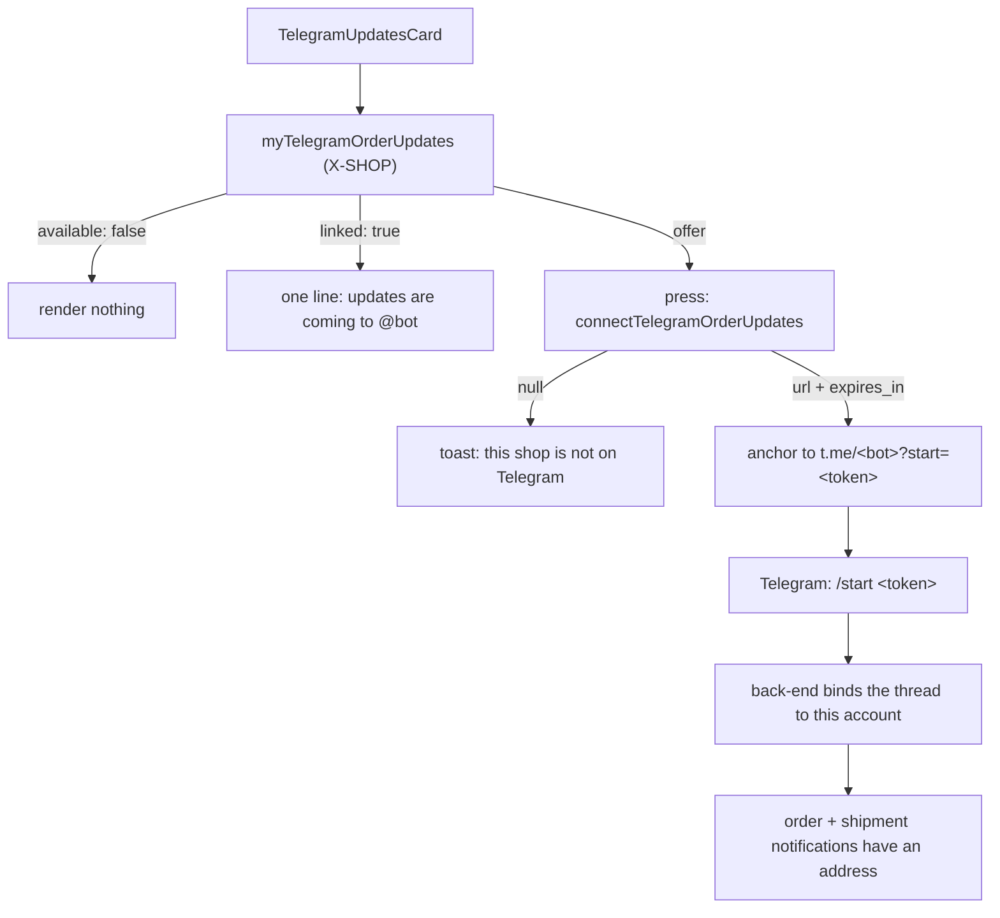

# telegram

**Last updated:** 2026-09-14 - **Feature:** `apps/storefront/src/features/telegram/`

## Overview

Opting a customer in to order updates on the shop's own Telegram bot.

**It exists because the notification was built and had nowhere to go.** A
Telegram bot cannot message anybody who has not pressed Start on it, so the
back-end only has an address when a `DirectConversation` on that shop's bot
carries `claimed_user_id` — and until this landed, the only thing that ever
wrote one was the AI cart-claim flow. A merchant switching Telegram
notifications on was told it worked and delivered to nobody, permanently.

One component, rendered in two places, which **renders nothing far more often
than it renders something**: a shop with no connected bot gets no card at all,
and a customer already bound gets a one-line confirmation instead of the offer
again.

## Screens / routes

| Route | Where the card sits |
|-------|---------------------|
| `/[shopSlug]/account/orders/[id]` | Under `OrderTimeline` — this doubles as the confirmation screen (`?placed=1`), so the offer lands where somebody is already thinking about the order arriving. |
| `/[shopSlug]/account` | Under the three destination links, above Sign out: it is a setting, not a place to go. |

## Diagram

## Components

| Component | Notes |
|-----------|-------|
| `TelegramUpdatesCard` | The whole feature. Three states — absent, offer, confirmed — and two of them render no button. |

## State & forms

No store and no form. The minted link lives in **component state and nowhere
else**: it is a single-use credential that binds a Telegram chat to this
account for fifteen minutes, so it is fetched by the press that will spend it,
shown once, and gone on unmount. The same rule the vendor dashboard's pairing
card follows — a link that can be re-read is a link that can be found in a
screenshot an hour later.

**Two steps rather than one, deliberately.** Navigating to `t.me` inside the
mutation's `onCompleted` is a popup after an await, which browsers block; and on
the confirmation screen it would take the customer off their brand-new order.
So the press mints, and the link that appears is an ordinary anchor the customer
chooses to follow.

The query is `cache-and-network` with `errorPolicy: "all"` — a customer who
opts in on one tab should not be asked again on another, and a failed side query
must not put an error on a screen whose subject is an order.

## GraphQL operations

| Operation | Type | Notes |
|-----------|------|-------|
| `myTelegramOrderUpdates` | Query | `available`, `linked`, `bot_username`. `linked` is the same thread lookup the notification dispatcher resolves, so the card cannot claim a connection no notification would use. |
| `connectTelegramOrderUpdates` | Mutation | Mints `https://t.me/<bot>?start=<token>`. **Nullable** — null is the race where the merchant disconnected the bot between the query and the press. |

Both are `JwtAuthGuard` + `X-SHOP` and nothing else: a customer holds no
permissions, and is buying here rather than running the shop. The language the
bot confirms in rides in the token, taken from `accept-language` — `/start
<token>` is pure ASCII, so the message itself carries no language signal.

## Validation

None. There is no input: the account comes from the session, the shop from the
header, and the token from the server.

## Main files

- `api.ts` — the two operations, and why the link is a mutation rather than a query.
- `components/telegram-updates-card.tsx` — the three states and the two-step press.
- `components/__tests__/telegram-updates-card.render.test.tsx` — pins that two of the three states render nothing, and that nothing is minted before the press.

## Notes

The card is rendered, not routed. There is no `/[shopSlug]/account/telegram`
screen, and adding one would be a page whose entire content is a single button
that most shops cannot show at all.

The back-end half — the token, its own Redis keyspace, the shop check that
stops a link minted on one shop binding a thread on another, and what `/start`
does — is in
[`back-end/docs/features/telegram.md`](../../../../back-end/docs/features/telegram.md).
