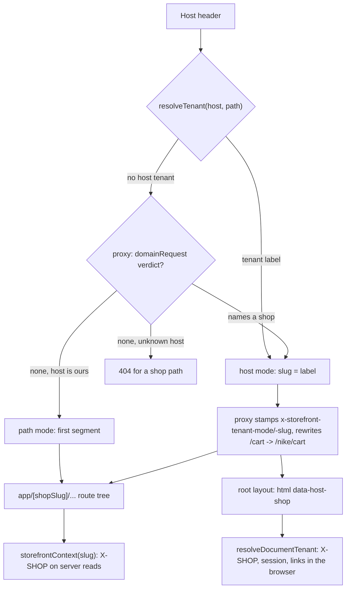

# tenancy

**Last updated:** 2026-09-25 - **Shared infrastructure, not a `src/features/` folder:** `src/shared/lib/hostname.ts`, `tenant.ts`, `tenant-server.ts`, `shop-scope.ts`, `use-shop-slug.ts`, `domain-request.ts`, `reserved-subdomains.ts`, and `src/proxy.ts`.

## Overview

One storefront answers at three kinds of address, all rendering the same route tree:

```
zaydak.com/acme/products/mug     path mode - the apex; the shop is the first path segment
acme.zaydak.com/products/mug     host mode - a platform subdomain; the label is the shop
nikestore.com/products/mug       host mode - a merchant's own domain; nothing in the string names the shop
```

**Reading the first path segment as the shop is wrong on a shop host, and it fails silently in three ways at once.** Parsed path-first, `acme.zaydak.com/checkout` resolves a shop named `checkout`: the Apollo link sends `X-SHOP: checkout`, the route guard looks for a `shop_checkout_access_token` cookie nothing ever wrote, and it un-gates the checkout screen. So the host is resolved first everywhere: `resolveTenant` reads the hostname and falls back to the path only on a host that is demonstrably ours (`hostServesPathTenants`).

**A custom domain is the one address that needs a lookup.** `proxy.ts` asks the back-end (`domainRequest`) for a verdict naming the shop, and whether to serve or 308 to the shop's primary domain. The server tree gets the shop through the internal rewrite, like any host-mode request. **The browser gets it from `<html data-host-shop="nike">`**, which the root layout renders from a header the proxy stamps. Before that attribute existed the verdict stopped at the rewrite: the server-rendered half of a page on a custom domain was correct, and every client query (`cart`, `reviews`, `shopPaymentOptions`, `storefrontRecommendations`, `negotiationAvailable`, the catalogue's next page) went out with no `X-SHOP` and was refused `MISSING_SHOP_HEADER`. The session was also hydrated for no shop, so a signed-in shopper read as a guest.

## The address forms

| Address | `mode` | `base` | How the browser knows the shop |
|---------|--------|--------|--------------------------------|
| `zaydak.com/acme/products/mug` | `path` | `/acme` | the first path segment; no rewrite |
| `acme.zaydak.com/products/mug` | `host` | `""` | the hostname label; the proxy rewrites to `/acme/products/mug` |
| `nikestore.com/products/mug` | `host` | `""` | `<html data-host-shop>`; the proxy rewrites to `/nike/products/mug` from the verdict |
| `zaydak.com/` | `path` | `""` | none: the marketplace directory, `NO_TENANT` |
| `www.zaydak.com/acme/...` | `path` | `/acme` | a reserved label serves as the apex, so the path still names the shop |

## Diagram



## Components

- **`shared/lib/hostname.ts`** — pure and synchronous. `normalizeHostname()` reduces a `Host` header to a comparable hostname or `null`; `resolveHostScope(host, rootDomain)` classifies it as tenant, reserved or apex. **Two root-domain exports:** `ROOT_DOMAIN` is the read path and defaults to `localhost` (so `demo.localhost:3003` works with no env file); `CANONICAL_ROOT_DOMAIN` is the write path and is `null` unless `NEXT_PUBLIC_ROOT_DOMAIN` is set.
- **`shared/lib/tenant.ts`** — `TenantScope = {mode, slug, base}`, `resolveTenant`, `internalPath`, `shopRelativePath`, `hostTenant`, `pathTenant`, `NO_TENANT`. Also `HOST_SHOP_ATTRIBUTE` and **`resolveDocumentTenant(host, path, hostShop)`**, the browser resolver: the host string first, then the document's host shop, then the path — the same precedence the proxy applies to its verdict.
- **`shared/lib/domain-request.ts`** — server-only cache in front of `domainRequest`. `SERVE` verdicts are held 60s per instance, misses 30s, and a `REDIRECT` is never cached (the loop guard).
- **`src/proxy.ts`** — resolves the tenant, asks for the verdict, 308s to a primary domain, 404s a shop path on a host that names no shop, and rewrites host-mode requests. It stamps `x-storefront-pathname` and `x-storefront-tenant-mode` on every request, and `x-storefront-tenant-host` plus **`x-storefront-tenant-slug`** in host mode only. In path mode it deletes inbound copies of those two, so a client cannot hand the server tree a shop.
- **`shared/lib/tenant-server.ts`** — server-only: `serverTenant(shopSlug)` reads the stamped mode, `publicPathname()` the pre-rewrite path, `requestOrigin()` the origin being served, and `serverHostShop()` the host-mode slug for the root layout, the one server component without `params.shopSlug`.
- **`app/layout.tsx`** — renders `data-host-shop` on `<html>` in host mode only. It is in the first bytes of HTML, so it is readable before hydration and before any query.
- **`shared/lib/shop-scope.ts`** and **`use-shop-slug.ts`** — the browser's answer. `documentHostShop()` reads the attribute; `currentTenant()` / `currentShopSlug()` feed the Apollo session link (`X-SHOP` and the bearer token, from one read); `shopPathFor(slug, path)` builds links for non-React callers (the error link, `forceLogout`, the receipt uploader); `useShopTenant()` / `useShopSlug()` serve components, including `SessionSync`, which hydrates the auth store.
- **`shared/auth/route-access.ts`** — `routeDecision` takes `shopSlug` and `base` rather than parsing the path; `isWithinShop(raw, base)` guards redirects.
- **`shared/lib/site-url.ts`** and **`shop-hostname.ts`** — `shopUrlBase(slug)` and `canonicalShopBase(slug)` build absolute URLs, preferring a promoted custom domain; `marketplaceHref(mode)` makes directory links absolute on a shop host.

## State and forms

**No store.** The scope is derived from the address and threaded, not recomputed: `app/[shopSlug]/layout.tsx` calls `serverTenant(shopSlug)` and passes `base` and `mode` to `ShopShell` and `ShopProvider`; screens read them off `useShop()`. Links are written `` `${base}/cart` ``.

The document's host shop is not a store either. It is fixed for the document's lifetime because a host-mode document never changes shop: client-side navigation cannot change the host, and on that host every path is rewritten under the same shop. Leaving the host is a full page load, which renders a new `<html>`. The server-side ban on a module-level "current shop" is untouched: nothing on the server holds it.

No forms live here; domains are managed from the vendor dashboard's `Settings > Domains`.

## GraphQL operations

- `domainRequest(hostname)` — asked by `proxy.ts` (through `domain-request.ts`) for any host that is not the apex, `localhost` or an IP, and by `shop-hostname.ts` to find a shop's primary domain for canonical URLs. Nothing in the browser calls it.

The back-end identifies the shop for every other operation **only** by `X-SHOP`: `storefrontContext(slug)` on the server, `currentShopSlug()` in the browser. A request with no header fails `RequireShopGuard` with `MISSING_SHOP_HEADER`; an unknown slug fails `ShopHeaderGuard` with "Shop not found".

## Validation

- **Hostname normalisation** returns `null` rather than a best guess: lowercased, port stripped, one trailing dot removed, userinfo, paths, whitespace and control characters refused. An unreadable host names no shop.
- **A subdomain label must be shaped like a handle** (`/^[a-z0-9]+(?:-[a-z0-9]+)*$/`, mirroring `UpdateShopInput.slug`), exactly one label deep. Reserved labels resolve as the apex.
- **An unknown host names no shop**, whatever its path says; the proxy 404s a shop-shaped path there and serves only `/`.
- Whether a shop by that name **exists** is decided by `fetchShopShell` in `app/[shopSlug]/layout.tsx`, which renders the closed-storefront screen.

## Main files

- `src/proxy.ts` — verdict, redirect, rewrite, the stamped headers, the route guard.
- `src/shared/lib/tenant.ts` — `TenantScope`, `resolveTenant`, `resolveDocumentTenant`.
- `src/shared/lib/shop-scope.ts` — the browser read, `documentHostShop`, `shopPathFor`.
- `src/shared/lib/tenant-server.ts` — the server reads of the stamped headers.
- `src/app/layout.tsx` — `data-host-shop` on `<html>`.
- `src/shared/lib/domain-request.ts` — the verdict cache.

## Notes

- `NEXT_PUBLIC_ROOT_DOMAIN` (optional) is the apex, inlined into the client bundle. Unset means platform subdomains are not read from the string; the proxy still resolves them from the verdict, and `data-host-shop` carries that to the browser.
- `CORS_ORIGINS` accepts one-label wildcards such as `https://*.zaydak.com`. A custom domain's origin is admitted by the back-end at request time (`ShopDomainsService.isTrustedOrigin`), not by that list.
- **Sessions are per shop and the cookie name carries the scope**, so a custom domain with no resolved shop also had no session: the Apollo link looked for no cookie at all.
- `robots.ts` emits `/checkout`-style patterns on a shop host and wildcard-prefixed `/*/checkout` ones on the apex.
- Covered by `src/shared/lib/__tests__/hostname.test.ts`, `tenant.test.ts`, `tenant-resolution.test.ts`, `proxy.redirect.test.ts`, `shop-scope.custom-domain.test.ts` (jsdom at a custom-domain URL, through the real Apollo link), `src/app/__tests__/layout.render.test.tsx`, and `src/shared/auth/__tests__/route-access.test.ts`.
