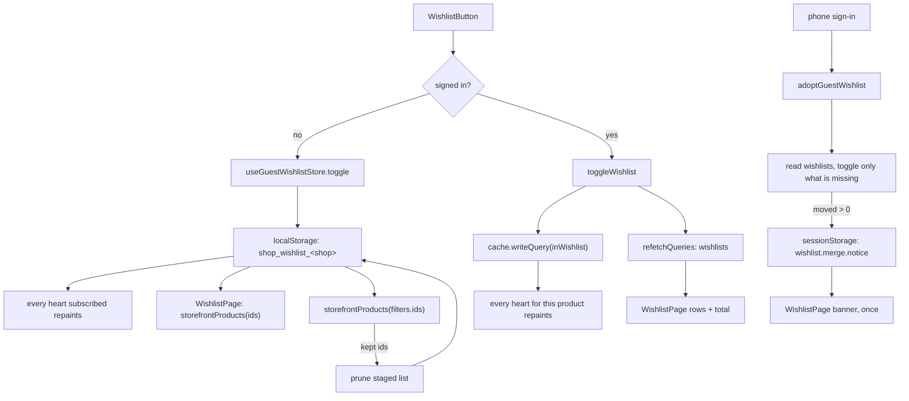

# wishlist

**Last updated:** 2026-09-26 - **Feature:** `apps/storefront/src/features/wishlist/`

## Overview

Saving products for later — the heart on every product tile and on the product
page, plus the saved-items screen.

**It works signed out**, like the cart — but stored differently. The server's
wishlist is keyed on the user row and nothing else (all three operations are
`JwtAuthGuard`), so a signed-out visitor's hearts are staged in `localStorage`
and handed to the account at sign-in by `adoptGuestWishlist`. The heart itself
does not branch: `useWishlistToggle` answers for both.

## Screens / routes

| Route | Screen |
|-------|--------|
| `/[shopSlug]/wishlist` | `WishlistPage` — the saved items, filtered to this shop. **Public**, like `/cart`. |
| every tile and PDP | `WishlistButton` in its `icon` and `labeled` variants. |

## Diagram

## Components

- **`WishlistButton`** — `icon` for the tile overlay (a bare button over the
  card's link, calling `preventDefault`/`stopPropagation` so saving never also
  navigates) and `labeled` for the product page's action row. It no longer
  branches on the session at all.
- **`WishlistPage`** — the saved-items grid. It reads `wishlists` when signed in
  and `storefrontProducts` filtered by the staged ids when not, normalising both
  into one row shape; both queries are declared unconditionally with one always
  `skip`ped, because hooks cannot sit behind a branch. It shows the handover's
  merge notice once per sign-in when one is owed, and prunes the staged list
  against the ids the rehydration returned.

## State & forms

`useWishlistToggle(productId)` wraps `inWishlist` + `toggleWishlist` when there
is a session, and `useGuestWishlistStore` when there is not. Callers see one
`saved`/`toggle` pair either way.

- The query is **skipped** when signed out rather than fired and allowed to
  fail: an unauthenticated call would trip the Apollo error link's auth handling
  and sign the visitor out of a session they never had.
- **`useGuestWishlistStore`** (`shared/stores/`) holds the signed-out list once
  for the app, for the reason `cart-session` is a store: a grid mounts one heart
  per tile. It gives the signed-out path what Apollo's cache gives the signed-in
  one — saving from a tile repaints the heart on the page behind it. Read in an
  effect, never during render, or the server sees an empty list and the client a
  full one.
- The toggle writes the server's answer into `inWishlist` via `cache.writeQuery`
  — one cache entry, so every heart for that product repaints at once — and
  `refetchQueries: [WISHLISTS]`, because the saved-items page's *shape* changes
  on a toggle and hand-patching that drifts a list from its own count.

No forms.

## GraphQL operations

| Operation | Type | Notes |
|-----------|------|-------|
| `inWishlist(product_id)` | Query | `JwtAuthGuard`. Skipped when signed out. |
| `toggleWishlist(input)` | Mutation | Returns `{ in_wishlist }` — the authority. |
| `wishlists(page, limit)` | Query | **Not shop-scoped**; see Notes. Also read by `adoptGuestWishlist` before it writes. |
| `storefrontProducts(filters.ids)` | Query | Signed-out only — rehydrates the staged ids into rows. |

## Validation

None — both writes take ids the UI already holds.

## Main files

- `use-wishlist.ts` — the two backing stores behind one interface.
- `adopt-guest-wishlist.ts` — the handover at sign-in.
- `../../shared/lib/guest-wishlist.ts`, `../../shared/stores/guest-wishlist.ts`
  — the staged list and the store every heart subscribes to.
- `components/wishlist-button.tsx` — both variants.
- `components/wishlist-page.tsx` — the saved-items screen.
- `api.ts` — the three operations.

## Notes

- **Identity (2026-09-14).** The saved-items screen and both heart variants use
  the Day 1 type scale and Teal. A saved heart is `--shop-accent`, not the
  sale token. `toggleWishlist`, the guest store and `adoptGuestWishlist` are
  unchanged.
- **The handover reads before it writes, because `toggleWishlist` is a
  toggle.** Replaying a staged id for a product the account already saved would
  *remove* it — quietly, and noticed much later. So `adoptGuestWishlist` fetches
  `wishlists` first and sends only the difference; if that read fails it sends
  nothing and leaves the list staged for the next attempt. Storage is cleared
  only for what actually landed.
- **The handover announces itself.** `adoptGuestWishlist` arms a
  `wishlist.merge.notice` flag in `sessionStorage` whenever anything moved, and
  `WishlistPage` reads-and-clears it into a dismissible banner (same
  restore-after-hydration effect the cart's merge notice uses). The storage
  itself is the retry — what did not land stays staged — so there is no retry
  flag, only the notice.
- **The list prunes itself.** The rehydration is asked for the staged ids
  verbatim, so an id the server does not return is a product that stopped
  existing on the storefront (deleted, unpublished, or the shop is off).
  `WishlistPage` mirrors that result into a `prune` — only after `data`
  actually resolved, so a loading query or a network error can never look like
  proof that everything saved is gone. That was not always possible: the
  `storefrontProducts` `ids` filter shipped ignored by the back-end, the saved
  page answered with the shop's newest page, and the "list only grows" symptom
  was really "the list never even renders". Since 2026-09-09 the back-end
  delegates an `ids` query to `findManyStorefrontByIds` (given order, no
  paging), which is what makes both the rehydration and the prune sound.
- **The route had to open with the feature.** `wishlist` was in
  `PRIVATE_SEGMENTS`; leaving it there would have let somebody save items and
  then refused to show them. It moved out, and into `robots.ts`'s own disallow
  list — public but per-visitor, exactly like `/cart`.
- **The guest list is per shop; the account's is not.** Nothing partitions
  `localStorage`, so the key carries the shop (`shopCookieKey`) and signing in at
  `/acme` pushes only Acme's hearts. The pre-write read is deliberately *not*
  shop-filtered — a product saved at another storefront is still saved, and
  toggling it would unsave it.
- **The guest list holds product ids only.** A saved variation is a refinement
  that arrives with an account; ids are all either side needs.
- `wishlists` spans **every shop** the customer has used, and the API has no
  filter for one, so the page narrows to this shop's `product.shop_id` in the
  client. Rows the filter drops are still saved and still visible from that
  shop's own page.
- A saved `VARIABLE` product carries no variation unless it was saved from the
  product page, so its add-to-cart is rejected server-side. The back-end's
  message names the missing option and is surfaced as the toast description.
