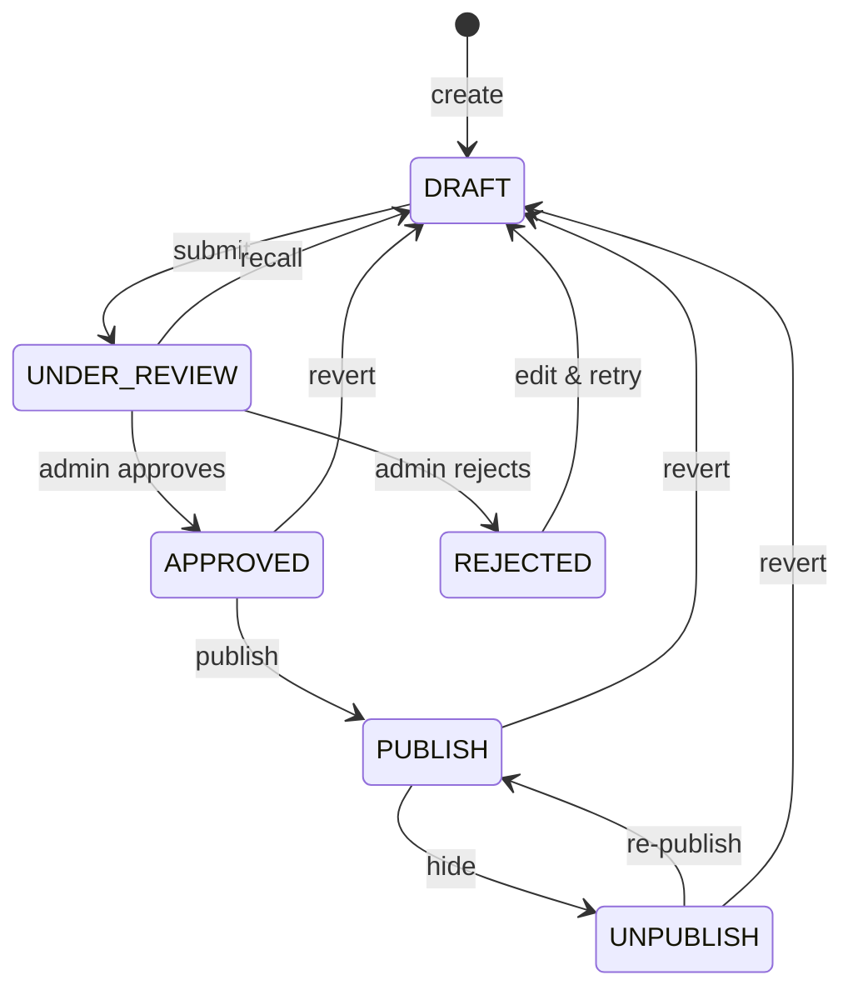
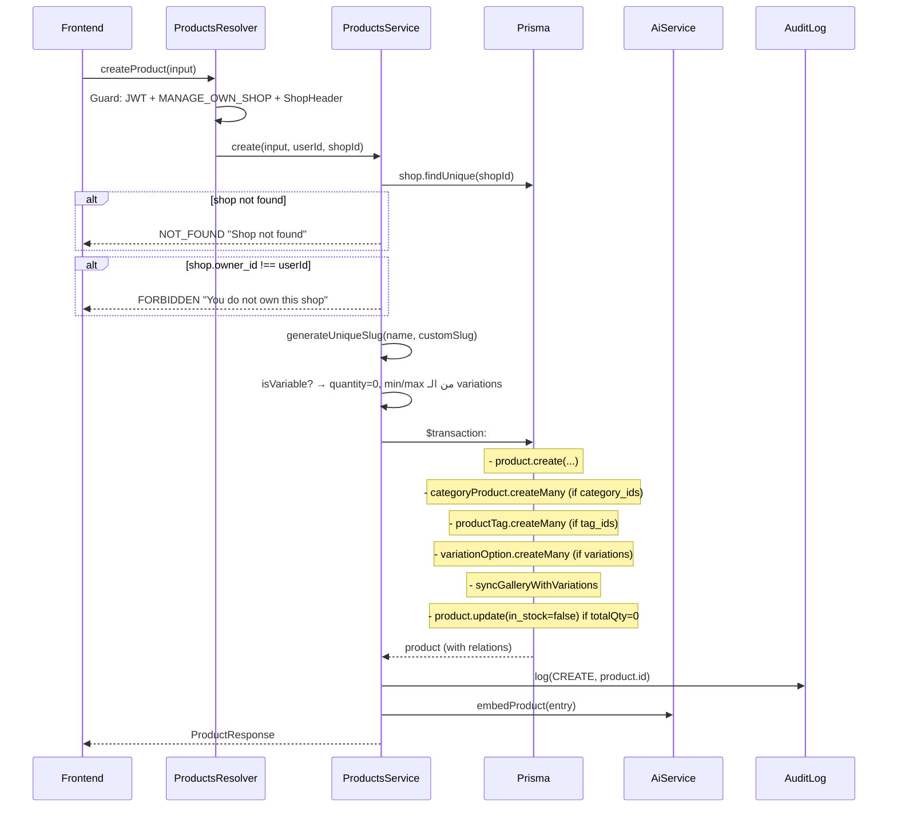
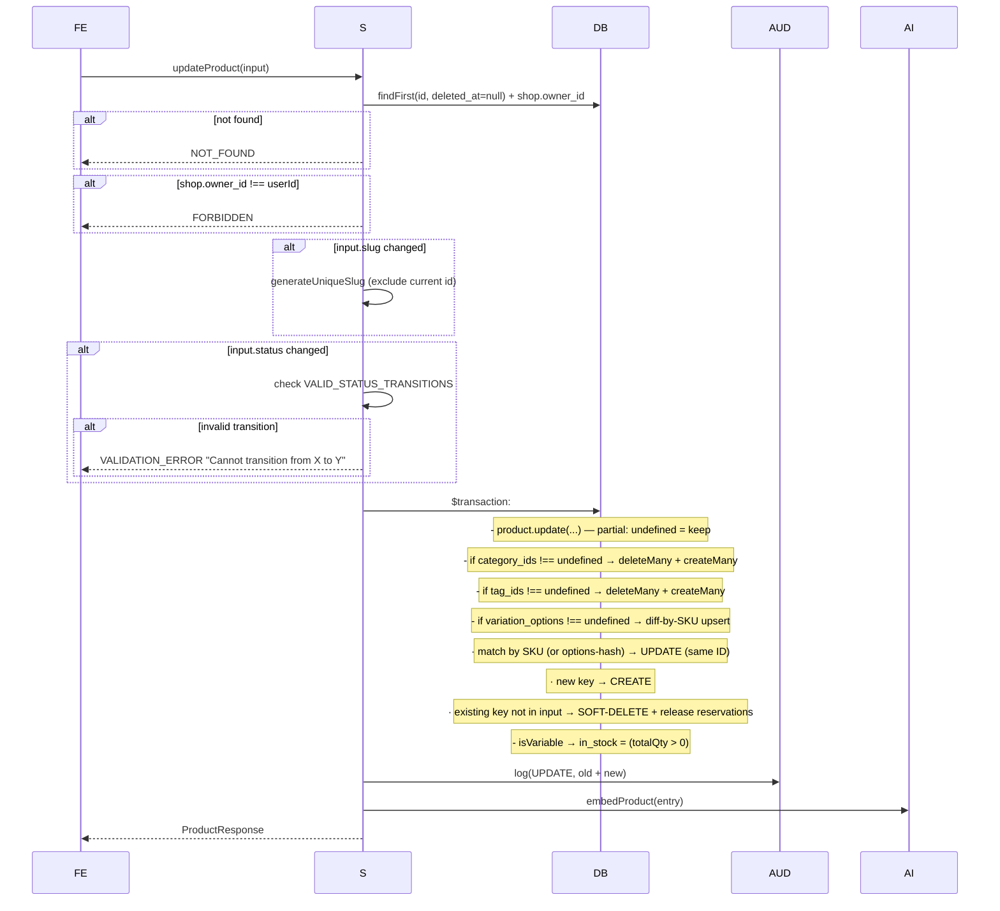

# Products Module — دليل شامل للـ Backend + Frontend

> **المصدر:** [src/products/](../src/products/) في مشروع NestJS
> **آخر تحديث:** 2026-04-21
> **الهدف:** مرجع كامل لأي مطوّر (backend أو frontend) عم يشتغل على المنتجات — من الـ data model للـ status transitions للـ variable products للـ gallery/variation sync للـ frontend integration.
>
> **تغييرات 2026-04-21:**
>
> - Auction pricing migrated to integer cents/basis points (لا Float بعد الآن)
> - Filter API غيّر لـ arrays (`statuses`, `product_types`, `stock_statuses`, ...)
> - Variations update strategy: **upsert-by-SKU/options** بدل wipe+recreate
> - `OrderProduct.variation_snapshot` — نسخة مجمّدة من الـ variation وقت الشراء
> - **`CartItem.status`** جديد (`AVAILABLE` / `OUT_OF_STOCK` / `UNAVAILABLE`) + `suggested_replacement_variation_id` للـ auto-recovery
> - Visibility: customers/guests محصورين بـ `status = PUBLISH`
> - Stock reservation hooks عند حذف variation — ولا reservation orphan
> - **Optimistic locking** على `Product` (حقل `version`) — يرفض lost-update
> - **DB partial unique** على `(product_id, sku)` للـ live variations
> - **Slug retry loop** — يحلّ race بين preflight check والـ INSERT
> - **Idempotency keys** — `Idempotency-Key` header على `createProduct` و `createOrder` — يمنع double-charge / duplicate products
> - **`SaleType` enum جديد** (سعر ثابت / تفاوض / مزايدة) — مفصول عن `ProductType`. الأخيرة اتقلصت لـ `SIMPLE | VARIABLE | DIGITAL | SERVICE` فقط
> - أخطاء validation جديدة: `STALE_VARIATION`, `SLUG_ALREADY_EXISTS`, `VARIABLE_REQUIRES_VARIATIONS`, `SALE_PRICE_NOT_LESS_THAN_PRICE`, `STALE_OBJECT`, `DUPLICATE_SKU`

---

## 📑 جدول المحتويات

1. [نظرة عامة](#1-نظرة-عامة)
2. [بنية الملفات](#2-بنية-الملفات)
3. [Data Model](#3-data-model)
4. [Enums (Status, Type, Target Audience)](#4-enums)
5. [Simple vs Variable Products](#5-simple-vs-variable-products)
6. [Status Transitions (State Machine)](#6-status-transitions-state-machine)
7. [Viewer Scoping (من يشوف شو)](#7-viewer-scoping)
8. [Gallery ↔ Variations Sync](#8-gallery--variations-sync)
9. [Stock Reservation (ملاحظة)](#9-stock-reservation-ملاحظة)
10. [CRUD Flows](#10-crud-flows)
11. [Filters & Sorting](#11-filters--sorting)
12. [GraphQL API Reference](#12-graphql-api-reference)
13. [AI Integration](#13-ai-integration)
14. [Error Codes](#14-error-codes)
    14.4. [Cart Availability — `status` + auto-recovery](#144-cart-availability--status--auto-recovery)
    14.5. [Order Snapshot — `variation_snapshot`](#145-order-snapshot--variation_snapshot)
    14.6. [Data Integrity & Concurrency — constraints / versioning / retry](#146-data-integrity--concurrency)
    14.7. [Idempotency — implemented](#147-idempotency--implemented-2026-04-21)
15. [دليل الـ Frontend](#15-دليل-الـ-frontend)

---

## 1. نظرة عامة

### الفلسفة

المنتجات في هاد النظام:

- **Integer cents** لكل الأسعار — ولا رقم عشري واحد (Phase 2 money migration 2026-04-18).
- **Shop-scoped** دائماً (ما في منتج بدون `shop_id` ماعدا منتجات platform-level).
- **Translatable fields** — `name` و `description` و `title` في variations كلها JSON بالشكل `{ en: "...", ar: "..." }`.
- **Two product shapes:** SIMPLE (سعر + كمية واحدة) أو VARIABLE (كل variation عندها سعر/كمية/sku خاص).
- **Soft delete** — `deleted_at` (ما بنشيل أي منتج فعلياً لأنو مربوط بـ orders).
- **State machine** للـ status — مش أي transition مسموح (مثلاً ما بتقدر تقفز من DRAFT لـ PUBLISH مباشرة).
- **Viewer-aware scoping** — admin يشوف كل شي، vendor يشوف شوبه، الباقي يشوف public فقط.
- **AI enrichment** — عند كل create/update بنبعث الـ product للـ embedding + tracking للـ views.

### Relations

```
Shop (1) ──< Product >── (1) Type
                │
                ├──── CategoryProduct >── Category (many-to-many)
                │
                ├──── ProductTag >── Tag (many-to-many)
                │
                └──── VariationOption (one-to-many)

Product ── Wishlist, CartItem, OrderProduct, Review, Question, CouponProduct, ...
```

---

## 2. بنية الملفات

```
src/products/
├── products.module.ts        # DI wiring (imports AuthModule + AiModule)
├── products.resolver.ts      # GraphQL mutations/queries
├── products.service.ts       # كل الـ business logic (783 سطر)
├── products.resolver.spec.ts
├── products.service.spec.ts
│
├── dto/
│   ├── create-product.input.ts     # CreateProductInput
│   ├── update-product.input.ts     # UpdateProductInput
│   ├── create-variation.input.ts   # CreateVariationInput (embedded)
│   └── product-filter.input.ts     # ProductFilterInput + ProductSortBy
│
└── types/
    └── product.types.ts            # ProductEntry, VariationOptionEntry, Responses
```

ملاحظة: الـ products module **ما فيه engines** مثل coupons لأن الـ logic أبسط (CRUD + validation). بس فيه helpers مشتركة يستخدمها:

- `slugify` + `generateUniqueSlug` → توليد slug فريد من اسم المنتج
- `paginationMeta` + `clampLimit` → pagination standard
- `PUBLIC_SHOP_WHERE` → تعريف الـ shop visibility للزوّار
- `AuditLogService` → logging لكل create/update/delete
- `AiService.embedProduct / trackBehavior` → AI embedding + behavior tracking
- `StockReservationService` (في `cart/services/`) → بتمتلك `reserved_quantity` — المنتج نفسو ما بيعدّله

---

## 3. Data Model

### `Product`

```prisma
model Product {
  id          String  @id @default(cuid())
  name        Json                              // { en: "...", ar: "..." }
  slug        String  @unique
  description Json?

  type    Type   @relation(fields: [type_id], references: [id])
  type_id String

  shop    Shop?   @relation(fields: [shop_id], references: [id], onDelete: Restrict)
  shop_id String?

  // Pricing (integer cents — Phase 2 money migration)
  price_cents      Int?
  sale_price_cents Int?
  min_price_cents  Int?                         // لـ VARIABLE = أرخص variation
  max_price_cents  Int?                         // لـ VARIABLE = أغلى variation

  // Inventory
  sku           String?
  quantity      Int     @default(0)             // لـ SIMPLE فقط (VARIABLE = 0)
  reserved_quantity Int @default(0)             // owned by StockReservationService
  sold_quantity Int?
  in_stock      Boolean @default(true)          // auto-synced من الـ variations total
  is_taxable    Boolean @default(false)

  // State
  status       ProductStatus @default(DRAFT)    // state machine
  product_type ProductType   @default(SIMPLE)   // SIMPLE | VARIABLE | DIGITAL | SERVICE (structure)
  sale_type    SaleType      @default(FIXED_PRICE) // FIXED_PRICE | NEGOTIABLE | AUCTION (pricing mechanism)

  // AI enrichment
  target_audience TargetAudience?               // MEN, WOMEN, KIDS, UNISEX
  brand           String?
  ai_keywords     Json?                         // { en: "...", ar: "..." }
  ai_summary      Json?
  ai_tags         String[] @default([])
  search_vector   Unsupported("tsvector")?      // Postgres FTS

  // Flags — Shopify-aligned (`is_digital` equivalent to `requires_shipping = false`).
  // Legacy `is_external` / `is_rental` / `external_product_*` removed 2026-04-24;
  // Shopify handles those via dedicated app surfaces, not product booleans.
  is_digital Boolean @default(false)

  // Physical attributes
  unit   String?                                // "kg", "piece", "box", ...
  height String?
  width  String?
  length String?

  // Media
  image   Json?                                 // { id, original, thumbnail }
  gallery Json?                                 // [{ id, original, thumbnail, color? }]
  video   Json?                                 // [{ url }]

  // Auction / bidding — integer cents + basis points (Phase 3 money 2026-04-21)
  min_bid_price_cents  Int?
  max_bid_price_cents  Int?
  max_percentage_bps   Int?    // 1bp = 0.01%, 10000 = 100%
  max_allowed_chat     Int?

  language String?
  views    Int     @default(0)

  categories        CategoryProduct[]
  tags              ProductTag[]
  variation_options VariationOption[]
  // ... + wishlists, cart_items, order_products, reviews, etc.

  created_at DateTime  @default(now())
  updated_at DateTime  @updatedAt
  deleted_at DateTime?
}
```

### `VariationOption`

```prisma
model VariationOption {
  id String @id @default(cuid())

  product    Product @relation(fields: [product_id], references: [id], onDelete: Cascade)
  product_id String

  title            Json                         // { en: "Red - Size M", ar: "..." }
  price_cents      Int
  sale_price_cents Int?
  sku              String?
  quantity         Int     @default(0)
  reserved_quantity Int    @default(0)          // parallel to Product — owned by stock-reservation
  sold_quantity    Int?
  is_disable       Boolean @default(false)
  options          Json                         // { color: "red", size: "M" }
  image            Json?                        // inherited من gallery لو ما في explicit
  deleted_at       DateTime?
}
```

### Pivot tables

```prisma
model CategoryProduct {
  category_id String
  product_id  String
  @@id([category_id, product_id])
}

model ProductTag {
  tag_id     String
  product_id String
  @@id([tag_id, product_id])
}
```

---

## 4. Enums

### `ProductStatus`

| Value          | المعنى                                      |
| -------------- | ------------------------------------------- |
| `DRAFT`        | البائع عم يبني المنتج، مش ظاهر لأحد         |
| `UNDER_REVIEW` | البائع بعت للـ admin review                 |
| `APPROVED`     | الـ admin وافق، بس لسا مش published         |
| `REJECTED`     | الـ admin رفض (مع ملاحظات في الـ audit log) |
| `PUBLISH`      | منشور — الزبون يشوفه ويشتريه                |
| `UNPUBLISH`    | كان منشور وتم سحبه (بدون حذف)               |

### `ProductType` — **بنية** المنتج (مش آلية البيع)

| Value      | الوصف                       | يستخدم           |
| ---------- | --------------------------- | ---------------- |
| `SIMPLE`   | منتج عادي بسعر وكمية واحدة  | أغلب المنتجات    |
| `VARIABLE` | فيه variations (color/size) | ملابس، أحذية     |
| `DIGITAL`  | منتج رقمي (file download)   | ebooks, software |
| `SERVICE`  | خدمة (مش سلعة)              | صيانة، تصميم     |

> ⚠️ **Migration 2026-04-21:** القيم القديمة `NEGOTIABLE` / `AUCTION` / `FIXED_PRICE` **انسحبت** من `ProductType` وانتقلت للـ enum الجديد `SaleType` — لأنها كانت تخلط بين *بنية* المنتج (structure) و *آلية البيع* (pricing mechanism). الصفوف القديمة تمّت إعادة تصنيفها تلقائياً لـ `product_type = SIMPLE` مع الـ `sale_type` المناسب.

### `SaleType` — **آلية البيع** (orthogonal عن `ProductType`)

| Value         | الوصف    | Backend behavior                                                     |
| ------------- | -------- | -------------------------------------------------------------------- |
| `FIXED_PRICE` | سعر ثابت | الـ default — buy-it-now عبر cart/checkout                           |
| `NEGOTIABLE`  | تفاوض    | السعر بينتهي عبر chat بين البائع والزبون قبل الـ order               |
| `AUCTION`     | مزايده   | يستعمل `min_bid_price_cents` / `max_bid_price_cents` / التوقيت       |

**Orthogonality — كل combo مسموح:**

```
SIMPLE   × FIXED_PRICE   → T-shirt عادية بسعر
SIMPLE   × AUCTION       → ساعة نادرة مزاد
VARIABLE × FIXED_PRICE   → أحذية بأحجام وألوان بسعر لكل variation
VARIABLE × NEGOTIABLE    → أثاث بمقاسات متعددة والسعر بيتّفق بالشات
DIGITAL  × FIXED_PRICE   → PDF للبيع
SERVICE  × NEGOTIABLE    → تصميم لوجو — بيتفقو على السعر
```

**Defaults:** لو الـ FE ما بعث `sale_type` → الـ backend بيخلّيه `FIXED_PRICE`.

### `TargetAudience`

```ts
enum TargetAudience {
  MEN,
  WOMEN,
  KIDS,
  UNISEX,
}
```

يستعمل كـ AI enrichment — بيحسّن relevance في الـ search والـ recommendations.

### `ProductSortBy` (للـ frontend فقط — مش في الـ DB)

```ts
enum ProductSortBy {
  NEWEST, // created_at desc (الافتراضي)
  OLDEST, // created_at asc
  PRICE_LOW, // min_price_cents asc
  PRICE_HIGH, // max_price_cents desc
  MOST_VIEWED, // views desc
}
```

### `StockStatus` (للـ filter فقط — محسوب، مش في الـ DB)

```ts
enum StockStatus {
  IN_STOCK, // in_stock=true AND (VARIABLE OR quantity > LOW_STOCK_THRESHOLD)
  LOW_STOCK, // in_stock=true AND !VARIABLE AND 0 < quantity ≤ LOW_STOCK_THRESHOLD
  OUT_OF_STOCK, // in_stock=false
}
```

`LOW_STOCK_THRESHOLD = 10` (من [tool-defaults.ts](../src/chat/tools/tool-defaults.ts)).

> ⚠️ LOW_STOCK ما بيشمل VARIABLE products — لأن `quantity` على مستوى المنتج = 0 للـ VARIABLE، والـ aggregate stock موّزع على الـ variations. هاد الـ limitation مقصود حالياً (لتجنب denormalization على مستوى المنتج).

---

## 5. Simple vs Variable Products

هاد أهم فرق في الـ module. الـ frontend لازم يفهمه منيح.

### SIMPLE

```
Product:
  price_cents = 10000          (100 SAR)
  sale_price_cents = 8000      (80 SAR — optional)
  quantity = 50
  in_stock = true
  min_price_cents = 10000      (= price_cents)
  max_price_cents = 10000      (= price_cents)

variation_options: []  ← فاضية
```

### VARIABLE

```
Product:
  price_cents = null           ← ما بنستخدمه
  sale_price_cents = null
  quantity = 0                 ← الـ service بيجبرها = 0
  in_stock = auto              ← (sum of variation quantities > 0)
  min_price_cents = 7500       ← أرخص variation
  max_price_cents = 15000      ← أغلى variation

variation_options: [
  { title: { en: "Red-S" }, options: { color: "red", size: "S" },
    price_cents: 7500, quantity: 10, sku: "RED-S-001", image: {...} },
  { title: { en: "Red-M" }, options: { color: "red", size: "M" },
    price_cents: 10000, quantity: 5 },
  { title: { en: "Blue-L" }, options: { color: "blue", size: "L" },
    price_cents: 15000, quantity: 0, is_disable: true },
]
```

### القواعد (enforced في الـ service)

```ts
const isVariable = productType === ProductType.VARIABLE;

if (isVariable && variation_options.length) {
  quantity = 0; // ما في price/qty على مستوى المنتج
  min_price_cents = Math.min(...variations.map((v) => v.price_cents));
  max_price_cents = Math.max(...variations.map((v) => v.price_cents));
  in_stock = sum(variations.quantity) > 0; // auto-sync
}
```

---

## 6. Status Transitions (State Machine)

```ts
VALID_STATUS_TRANSITIONS = {
  DRAFT         → [UNDER_REVIEW]
  UNDER_REVIEW  → [APPROVED, REJECTED, DRAFT]
  APPROVED      → [PUBLISH, DRAFT]
  PUBLISH       → [UNPUBLISH, DRAFT]
  UNPUBLISH     → [PUBLISH, DRAFT]
  REJECTED      → [DRAFT]
}
```

### Visualization



أي transition مش في الجدول → `AppException.validation({ code: 'INVALID_STATUS_TRANSITION' })`.

**مثال:** `DRAFT → PUBLISH` مباشرة → **مرفوض** (لازم تمر بـ UNDER_REVIEW → APPROVED → PUBLISH).

---

## 7. Viewer Scoping

فكرة مهمّة: نفس الـ `products` query بيرجع **نتائج مختلفة** حسب الـ viewer. السلوك معرّف في `applyVisibilityScope` ([products.service.ts:255-284](../src/products/products.service.ts#L255-L284)):

| Viewer                  | Shops visible                                         | Statuses visible                               |
| ----------------------- | ----------------------------------------------------- | ---------------------------------------------- |
| `super_admin` / `admin` | كل الـ shops بما فيها deleted/suspended               | كل الـ statuses                                |
| `vendor`                | شوبه (أي status) ∪ public shops الباقية               | شوبه: أي status. باقي الـ shops: `PUBLISH` فقط |
| `customer` / guest      | `PUBLIC_SHOP_WHERE` (approved + active + not deleted) | `PUBLISH` فقط — hard enforced                  |

**مفتاح أمان جديد:** للـ customer/guest، الـ status مثبّت على `PUBLISH` في الكود مش بس filter اختياري. يعني حتى لو الزبون بعث `statuses: [DRAFT]` في الـ filter، بيتجاهل — ما ممكن يشوف drafts.

### كيف الـ vendor OR بيشتغل (تقنياً)

```ts
where.AND = [
  {
    OR: [
      { shop: PUBLIC_SHOP_WHERE, status: 'PUBLISH' }, // public shops: PUBLISH only
      { shop: { owner_id: viewer.id } }, // own shops: any status
    ],
  },
];
```

فلو الـ vendor عمل `statuses: [DRAFT]`:

- `status IN [DRAFT] AND ((public AND PUBLISH) OR (my shops))` = **drafts من شوبه فقط** ✓

### ليش هاد مهم؟

- **Public storefront:** الزبون ما بده يشوف shops محذوفة أو suspended ولا products في DRAFT/REJECTED (حتى لو عرف الـ slug).
- **Vendor UI:** البائع بده يشوف شوبه حتى لو suspended — عشان يعدّل ويطلب الـ unblock.
- **Admin dashboard:** الـ admin بده يشوف كل شي بما فيه الـ drafts والـ suspended shops.

### الـ `PUBLIC_SHOP_WHERE` constant

معرّف في [src/common/constants/shop-visibility.ts](../src/common/constants/shop-visibility.ts) — `{ deleted_at: null, is_active: true, status: 'APPROVED' }` (أو شبيه — شوف الملف للـ exact shape).

---

## 8. Gallery ↔ Variations Sync

عند الـ create/update، الـ service بيعمل auto-sync بين الـ `gallery` والـ `variation_options` حسب اللون:

```ts
function syncGalleryWithVariations(gallery, variations) {
  // اجمع أول صورة لكل color من الـ gallery
  galleryByColor = new Map();
  for (img of gallery) {
    if (img.color && !galleryByColor.has(img.color)) {
      galleryByColor.set(img.color, img);
    }
  }

  // لكل variation فيها color ومافي explicit image → خذ الصورة من الـ gallery
  return variations.map((v) => {
    if (v.image) return v; // فيه explicit image → ما نتدخّل
    const color = v.options.color;
    if (color && galleryByColor.has(color)) {
      return { ...v, image: galleryByColor.get(color) };
    }
    return v;
  });
}
```

### مثال عملي

```js
// Input
gallery: [
  { id: 'img1', original: '...', color: 'red' },
  { id: 'img2', original: '...', color: 'blue' },
  { id: 'img3', original: '...' }                            // بدون color
]

variations: [
  { options: { color: 'red', size: 'M' }, /* no image */ },
  { options: { color: 'blue', size: 'L' }, image: {...} },   // explicit — محفوظ
  { options: { color: 'green', size: 'S' } }                  // ما في gallery image → بدون image
]

// Output
variations: [
  { options: { color: 'red', size: 'M' }, image: { id: 'img1', ... } },  // ← synced
  { options: { color: 'blue', size: 'L' }, image: { /* explicit */ } },  // ← unchanged
  { options: { color: 'green', size: 'S' } }                              // ← still no image
]
```

هاد بيوفر على الـ frontend شغل واجد — الصور بتنحدد تلقائياً. بالمقابل، لو بدك تعمل override، حط `image` صراحة في الـ variation.

---

## 9. Stock Reservation (ملاحظة)

الـ products service **ما بيلمس** `reserved_quantity` ولا `quantity` decrements. هاد الـ logic موجود في:

[src/cart/services/stock-reservation.service.ts](../src/cart/services/stock-reservation.service.ts)

```
Invariants:
  - Available stock = quantity - reserved_quantity
  - كل increment/decrement على reserved_quantity بيصير عبر conditional UPDATE — ما نقدر نعمل oversell
  - Reservations TTL = 30 دقيقة (ENABLE_STOCK_RESERVATION=true + STOCK_RESERVATION_TTL_MINUTES)
  - عند checkout: reservation بتنقلب لـ sold_quantity + quantity decrement
  - عند cart abandon: reservation بتنتهي تلقائياً وبترجّع
```

### Race-safety — Atomic conditional UPDATE (2026-04-21)

الـ `reserve` بيستخدم **single raw UPDATE** بـ conditional WHERE بيفحص المتاح الحقيقي داخل نفس الـ statement — مش two-step (check-then-act) اللي كان فيه TOCTOU:

```sql
UPDATE "variation_options"
SET "reserved_quantity" = "reserved_quantity" + $qty
WHERE "id" = $id
  AND "quantity" - "reserved_quantity" >= $qty    -- ← الفحص الحقيقي
  AND "deleted_at" IS NULL                         -- ← ما نحجز على dead variation
```

**Guarantees:**

1. **No oversell** — PG بياخد row-level lock للـ UPDATE، اتنين concurrent reserves على آخر وحدة بيتسلسلو، واحد بس بينجح.
2. **No double-fail** — الـ two-step approach القديم كان ممكن يخلي الاتنين يفشلو (both see invariant violated، both rollback). الـ atomic approach — واحد يمرّ، التاني يفشل نظيف.
3. **Orphan protection** — `deleted_at IS NULL` في الـ WHERE — لو الـ vendor حذف الـ variation بنفس اللحظة، الـ reserve بيفشل بدل ما يخلّف hold على variation ميتة.

**Invariant:** `reserved_quantity ≤ quantity` — محفوظ atomically بغض النظر عن الـ concurrency.

كود الـ implementation: [stock-reservation.service.ts:reserveInternal](../src/cart/services/stock-reservation.service.ts).

### Layered defence — كامل الـ checkout flow

```
┌───────────────┐    ┌──────────────────┐    ┌──────────────────┐    ┌──────────────┐
│  Add to cart  │ →  │  Cart load       │ →  │  Checkout click  │ →  │ Order create │
│               │    │                  │    │                  │    │              │
│  reserve()    │    │  compute status  │    │  SERIALIZABLE tx │    │  decrement   │
│  atomic SQL   │    │  per line        │    │  + physical      │    │  quantity    │
│               │    │                  │    │  stock check     │    │  + releaseAll│
└───────────────┘    └──────────────────┘    └──────────────────┘    └──────────────┘
   No oversell         UX signal                Correctness             Consume holds
   (row lock)          (status enum)            (PG retry on 40001)
```

- **Add to cart** — `reserve()` atomic SQL بيضمن إنّو ما ممكن نحجز أكتر من المتاح.
- **Cart load** — `status` حقل محسوب بيخلّي الـ FE يعرض الحالة بدل ما يفاجئ الزبون على الـ checkout ([§14.4](#144-cart-availability--status--auto-recovery)).
- **Checkout click** — الـ order creation بـ [withSerializableRetry](../src/orders/orders.service.ts) — لو اتنين متقاطعين، PG بيرمي 40001 والـ retry بيقرأ الـ state الجديد ويعيد الفحص. لا oversell هون كمان.
- **Order create** — physical decrement على `quantity` + release holds. Idempotent لأن كل order بياخد SERIALIZABLE lock.

### Known edge cases + how they're handled

| Race                                                   | متى بتصير                          | الحماية                                                                                         |
| ------------------------------------------------------ | ---------------------------------- | ----------------------------------------------------------------------------------------------- |
| اتنين بيحجزو آخر وحدة                                  | نادراً                             | Atomic UPDATE (السابق): واحد بيمرّ                                                              |
| Reservation TTL expired قبل checkout                   | لو الزبون قعد 30+ دقيقة            | Reaper بيحرّر الـ hold. لو stock لسّا متاح، checkout بيمرّ؛ لو لأ، OUT_OF_STOCK واضح            |
| Vendor حذف variation مع cart active                    | البائع سبق الزبون                  | Vendor update ← releaseForVariations فوراً (نفس الـ tx). Checkout ← STALE_VARIATION clean error |
| اتنين بيعملو checkout على نفس الوحدة                   | orders.service                     | SERIALIZABLE retry. واحد بيمرّ، التاني بيفشل 40001 → يعيد → OUT_OF_STOCK                        |
| Cart page stale (الـ user عند الـ cart بس البائع عدّل) | دقائق بين الـ page load والـ click | `status` على الـ cart line بيكون `UNAVAILABLE` — الـ FE بيعطّل الـ checkout button              |

### Hook: Variation soft-delete → reservations release فوري

لمّا الـ vendor يشيل variation بالـ update (upsert بيلاقي إنها مش في الـ input)، الـ product service بينادي `stockReservation.releaseForVariations([...ids], tx)` داخل نفس الـ transaction. بيعمل:

- Find كل الـ live reservations على هالـ variations
- Decrement `reserved_quantity` على الـ variation (حتى لو لسّا ما انسوفت-ديليت بالكامل — الـ counter لازم يضل truthful)
- Mark الـ reservation `released_at = now()`

**النتيجة:** ما في reservation orphan عالقة على variation ميتة. الـ TTL 30 دقيقة ما عاد هو الـ fallback الوحيد.

الـ `Product.quantity` اللي بيرجعه الـ products query **هو إجمالي الـ stock**، مش المتاح. للمعلومة المتاحة الحقيقية استخدم `quantity - reserved_quantity`.

---

## 10. CRUD Flows

### 10.1 Create Product



### 10.2 Update Product



**Merge semantics:** `undefined` = "خلّي الحقل كما هو"، القيمة (حتى `null`) = "عدّل".

### Variation upsert strategy (diff-by-SKU)

أي update للـ `variation_options` **بيعمل diff** — مش wipe:

```ts
function variationIdentityKey(v: { sku?; options }): string {
  if (v.sku) return `sku:${v.sku}`; // الأولوية للـ SKU الصريح
  const sorted = Object.keys(v.options)
    .sort()
    .map((k) => `${k}=${v.options[k]}`)
    .join('|');
  return `opts:${sorted}`; // fallback للـ options hash
}
```

**السلوك:**

| Case                            | النتيجة                                                                                    |
| ------------------------------- | ------------------------------------------------------------------------------------------ |
| Incoming key يطابق existing     | **UPDATE** — الـ `id` بيضل نفسه، السعر/العنوان/الكمية بتتعدّل                              |
| Incoming key جديد               | **CREATE** — variation جديدة بـ `id` جديد                                                  |
| Existing key مش في الـ incoming | **SOFT-DELETE** — `deleted_at = now()`، و `releaseForVariations` بيطلق أي reservation live |

**ليش هاد مهم:**

- `OrderProduct.variation_option_id` / `CartItem.variation_option_id` / `StockReservation.variation_option_id` **تظل valid** بعد الـ update، ما بتصير orphan.
- السعر بيتغيّر على نفس الـ row → تاريخ الطلبات بيشوف الـ `variation_snapshot` (راجع [قسم 15.14](#1514-order-snapshot-variation_snapshot)).
- لو البائع غيّر SKU لـ variation موجودة → هاد بيُعتبر identity جديدة (الـ key تغيّر) → الـ القديمة تنسوفت-ديليت والجديدة تنخلق. هاد مقصود.

### 10.3 Delete (soft)

```ts
product.update({ deleted_at: new Date() });
auditLog.log(DELETE, { old: { name, slug } });
```

الـ `Product.deleted_at IS NOT NULL` → بيختفي من كل queries. بس ما بنحذف variations/relations لأن الـ orders بدها تبقى valid.

### 10.4 View (increment counter)

```ts
@Mutation viewProduct(slug)   // throttled 10/min
  → product.update({ views: { increment: 1 } })
  → if userId: aiService.trackBehavior(userId, product.id, 'view')
```

**ليه Mutation مش Query؟** لأنو بيعدّل state (`views++`). الـ frontend بيستدعيها بعد ما الزبون يفتح صفحة المنتج.

### 10.5 Find / List

راجع [Filters & Sorting](#11-filters--sorting).

---

## 11. Filters & Sorting

### الـ `ProductFilterInput` (multi-select arrays)

```graphql
input ProductFilterInput {
  shop_ids: [String!] # X-SHOP header بيغلبهم لو موجود
  type_ids: [String!]
  statuses: [ProductStatus!] # وجوده يتجاهل للـ customer/guest (pinned to PUBLISH)
  product_types: [ProductType!]
  sale_types: [SaleType!] # FIXED_PRICE | NEGOTIABLE | AUCTION (OR-composed)
  category_ids: [String!]
  tag_ids: [String!]
  stock_statuses: [StockStatus!] # IN_STOCK | LOW_STOCK | OUT_OF_STOCK (OR-composed)
  search: String # match على الـ slug (بعد slugify)
  min_price_cents: Int # overlap range (راجع أسفل)
  max_price_cents: Int
  sort_by: ProductSortBy = NEWEST
  page: Int = 1
  limit: Int = 15 # max = 100 (clampLimit)
}
```

### Multi-select semantics

- `shop_ids: ["s1"]` → `shop_id = "s1"` (optimized single value)
- `shop_ids: ["s1", "s2", "s3"]` → `shop_id IN (...)` (Prisma `in`)
- `stock_statuses: [IN_STOCK, LOW_STOCK]` → OR-composed (منتجات من أي bucket)
- `statuses` + vendor/admin: intersect مع الـ visibility scope
- `statuses` + customer/guest: **يتجاهل** (`PUBLISH` enforced)

### Search behavior

`search: "red shirt"` → `slug contains slugify("red shirt")` = `slug contains "red-shirt"`.

> ⚠️ البحث حالياً على الـ slug فقط. للـ full-text search (اسم ووصف بلغات متعددة) فيه `search_vector` (tsvector) محجوز لكن مش مستخدم في هالـ endpoint. لو بدك search أقوى، استخدم `/search` module بدلاً من `products`.

### Price range — overlap semantics (بعد الـ 2026-04-21 fix)

الفلتر بيرجّع أي منتج **يتقاطع** مع الـ range، مش بس اللي كل نطاقه داخل الـ range:

```ts
// filter: { min_price_cents: 5000, max_price_cents: 10000 }
// منتج VARIABLE بنطاق [3000 – 8000] → بيطلع ✓ (في variations بين 5000 و 8000)
// منتج SIMPLE بسعر 6000 → بيطلع ✓
// منتج VARIABLE بنطاق [12000 – 20000] → ما بيطلع ✗

// Prisma translation:
where.max_price_cents = { gte: filters.min_price_cents };
where.min_price_cents = { lte: filters.max_price_cents };
```

### Sort

```ts
NEWEST      → created_at desc
OLDEST      → created_at asc
PRICE_LOW   → min_price_cents asc
PRICE_HIGH  → max_price_cents desc
MOST_VIEWED → views desc
```

### مثال

```graphql
query CheapInStock {
  products(
    filters: {
      statuses: [PUBLISH]
      stock_statuses: [IN_STOCK, LOW_STOCK] # shows both buckets
      product_types: [SIMPLE, VARIABLE]
      max_price_cents: 10000 # max 100 SAR
      sort_by: PRICE_LOW
      page: 1
      limit: 20
    }
  ) {
    success
    data {
      id
      slug
      name
      price_cents
      min_price_cents
      max_price_cents
      image
    }
    meta {
      total
      page
      total_pages
    }
  }
}
```

---

## 12. GraphQL API Reference

### Queries

| Query           | Auth                  | Args       | Purpose                        |
| --------------- | --------------------- | ---------- | ------------------------------ |
| `products`      | Optional JWT + X-SHOP | `filters?` | List مع viewer scoping         |
| `product(slug)` | Optional JWT + X-SHOP | `slug`     | Single product (بـ id أو slug) |

### Mutations

| Mutation            | Auth                  | Rate Limit | Purpose                          |
| ------------------- | --------------------- | ---------- | -------------------------------- |
| `createProduct`     | JWT + MANAGE_OWN_SHOP | —          | إنشاء                            |
| `updateProduct`     | JWT + MANAGE_OWN_SHOP | —          | تحديث                            |
| `deleteProduct(id)` | JWT + MANAGE_OWN_SHOP | —          | Soft delete                      |
| `viewProduct(slug)` | Optional JWT          | 10/min     | increment views + track behavior |

### الـ ProductEntry shape (الردّ)

```ts
{
  id, slug
  name:        { en, ar, ... }
  description: { en, ar, ... }

  type: { id, name: { en, ar }, slug }
  type_id
  shop: { id, name, slug }
  shop_id

  // Pricing (all integer cents)
  price_cents, sale_price_cents
  min_price_cents, max_price_cents       // VARIABLE: range

  // Inventory
  sku, quantity, sold_quantity, in_stock

  // State
  status: ProductStatus
  product_type: ProductType       // structure
  sale_type: SaleType             // pricing mechanism (FIXED_PRICE | NEGOTIABLE | AUCTION)
  is_taxable, is_digital

  // Auction (integer cents/bps)
  min_bid_price_cents, max_bid_price_cents, max_percentage_bps, max_allowed_chat

  // Physical
  unit, height, width, length

  // Media
  image:   { id, original, thumbnail }
  gallery: [{ id, original, thumbnail, color? }]
  video:   [{ url }]

  // Meta
  language, views
  target_audience, brand, ai_keywords

  // Relations
  categories: [{ id, name, slug }]
  tags:       [{ id, name, slug }]
  variation_options: [VariationOptionEntry]  // بس في الـ single product query

  created_at, updated_at
}
```

### الـ VariationOptionEntry shape

```ts
{
  id
  title: { en, ar, ... }
  price_cents
  sale_price_cents
  sku
  quantity, sold_quantity
  is_disable
  options: { color: "red", size: "M", ... }   // JSON free-form
  image: { id, original, thumbnail }
}
```

### ملاحظة — `variation_options` في List vs Single

- **List query (`products`)** → بيستخدم `productListInclude` — **ما بيرجع variations** (performance).
- **Single query (`product`)** + create/update responses → بيستخدم `productDetailInclude` — بيرجع variations (مع `deleted_at=null`).

---

## 13. AI Integration

عند كل create/update ناجح:

```ts
this.aiService.embedProduct(this.mapEntry(row));
```

هاد بيعمل:

1. استخراج `name + description + brand + ai_keywords + categories` كنص.
2. يوّلد embedding (vector representation).
3. يخزّنه في الـ vector DB (pgvector) للـ semantic search والـ recommendations.

وعند كل view:

```ts
if (userId) aiService.trackBehavior(userId, product.id, 'view');
```

بيخزّن في الـ behavior log لـ recommendation engine ("الزبون X شاف المنتج Y"). بعدين ignored لو `userId` null (anonymous).

---

## 14. Error Codes

| HTTP Code                        | متى؟                        |
| -------------------------------- | --------------------------- |
| `RESOURCE_NOT_FOUND` (404)       | product أو shop ما موجود    |
| `INSUFFICIENT_PERMISSIONS` (403) | `shop.owner_id !== userId`  |
| `VALIDATION_ERROR` (422)         | راجع الجدول تحت             |
| `INTERNAL_SERVER_ERROR` (500)    | transaction فشل غير متوقّع  |
| `TOO_MANY_REQUESTS` (429)        | throttler على `viewProduct` |
| `AUTHENTICATION_REQUIRED` (401)  | mutation بدون JWT           |

### Validation error codes (تحت `extensions.validation_errors[].code`)

| Code                                                      | المسبب                                                     | الحل الصحيح من الـ FE                                                 |
| --------------------------------------------------------- | ---------------------------------------------------------- | --------------------------------------------------------------------- |
| `INVALID_STATUS_TRANSITION`                               | محاولة قفز مثل DRAFT→PUBLISH                               | اعرض رسالة، و اقترح الـ transitions المسموحة                          |
| `VARIABLE_REQUIRES_VARIATIONS`                            | `product_type=VARIABLE` بدون variations                    | ارفض submit، طلب من البائع يضيف variation                             |
| `SALE_PRICE_NOT_LESS_THAN_PRICE`                          | `sale_price_cents >= price_cents`                          | highlight الـ input، اطلب سعر sale أقل                                |
| `SLUG_ALREADY_EXISTS`                                     | race على الـ slug أو تكرار صريح                            | حدّث الـ slug تلقائياً (append `-2`) أو اطلب تعديل                    |
| `STALE_VARIATION`                                         | الـ cart/order بيشاور على variation اتشالت من البائع       | **اعرض dialog للزبون "هاد الخيار ما عاد متاح — اختر غيره"**           |
| `OUT_OF_STOCK`                                            | stock reservation فشل                                      | ارفض add-to-cart، اعرض "الكمية المتاحة X"                             |
| `STALE_OBJECT`                                            | `expected_version` ما طابق الـ DB (lost-update protection) | Refresh + rebase — اعرض للأدمن dialog "المنتج اتعدّل من قبل شخص تاني" |
| `DUPLICATE_SKU`                                           | variation SKU مكرر داخل نفس المنتج                         | Highlight الـ SKU field + "مستخدم من قبل variation تانية"             |
| class-validator codes (`min`, `isInt`, `isNotEmpty`, ...) | DTO validation فشل                                         | inline message على الـ form field                                     |

### مثال على payload كامل

```json
{
  "extensions": {
    "error_code": "VALIDATION_ERROR",
    "validation_errors": [
      {
        "field": "status",
        "code": "INVALID_STATUS_TRANSITION",
        "messages": ["Cannot transition from DRAFT to PUBLISH"]
      },
      {
        "field": "variation_options",
        "code": "VARIABLE_REQUIRES_VARIATIONS",
        "messages": ["Variable products require at least one variation"]
      },
      {
        "field": "products",
        "code": "STALE_VARIATION",
        "messages": ["Product option is no longer available. Please re-select."]
      }
    ]
  }
}
```

---

## 14.4 Cart Availability — `status` + auto-recovery

الـ FE **ما لازم** ينتظر الـ checkout عشان يكتشف المشاكل. الـ cart بيحسب الـ status لكل line ويرجعه للـ FE فوراً:

```graphql
type CartItemEntry {
  # ... existing fields ...
  status: CartItemStatus! # AVAILABLE | OUT_OF_STOCK | UNAVAILABLE
  unavailable_reason: String # لليسبب
  suggested_replacement_variation_id: String # auto-recovery — نفس options بـ variation بديلة
  stock_status: String # DEPRECATED — استخدم status
}

enum CartItemStatus {
  AVAILABLE
  OUT_OF_STOCK
  UNAVAILABLE
}
```

### Computation logic

مصدر الحقيقة [cart-pricing.engine.ts:computeAvailability](../src/cart/engines/cart-pricing.engine.ts). الترتيب:

1. `product.deleted_at !== null` → `UNAVAILABLE` + `reason: 'product_deleted'`
2. `product.status !== 'PUBLISH'` → `UNAVAILABLE` + `reason: 'product_unpublished'`
3. (variation items) variation not found → `UNAVAILABLE` + `reason: 'variation_missing'`
4. (variation items) `variation.deleted_at !== null` → `UNAVAILABLE` + `reason: 'variation_deleted'` + **suggested replacement لو لقى match بنفس options**
5. (variation items) `variation.is_disable` → `UNAVAILABLE` + `reason: 'variation_disabled'`
6. `variation.quantity <= 0` (أو `product.quantity <= 0` للـ SIMPLE) → `OUT_OF_STOCK` + `reason: 'out_of_stock'`
7. غير هيك → `AVAILABLE`

### Subtotal behavior

**Only `AVAILABLE` lines contribute to `summary.subtotal_price_cents`.** الـ line بيضل يطلع في الـ list مع `total_price_cents` على حاله (عشان الـ FE يعرض سياق "كان بـ 50 SAR")، لكنه ما بيضرب الـ total الـ payable.

### Critical: الـ cart بيحمّل deleted variations

[cart.repository.ts](../src/cart/repositories/cart.repository.ts) — الـ `variation_options` include **ما بيفلتر `deleted_at: null`** خصيصاً. السبب: لو فلتر، الـ FE رح يشوف `variation_option_id` موجود في الـ cart item بس الـ variation هيّ `null` في الـ response — حالة غامضة بدل ما تقدر تعرض "no longer available".

> ⚠️ هاد **مختلف** عن `products` queries اللي بيفلتر الـ deleted variations. الـ cart ملزم يعرض الحقيقة كاملة عشان الـ UX.

### FE contract — UI behavior per status

| status         | UI                                                                          | Subtotal | Checkout button                     |
| -------------- | --------------------------------------------------------------------------- | -------- | ----------------------------------- |
| `AVAILABLE`    | normal line                                                                 | يحسب     | enabled (لو كل الـ lines AVAILABLE) |
| `OUT_OF_STOCK` | "❌ Out of stock" + [Remove]                                                | لا يحسب  | **disabled**                        |
| `UNAVAILABLE`  | "❌ No longer available" + [Remove] (+ "Try X" لو في suggested_replacement) | لا يحسب  | **disabled**                        |

```tsx
// FE pattern — اعمل هيك في الـ cart page
const canCheckout = cart.items.every((i) => i.status === 'AVAILABLE');
<Button disabled={!canCheckout} onClick={handleCheckout}>
  Checkout
</Button>;

{
  cart.items.map((item) =>
    item.status === 'UNAVAILABLE' && item.suggested_replacement_variation_id ? (
      <Alert>
        هذا الخيار ما عاد متاح.
        <Button
          onClick={() =>
            replaceItem(item.id, item.suggested_replacement_variation_id)
          }
        >
          استبدل بـ البديل المتاح
        </Button>
      </Alert>
    ) : null,
  );
}
```

### Layered defence — ترتيب الـ validation

الـ `status` هو **الـ first line of defense** (UX). الـ `STALE_VARIATION` / `OUT_OF_STOCK` على الـ checkout هو **safety net** لو الـ FE عدّى الـ status (bug أو race):

```
┌────────────────┐   ┌────────────────┐   ┌────────────────┐
│  Cart load     │ → │  Checkout      │ → │  Order create  │
│  computes      │   │  re-validates  │   │  writes snap   │
│  `status`      │   │  (safety net)  │   │  (immutable)   │
└────────────────┘   └────────────────┘   └────────────────┘
     FE signal          Error if FE            History
                        missed it              preserved
```

---

## 14.5 Order Snapshot — `variation_snapshot`

من 2026-04-21، `OrderProduct` بيخزّن **نسخة مجمّدة** من الـ variation وقت الشراء — ما تأثرة بأي تعديل لاحق. الهدف: تاريخ الطلبات يضل truthful حتى لو البائع غيّر السعر أو شال الـ variation.

### الـ Schema

```prisma
model OrderProduct {
  // ...
  variation_option_id String?    // FK للـ analytics (onDelete: SetNull)
  variation_snapshot  Json?      // ← الحقل الجديد
}
```

**محتوى الـ snapshot:**

```json
{
  "id": "var_abc",
  "title": { "en": "Red / M", "ar": "أحمر / M" },
  "options": { "color": "red", "size": "M" },
  "sku": "TS-R-M",
  "price_cents": 12000,
  "sale_price_cents": 10000,
  "image": { "id": "...", "original": "...", "thumbnail": "..." }
}
```

### متى بيُكتب

وقت الـ `tx.order.create` في [orders.service.ts:551-597](../src/orders/orders.service.ts#L551-L597) — بيُقرأ من الـ `productMap` المحمّلة أصلاً (zero extra queries).

### Response precedence

الـ GraphQL response للـ `OrderProductEntry` بيفضّل الـ snapshot على الـ live join:

```ts
variation_title:    snapshot?.title    ?? live_variation?.title,
variation_options:  snapshot?.options  ?? live_variation?.options,
variation_snapshot: snapshot,   // متاح صريح للـ FE
```

فحتى لو الـ variation اتشالت soft، الزبون بيفتح طلبه القديم وبيشوف "Red / M" صحيحة.

### الـ Backfill للـ orders القديمة

الـ migration [2026-04-21-order-variation-snapshot.sql](../prisma/migrations/manual/2026-04-21-order-variation-snapshot.sql) بيعبّي الـ `variation_snapshot` من الـ `variation_options` الموجودة (حتى soft-deleted — هدفنا التاريخ) للـ orders كلها.

---

## 14.6 Data Integrity & Concurrency

هاد القسم موسّع عن §9 — بيغطي الحدود الدفاعية اللي على مستوى الـ DB والـ service عشان ما نعتمد على "الـ logic لحاله".

### DB-level constraints

| Constraint                                                                      | مكان                                                                                                                       | غرضه                                                                                                              |
| ------------------------------------------------------------------------------- | -------------------------------------------------------------------------------------------------------------------------- | ----------------------------------------------------------------------------------------------------------------- |
| `Product.slug UNIQUE`                                                           | [schema.prisma:470](../prisma/schema.prisma)                                                                               | ما ممكن اتنين products بنفس slug — حتى تحت race                                                                   |
| `(product_id, sku) PARTIAL UNIQUE WHERE sku IS NOT NULL AND deleted_at IS NULL` | [2026-04-21-product-version-and-sku-unique.sql](../prisma/migrations/manual/2026-04-21-product-version-and-sku-unique.sql) | ما ممكن variation واحدة عندها SKU مكرر في نفس المنتج (للـ live rows). soft-deleted بتحتفظ بـ SKU لـ order history |
| `Product.version Int DEFAULT 0`                                                 | [schema.prisma:548-553](../prisma/schema.prisma)                                                                           | Optimistic-lock token — يزداد في كل update                                                                        |
| `FK OrderProduct.variation_option_id ON DELETE SET NULL`                        | [schema.prisma:1266](../prisma/schema.prisma)                                                                              | orders ما بتنكسر لو variation اتشالت hard (ما بيصير عندنا — بس defence-in-depth)                                  |

> **ليش partial unique وليس @@unique العادي؟** لو عملنا `@@unique([product_id, sku])` العادي، soft-deleted variation بتبقى تحتل الـ SKU وبتمنع vendor من إعادة استخدامه. الـ `WHERE sku IS NOT NULL AND deleted_at IS NULL` بيحلّها. Prisma ما بتعبّر عنها بالـ schema — migration يدوي.

### Optimistic locking — ليش وكيف

**المشكلة** (lost-update):

```
Admin A  @ t0 ← reads product.version = 5
Admin B  @ t1 ← reads product.version = 5
Admin A  @ t2 → writes change, saves
Admin B  @ t3 → writes different change, saves (بلا علم بـ A)
                 → تعديل A ضاع صامتاً
```

**الحل:** الـ FE لازم يبعت `expected_version` مع كل update. الـ service بيفحصه مرتين (belt-and-suspenders):

```ts
// Phase 1 — pre-flight check (ينهى بسرعة بـ STALE_OBJECT قبل ما نفتح tx)
if (input.expected_version !== undefined &&
    input.expected_version !== existing.version) {
  throw AppException.validation([{ code: 'STALE_OBJECT', ... }]);
}

// Phase 2 — atomic check-and-bump داخل الـ tx
const updated = await tx.product.updateMany({
  where: { id, version: expected_version },  // ← atomic guard
  data: { version: { increment: 1 } },
});
if (updated.count === 0) throw STALE_OBJECT;  // concurrent edit beat us
```

**السلوك للـ FE:**

1. Fetch product → احفظ `product.version`
2. User يعدّل → send mutation مع `expected_version: <saved version>`
3. لو نجحت → الـ response فيه `version` جديدة — احفظها
4. لو `STALE_OBJECT` → refresh من الـ server، أعرض rebase dialog

**إذا الـ FE ما بعت `expected_version`:** الـ update بيمشي بلا فحص (backward-compat). **للـ admin/vendor UIs نوصي دائماً بإرساله.**

### Slug retry loop — لسد race الـ TOCTOU

`generateUniqueSlug` بيعمل preflight check، بس بين الـ check والـ INSERT ممكن request تاني يحجز نفس الـ slug. الحل في [products.service.ts:create()](../src/products/products.service.ts):

```ts
let slug = await generateUniqueSlug({ ... });
const baseSlug = slug;
for (let attempt = 0; attempt <= MAX_SLUG_RETRIES; attempt++) {
  try {
    return await tx.product.create({ slug, ... });
  } catch (err) {
    if (slug-unique-violation && attempt < MAX_SLUG_RETRIES) {
      slug = `${baseSlug}-${random(4)}`;   // retry بـ suffix عشوائي
      continue;
    }
    throw SLUG_ALREADY_EXISTS;             // استسلم بعد 3 محاولات
  }
}
```

**Guarantees:**

- تحت contention عادية (< 3 concurrent بنفس الـ slug): retry بينجح
- تحت contention شديدة (> 3): FE بيستقبل `SLUG_ALREADY_EXISTS` ويقدر يقترح slug بديل
- صفر phantom products: الـ DB `UNIQUE` constraint هو الـ authoritative guard

### New error codes

| Code                  | متى؟                               | FE action                                       |
| --------------------- | ---------------------------------- | ----------------------------------------------- |
| `STALE_OBJECT`        | `expected_version` ما طابق current | Refresh + rebase dialog                         |
| `DUPLICATE_SKU`       | variation SKU مكرر داخل نفس المنتج | Highlight الـ SKU input + رسالة "مستخدم من قبل" |
| `SLUG_ALREADY_EXISTS` | slug retry استنفد 3 محاولات        | اقترح slug بديل أو auto-append                  |

---

## 14.7 Idempotency — implemented (2026-04-21)

حماية الـ mutations الحرجة من double-execution تحت network retry / FE double-click / gateway replay. Opt-in per request بالـ `Idempotency-Key` header — backward-compat (الـ FE القديم بيشتغل بدون تغيير).

### Client contract

```http
POST /graphql
Idempotency-Key: 550e8400-e29b-41d4-a716-446655440000
Authorization: Bearer <token>
Content-Type: application/json
```

**قواعد للـ FE:**

- ولّد UUIDv4 جديد **لكل logical action** (زر "Checkout" مثلاً). **نفس الـ UUID** لو نفس الـ action تعاد (network retry، double-click).
- Header **اختياري**: لو تركته فاضي → الـ mutation بتعمل normal (بلا حماية).
- TTL = 24h. بعد هالمدّة الـ key ينتهي ومش رح يتحقق hit ثانية.

### Server anatomy

| Component                                     | File                                                                                                                                                      |
| --------------------------------------------- | --------------------------------------------------------------------------------------------------------------------------------------------------------- |
| `@Idempotent(scope)` decorator                | [src/idempotency/decorators/idempotent.decorator.ts](../src/idempotency/decorators/idempotent.decorator.ts)                                               |
| `IdempotencyService.lookup/store/reapExpired` | [src/idempotency/idempotency.service.ts](../src/idempotency/idempotency.service.ts)                                                                       |
| `IdempotencyInterceptor` (APP_INTERCEPTOR)    | [src/idempotency/idempotency.interceptor.ts](../src/idempotency/idempotency.interceptor.ts)                                                               |
| Reaper cron (hourly)                          | [token-cleanup.processor.ts](../src/queues/processors/token-cleanup.processor.ts) + [cleanup.scheduler.ts](../src/queues/schedulers/cleanup.scheduler.ts) |
| Schema + migration                            | [2026-04-21-idempotency-records.sql](../prisma/migrations/manual/2026-04-21-idempotency-records.sql)                                                      |

### Execution flow

```
Request with Idempotency-Key header
          ↓
  @Idempotent("createProduct") on handler?
          ↓ Yes
  GqlExecutionContext → req.headers['idempotency-key']
          ↓
  IdempotencyService.lookup(key, user_id, scope)
          ↓
     ┌────┴────┐
  Hit           Miss
     │           │
  short-       run handler
  circuit      + store(result)
  (return        + return
   cached)
```

**Guarantees:**

- Cache hit → handler **ما يتنفّذ** — zero side effects
- Cache miss → handler يتنفّذ، بعدين `store()` atomic (P2002 race → silent swallow)
- Store failures (DB down، table missing) → log warning، **لا يقتل الـ mutation**

### Scope للـ Phase 1 (applied)

| Mutation        | Scope             | لماذا                                  |
| --------------- | ----------------- | -------------------------------------- |
| `createProduct` | `"createProduct"` | duplicate inventory — confusion للبائع |
| `createOrder`   | `"createOrder"`   | **double-charge** — الأخطر             |

للـ future: `applyCoupon`, `confirmRefund`, أي payment-related mutation.

### الـ partitioning

الـ cache key = `(key, user_id, scope)`:

- **Authenticated**: user_id صريح، isolation كاملة
- **Guest**: user_id = null → الـ guests بيتشاركو نفس الـ partition. UUIDv4 collision odds (1 in 2^122) تخلّي هذا عملياً آمن
- **Scope**: يمنع double-use للـ key على mutations مختلفة (لو الـ FE glitches بتستخدم نفس الـ uuid)

### Concurrent requests بنفس الـ key

اتنين requests بنفس الـ UUID يوصلو لحظياً:

1. الاتنين ينفّذو lookup → miss
2. الاتنين ينفّذو الـ handler (side effects تمّت مرتين — bad، لكن rare)
3. الأول ينجح في `store` → الثاني يصطدم P2002 → silent swallow

**Trade-off المعروف:** double-execution ممكن لو الـ two retries تمامًا متزامنين. المستقبل: acquire pessimistic lock (INSERT ... ON CONFLICT DO NOTHING RETURNING id) قبل الـ handler. الـ MVP أرقى للـ normal retry patterns (1-3 ثواني فاصل) بدل الـ concurrent storm.

### FE implementation tip

```ts
// Generate once per logical action, store in React state
const idempotencyKey = useMemo(() => crypto.randomUUID(), []);

const [createProduct] = useMutation(CREATE_PRODUCT, {
  context: {
    headers: { 'Idempotency-Key': idempotencyKey },
  },
});

// لو الزبون ضغط submit مرتين، أو الـ network retry — نفس الـ key
// بينرجع نفس الـ response بلا duplicate.
```

### Reaper cadence

Cron: `15 * * * *` (كل ساعة بـ 15 دقيقة). Pattern: `DELETE FROM idempotency_records WHERE expires_at < NOW()`. TTL = 24h فـ الـ delay في الـ cleanup ما بيأذي — السطر انتهت صلاحيته أصلاً.

---

## 15. دليل الـ Frontend

### 15.1 HTTP Headers لكل الـ requests

```
Authorization: Bearer <access_token>          # للـ mutations
X-SHOP: <shop-slug>                           # لأي query على shop-scoped products
Accept-Language: ar | en                      # بيأثر على رسائل الـ error فقط
```

### 15.2 GraphQL Queries/Mutations جاهزة

```ts
import { gql } from '@apollo/client';

export const GET_PRODUCTS = gql`
  query Products($filters: ProductFilterInput) {
    products(filters: $filters) {
      success
      data {
        id
        slug
        name
        image
        price_cents
        sale_price_cents
        min_price_cents
        max_price_cents
        product_type
        sale_type
        status
        in_stock
        quantity
        views
        shop {
          id
          name
          slug
        }
        categories {
          id
          name
          slug
        }
        tags {
          id
          name
          slug
        }
      }
      meta {
        total
        page
        limit
        total_pages
      }
    }
  }
`;

// Example filter payload (multi-select):
// {
//   statuses: ['PUBLISH'],
//   product_types: ['SIMPLE', 'VARIABLE'],
//   sale_types: ['FIXED_PRICE', 'AUCTION'],   // ← جديد: filter بآلية البيع
//   stock_statuses: ['IN_STOCK', 'LOW_STOCK'],
//   category_ids: ['cat-1', 'cat-2'],
//   min_price_cents: 1000,
//   max_price_cents: 50000,
//   sort_by: 'NEWEST',
//   page: 1, limit: 20,
// }

export const GET_PRODUCT = gql`
  query Product($slug: String!) {
    product(slug: $slug) {
      success
      data {
        id
        slug
        name
        description
        version # ← احفظه + ابعته عند update كـ expected_version
        image
        gallery
        video
        price_cents
        sale_price_cents
        min_price_cents
        max_price_cents
        product_type
        sale_type
        status
        in_stock
        quantity
        sold_quantity
        is_digital
        unit
        height
        width
        length
        brand
        target_audience
        ai_keywords
        language
        views
        min_bid_price_cents
        max_bid_price_cents
        max_percentage_bps
        max_allowed_chat
        type {
          id
          name
          slug
        }
        shop {
          id
          name
          slug
        }
        categories {
          id
          name
          slug
        }
        tags {
          id
          name
          slug
        }
        variation_options {
          id
          title
          options
          price_cents
          sale_price_cents
          sku
          quantity
          sold_quantity
          is_disable
          image
        }
      }
    }
  }
`;

export const VIEW_PRODUCT = gql`
  mutation ViewProduct($slug: String!) {
    viewProduct(slug: $slug) {
      success
      data {
        id
        views
      }
    }
  }
`;

export const CREATE_PRODUCT = gql`
  mutation CreateProduct($input: CreateProductInput!) {
    createProduct(input: $input) {
      success
      data {
        id
        slug
        name
        status
        product_type
      }
    }
  }
`;

export const UPDATE_PRODUCT = gql`
  mutation UpdateProduct($input: UpdateProductInput!) {
    updateProduct(input: $input) {
      success
      data {
        id
        slug
        name
        status
        version
      } # ← احفظ الـ version الجديد للتحديث التالي
    }
  }
`;

// Example update payload WITH optimistic lock (recommended for admin/vendor UIs):
// {
//   id: "prod-abc",
//   name: { en: "New name" },
//   expected_version: 7,   // ← الـ version اللي الـ FE فتحه
// }
// لو response فيه STALE_OBJECT → الـ FE يعيد fetch + يعرض rebase dialog

export const DELETE_PRODUCT = gql`
  mutation DeleteProduct($id: String!) {
    deleteProduct(id: $id) {
      success
    }
  }
`;
```

### 15.3 Create Product — مثال SIMPLE

```graphql
mutation CreateSimpleProduct {
  createProduct(
    input: {
      name: { en: "Classic T-Shirt", ar: "تيشيرت كلاسيكي" }
      description: { en: "Cotton crew neck", ar: "رقبة قطنية" }
      type_id: "type_apparel_id"
      price_cents: 5000 # 50 SAR
      sale_price_cents: 4000 # 40 SAR
      quantity: 100
      sku: "TSHIRT-001"
      is_taxable: true
      status: DRAFT
      product_type: SIMPLE
      image: { id: "img_main", original: "...", thumbnail: "..." }
      gallery: [
        { id: "g1", original: "...", thumbnail: "..." }
        { id: "g2", original: "...", thumbnail: "..." }
      ]
      target_audience: MEN
      brand: "Zaydak"
      category_ids: ["cat_mens_id", "cat_summer_id"]
      tag_ids: ["tag_cotton_id"]
      language: "en"
    }
  ) {
    success
    data {
      id
      slug
      status
    }
  }
}
```

### 15.4 Create Product — مثال VARIABLE

```graphql
mutation CreateVariableProduct {
  createProduct(
    input: {
      name: { en: "Nike Air Max", ar: "نايك اير ماكس" }
      type_id: "type_shoes_id"
      product_type: VARIABLE
      status: DRAFT
      image: { id: "main", original: "..." }
      gallery: [
        { id: "g_red", original: "...", color: "red" }
        { id: "g_blue", original: "...", color: "blue" }
      ]
      # ملاحظة: ما بنبعت price_cents أو quantity للـ VARIABLE
      variation_options: [
        {
          title: { en: "Red / 42", ar: "أحمر / 42" }
          options: { color: "red", size: "42" }
          price_cents: 25000
          sale_price_cents: 20000
          sku: "AM-R-42"
          quantity: 15
          # image بينحط تلقائياً من g_red (lookupByColor)
        }
        {
          title: { en: "Red / 43", ar: "أحمر / 43" }
          options: { color: "red", size: "43" }
          price_cents: 25000
          sku: "AM-R-43"
          quantity: 10
        }
        {
          title: { en: "Blue / 42", ar: "أزرق / 42" }
          options: { color: "blue", size: "42" }
          price_cents: 26000
          sku: "AM-B-42"
          quantity: 8
        }
      ]
      category_ids: ["cat_shoes_id"]
      tag_ids: ["tag_running_id"]
    }
  ) {
    success
    data {
      id
      slug
      min_price_cents # = 25000 (auto)
      max_price_cents # = 26000 (auto)
      in_stock # = true (auto — totalQty > 0)
      variation_options {
        id
        title
        options
        price_cents
        quantity
        image
      }
    }
  }
}
```

### 15.5 Status Transitions — UI Flow

```tsx
// Vendor dashboard: action buttons per current status
function StatusActions({ product }: { product: ProductEntry }) {
  const allowed: Record<ProductStatus, ProductStatus[]> = {
    DRAFT: ['UNDER_REVIEW'],
    UNDER_REVIEW: ['DRAFT'], // البائع يقدر يسحبه
    APPROVED: ['PUBLISH', 'DRAFT'],
    PUBLISH: ['UNPUBLISH', 'DRAFT'],
    UNPUBLISH: ['PUBLISH', 'DRAFT'],
    REJECTED: ['DRAFT'],
  };

  const labels = {
    UNDER_REVIEW: 'Submit for review',
    APPROVED: 'Approve',
    REJECTED: 'Reject',
    PUBLISH: 'Publish',
    UNPUBLISH: 'Unpublish',
    DRAFT: 'Move to draft',
  };

  return (
    <div>
      {allowed[product.status].map((next) => (
        <Button key={next} onClick={() => updateStatus(product.id, next)}>
          {labels[next]}
        </Button>
      ))}
    </div>
  );
}
```

### 15.6 Price Display — Simple vs Variable

```tsx
function PriceDisplay({ p }: { p: ProductEntry }) {
  // VARIABLE
  if (p.product_type === 'VARIABLE') {
    if (p.min_price_cents === p.max_price_cents) {
      return <span>{formatCents(p.min_price_cents!)}</span>;
    }
    return (
      <span>
        {formatCents(p.min_price_cents!)} – {formatCents(p.max_price_cents!)}
      </span>
    );
  }

  // SIMPLE (with optional sale)
  if (p.sale_price_cents && p.sale_price_cents < (p.price_cents ?? 0)) {
    return (
      <>
        <span className="line-through">{formatCents(p.price_cents!)}</span>
        <span className="ml-2 text-red-600">
          {formatCents(p.sale_price_cents)}
        </span>
      </>
    );
  }

  return <span>{formatCents(p.price_cents!)}</span>;
}

function formatCents(cents: number, currency = 'SAR') {
  return new Intl.NumberFormat('ar-SA', {
    style: 'currency',
    currency,
    minimumFractionDigits: 2,
  }).format(cents / 100);
}
```

### 15.7 Variation Picker

```tsx
function VariationPicker({ product }: { product: ProductEntry }) {
  const [selected, setSelected] = useState<VariationOptionEntry | null>(null);

  // جمع كل القيم المتاحة لكل axis (color, size, ...)
  const axes = useMemo(() => {
    const map: Record<string, Set<string>> = {};
    for (const v of product.variation_options ?? []) {
      for (const [k, val] of Object.entries(v.options)) {
        if (!map[k]) map[k] = new Set();
        map[k].add(String(val));
      }
    }
    return Object.fromEntries(Object.entries(map).map(([k, s]) => [k, [...s]]));
  }, [product]);

  const [picked, setPicked] = useState<Record<string, string>>({});

  // لما تنحدد كل الـ axes — نلاقي الـ variation
  useEffect(() => {
    if (Object.keys(axes).every((k) => picked[k] !== undefined)) {
      const match = product.variation_options?.find((v) =>
        Object.keys(axes).every((k) => v.options[k] === picked[k]),
      );
      setSelected(match ?? null);
    }
  }, [picked, axes, product]);

  return (
    <div>
      {Object.entries(axes).map(([axis, values]) => (
        <div key={axis}>
          <label>{axis}</label>
          {values.map((v) => (
            <button
              key={v}
              onClick={() => setPicked((p) => ({ ...p, [axis]: v }))}
              className={picked[axis] === v ? 'selected' : ''}
            >
              {v}
            </button>
          ))}
        </div>
      ))}

      {selected && (
        <>
          <PriceDisplay
            price_cents={selected.price_cents}
            sale_price_cents={selected.sale_price_cents}
          />
          <span>{selected.quantity > 0 ? 'In stock' : 'Out of stock'}</span>
          {selected.image && }
        </>
      )}
    </div>
  );
}
```

### 15.8 View Tracking

```ts
// بعد ما الزبون يفتح صفحة المنتج (ولو كانوا بيقرؤو الـ description)
useEffect(() => {
  if (!slug) return;
  // debounced: لا تسجّل view إلا بعد ~3 ثواني من الفتح
  const timer = setTimeout(() => {
    client.mutate({ mutation: VIEW_PRODUCT, variables: { slug } });
  }, 3000);
  return () => clearTimeout(timer);
}, [slug]);
```

### 15.9 Stock Logic

```ts
function isBuyable(
  product: ProductEntry,
  variation?: VariationOptionEntry,
): boolean {
  if (product.status !== 'PUBLISH') return false;
  if (!product.in_stock) return false;

  if (product.product_type === 'VARIABLE') {
    if (!variation) return false;
    if (variation.is_disable) return false;
    return variation.quantity > 0;
  }

  return product.quantity > 0;
}
```

> ⚠️ ملاحظة: الـ `quantity` اللي بيرجع من الـ API هو الـ total (مش المتاح). لو بدك تعرف المتاح الفعلي = `quantity - reserved_quantity`. الـ `reserved_quantity` مش في الـ GraphQL response حالياً — لو احتجته لازم تضيفه للـ `ProductEntry`.

### 15.10 Image Fallback Chain

```tsx
function ProductImage({
  product,
  variation,
}: {
  product: ProductEntry;
  variation?: VariationOptionEntry;
}) {
  // 1. image من الـ variation المختارة (لو موجودة)
  // 2. image من أول gallery match بالـ color (لكن الـ backend بيعمل هذا تلقائياً)
  // 3. image الرئيسية للمنتج
  // 4. placeholder
  const src =
    (variation?.image?.original as string) ||
    (product.image?.original as string) ||
    '/placeholder.png';

  return ;
}

function pickLocale(
  field: Record<string, string> | undefined,
  lang = 'ar',
): string {
  return field?.[lang] ?? field?.en ?? '';
}
```

### 15.11 Form Validation — Mirror الـ Backend

```ts
function validateProductForm(input: Partial<CreateProductInput>): Errors {
  const errors: Errors = {};

  // Required
  if (!input.name?.en && !input.name?.ar) errors.name = 'required';
  if (!input.type_id) errors.type_id = 'required';

  // Pricing
  if (input.product_type !== 'VARIABLE') {
    if (input.price_cents != null && input.price_cents < 0)
      errors.price_cents = 'must be >= 0';
    if (
      input.sale_price_cents != null &&
      input.price_cents != null &&
      input.sale_price_cents >= input.price_cents
    )
      errors.sale_price_cents = 'must be < price_cents';
  }

  // VARIABLE → لازم variations
  if (input.product_type === 'VARIABLE' && !input.variation_options?.length)
    errors.variation_options = 'at least one variation required';

  // Auction
  if (input.product_type === 'AUCTION') {
    if (input.min_bid_price_cents == null)
      errors.min_bid_price_cents = 'required';
    if (
      input.max_bid_price_cents != null &&
      input.min_bid_price_cents != null &&
      input.max_bid_price_cents < input.min_bid_price_cents
    )
      errors.max_bid_price_cents = 'must be >= min_bid_price_cents';
  }

  return errors;
}
```

### 15.12 الـ Translatable Fields في الـ UI

```tsx
// Form
<LangTabs value={lang} onChange={setLang}>
  <Tab value="ar">عربي</Tab>
  <Tab value="en">English</Tab>
</LangTabs>

<input
  value={formData.name?.[lang] ?? ''}
  onChange={e => setFormData({
    ...formData,
    name: { ...formData.name, [lang]: e.target.value }
  })}
/>

// Display
<h1>{pickLocale(product.name, i18n.language)}</h1>
<p>{pickLocale(product.description, i18n.language)}</p>
```

### 15.13 Checklist للـ Frontend

**Pricing**

- [ ] كل الأسعار بالـ cents في الـ state (ولا float — بما فيها **auction**: `min_bid_price_cents`, `max_bid_price_cents`, `max_percentage_bps`)
- [ ] `formatCents()` helper واحد في كل المشروع
- [ ] `sale_price_cents < price_cents` validation قبل submit (الـ backend برفض)

**Headers**

- [ ] `X-SHOP` header مع كل query للـ products
- [ ] `Authorization` header للـ mutations

**SIMPLE vs VARIABLE**

- [ ] التمييز بين SIMPLE و VARIABLE في الـ UI (price range + variation picker)
- [ ] VARIABLE products **لازم** فيها variation واحدة على الأقل (الـ backend برفض `VARIABLE_REQUIRES_VARIATIONS`)
- [ ] لو الـ gallery item عنده `color` ومافي explicit image في الـ variation → backend بيعمل sync تلقائياً

**Sale Type (آلية البيع)**

- [ ] اعرض 3 أزرار في الـ create form: "سعر ثابت" / "تفاوض" / "مزايده" → بيترجمو لـ `sale_type: FIXED_PRICE | NEGOTIABLE | AUCTION`
- [ ] `FIXED_PRICE` default لما الزبون ما يختار
- [ ] `AUCTION` → اعرض حقول `min_bid_price_cents` / `max_bid_price_cents` / `max_percentage_bps`
- [ ] `NEGOTIABLE` → اعرض CTA "تواصل للتفاوض" بدل "Add to cart"
- [ ] Filter: `sale_types` array (orthogonal عن `product_types`)
- [ ] **لا تخلط بين `product_type` و `sale_type`** — الأول structure، الثاني pricing mechanism (راجع §4)

**Filtering (multi-select arrays)**

- [ ] استخدم الأسماء الجديدة: `statuses`, `product_types`, `stock_statuses`, `shop_ids`, `category_ids`, `tag_ids`, `type_ids` (كلها arrays)
- [ ] `stock_statuses: [IN_STOCK, LOW_STOCK, OUT_OF_STOCK]` — multi-select يطلع OR
- [ ] لا تبعث `statuses` كـ guest/customer — بيتتجاهل (الـ backend بيثبّت PUBLISH)

**Status & Transitions**

- [ ] status action buttons تحترم `VALID_STATUS_TRANSITIONS`
- [ ] validation errors من الـ backend تظهر على الـ form inline

**Concurrency (admin/vendor UIs — راجع [§14.6](#146-data-integrity--concurrency))**

- [ ] بعد fetch للمنتج، احفظ `version` في الـ form state
- [ ] كل `updateProduct` mutation لازم تبعث `expected_version: <saved>`
- [ ] لو وصل `STALE_OBJECT` error → re-fetch المنتج، اعرض للأدمن diff dialog ("تم تعديل المنتج من قبل شخص آخر") ويختار: merge أو override
- [ ] لو وصل `DUPLICATE_SKU` → highlight الـ SKU field الخاص بالـ variation

**Idempotency (راجع [§14.7](#147-idempotency--implemented-2026-04-21))**

- [ ] **`createProduct`** و **`createOrder`**: بعث `Idempotency-Key` header مع كل call
- [ ] ولّد UUIDv4 مرة واحدة لكل logical action (useMemo في React) — احتفظ فيه طول ما الـ form مفتوح
- [ ] نفس الـ key لو عملت retry بعد network error — الـ server يرجّع نفس الـ response بلا duplicate charge / product
- [ ] TTL = 24h على الـ server — بعدها الـ key ينتهي ولازم توّلد جديد

**Stock**

- [ ] `viewProduct` بـ debounce (مش فوراً عند الفتح)
- [ ] الـ `in_stock` + `quantity` + `variation.is_disable` كلها تتحقق قبل add to cart
- [ ] عند `STALE_VARIATION` error (variation اتشالت من البائع): **اعرض dialog "هاد الخيار ما عاد متاح، اختر خيار تاني"** — ما تعرض raw 500 error

**Cart UX (راجع [§14.4](#144-cart-availability--status--auto-recovery))**

- [ ] اعرض `cart_item.status` لكل line: `AVAILABLE` / `OUT_OF_STOCK` / `UNAVAILABLE`
- [ ] **disable الـ checkout button** لو أي line `!== 'AVAILABLE'`
- [ ] لو فيه `suggested_replacement_variation_id` → اعرض CTA "استبدل بالبديل المتاح"
- [ ] `stock_status` string deprecated — استخدم `status` enum
- [ ] لا تعتمد على `STALE_VARIATION`/`OUT_OF_STOCK` في الـ checkout كـ first-line — هم safety net

**Media & i18n**

- [ ] translatable fields بتاخذ fallback إذا اللغة الحالية ناقصة
- [ ] image لازم يكون: variation image > product image > placeholder

**Orders (FE history pages)**

- [ ] استخدم `order.products[].variation_snapshot` لعرض "Red / M" في الـ order history — **ما تعتمد على الـ live variation join** لأنها بتختفي لو البائع عدّل

**Perf**

- [ ] list query ما بيرجع `variation_options` — لازم تطلب `product(slug)` للـ details
- [ ] sort_by default = NEWEST (`created_at desc`)
- [ ] `limit` max 100 (clampLimit في الـ backend)

---

## 16. Shopify-style Taxonomy + Metafields + Collections (v6 — 2026-04-22)

هذه الطبقة أضيفت في 2026-04-22 لتحويل النظام من "Category CRUD واحد يخلط classification + curation" إلى تصميم Shopify الفعلي المفصول على 3 طبقات:

### 16.1 الطبقات الثلاث

| Layer | Model | Mutability | Scope | Purpose |
| --- | --- | --- | --- | --- |
| **Classification** | `SystemCategory` | read-only (seeded) | global | Google Product Taxonomy tree — "ما الصنف؟" |
| **Curation** | `Collection` | vendor CRUD | `shop_id` | Manual + rule-based product groupings — "كيف نعرضهم؟" |
| **Semantics** | `CategoryAttributeDefinition` + `ProductAttributeValue` | admin CRUD | system category | Structured metafield schema — "أي خصائص لازم يحملها المنتج؟" |

### 16.2 SystemCategory (taxonomy)

- **Seed:** [prisma/seeds/taxonomy.en-US.txt](../prisma/seeds/taxonomy.en-US.txt) (5595 nodes من Google Product Taxonomy).
- **Seed CLI:** `npm run seed:taxonomy` — idempotent عبر sha256 hash في `taxonomy_metadata`. لا يكتب ولا يحدّث إن كان الـ hash مطابق.
- **Identity:** `cuid` id (stable FK target) + unique `slug` + materialized `path` (`"apparel/apparel-clothing/..."`). الـ `path` is derived-only — يُعاد حسابه من الـ parent chain في كل seed run.
- **In-memory cache:** `TtlMap<locale, TreeSnapshot>` بـ TTL ساعة. `SystemCategoriesService.onModuleInit` بيسخن الـ cache + asserts NOT NULL deadline في production.
- **Queries:** `systemCategoriesFlat(locale)`, `systemCategoryTree(locale, rootId?)`, `systemCategory(id, locale)`.
- **Cache version hash:** `SystemCategoriesService.getTreeVersionHash` يُستخدم كجزء من مفتاح الـ schema cache → أي تعديل على الشجرة يبطل schemas المعتمدة عليها.

### 16.3 Collection (MANUAL + AUTOMATED)

- **MANUAL:** Vendor-picked products عبر `attachProductToCollection` / `detachProductFromCollection`.
- **AUTOMATED:** Rule-based. الـ `rules` JSON محكومة بـ whitelist صارم (field + operator per type). المحرّك في [src/collections/evaluator/collection-rule.evaluator.ts](../src/collections/evaluator/collection-rule.evaluator.ts) يرفض أي shape غير صحيح بـ `AppException.validation`. حد أقصى 10 conditions per collection.
- **Membership sync:**
  - عند تعديل `rules` → `syncAutomatedMembership` (full sweep: insert matching, delete non-matching).
  - عند تعديل منتج → `CollectionsService.evaluateForProduct` يقيّم كل AUTOMATED collections في الـ shop (`O(#automated × rule_cost)`).
- **AUTOMATED لا يقبل attach/detach يدوي** — يرجع `COLLECTION_MANUAL_ONLY_ACTION`.
- **Rule fields whitelisted:** `system_category_id` (مع `DESCENDANT_OF`), `price_cents`, `sale_type`, `status`, `tag`, `brand`, `product_type`, `attribute`.

### 16.4 Category Metafields (attributes)

#### Inheritance — extend-only, strict

`parent defines, child extends only` — لا shadow overrides، لا auto-heal. Duplicate key عبر الـ ancestor chain:
- عند admin CRUD: `ATTRIBUTE_KEY_CONFLICT`.
- عند read-time resolver: `SCHEMA_DUPLICATE_KEY` (throw). لا يوجد fallback — أي غموض لازم يطلع للسطح.

#### Storage — typed columns + DB CHECK

`ProductAttributeValue` فيه 5 أعمدة nullable (`value_text / value_number / value_boolean / value_option_id / value_option_ids`). `pav_exactly_one_value` CHECK constraint يفرض بالـ DB أن واحد فقط يكون مأهول. المنطق في الـ service layer يرفض mismatch قبل ما تصل القيمة لقاعدة البيانات.

#### Versioning + drift

`CategoryAttributeDefinition.version` يتزايد على أي edit (name, type, options, etc). `ProductAttributeValue.definition_version_snapshot` يُخزَّن وقت الكتابة. عند القراءة `ProductAttributeEntry.is_outdated` محسوب `snapshot < current_version` — لا column مخزّن (no drift in the drift indicator itself).

#### Filter operators — whitelisted + budgeted

| `AttributeType` | Allowed operators |
| --- | --- |
| `TEXT` | `EQ`, `NE`, `CONTAINS` |
| `NUMBER` | `EQ`, `NE`, `GTE`, `LTE`, `BETWEEN` |
| `BOOLEAN` | `EQ` |
| `SELECT` | `EQ`, `NE`, `IN`, `NOT_IN` |
| `MULTI_SELECT` | `IN` (any), `NOT_IN` (none), `CONTAINS_ALL` (superset) |

Budget: `MAX_ATTRIBUTE_FILTERS = 5`, `MAX_FILTER_VALUES = 20`. Mandatory category scope — `attribute_filters` without `system_category_id` → `ATTRIBUTE_FILTER_REQUIRES_CATEGORY_SCOPE`.

#### Compiler isolation

[src/category-attributes/compilers/attribute-filter.compiler.ts](../src/category-attributes/compilers/attribute-filter.compiler.ts) pure, sync, stateless: input `(validated_filters, effective_schema)` → output `Prisma.ProductWhereInput[]`. لا cache على هذا المستوى (v6 removed the LRU — correctness > micro-perf).

#### Schema resolver — version-hashed cache key

```
schemaCache.key = `${categoryId}:${locale}:${treeVersionHash}:${schemaVersionHash}`
```

- `treeVersionHash` من `SystemCategoriesService` — يتغير عند أي تعديل شجرة.
- `schemaVersionHash` = `sha1((id:version)[])` لكل تعريفات الـ ancestors — يتغير عند أي definition/option CRUD.
- معًا: مفتاح cache يتغير فورًا عند أي إمكانية لتغيّر الناتج. Stale reads impossible by construction.

#### Seed

- JSON: [prisma/seeds/category-attributes.seed.json](../prisma/seeds/category-attributes.seed.json). يحتوي schemas ابتدائية للـ electronics + apparel/clothing.
- CLI: `npm run seed:attributes`. idempotent upsert by `(system_category_id, key)` + `(attribute_definition_id, value)`.

### 16.5 ProductReadModel (Phase 2)

جدول denormalized للـ listing path. مُنشأ في [prisma/migrations/manual/2026-04-22-product-read-model.sql](../prisma/migrations/manual/2026-04-22-product-read-model.sql) مع backfill + GIN indexes (`attributes` JSONB, `collection_ids` String[], `searchable_text` pg_trgm). الـ service wiring (post-commit upsert) deferred لـ PR متابع — الـ listing queries في هذا الـ PR تبقى على الطبقة الطبيعية.

### 16.6 QueryTrace (observability)

[src/common/interceptors/query-trace.interceptor.ts](../src/common/interceptors/query-trace.interceptor.ts) — global GraphQL interceptor يسجل `{ trace_id, op, duration_ms, filter_count, attribute_filter_count, input_hash, result_count, cache_hit }` لكل query/mutation. No storage, no replay engine — grep-based replay فقط.

### 16.7 NOT NULL deadline

- الـ migration: [prisma/migrations/manual/2026-05-06-system-category-not-null.sql](../prisma/migrations/manual/2026-05-06-system-category-not-null.sql) يشحن مع هذا الـ PR لكن لا يُنفَّذ الآن.
- `SystemCategoriesService.onModuleInit` بعد `2026-05-06` يعدّ الـ products المُصنَّفة بـ `system_category_id=null`. في production يرفض الـ boot حتى يُنفَّذ الـ migration. في dev يسجل warning فقط.

### 16.8 Out of scope في هذا الـ PR (roadmap items)

- ~~**Categories module deletion**~~ — **DONE 2026-04-22.** جدول `Category` + الـ pivots (`CategoryProduct`, `CouponCategory`, `CouponBuyCategory`, `CouponGetCategory`) تم حذفهم. Coupon scope يستخدم الآن أعمدة `collection_ids[]` / `buy_collection_ids[]` / `get_collection_ids[]` على الـ Coupon مباشرة (vendor-curated، direct membership intersection بـ `CollectionProduct`). Migrations: [2026-04-22-drop-legacy-categories.sql](../prisma/migrations/manual/2026-04-22-drop-legacy-categories.sql), [2026-04-22-coupon-scope-to-collections.sql](../prisma/migrations/manual/2026-04-22-coupon-scope-to-collections.sql).
- **ProductReadModel sync wiring** — الجدول + الـ backfill + الـ GIN indexes جاهزين؛ الـ post-commit hook في `ProductsService` deferred.
- **`ProductsService.evaluateForProduct` hook للـ AUTOMATED collections** — الـ evaluator جاهز في `CollectionsService`، لكن استدعاءه من `ProductsService.create/update` يحتاج تكامل إضافي.
- **AR translations للـ taxonomy** — عبر `AiService` batch.
- **FacetEngine + precomputed counts** — trigger-based (FE يطلب `products.facets(...)`).
- **Elasticsearch hybrid** — عند > 500k products أو ranking requirement.

### 16.9 API Reference — الجديد

```graphql
# Taxonomy
query { systemCategoriesFlat(locale: "en") { data { id slug path parent_id name level } meta { total } } }
query { systemCategoryTree(locale: "en", rootId: null) { data { id slug name children { id slug name } } } }

# Attributes (admin-only mutations gated by Permission.MANAGE_USERS)
query { categoryAttributes(systemCategoryId: "sc_...", locale: "en") { data { id key name type required filterable options { id value label } version } } }

mutation {
  createAttributeDefinition(input: {
    system_category_id: "sc_..."
    key: "ram"
    name: { en: "RAM" }
    type: NUMBER
    required: true
    unit: "GB"
  }) { data { id version } }
}

# Collections (vendor-scoped, X-SHOP header required)
mutation {
  createCollection(input: {
    name: { en: "Summer Sale" }
    slug: "summer-sale"
    type: AUTOMATED
    rules: {
      match: "ALL"
      conditions: [
        { field: "price_cents", operator: "LTE", value: 10000 }
        { field: "system_category_id", operator: "DESCENDANT_OF", value: "sc_apparel" }
      ]
    }
  }) { data { id product_count } }
}

# Create product with full stack
mutation {
  createProduct(input: {
    name: { en: "ThinkPad X1" }
    type_id: "..."
    system_category_id: "sc_laptops"
    collection_ids: ["ckCol1"]
    attribute_values: [
      { attribute_key: "ram", value_number: 16 }
      { attribute_key: "brand", value_text: "Lenovo" }
    ]
  }) { data { id system_category { id path name } collections { id name } attributes { key value display_value unit is_outdated } } }
}

# Attribute-based filter (strict category scope, max 5 filters)
query {
  products(filters: {
    system_category_id: "sc_laptops"
    attribute_filters: [
      { key: "ram", operator: "GTE", values: ["16"] }
    ]
  }) { data { id name } meta { total } }
}
```

### 16.10 Error codes الجديدة

| Code | المعنى |
| --- | --- |
| `ATTRIBUTE_UNKNOWN_KEY` | مفتاح attribute غير موجود في الـ effective schema |
| `ATTRIBUTE_REQUIRED` | مفتاح required لم يتم إرساله |
| `ATTRIBUTE_TYPE_MISMATCH` | الـ value column لا يناسب type الـ definition |
| `ATTRIBUTE_INVALID_OPTION` | option.value غير موجود في الـ definition |
| `ATTRIBUTE_KEY_CONFLICT` | نفس المفتاح موجود عند ancestor/descendant (extend-only rule) |
| `ATTRIBUTE_FILTER_BUDGET_EXCEEDED` | > 5 filters أو > 20 values |
| `ATTRIBUTE_FILTER_UNSUPPORTED_OPERATOR` | operator not allowed for attribute type |
| `ATTRIBUTE_FILTER_NOT_FILTERABLE` | definition.filterable = false |
| `ATTRIBUTE_FILTER_REQUIRES_CATEGORY_SCOPE` | attribute_filters بدون system_category_id |
| `SCHEMA_DUPLICATE_KEY` | (internal) duplicate detected at resolve-time — admin CRUD bug |
| `COLLECTION_RULES_REQUIRED` | AUTOMATED collection بلا rules |
| `COLLECTION_RULES_EMPTY` | rules.conditions فاضية |
| `COLLECTION_RULES_BUDGET_EXCEEDED` | > 10 conditions |
| `COLLECTION_RULES_UNKNOWN_FIELD` | field غير في الـ whitelist |
| `COLLECTION_RULES_UNSUPPORTED_OPERATOR` | operator لا يناسب الـ field |
| `COLLECTION_RULES_ATTRIBUTE_KEY_REQUIRED` | field=attribute بدون attribute_key |
| `COLLECTION_MANUAL_ONLY_ACTION` | attach/detach على AUTOMATED collection |

---

## 📎 مراجع داخلية

### الـ Backend code

- [src/products/products.resolver.ts](../src/products/products.resolver.ts)
- [src/products/products.service.ts](../src/products/products.service.ts)
- [src/products/types/product.types.ts](../src/products/types/product.types.ts)
- [src/products/dto/create-product.input.ts](../src/products/dto/create-product.input.ts)
- [src/products/dto/update-product.input.ts](../src/products/dto/update-product.input.ts)
- [src/products/dto/create-variation.input.ts](../src/products/dto/create-variation.input.ts)
- [src/products/dto/product-filter.input.ts](../src/products/dto/product-filter.input.ts)
- [src/common/constants/shop-visibility.ts](../src/common/constants/shop-visibility.ts)
- [src/common/helpers/slug.helper.ts](../src/common/helpers/slug.helper.ts)
- [src/cart/services/stock-reservation.service.ts](../src/cart/services/stock-reservation.service.ts) — owns `reserved_quantity`
- [prisma/schema.prisma](../prisma/schema.prisma) — Product + VariationOption models
- [src/system-categories/](../src/system-categories/) — taxonomy (v6)
- [src/collections/](../src/collections/) — MANUAL + AUTOMATED collections (v6)
- [src/category-attributes/](../src/category-attributes/) — metafield schema + validators + compiler (v6)
- [src/common/cache/ttl-map.ts](../src/common/cache/ttl-map.ts) — shared TTL cache abstraction
- [src/common/interceptors/query-trace.interceptor.ts](../src/common/interceptors/query-trace.interceptor.ts) — lightweight GraphQL observability

### الـ Tests

- [src/products/products.service.spec.ts](../src/products/products.service.spec.ts)
- [src/products/products.resolver.spec.ts](../src/products/products.resolver.spec.ts)
- [src/cart/services/stock-reservation.service.spec.ts](../src/cart/services/stock-reservation.service.spec.ts)

### Manual migrations (تطبق مرة وحدة)

- [prisma/migrations/manual/2026-04-21-product-auction-cents.sql](../prisma/migrations/manual/2026-04-21-product-auction-cents.sql) — Float auction → Int cents/bps
- [prisma/migrations/manual/2026-04-21-order-variation-snapshot.sql](../prisma/migrations/manual/2026-04-21-order-variation-snapshot.sql) — OrderProduct.variation_snapshot + backfill
- [prisma/migrations/manual/2026-04-21-product-version-and-sku-unique.sql](../prisma/migrations/manual/2026-04-21-product-version-and-sku-unique.sql) — **Two-phase:** Phase 1 = `Product.version` (always safe). Phase 2 = partial unique on `(product_id, sku)` (fails إذا في duplicates في الـ live rows — استخدم الـ helper تحت)
- [prisma/migrations/manual/2026-04-21-variation-sku-dedup-helper.sql](../prisma/migrations/manual/2026-04-21-variation-sku-dedup-helper.sql) — Diagnose + clean duplicate live SKUs. شغّله فقط لو Phase 2 من الـ migration فوق فشل بـ P2002
- [prisma/migrations/manual/2026-04-21-idempotency-records.sql](../prisma/migrations/manual/2026-04-21-idempotency-records.sql) — IdempotencyRecord table + indexes
- [prisma/migrations/manual/2026-04-21-sale-type-split.sql](../prisma/migrations/manual/2026-04-21-sale-type-split.sql) — New `SaleType` enum + `Product.sale_type` column + reclassify legacy rows + shrink `ProductType` to `SIMPLE | VARIABLE | DIGITAL | SERVICE`

### Order of application

```bash
# 1. المستقلة — طبّقهم بأي ترتيب:
npx prisma db execute --file prisma/migrations/manual/2026-04-21-product-auction-cents.sql
npx prisma db execute --file prisma/migrations/manual/2026-04-21-order-variation-snapshot.sql
npx prisma db execute --file prisma/migrations/manual/2026-04-21-idempotency-records.sql

# 2. Version + SKU unique — two-phase:
npx prisma db execute --file prisma/migrations/manual/2026-04-21-product-version-and-sku-unique.sql

# لو Phase 2 فشل بـ "duplicate key" على variation_options_live_sku_uq:
#   (أ) افتح الـ dedup helper، شغّل الـ DETECT section لرؤية الـ dupes
#   (ب) uncomment واحد من FIX A / FIX B / FIX C حسب حالة الـ data
#   (ج) أعد تشغيل الـ migration فوق — Phase 1 idempotent، Phase 2 بينجح
```

> **Phase 1 (`ADD COLUMN version`) مستقلة** — حتى لو Phase 2 تلغى، الـ `version`
> column بتكون committed والـ app بيشتغل. الـ partial unique index بتأجل لما تنظّف
> الـ duplicates.
