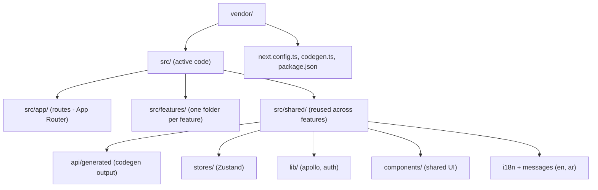

# 00 - Project Map

Where things live in the frontend. All active code is under `src/`. The top-level `components/`, `graphql/`, `hooks/`, `lib/`, `stores/` folders are legacy and not used.

| Node | Simple meaning |
|------|----------------|
| `src/app/` | Pages and layouts. The URL structure maps to these folders (App Router). |
| `src/features/<name>/` | One folder per feature (products, collections, orders, inventory, ...). Each holds `api/` (GraphQL), `components/`, `validations/` (zod), and types. |
| `src/shared/` | Things reused across features: UI components, Apollo + auth libs, Zustand stores, i18n. |
| `src/shared/api/generated/` | TypeScript types generated from the back-end GraphQL schema. Do not edit by hand. |
| `src/shared/stores/` | Global client state: auth tokens, active shop, the unsaved-changes save bar. |
| Legacy top-level folders | `components/`, `graphql/`, `hooks/`, `lib/`, `stores/` at the project root are old and unused - ignore them. |

## Main code files

- `src/app/layout.tsx` - root layout.
- `src/features/` - all feature modules.
- `src/shared/lib/apollo/` - the GraphQL client.
- `src/shared/stores/` - global state.
- `tsconfig.json` - the `@/*` -> `src/*` path alias.
