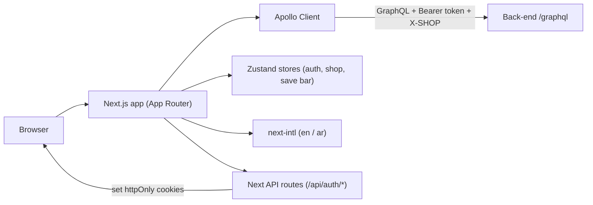

# 01 - System Overview

The whole frontend in one picture: a Next.js dashboard that talks to the back-end over GraphQL, keeps a little state on the client, and shows everything in English or Arabic.

| Node | Simple meaning |
|------|----------------|
| Next.js app | The dashboard UI. Server components render the shell; client components handle forms and interactivity. |
| Apollo Client | Sends GraphQL queries/mutations to the back-end and caches results. Adds the auth token and the active shop header. |
| Zustand stores | Small pieces of global state held in the browser (login state, current shop, the save bar). |
| next-intl | Switches the UI language between English and Arabic (right-to-left). |
| Next API routes | A few server-side endpoints under `/api/auth/*` that store the refresh token in a secure cookie. |

## Main code files

- `src/app/layout.tsx` - wraps the app with Apollo + i18n.
- `src/shared/lib/apollo/` - the GraphQL client and its links.
- `src/shared/stores/` - auth, active shop, save bar.
- `src/app/api/auth/` - cookie/session endpoints.
- `src/shared/i18n/` - language setup.
