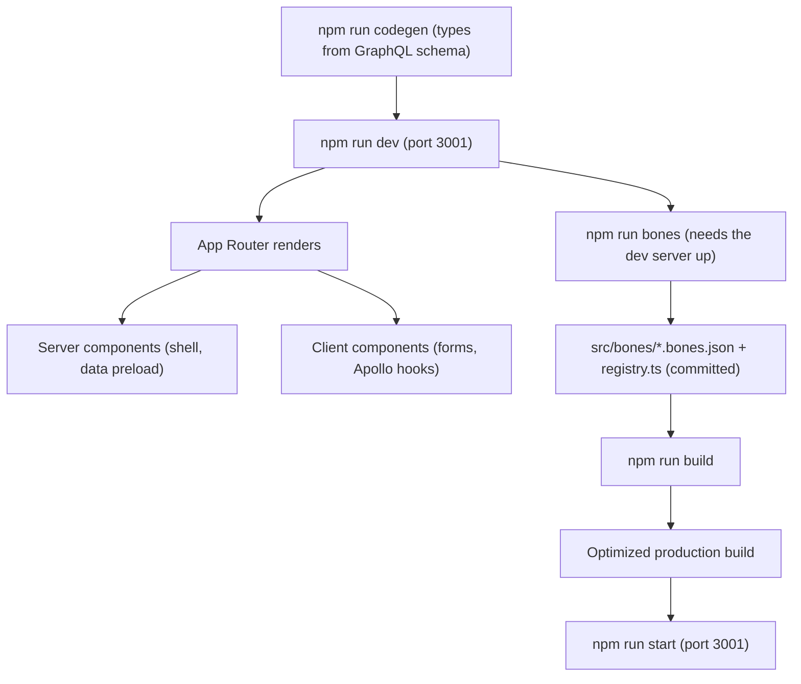

# 02 - Build and Startup

How the frontend is built and how it renders. There is no long boot sequence like a server - Next.js compiles the app and serves pages.

| Node | Simple meaning |
|------|----------------|
| codegen | Reads the back-end GraphQL schema and writes TypeScript types into `src/shared/api/generated/`. Run it after the schema changes. |
| dev | Starts the local dev server on port 3001 with hot reload. |
| bones | Captures skeleton loading shapes from the running app. Generated output is committed; `build` only reads it. Optional — `<Bones>` also measures itself at runtime — but it is what covers the first paint. |
| Server components | The default. They render on the server and can preload data (the dashboard layout preloads the current user and shops). |
| Client components | Marked `"use client"`; used for forms, state, and Apollo hooks. |
| build / start | `build` makes the optimized bundle; `start` serves it. |

Boot needs `NEXT_PUBLIC_GRAPHQL_URL` (the back-end GraphQL endpoint, default `http://localhost:3000/graphql`). The UI language comes from a `locale` cookie, not the URL.

## Skeleton capture (npm run bones)

`npm run bones` (boneyard-js) drives a headless Chromium over the running dev server, measures the real DOM of each `<Bones name="...">`, and writes `src/bones/<name>.bones.json` plus `src/bones/registry.ts`. It is a **manual, local step, not part of `build`** — it needs a browser and a logged-in session, neither of which CI has. Its output is committed, so production reads bones without ever launching a browser.

One-time: `npm run bones:setup` (downloads Chromium).

Each run needs three things, all read from `boneyard.config.json`:

- **The dev server up** on port 3001, with the back-end reachable — bones are measured from real query results.
- **A session.** `BONEYARD_ACCESS_TOKEN` and `BONEYARD_REFRESH_TOKEN` must hold cookies from a real browser login; the dashboard is auth-gated and the CLI otherwise just follows the redirect to `/login`. It fails fast when they are unset.
- **A real shop slug** in the config's `skeletons` routes (it ships `demo-store`), because the captured routes are concrete URLs and the dashboard's are `[shopSlug]`-scoped.

### Two sources of bones, and why the capture is still worth running

`<Bones>` (`@repo/ui/components/bones`) takes no hand-written placeholder — that is the point of it. It resolves bones from two places:

1. **The committed capture** above. Covers the **first** paint, at every breakpoint, before any content has ever rendered.
2. **Its own runtime measurement.** The library's `<Skeleton>` never does this, so the wrapper adds it: once the real content has rendered, it calls the same `snapshotBones()` the CLI uses on the live subtree and caches it under `name` + viewport bucket. Every later load of that name then draws real measured bones with **no build step at all**.

So a screen with no capture is not broken — it simply shows nothing on the very first load (there is genuinely nothing measured yet) and works from then on. Running the capture is what closes that first-load gap and makes it responsive across breakpoints.

The library is **silent** when a name resolves to no bones, which is what made a missing capture read as a broken component. The wrapper logs a one-line dev warning naming the skeleton instead. `packages/ui/src/components/__tests__/bones.render.test.tsx` pins all three states apart: registered bones draw, an unknown name draws nothing *and* warns, and a rendered subtree gets measured so the next load draws.

Bones go stale silently when the wrapped component is relaid out — nothing fails loudly. Rerun the capture after changing anything a `<Bones>` wraps.

## Main code files

- `package.json` - the `dev`, `build`, `codegen`, `bones` scripts.
- `next.config.ts` - next-intl plugin + image settings.
- `codegen.ts` - where types are generated from.
- `boneyard.config.json` - capture routes, breakpoints, bone colours, and the auth cookies for `npm run bones`.
- `src/shared/components/bones.tsx` - re-exports `@repo/ui/components/bones`; exists only to side-effect-import the generated registry into the client bundle.
- `../../packages/ui/src/components/bones.tsx` - the shared `Bones` component: registry lookup, runtime self-measurement, the dev warning.
- `src/app/layout.tsx` - the root layout.
- `src/shared/i18n/request.ts` - per-request language + messages.
