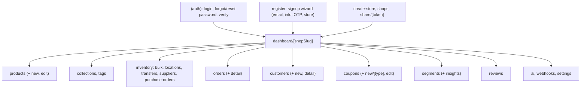

# 03 - Entrypoints

The screens a user can open. Routes come from folders under `src/app/`. Most of the app lives under a shop, addressed by its slug.

| Node | Simple meaning |
|------|----------------|
| (auth) | Public pages for signing in and account recovery (grouped layout, not shop-scoped). |
| Onboarding | Create the first store, switch shops, or open a shared link. |
| dashboard/[shopSlug] | Everything after sign-in. `[shopSlug]` is the current shop; it drives the `X-SHOP` header sent to the back-end. Its layout redirects a retired handle to the shop's current one, keeping the rest of the path — `src/proxy.ts` forwards the full path in an `x-vendor-pathname` header, because a layout is handed only its own params. |
| products / inventory / orders / ... | The feature screens. Dynamic segments like `[id]` or `[slug]` open a single record. |
| theme-preview/[templateId] | A storefront template at full size with its sample shop, opened from Online Store -> Themes. Outside the shop layout because a template owns the window scroll; still behind sign-in (`/theme-preview` is a protected prefix in `src/proxy.ts`). |
| api/auth/* | Server route handlers (not user screens) that manage the session cookie. |

## Main code files

- `src/app/(auth)/` - login and recovery pages.
- `src/app/page.tsx` - `/` hands off to `/store`, which picks a shop the signed-in account holds.
- `src/app/store/[shopSlug]/` - all shop screens.
- `src/app/store/[shopSlug]/layout.tsx` - the stale-handle redirect.
- `src/app/store/layout.tsx` - sign-in guard + preload.
- `src/app/api/auth/` - session/refresh/logout handlers.
- `src/app/theme-preview/[templateId]/page.tsx` - storefront template preview.
- `src/app/layout.tsx` - the root layout.
