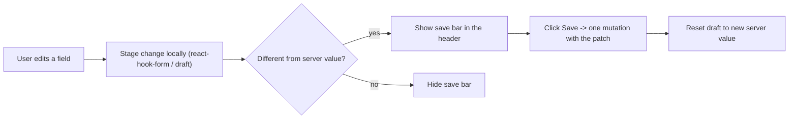
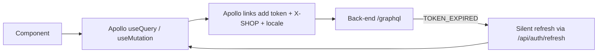

# 04 - Core Flows

The three flows you meet on almost every screen: how edits are saved, how data is fetched, and how sign-in works.

## Editing: the contextual save bar (mandatory)

| Node | Simple meaning |
|------|----------------|
| Stage locally | Edits are kept in memory; nothing is saved on keystroke or blur. |
| Dirty check | "Dirty" compares the staged value to the server value, so reverting an edit hides the bar. |
| Save bar | A global bar in the header with Save / Discard. Driven by `useUnsavedBarStore`. |
| Save | Fires a single mutation with only the changed fields; on error the bar turns red. |

Read `../AGENTS.md` for the full rules and reference implementations (collections, products, transfers).

## Data fetching and auth

| Node | Simple meaning |
|------|----------------|
| Apollo hooks | Components fetch and mutate with typed GraphQL documents generated by codegen. |
| Apollo links | Middleware that attaches the access token, the active shop (`X-SHOP`), and the language. |
| Silent refresh | If the access token expired, an error link refreshes it and retries the request once. |

## Main code files

- `src/shared/stores/unsaved-bar.ts` - the save bar state.
- `src/features/collections/components/new/use-collection-submit.ts` - save-bar reference.
- `src/shared/lib/apollo/` - client + links.
- `src/shared/lib/auth/refresh.ts` - silent token refresh.
- `src/app/(auth)/login/page.tsx` - the login screen.
