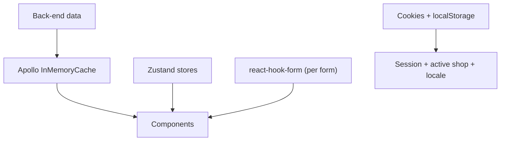

# 05 - Data and State

Where the frontend keeps information. Server data lives in the Apollo cache; a little global UI state lives in Zustand; the session lives in cookies.

| Node | Simple meaning |
|------|----------------|
| Apollo cache | Caches everything fetched from GraphQL (default cache-first). No separate react-query. Changing the active shop drops it whole (`ShopCacheBoundary`), because the shop rides in a header the cache cannot see. |
| In-flight tracker | A counting link at the head of the chain (`shared/lib/apollo/inflight.ts`). `useSwitchShop` waits on it before changing the active shop: the cache clear cancels anything still out, and that rejection is thrown at render by a suspense reader. |
| Zustand stores | Three global stores: `auth` (access token), `active-shop` (current shop slug), `unsaved-bar` (save bar). |
| react-hook-form | Each create/edit form holds its own draft; `isDirty` drives the save bar. Inputs are validated with zod. |
| Cookies | Refresh token (httpOnly, server-only), access token + expiry (readable), `locale`, and `active_shop_slug`. |
| localStorage | Mirrors the active shop slug so it survives reloads. |

## Main code files

- `src/shared/stores/auth.ts` - access token state.
- `src/shared/stores/active-shop.ts` - current shop slug.
- `src/shared/hooks/use-switch-shop.ts` - the one way to change it (settle, write, navigate).
- `src/shared/stores/unsaved-bar.ts` - save bar.
- `src/shared/api/generated/` - generated GraphQL types.
- `src/shared/lib/auth/cookies.ts` - cookie options.
