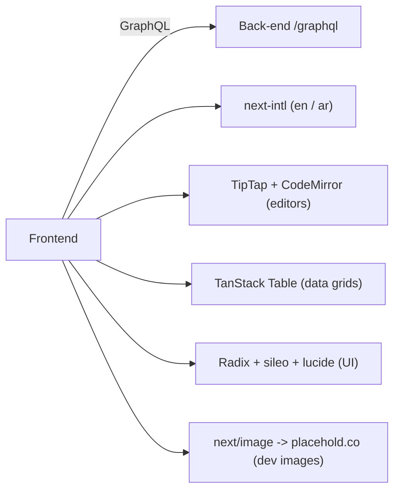

# 06 - External Integrations

What the frontend depends on outside its own code. The big one is the back-end GraphQL API; the rest are UI libraries.

| Node | Simple meaning |
|------|----------------|
| Back-end GraphQL | The only data source. Endpoint set by `NEXT_PUBLIC_GRAPHQL_URL`. Codegen also reads the local schema at `../../back-end/src/schema.gql`. |
| next-intl | Loads English/Arabic message catalogs and sets text direction. |
| TipTap / CodeMirror | Rich-text editor and code editor used in forms (descriptions, rules). |
| TanStack Table | Powers the list/grid views (products, orders, customers). |
| Radix / sileo / lucide | Dropdowns and popovers, toasts, and icons. |
| Images | `next.config.ts` allows images from `placehold.co` for seeded dev imagery; no production CDN is configured yet. |

No analytics, maps, or error-tracking SDK is wired into the frontend today.

## Main code files

- `codegen.ts` - schema source + generated output.
- `src/shared/lib/apollo/` - where the endpoint is called.
- `next.config.ts` - allowed image hosts + i18n plugin.
- `src/shared/messages/en/`, `ar/` - translations, one JSON file per namespace, assembled by each folder's `index.ts`.
- `src/shared/i18n/` - locale config.
