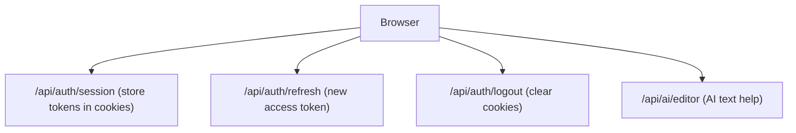

# 07 - Background Jobs

The frontend has no real background jobs - no queues, no cron. The only server-side code is a handful of Next.js route handlers under `src/app/api/`.

| Node | Simple meaning |
|------|----------------|
| /api/auth/session | Saves the refresh token into a secure httpOnly cookie after login. |
| /api/auth/refresh | Exchanges the refresh cookie for a fresh access token. |
| /api/auth/logout | Clears the session cookies. |
| /api/ai/editor | Server-side helper for the in-editor AI feature (keeps the AI key off the client). |

All real background work (emails, cleanup, webhooks) happens in the back-end - see `../../back-end/docs/07_background_jobs/`.

## Main code files

- `src/app/api/auth/session/route.ts` - store session.
- `src/app/api/auth/refresh/route.ts` - refresh token.
- `src/app/api/auth/logout/route.ts` - clear session.
- `src/app/api/ai/editor/route.ts` - AI editor helper.
