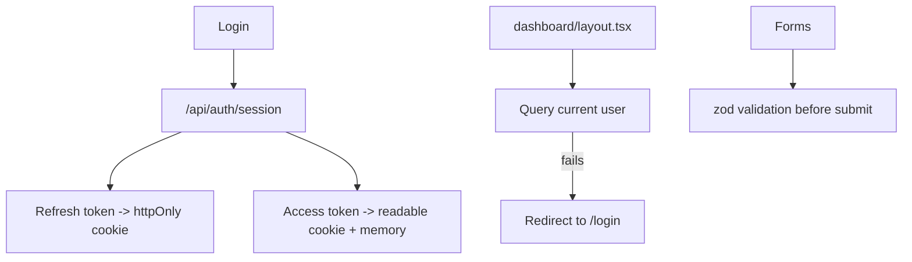

# 08 - Security and Safety

How the frontend protects the session and keeps bad input out. The key idea: the refresh token never touches JavaScript.

| Node | Simple meaning |
|------|----------------|
| Refresh token | Stored only in an httpOnly cookie, so page scripts (and XSS) cannot read it. Sent only to `/api/auth/refresh`. |
| Access token | Short-lived; kept in a readable cookie and memory so Apollo can attach it. Refreshed silently. |
| Route protection | There is no `middleware.ts`. The dashboard layout queries the current user and redirects to `/login` if that fails. |
| zod validation | Every form validates input with a zod schema (in each feature's `validations/`) before sending a mutation. |
| Cookies | `sameSite=lax` and `secure` in production reduce CSRF and leakage risk. |
| Env vars | Only `NEXT_PUBLIC_*` values reach the browser bundle; secrets like the AI key stay server-side. |

## Main code files

- `src/app/api/auth/session/route.ts` - sets the cookies.
- `src/shared/lib/auth/cookies.ts` - cookie options.
- `src/app/store/layout.tsx` - the sign-in guard.
- `src/features/*/validations/` - zod schemas.
- `src/shared/lib/apollo/` - where the token is attached.
