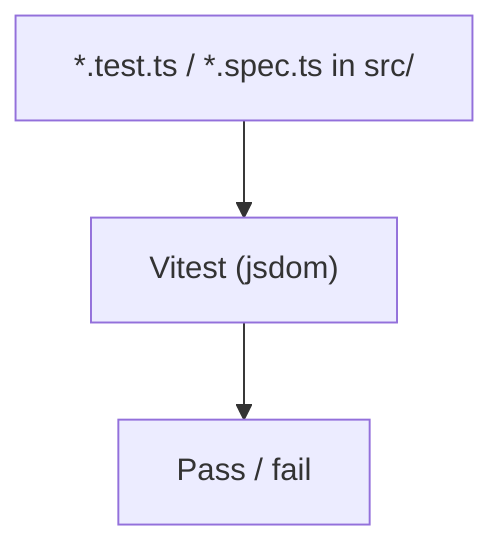

# 09 - Testing

How the frontend is tested. It uses Vitest with a jsdom browser-like environment. Coverage today is light and focused on logic (not full UI flows).



| Node | Simple meaning |
|------|----------------|
| Test files | Live next to the code they test, mostly under `src/features/*/lib/`. |
| Vitest | The test runner, configured for a jsdom (fake browser) environment. |
| Scope | Current tests cover pure logic (for example segment query helpers); there are only a few of them. |

Commands:

```bash
npm test         # run once
npm run test:watch  # watch mode
npm run typecheck   # tsc --noEmit (catches type errors)
```

## Translating in a test

Most next-intl mocks in the app echo the key back (`useTranslations: () => (key) => key`). That is enough for a component whose test only checks that something rendered, and wrong for one that asserts on the copy a merchant reads - a key echo passes just as happily when the key is missing from the English catalogue.

`src/shared/test/next-intl.ts` is the alternative: a `vi.mock` factory that builds a translator over the real English catalogue (`@/shared/messages/en`) with next-intl's own `createTranslator`, so ICU plurals, `{placeholders}` and `t.rich` behave as they do in the app and a missing key fails the test. The factory must be called inside the `vi.mock` call, because `vi.mock` is hoisted above the file's imports:

```ts
vi.mock("next-intl", async () =>
  (await import("@/shared/test/next-intl")).nextIntlMock(),
)
```

`src/shared/i18n/__tests__/messages-parity.test.ts` guards the other half: it walks the English and Arabic catalogues and fails when their key paths differ in membership or order, when a message is empty, or when a namespace file in `messages/en/` or `messages/ar/` is not imported by that folder's `index.ts`, so a half-finished translation is caught here rather than at render time in Arabic.

## Main code files

- `vitest.config.ts` - runner config (jsdom, globals).
- `src/shared/test/next-intl.ts` - the real-messages next-intl mock factory.
- `src/shared/i18n/__tests__/messages-parity.test.ts` - en/ar key-parity guard.
- `src/features/segments/lib/__tests__/` - example tests.
- `package.json` - `test` and `typecheck` scripts.
