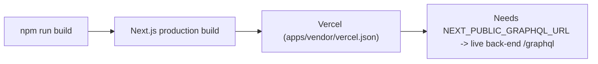

# 10 - Deployment

How the frontend ships. The chosen target is **Vercel**, and its config (`apps/vendor/vercel.json`) is committed.

| Node | Simple meaning |
|------|----------------|
| Build | `npm run build` (`next build`) produces the optimized Next.js output. It uses the committed `src/shared/api/generated/` types, so codegen (which reads `../../back-end`) does NOT run on the host. |
| Host | Vercel, configured by `apps/vendor/vercel.json` (`framework: nextjs`, build/install commands). The back-end stays on Render (`render.yaml` at the repo root). |
| Monorepo | This is an npm workspace under `apps/`. In the Vercel project, set **Root Directory = `apps/vendor`**. Vercel detects the root `package.json` `workspaces` field and runs the install from the repo root against the root `package-lock.json`. |
| Required env | Set `NEXT_PUBLIC_GRAPHQL_URL` to the production back-end GraphQL URL. Error tracking is env-only: `NEXT_PUBLIC_SENTRY_DSN` (browser) and/or `SENTRY_DSN` (Node/edge). Source maps need `SENTRY_ORG`, `SENTRY_PROJECT`, and `SENTRY_AUTH_TOKEN` at build. Unset, capture is a no-op. Traces sample rate is 0.1 in production, 1.0 in development — not env vars. See section 11 and `.env.example`. |

## Vercel setup (once)

1. Import the repo; set **Root Directory** to `apps/vendor`.
2. Add the env vars above (Production + Preview).
3. Deploy. `vercel.json` pins the framework + build/install commands; everything else is Vercel's Next.js defaults.

## Trial against a local Docker API

A Vercel preview cannot reach `localhost:3000`. For a short trial, expose the
local API with ngrok and set Preview `NEXT_PUBLIC_GRAPHQL_URL` to
`https://<subdomain>.ngrok-free.app/graphql`, then redeploy. The skip-browser-warning
header is attached automatically. Full steps: [vercel-local-api-ngrok.md](../../../docs/vercel-local-api-ngrok.md).
Leave Production pointing at the Render API.

## Main code files

- `vercel.json` - the committed Vercel config (framework + build/install commands).
- `package.json` - `build` and `start` scripts.
- `next.config.ts` - build-time settings.
- `../../render.yaml` - back-end only (no frontend entry).
