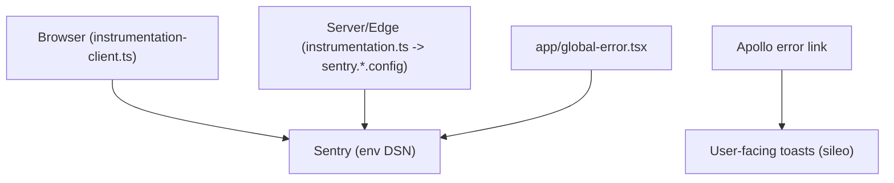

# 11 - Observability

What visibility exists into the running frontend. Error + performance tracking is wired via the **Sentry Next.js SDK** (`@sentry/nextjs`) across all runtimes. There is no separate product-analytics SDK.

| Node | Simple meaning |
|------|----------------|
| Browser SDK | `instrumentation-client.ts` initializes Sentry on the client: uncaught errors, unhandled rejections, App Router navigation transitions, and Session Replay (masked). |
| Server/Edge SDK | `instrumentation.ts` `register()` loads `sentry.server.config.ts` / `sentry.edge.config.ts`; `onRequestError` captures unhandled server request errors. |
| global-error | `app/global-error.tsx` reports React render failures that escape every boundary. |
| Apollo error link | Maps GraphQL error codes to actions (refresh on expired token, logout on reuse, toast otherwise) — unchanged. |
| Build | `next.config.ts` is wrapped with `withSentryConfig`; org/project come from `SENTRY_ORG` / `SENTRY_PROJECT`. It uploads source maps on `next build` when `SENTRY_AUTH_TOKEN` is set, and serves a `/monitoring` tunnel route to dodge ad-blockers. |

## Configuration

| Env var | Meaning |
|---------|---------|
| `NEXT_PUBLIC_SENTRY_DSN` / `SENTRY_DSN` | Browser / Node-edge DSN. Unset, every `Sentry.init` is a no-op — there is no hardcoded fallback. Listed empty in `.env.example`. |
| `SENTRY_ORG` / `SENTRY_PROJECT` | Source-map upload target at `next build`. Unset, the build still succeeds with no upload. |
| `SENTRY_AUTH_TOKEN` | Source-map upload token. Set in CI / Vercel (never committed); without it the build still succeeds with minified traces. |

Privacy defaults (see the `sentry.*.config` files): `sendDefaultPii: false` (no IP/PII — this is a financial dashboard), Session Replay masks all text + media, `tracesSampleRate` 0.1 in production. Adjust per a privacy review.

Not wired: profiling, cron monitoring, custom metrics.

## Main code files

- `instrumentation-client.ts` - browser Sentry init + router-transition hook.
- `instrumentation.ts` - server/edge `register()` + `onRequestError`.
- `sentry.server.config.ts` / `sentry.edge.config.ts` - server/edge init.
- `next.config.ts` - `withSentryConfig` (source maps, tunnel route, org/project).
- `src/app/global-error.tsx` - reports root render failures to Sentry.
- `src/app/sentry-example-page/page.tsx` - temporary verification page (delete after testing).
- `src/shared/lib/apollo/` - the GraphQL error link.
