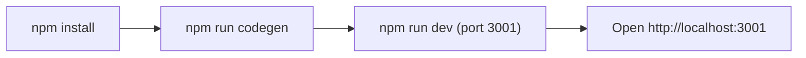

# 12 - Runbook

Practical steps to run the frontend and fix the problems you are most likely to hit.

| Situation | What to do |
|-----------|------------|
| First run | `npm install` **at the repo root** (npm workspaces), then `npm run codegen` (needs the back-end schema), then `npm run dev`. |
| GraphQL types missing or red | Run `npm run codegen`. It reads `../../back-end/src/schema.gql`, so make sure the back-end is present. |
| "Cannot reach API" / data not loading | Check `NEXT_PUBLIC_GRAPHQL_URL` and that the back-end is running on its port (default 3000). A Vercel preview aimed at a local API needs a live ngrok tunnel — see [vercel-local-api-ngrok.md](../../../docs/vercel-local-api-ngrok.md). |
| Stuck on login / instant logout | Token cookies or refresh failing - check the `/api/auth/*` routes and that the back-end auth is up. |
| Wrong language or direction | The UI reads the `locale` cookie (en / ar); clear or reset it. |
| Type errors before commit | Run `npm run typecheck`. |

## Main code files

- `package.json` - all the commands above.
- `codegen.ts` - schema source for type generation.
- `src/app/api/auth/` - session endpoints.
- `src/shared/lib/apollo/` - API connection + errors.
