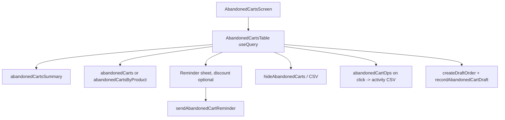

# Abandoned carts

**Last updated:** 2026-10-05 - **Feature:** `src/features/abandoned-carts/` — status counts follow the other chips, and select-all matching reads `abandonedCartIds`

## Overview

Vendor marketing list of registered-customer carts that still hold items and have been idle 24 hours (or already marked `abandoned` by the recovery sweep). The list chrome follows Linear's Issues density on our light tokens: quiet Customer / Product views, a funnel that adds a filter, and chips in a second row (`Status is Ready to remind`). The table itself sits on a white `bg-card` surface with a quiet ring so it reads as a list against the gray dashboard, without going back to a loud spreadsheet. Merchants send a reminder now (discount optional), hide a row, export the current page, export the shop's send / hide activity log, or copy the lines into a draft order. There are no cadence tabs. Automatic recovery emails live under Settings → Abandoned cart reminders.

The date picker on the KPI row scopes **both** list queries and `abandonedCartsSummary` (default **all time**). A dated range is a half-open `[start, end)` on the cart's activity date. Filter chips (status, value band, created date, hidden) apply to the table. The funnel's status options each carry a count from `abandonedCartStatusCounts`: the list's own filter with the status left out, so search, value band, created date, hidden and the KPI date range all apply, and the picked status does not.

## Screens / routes

| Route | Purpose |
|-------|---------|
| `/store/[shopSlug]/marketing/carts` | List + KPIs + reminder sheet |
| `/store/[shopSlug]/settings/abandoned-carts` | Automatic reminders (`abandoned_checkout`) — see [settings](settings.md) |

Sidebar: Marketing → Abandoned carts. Customer / Product is a view switch on this page, not a second route.

## How it works

## Components

`AbandonedCartsScreen`, `AbandonedCartsBanner`, `AbandonedCartsKpis` + `AbandonedCartsRange`, `AbandonedCartsTable`, `AbandonedCartsToolbar` (view tabs + funnel + compact search on the shared `DataTableToolbar`), `AbandonedCartsViewOptions`, `AbandonedCartsBulkBar`, `abandonedCartColumns` / `abandonedCartProductColumns`, `AbandonedCartsStatusPopover`, `AbandonedCartsItemsSheet`, `AbandonedCartsRowActions`, `AbandonedCartReminderSheet`, `AbandonedCartsEmpty`.

## State & forms

List state is URL search params (`page`, `limit`, `search`, `status`, `hidden`, `range`, `from`, `to`, `view`, `value`, `created`, `sort`, `dir`). FilterBar chips are held in state and reconciled with the URL; a replace in flight is not treated as an external URL change, so changing a chip's field cannot drop it. The funnel writes a complete chip (field + value) in one pick; the chip row's + adds another field. Column visibility is `localStorage` per shop and view. No saved views. The reminder sheet is local React state. Promo dismiss is `localStorage`. A leftover `?tab=cadence` is ignored.

## GraphQL operations

| Operation | Type | Purpose |
|-----------|------|---------|
| `GET_ABANDONED_CARTS` | Query | Paginated customer-mode list |
| `GET_ABANDONED_CARTS_BY_PRODUCT` | Query | Product-mode aggregates |
| `GET_ABANDONED_CARTS_SUMMARY` | Query | KPI totals for the date chip; also the "N hidden by filters" remainder and, via `by_status`, the counts on the funnel's status options |
| `GET_ABANDONED_CART_OPS` | Query | Send / hide / unhide log for the date range, fetched with `client.query` only when Export activity log is pressed |
| `SEND_ABANDONED_CART_REMINDER` | Mutation | Send now; discount optional |
| `HIDE_ABANDONED_CART` / `UNHIDE_ABANDONED_CART` / `HIDE_ABANDONED_CARTS` | Mutation | Hide rows |
| `RECORD_ABANDONED_CART_DRAFT` | Mutation | Mark COMPLETED after create-order |
| `GET_ABANDONED_CHECKOUT_SETTING` / `UPSERT_ABANDONED_CHECKOUT_SETTING` | Query/Mutation | Cadence on Settings |
| `CREATE_DRAFT_ORDER` | Mutation | Orders feature |

Client `useQuery` only — these are JwtAuthGuard ops and are not RSC-preloaded.

## Validation

Discount percent 1–100 when the discount switch is on. At least one reachable channel. Merge tags `{name}`, `{shop_name}`, `{cart_url}`, `{discount_code}`, `{discount_amount}`, `{date}`.

## Main files

- `api.ts`, `types.ts`, `lib/{query-state,filters,message,status,constants,export-csv,column-prefs}.ts`
- `components/abandoned-carts-*.tsx`, `abandoned-cart-reminder-sheet.tsx`
- Route: `src/app/store/[shopSlug]/marketing/carts/page.tsx`

## Notes

Guests stay out — Cart stores no guest email/phone. Status is derived: READY / SENT / RETURNED (`last_activity_at` **or** `reminder_link_opened_at` after `last_reminder_at`) / FAILED (`last_reminder_failed_at`) / COMPLETED (converted or recorded draft); `marketingStatusOf` in `lib/status.ts` mirrors the back-end rule. **Opened reminder link** in the status popover's timeline is `reminder_link_opened_at`: the reminder's `{cart_url}` carries a signed `?rc=` token, and the storefront reports the click when the shopper lands on their cart — only the first open after the latest send is kept. It is a click, not an email-open pixel; there is no open tracking. The `preview_body` the send returns has the cart link without its token, so opening it from here records nothing; only the message the customer received is signed. No app-vs-browser source. Select-all matching asks `abandonedCartIds` for the list's filter and order, with no paging, and holds those ids across pages; the answer is cut at 500 (`SELECT_ALL_LIMIT`) and `total` says when it was. The list CSV is the current page or the current selection. **Export activity log** (view options, beside Export) is a different file: it asks `abandonedCartOps` for the KPI date range with `limit: 2000` — the back-end's own cap — and downloads `abandoned-carts-activity.csv` (`created_at`, `op`, `cart_ids`, `cart_count`, actor, channels, failed channels, coupon). It ignores chips and view on purpose, since it records what the team did rather than what the list shows; an empty window is a toast rather than an empty file, and a full 2000 warns that older entries were left out. The 2000 are ops, not raw audit rows: the back-end reads past the draft records that share their audit entity until it has 2000 or the window ends, so a shorter file is the whole window. Status counts in the funnel are `abandonedCartStatusCounts`, the list's filter with the status left out. They are absent (not zero) until that query answers. The summary's own `by_status` still ignores every chip except the KPI date range, and the funnel does not read it. Line money prefers the variation. Search is customer name/email/phone or a product name on a line. Rows are not grouped by reminder status: the list is server-paged, and grouping the current page would lie about counts.

**Create order** sends the cart's own customer (`customers.id`) with the lines, name and contact. The list still shows a cart whose customer was soft-deleted (the 2026-09-26 customer migration carried deleted accounts over as deleted customers), and `createDraftOrder` refuses that customer as `invalid_customer` before writing anything. The row reads the refusal with `draftCustomerErrorKey` and says the account was deleted, with a hint to create a draft without a customer from Orders → Drafts or hide the cart (`toasts.draftCustomerDeleted` / `draftCustomerDeletedHint`); any other failure is still `toasts.draftFailed`. Retrying as a guest draft with the cart's contact: Not yet implemented.

The list reads `abandonedCarts.*` (en + ar); the cadence editor (mounted by Settings) reads `settings.abandonedCarts`. The sort field and direction selects (view options) and the cadence unit selects show labels rather than the stored value. `formatStepMinutes(minutes, t)` (`lib/status.ts`) words a step from `abandonedCarts.step` with Arabic's plural forms; no screen calls it today. The reminder a shop's customer receives is still worded in the merchant's dashboard language (`lib/message.ts`), not the customer's.
