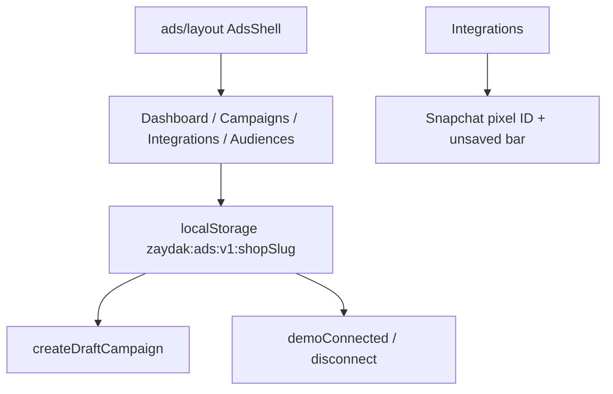

# Ads

**Last updated:** 2026-09-26 — **Feature:** `src/features/ads/`

## Overview

Marketing → Ads is the vendor shell for paid-acquisition work inspired by common marketplace marketing screens: a dashboard, campaign list/detail, per-platform integration tools (Meta, Google Ads, TikTok, Snapchat), and an audience manager placeholder. This first slice is UI scaffolding only. Connections and campaigns persist in `localStorage` per shop slug. There is no GraphQL ads module, no OAuth, and no live impressions/CPC/spend yet — KPIs stay at zero until a back-end exists.

## Screens / routes

| Route | Purpose |
|-------|---------|
| `/store/[shopSlug]/marketing/ads` | Dashboard: platform chips, KPI cards, empty performance chart, latest drafts |
| `/store/[shopSlug]/marketing/ads/campaigns` | Ad management: campaign list + detail (draft banner, edit stub, delete) |
| `/store/[shopSlug]/marketing/ads/integrations` | Integration tools: platform pills, hero, benefits, Connect demo; Snapchat connected panel |
| `/store/[shopSlug]/marketing/ads/audiences` | Audience manager empty state |

Sidebar: Marketing → Ads (group URL points here). Coupons and Abandoned carts remain siblings.

## How it works

## Components

`AdsShell` (title, Create ad, sub-nav), `AdsDashboard`, `AdsManagement`, `AdsIntegrations` (+ Snapchat panel), `AdsAudiences`, `PlatformPills`, `PlatformIcon`, `CreateAdDialog`. State helpers live in `lib/store.ts` and `hooks/use-ads-store.ts`.

## State & forms

Campaigns and connections are shop-scoped JSON in `localStorage`, subscribed via `useSyncExternalStore`. `readAdsState` caches the parsed object per shop so `getSnapshot` stays referentially stable (a fresh object every read loops React). Create Ad appends a `draft` row and routes to campaigns. Connect writes a demo `PlatformConnection` (not OAuth). Snapchat pixel ID stages locally and registers the contextual save bar while dirty; Save writes `pixel_id` back to the same store.

## GraphQL operations

None. Attribution ad-spend under Analytics remains a separate feature.

## Validation

Create dialog: empty name falls back to a localized “Untitled campaign”. Pixel save trims the string and sets `pixel_active` when non-empty.

## Main files

- `src/features/ads/components/ads-shell.tsx` — shared chrome
- `src/features/ads/components/ads-dashboard.tsx` / `ads-management.tsx` / `ads-integrations.tsx` / `ads-audiences.tsx`
- `src/features/ads/lib/routes.ts` / `platforms.ts` / `store.ts`
- `src/app/store/[shopSlug]/marketing/ads/**` — App Router pages + layout

## Notes

- Light `@repo/ui` tokens; not a dark-theme copy of the reference screenshots.
- i18n: `ads.*` in `messages/en/ads.json` / `messages/ar/ads.json`. The dashboard range `SelectValue` renders `ads.range.*` rather than the raw `last_7_days` enum.
- Follow-ups (OAuth, Events API, catalog sync, live metrics, audience sync) are tracked in `TODO.md`.
