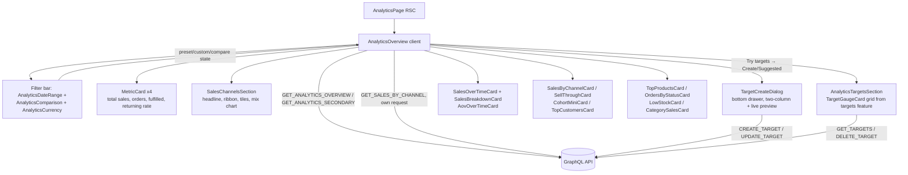

# Analytics

**Last updated:** 2026-10-01 — **Feature:** `src/features/analytics/`

## Overview

The analytics feature is the shop owner's reporting dashboard. A single overview page presents a Shopify-style sales report for a chosen date range — KPI cards (total sales, orders, **orders fulfilled**, returning rate) with period-over-period deltas, a full-width **Sales by channel** section (where orders were placed: online store, Telegram, WhatsApp or a manual order), "total sales over time" and **"AOV over time"** area charts, and a **profit-first breakdown** (gross → net → total, then **COGS / payment fees / gross & net profit / margin**, plus an informational **return fees kept** line) — alongside cards for **sales by traffic source** (UTM attribution), **sell-through rate**, a **customer cohort matrix** and **top customers** (both linking to their full reports), total sales by product, orders by status, low stock, and category sales. Money is formatted in the **shop's currency**. Controls follow Shopify's analytics layout: a header with a **"last refreshed"** clock, a **⋯ overflow menu** (Refresh, Export CSV), a **"Try targets"** menu, and a **"New exploration"** link to the report builder; below it a filter bar of three separate buttons — a **date-range picker** (preset rail + two-month calendar in one popover), a **comparison** dropdown (No comparison / Previous period, mapped to the back-end's boolean), and a display-only **currency** chip. The shop's targets render as gauge cards directly on this page (Shopify-style) via the `targets` feature. Apart from target create/edit/delete, the page is read-only; it drives its own GraphQL queries client-side and re-fetches when the date range or comparison changes.

## Screens / routes

| Route | Purpose |
|-------|---------|
| `/store/[shopSlug]/analytics` | Single overview dashboard (KPIs, chart, breakdown, supporting cards) |

## How it works

## Components

| Component | What it shows |
|-----------|--------------|
| `AnalyticsOverview` | Root client island. Owns `preset`/`customRange` + `compare` + target-dialog state + the "last refreshed" clock, derives the ISO date window, runs the two batched queries, and lays out the header, filter bar, and grid. |
| `AnalyticsDateRange` | One trigger button opening a Shopify-style popover: a preset rail (Today … This year + Custom range) beside a two-month calendar (future days disabled), staged and committed on Apply. |
| `AnalyticsComparison` | Dropdown mapping "No comparison"/"Previous period" to the back-end's `compare` boolean; the trigger shows the previous window's dates when on. |
| `AnalyticsCurrency` | Display-only chip showing the report currency (the store's own); a popover explains reports always use it. |
| `AnalyticsTargetsSection` | The shop's targets as `TargetGaugeCard`s (from the `targets` feature), rendered as the **last** section of the page; hidden when there are none. Owns the delete mutation. |
| `InsightsCard` | Proactive AI insights (from the `insights` feature) rendered below the KPI row; hidden when there are none. See [insights.md](insights.md). |
| `MetricCard` | A single KPI: label, value, and a `DeltaBadge` when comparison is on. Accepts an optional `valueContent` node — the Total sales card passes an `AutoscaleInput` so its figure auto-scales to fit — and an optional `boneName` for its loading state. |
| `SalesChannelsSection` | Full-width, directly under the KPI row. A Sales / Orders switch (`MeasureToggle`, a radio group) drives everything in it: a sentence naming the leading channel and its share, the channel mix as one rounded ribbon (`ChannelRibbon`, `role="img"`), one `ChannelTile` per channel (figure, `DeltaBadge`, orders · AOV · customers, share, recharts sparkline), and a stacked `ChannelMixChart` per bucket with a legend, a tooltip listing every channel, and a screen-reader table. Hovering a tile or ribbon segment highlights that channel in all three. An idle channel shows its description and one action (connect Telegram/WhatsApp when not live, open draft orders). Own states: bones, empty, and an inline error with retry. The chart's axis, tooltip and table name dates in the dashboard language (`formatBucketLabel(date, granularity, locale)`). |
| `EmptyRow` | The shared "no data" line (`card-states.tsx`). All that is left of that file since `ListSkeleton` was removed. |
| `AutoscaleInput` | Shared hero-amount field (`shared/components/ui`) whose font shrinks to fit as digits grow (Uniswap/Wise pattern). Used read-only for the Total sales KPI (currency as prefix); also usable as a real form input. |
| `DeltaBadge` | Coloured up/down pill; `goodWhen` flips the colour for metrics where a decrease is good. |
| `SalesOverTimeCard` | recharts `AreaChart` of total sales per bucket, with a dashed previous-period overlay and a custom tooltip. |
| `AovOverTimeCard` | Per-bucket AOV line (total ÷ orders, client-computed from the series; zero-order buckets are gaps) with previous-period overlay. |
| `SalesBreakdownCard` | The breakdown rows (gross → net → total → profit), discounts/returns negative, plus informational margin and return-fees lines. |
| `SalesByChannelCard` | "Sales by traffic source": revenue per attribution channel (UTM last-touch) with share bars; links to the attribution report. Bars are shares of the **positive** revenue and clamped to 0-100%: a group can be negative (a refund settled in the window against an earlier order), and a negative CSS width is dropped by the browser and drawn as a full track. Not the same thing as `SalesChannelsSection`, which is where the order was placed. |
| `SellThroughCard` | Products by sell-through rate (`sold/(sold+on-hand)`) with progress bars. |
| `CohortMiniCard` | Compact monthly retention heat matrix from `customerAnalytics`; links to customer insights. |
| `TopCustomersCard` | Top customers by lifetime spend; links to customer insights. |
| `TopProductsCard` | Products ranked by sales value (`by: SALES`) with order count and sales for the window. |
| `OrdersByStatusCard` | Per-status counts as proportional bars. |
| `LowStockCard` | Products under the stock threshold with a coloured quantity pill. |
| `CategorySalesCard` | Per-category units-sold bars. |

## State & forms

`AnalyticsOverview` holds local state for the date selection (`RangePreset | "custom"` + the resolved custom `DateRange`), the `compare` boolean, and which target dialog is open (a `{ mode: "new", suggestion? } | { mode: "edit", target } | null` discriminated union). The "last refreshed" clock is stamped with the adjust-state-during-render pattern (guarded by a data-reference change), not an effect, so SSR and hydration agree. Changing the date selection recomputes the ISO `[start, end)` window (via `rangeForPreset` / `rangeForCustom`) and Apollo re-fetches with `fetchPolicy: "cache-and-network"`, so cards keep their last value while refreshing. Target create/edit happens in `TargetCreateDialog` (the `targets` feature) — a two-column bottom drawer with an explicit "Save to dashboard" button; the dashboard itself registers no unsaved bar. The active shop scope rides the `X-SHOP` header injected by the Apollo link (from the URL slug), so no shop id is passed in the queries. `SalesChannelsSection` keeps two pieces of local state of its own — the Sales / Orders measure and the channel currently highlighted by hover or focus — and neither is persisted.

## GraphQL operations

The dashboard fires **two** batched queries (each requests several root fields in a single round trip), grouped by lifecycle, plus one on its own:

| Operation | Type | Purpose |
|-----------|------|---------|
| `AnalyticsOverview` | Query | **Range-dependent**, refetches on date/compare change — one round trip resolving `salesReport` (breakdown incl. `fulfilled_orders_count`/`return_fees_cents` + series + comparison), `topProducts(by: SALES)`, `sellThroughProducts`, `customerAnalytics` (summary subset + cohorts + top customers), and `attributionReport(groupBy: CHANNEL)` for `[start, end)`. |
| `AnalyticsSecondary` | Query | **Range-independent**, fetched once: `ordersByStatus` + `lowStockProducts` + `categorySales`. |
| `AnalyticsSalesByChannel` | Query | `salesByChannel(input: { start, end, compare })` for the same window: four rows (ONLINE_STORE, TELEGRAM, WHATSAPP, DRAFT_ORDER) with sales, orders, returns, AOV, customers, `share_bps`, `previous_*` and per-bucket `series`, plus `connected` for the chat channels. |

`AnalyticsSalesByChannel` is **deliberately not a field of `AnalyticsOverview`**. GraphQL validates a document as a whole, so an API that does not yet know `salesByChannel` would reject the overview and blank every card; as its own request only the section fails. A refusal for a field or type the schema lacks (`isSchemaMismatchError`, `lib/schema-mismatch.ts`) leaves the section out entirely, because retrying cannot work until the API is rebuilt; any other failure shows the section's error and retry. `analytics-overview.render.test.tsx` pins both. It passes `context: { silentErrors: true }` for the same reason (the section owns its error UI; the unknown-field `VALIDATION_ERROR` is already never toasted). Across a range change it holds `previousData`, dimmed, instead of flashing skeletons.

The embedded targets section reuses the `targets` feature's operations (`AnalyticsTargets`, `AnalyticsCreateTarget`, `AnalyticsUpdateTarget`, `AnalyticsDeleteTarget`) — see [targets.md](targets.md).

Splitting by lifecycle (rather than one mega-query) means the static widgets don't refetch every time the date range changes. The individual operations (`AnalyticsSalesReport`, `AnalyticsTopProducts`, …) remain exported for reuse but the overview no longer calls them per-card.

## Validation

None. Inputs are bounded by the UI (a fixed set of date presets and a boolean toggle); the back-end validates `SalesReportInput`.

## Main files

- `src/features/analytics/api/queries.ts` — the eight `gql` operations + the `SalesBreakdownFields` fragment
- `src/features/analytics/types.ts` — response/entity interfaces (`SalesReport`, `SalesBreakdown`, `SalesTimePoint`, …)
- `src/features/analytics/lib/date-ranges.ts` — `RangePreset`, `rangeForPreset`, `rangeForCustom`, `previousWindow`, `formatRangeLabel`, `formatBucketLabel`
- `src/features/analytics/lib/metrics.ts` — `computeDelta`, `formatBps`, `formatDeltaPct`
- `src/features/analytics/components/analytics-overview.tsx` — orchestrator + header + filter bar + layout
- `src/features/analytics/components/analytics-date-range.tsx` / `analytics-comparison.tsx` / `analytics-currency.tsx` — the three filter-bar controls
- `src/features/analytics/components/sales-over-time-card.tsx` + `aov-over-time-card.tsx` — recharts charts
- `src/features/analytics/components/cohort-mini-card.tsx` / `sales-by-channel-card.tsx` / `sell-through-card.tsx` / `top-customers-card.tsx` — Shopify-parity cards reusing `customer-analytics` / `attribution` data
- `src/features/analytics/components/sales-channels/` — `SalesChannelsSection` and its parts; `lib/channel-mix.ts` — its pure rules (row normalising, tile order, clamped shares, share rounding, headline choice, chart buckets, stack edges, axis ticks); `src/shared/lib/sales-channels.ts` — channel order, icon and colour, shared with Sidekick's cards
- `src/features/analytics/lib/__tests__/` — unit tests for the delta/range/format helpers and `channel-mix`; `components/sales-channels/__tests__/` — the section's render test (English and Arabic)

## Notes

- All money fields arrive as integer cents and render through `formatMoneyCents`/`formatMoney` in the shop's currency (echoed by `salesReport.currency`; SAR is only the pre-load fallback). As of 2026-09-12 that is true of the whole feature: the last Float money fields were renamed on the back-end — `analytics.total_revenue`/`todays_revenue` → `*_cents`, `yearlySales.total` → `total_cents`, `topProducts.total_sales` → `total_sales_cents` — so `TopProductsCard` moved from `formatMoney` to `formatMoneyCents` and nothing in this feature divides by 100.
- The back-end buckets the time series by the **shop's** IANA timezone (echoed as `salesReport.timezone`); the date presets here are computed in the **browser's** local time. That is the real mismatch: a merchant browsing from a different zone than the shop's picks a window whose ends do not line up with the buckets it gets back.
- The sidebar `analytics` nav entry already pointed here; this feature fills the previously-dead `/analytics` route.
- recharts is the charting dependency; its series use concrete colors (brand teal / muted slate) because SVG internals cannot consume Tailwind classes. Grid and tick colours are the theme tokens (`var(--border)`, `var(--muted-foreground)`) on every chart here, the targets pacing chart and the attribution chart, so the hairlines hold on the dark card; the older charts' fixed `#e2e8f0` grid glared there. Every axis names its dates in the dashboard language (`formatBucketLabel(date, granularity, locale)` with `useLocale()`), pinned by `over-time-charts.render.test.tsx`. `salesReport` also takes `granularity: "week"` (2026-10-01; Monday-start, keyed by the Monday's date, so `formatBucketLabel` names it as that day), but this screen never sends a granularity: the server's day-or-month choice stands.
- **What counts as a sale** is the back-end's definition (2026-09-29): every order except cancelled and failed, net of partially cancelled slices, minus settled refunds dated in the window. So every figure on this page — the KPIs, the breakdown, the channel section — includes pending and processing orders, not only completed ones.
- **Channels are derived at read time**, never stored: `placed_via = telegram_assistant` is TELEGRAM, `whatsapp_assistant` is WHATSAPP, an order a draft points at is DRAFT_ORDER ("Manual orders"), everything else is ONLINE_STORE. The four rows add up to `salesReport.current`. `share_bps` can be negative when a channel's refunds outweigh its sales, so the section draws its own split of the positive total (`channelShares`); a real slice never reads "0%" and a non-sole leader never reads "100%".
- The channel colours (violet, sky, emerald, orange, Tailwind -600) passed the dataviz palette validator with every pair checked, on both the light and the dark card, so one hex serves both themes; recharts gets it as a concrete fill. Telegram sky and WhatsApp emerald match the orders list's `PlacedViaMark`.
- **Loading states are `<Bones>`** (`@repo/ui/components/bones`), measured from the real rendered DOM — there is no hand-written skeleton in this feature. Bones come from the committed `npm run bones` capture (first paint, every breakpoint; names in `boneyard.config.json`) or from runtime measurement (no build step, cannot cover the first paint). They go stale silently when a wrapped component is relaid out. `MetricCard` shares one name (`analytics-kpi-figure`) across all twenty KPI call sites; Total sales overrides it. Chart bones use `snapshotConfig={{ leafTags: ["svg"] }}`, and a `ResponsiveContainer` inside `<Bones>` needs `[&>[data-boneyard-content]]:h-full`. The channel section adds `analytics-sales-channels-{headline,tiles,chart}` (in `boneyard.config.json`, routed to `/store/entaj/analytics` because the section draws no bones in its empty state) and reserves its height while loading; its snapshot config skips `.sr-only`, since the chart's clipped screen-reader table otherwise measured as 160 bones below the chart. The committed capture (2026-09-29) is a single-page run, `npx boneyard-js build http://localhost:3001/store/entaj/analytics --force` with the seed vendor's cookies, so `src/bones/` holds this page's 18 skeletons only; `analytics-sales-over-time-chart` and `analytics-aov-chart` capture at zero height and draw nothing until they measure themselves. See [02_build_startup](../02_build_startup/README.md).
