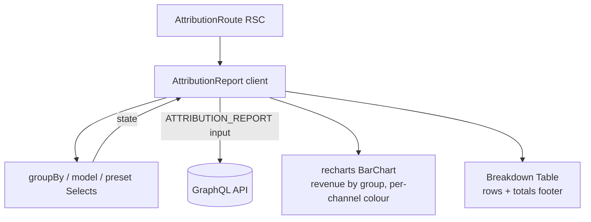

# Attribution

**Last updated:** 2026-10-01 — **Feature:** `src/features/attribution/`

## Overview

The attribution report shows a shop owner which marketing channels and campaigns drive their sales. A read-only report page lets the merchant pick a grouping dimension (Channel / Source / Medium / Campaign), an attribution model (Last touch / First touch), and a date-range preset; it renders a revenue-by-group bar chart (coloured per channel) and a breakdown table with revenue, orders, AOV, new-vs-returning customers, and **CAC / ROAS**, plus a grand-total footer. A sibling **Ad spend** page (`/attribution/ad-spend`) is a table + save-bar form where the merchant enters advertising spend (the CAC/ROAS denominator); spend is stored converted to the shop base currency. Money renders in the shop's currency from the report payload.

## Screens / routes

| Route | Purpose |
|-------|---------|
| `/store/[shopSlug]/analytics/attribution` | Attribution report (controls, chart, breakdown table with CAC/ROAS) |
| `/store/[shopSlug]/analytics/attribution/ad-spend` | Ad-spend manager (list + create/edit/delete) |

## How it works

## Components

| Component | What it shows |
|-----------|--------------|
| `AttributionReport` | Report island. Owns `groupBy` + `model` + `preset` state, derives the ISO window, runs one query, lays out the chart + CAC/ROAS table, and links to Ad spend. |
| `AdSpendManager` | Ad-spend list island (toggles to the form); table of entries with edit/delete + a delete-confirm dialog. |
| `AdSpendForm` | Create/edit ad-spend form wired to the global contextual save bar (react-hook-form + zod, no auto-save). |

## GraphQL operations

| Operation | Type | Purpose |
|-----------|------|---------|
| `AnalyticsAttributionReport` | Query | `attributionReport(input)` — rows + totals grouped by the chosen dimension/model over the window. |
| `AnalyticsAdSpends` | Query | `adSpends(start?, end?)` — the shop's ad-spend entries. |
| `AnalyticsCreateAdSpend` / `AnalyticsUpdateAdSpend` / `AnalyticsDeleteAdSpend` | Mutation | Ad-spend CRUD; mutations `refetchQueries: "active"`. |

## State & forms

The report page is read-only (three local state pieces). The **ad-spend form** stages edits in react-hook-form and registers the global save bar while dirty (`useUnsavedBarStore`); Save fires one create/update mutation, Discard resets. Spend + exchange rate are entered as strings and converted at submit (`majorToCents`, `rate × 10000` → bps).

## Validation

Report: none client-side (bounded by the UI; the back-end validates `AttributionReportInput` and rejects multi-touch models). Ad-spend form: `adSpendFormSchema(t)` (zod, `validations.ts`), built from an `adSpend.validation` translator so its messages follow the dashboard language — source required, positive spend/rate, a date, non-empty currency; server `AD_SPEND_DUPLICATE` maps to the form.

## Main files

- `src/features/attribution/api/queries.ts` — the report query + ad-spend CRUD ops + fragments.
- `src/features/attribution/types.ts` — response/row/input + ad-spend interfaces.
- `src/features/attribution/lib/attribution.ts` — dimension/model/channel option lists, per-channel colours, and the null-safe ratio helpers (`roasMultiple`, `cacCents`, `aovCents`).
- `src/features/attribution/components/attribution-report.tsx` — controls, bar chart, CAC/ROAS table.
- `src/features/attribution/components/ad-spend-manager.tsx` + `ad-spend-form.tsx` + `use-ad-spend-submit.ts` — ad-spend list, save-bar form, and mutation hook.

## Notes

- The report reads `attribution.*` (en + ar); the ad-spend list and form read `adSpend.*`, including the channel names (`adSpend.channels.*`).
- All money arrives as integer cents and renders via `formatMoneyCents`/`formatMoney` with the shop's `currency`. ROAS is a ratio (`roas_bps / 10000` → `2.5x`); CAC is money.
- The bar chart colours each group by its dominant channel (recharts `Cell`); source/campaign rows inherit the colour of their channel.
- `cac_cents`/`roas_bps` show a dash until the group has ad spend; `conversion_rate_bps` is fetched but not shown (needs the storefront event pipeline).
- **A group can end the window at zero or below (2026-09-29).** Revenue is net of refunds settled in the window, and a refund can belong to an order placed before it, so a group can carry 0 orders and negative revenue. Its revenue prints as it is (negative) and its bar draws below the zero line; every ratio goes through a helper in `lib/attribution.ts` that answers null, printed as a dash, where there is no honest figure: `roasMultiple` for negative revenue (the API nulls ROAS there too; an older API sent a negative ratio, which is dropped) — zero revenue with spend reads `0.00x`, as the API sends it (since 2026-10-01; it printed a dash, which read like a group with no spend), `aovCents` for zero orders (the API sends 0) or a negative average, `cacCents` for a missing, negative or non-finite figure. A note under the table explains negative revenue whenever a row or the total has it (`attribution.negativeHint`). Pinned by `lib/__tests__/attribution.test.ts` and `components/__tests__/attribution-report.render.test.tsx`.
- recharts uses concrete hex colours for the bars (channel palette in `lib/attribution.ts`) because its SVG internals can't read Tailwind classes; the grid, ticks and hover band are theme tokens (`var(--border)`, `var(--muted-foreground)`, `var(--muted)`), so they hold on the dark card.
- Loading states are `<Bones>` (`shared/components/bones.tsx`), captured from the real DOM by `npm run bones` — there is no hand-written skeleton on this screen; a name with no committed capture shows nothing on the very first load and then measures itself, so every later load draws real bones. Bone names: `attribution-revenue-chart` (with `leafTags: ["svg"]` so the recharts surface stays one block), `attribution-breakdown`, and `ad-spend-table` on the ad-spend screen. See [02_build_startup](../02_build_startup/README.md).
- Dimension, model and date-range `SelectValue`s render through `useTranslations` (`attribution.dimensions` / `attribution.models` / `analytics.ranges`). The closed trigger used to echo the raw enum (`CHANNEL`, `LAST_TOUCH`, `last_30_days`).
