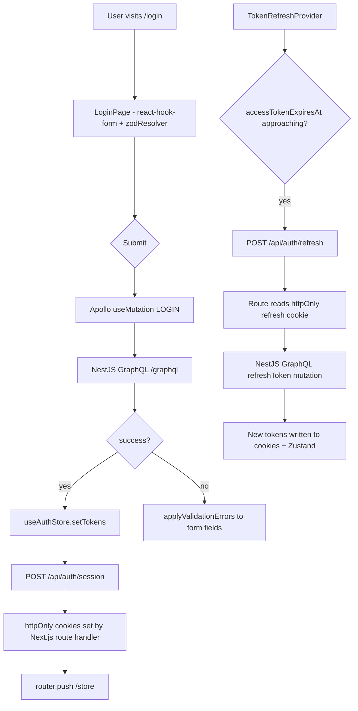

# Auth

**Last updated:** 2026-10-04 - **Feature:** `src/features/auth/`

## Overview

The auth feature covers password login, OTP login, **Google / Apple Sign-In**,
forgot/reset password, email verification, and logout. After success it writes tokens into httpOnly cookies via Next.js API routes,
keeps the access token in `useAuthStore`, runs `completeVendorSignIn` (creates
a temporary shop when `myShops` is empty, then opens `/store/{slug}` — or the
`?redirect=` target, provided any shop it names is one this account holds), and
schedules refresh via `TokenRefreshProvider`.

## Screens / routes

| Route | Purpose |
|-------|---------|
| `/(auth)/login` | Email/phone + password. Or → Google / Apple (when configured) + OTP link. Discards signup progress |
| `/(auth)/forgot-password` | Request a reset code; goes on to `/reset-password?identifier=…&code_length=…` (`resetPasswordHref`) |
| `/(auth)/reset-password` | Two screens: the code (`?code_length=` boxes, 6 when absent or out of range), then new password + confirm only. `?identifier=` required |
| `/verify-otp` | Two-step passwordless sign-in: collect identifier, then enter the code in as many boxes as the send announced. Outside the `(auth)` group — see below |
| `/(auth)/verify-email` | Confirms email via `?token=`; handles expired/invalid; allows resend |
| `/register` | Signing up moved out of this feature and out of the `(auth)` frame — see [signup](signup.md). The client `register` mutation and `registerSchema` no longer exist. |
| `/api/auth/session` (POST/DELETE) | Stores tokens in httpOnly cookies / clears them |
| `/api/auth/refresh` (POST) | Server-side token rotation via httpOnly refresh cookie |
| `/api/auth/logout` (POST) | Revokes refresh token on server, then clears all auth + shop cookies |

**`/verify-otp` wears the same `AuthShell` frame with the same layout slots** — it is a sign-in, so only the card's question differs from `/login`. It stays outside the `(auth)` group (the screen passes its own shell props rather than taking the layout's), so the URL is unchanged and `proxy.ts` needed no edit. The screen itself is `features/auth/components/code-sign-in.tsx`; every mutation, cooldown and error path is as it was. Filling the last slot submits `verifyOtpCode` immediately; the Verify button stays as a fallback.

The remaining auth screens share the `(auth)` layout, which renders `AuthShell` from `@repo/ui`: **one white card centered on a dark shader ground** — the same card-on-ground composition `/register` and `/verify-otp` stand on, so every entry screen is one design language. The ground is `ShaderBackground` ("Mesh drift"): deep-navy-to-cyan lobes drifting across a WebGL field and rotating under the pointer, with a fixed dark scrim between the canvas and the content because the recipe's brightest colour is near-white and the type above the card is cream. It is the same ground `/shops` stands on, so the screens either side of a sign-in match; where there is no WebGL the shell's own `#0a0a0a` shows through unchanged. Above the card: brand, a mono eyebrow, the display headline (a `p`, not a heading — the card's own `h1` owns the page), and the muted quote; below it, a row of product-truth chips ("Products & orders" …) — all localized slots from the layout. The ground does not flip theme tokens (the card must stay light, and carries `color-scheme: light` for autofill); the top bar and brand block sit in small `dark` subtrees with an explicit cream resting colour, so "Home" and the locale switcher stay visible on the ink. The mono eyebrows drop their letter-tracking under RTL because spaced-apart Arabic script breaks its joins. The ground freezes to one still frame under `prefers-reduced-motion`.

Each screen opens with `AuthHeading` (`@repo/ui`): a mono eyebrow naming the flow ("Sign in", "Account recovery", …) behind a single ember cell, then the title and supporting line. Controls come from the shared auth form kit (`@repo/ui/components/auth-form`): `AuthInput`/`AuthSubmit` at the signup wizard's `h-14 rounded-xl` scale, and `AuthOtpGroup`/`AuthOtpSlot` for separated always-LTR code boxes — the same vocabulary on every entry card, wrapped over the ordinary `Field`/`FieldLabel`/`FieldError` plumbing. Page content is start-aligned; the OTP control and its error stay centered, since the slots read as one unit.

## How it works

## Components

Reset and passwordless sign-in live under `src/features/auth/components/`. The remaining auth pages are self-contained client components under `src/app/(auth)/`. Supporting infrastructure lives in `src/shared/lib/auth/`:

| File | Role |
|------|------|
| `components/code-sign-in.tsx` | Passwordless `/verify-otp`: identifier, then the code — `code_length` boxes from the send (a resend that answers another length redraws and clears them). Completing the last slot submits immediately. A phone number not proven on its account gets no code (`PHONE_NOT_CONFIRMED`): the identifier field says to sign in with the email (`auth.verifyOtp.phoneNotConfirmed`) |
| `components/reset-password-flow.tsx` | Forgot-password steps 2 and 3: OTP-only in `code_length` boxes (auto-continues when complete), then new + confirm. The mutation still sends `identifier` + `code` + passwords; the code is never on the password screen |
| `token-refresh-provider.tsx` | Hydrates Zustand from cookies on mount; schedules proactive refresh 60 s before expiry; detects `TOKEN_REUSE_DETECTED` and force-logs out |
| `graphql-errors.ts` | `applyValidationErrors` maps GraphQL field errors onto react-hook-form; `getErrorCode` extracts `error_code` from Apollo errors |
| `cooldown.ts` | `startCooldown` / `getRemainingCooldownSeconds` enforce a 60-second OTP resend throttle via `localStorage` |
| `cookies.ts` | Set-Cookie option factories (`accessCookieOptions`, `refreshCookieOptions`, `expiryCookieOptions`) shared by API route handlers |
| `cookie-names.ts` | Cookie name constants (`ACCESS_TOKEN_COOKIE`, `REFRESH_TOKEN_COOKIE`, etc.) |

## State & forms

**Zustand store - `useAuthStore` (`src/shared/stores/auth.ts`)**

Fields: `accessToken`, `accessTokenExpiresAt`, `refreshTokenExpiresAt`, `isAuthenticated`. Key actions: `setTokens` (calls `/api/auth/session`, then updates state), `setAccessToken` (called after silent refresh), `clearTokens` (local state only; callers must also hit an API route to clear cookies), `hydrate` (reads cookies into Zustand on first mount).

Auth screens use `useForm` + `zodResolver`. No save bar - auth screens fire mutations on submit (no edit-staging pattern). Server field errors are wired back via `applyValidationErrors`.

## GraphQL operations

| Operation | Type | Purpose |
|-----------|------|---------|
| `Login` | Mutation | Password-based login; returns full token payload |
| `SignInWithSocial` | Mutation | Google / Apple sign-in; returns full token payload |
| `RefreshToken` | Mutation | Rotate the refresh token; called by `/api/auth/refresh` |
| `Logout` | Mutation | Revoke a refresh token on the server |
| `SendOtpCode` | Mutation | Dispatch a one-time code to an email or phone; answers `data.code_length` (4 to 8). Sent through `useSendOtpCode` |
| `VerifyOtpCode` | Mutation | Redeem an OTP; returns full token payload |
| `RequestMagicLink` | Mutation | Generate a magic-link URL |
| `VerifyMagicLink` | Mutation | Redeem a magic-link token; returns access + refresh tokens |
| `ForgetPassword` | Mutation | Dispatch a password-reset code; answers `data.code_length`. Sent through `useForgetPassword` |
| `ResetPassword` | Mutation | Redeem the OTP and set a new password |
| `VerifyEmail` | Mutation | Confirm email ownership via link token |
| `ResendVerificationEmail` | Mutation | Re-send the verification email |
| `ChangePassword` | Mutation | Change password while authenticated |
| `GetMe` | Query | Fetch the authenticated user's profile, role, and permissions |
| `Lookups` | Query | Fetch enum options and locale list (used on app bootstrap) |

## Validation

All schemas are in `src/features/auth/validations/auth.ts` (Zod). Each is a factory over an `auth.validation` translator, so its messages follow the dashboard language:

| Schema | Key rules |
|--------|-----------|
| `loginSchema(t)` | `identifier` non-empty; `password` non-empty |
| `forgotPasswordSchema(t)` | `identifier` non-empty |
| `verifyOtpSchemaFor(length, t)` | `code` exactly `length` digits — built per code, also on the reset screen. `codeLengthFrom` turns the server's `code_length` into 4 to 8, else 6 |
| `newPasswordSchema(t)` | Password rules (min 8 chars, upper+lower+digit+special); confirmation must match. No `code` field |
| `resetPasswordSchema(t)` | Full `resetPassword` payload: identifier + a 4- to 8-digit code + password rules |
| `sendOtpSchema(t)` | `identifier` non-empty |
| `changePasswordSchema(t)` | `old_password` non-empty; new password rules; confirmation must match |

## Main files

- `src/features/auth/api/mutations.ts` - 13 GraphQL mutation documents
- `src/features/auth/api/queries.ts` - `GetMe` and `Lookups` query documents
- `src/features/auth/components/reset-password-flow.tsx` - OTP step then password-only step
- `src/features/auth/validations/auth.ts` - Zod schemas and inferred TypeScript input types
- `src/features/auth/types.ts` - TypeScript response interfaces for all operations
- `src/shared/stores/auth.ts` - Zustand auth store (tokens, `setTokens`, `hydrate`)
- `src/shared/lib/auth/token-refresh-provider.tsx` - Proactive refresh timer and hydration on app mount
- `src/app/api/auth/session/route.ts` - Sets / clears httpOnly cookies after login or logout
- `src/shared/lib/auth/origin.ts` - `isSameOrigin` before any cookie write or clear
- `src/shared/lib/auth/redirect.ts` - `safeRedirect`, the open-redirect guard on `?redirect=`

## Notes

- Screens read `auth.*` (en + ar). The Apollo error link's toasts (account locked, OTP locked, OTP cooldown, email not verified, too many requests with the real wait, network error) and the token-reuse sign-out read `requestErrors.*` through `translatorFor()` (`src/shared/i18n/outside-react.ts`), which takes the language from `<html lang>`, so a toast matches the page under it.
- **The code's length comes from the send (2026-09-27).** An admin sets it from 4 to 8 and a Twilio Verify service has its own, so the boxes, the zod schema and the auto-submit all follow `code_length`. `lib/legacy-code-length.ts` is transitional and holds only the two legacy documents: an API older than the field refuses the selection at validation (nothing is sent), and the send is retried once with the old selection, drawing 6. The refusal test and the retry themselves (`isUnknownFieldError`, `withLegacyFallback`) live in `shared/lib/apollo/legacy-fallback.ts` and are re-exported from this file; the share page's currency fallback uses the same pair. Delete the file once the API has shipped.
- Completing every OTP slot on `/verify-otp` and on the reset-code screen submits immediately (`useOtpAutoSubmit` in `@repo/ui`). A latch on the completed value plus an in-flight lock prevent a second request from a duplicate complete event or from clicking Verify while the first is running.
- The dashboard `EmailVerificationBanner` ("Verify your email" / resend activation link) renders in `DashboardShell` only when `me.email_verified === false`. Email OTP (signup or `/verify-otp`) sets that flag, so the banner does not appear after proving the inbox. Phone-only OTP still shows it.
- **A `?redirect=` into another account's shop is dropped** (`src/features/auth/lib/complete-vendor-sign-in.ts`). The proxy writes `/login?redirect=<path>` whenever a signed-out request reaches a dashboard page, and the parameter outlives the session that wrote it, so after an account switch it names the previous account's shop. Following it opened a dashboard whose every shop-scoped query `ShopHeaderGuard` refused with `RESOURCE_NOT_FOUND`, shown as a "Resource Not Found" toast. A `/store/<slug>` or `/plan/<slug>` target is now followed only when `<slug>` is one of the handles `ensureVendorShop` returns; anything else lands on the dashboard, including a retired handle of the vendor's own shop, since only current handles are known at sign-in. If the shop list cannot be read, a shop-scoped target goes to `/store`, which makes the same check on the server. Which segment counts as a shop is `shopSlugOfPath` (`src/shared/lib/shop-path.ts`), the same answer the proxy uses.
