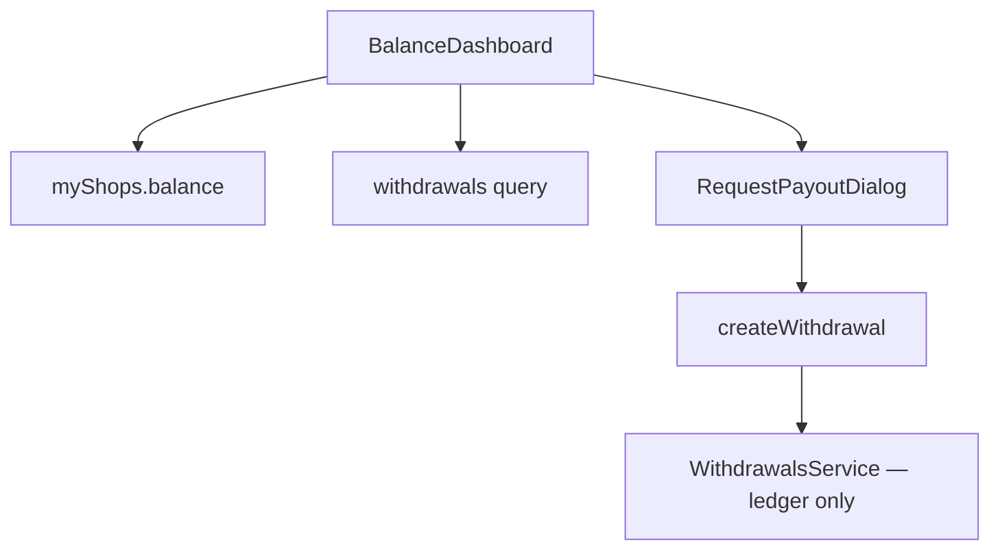

# balance

**Last updated:** 2026-09-28

**Deprecated / planned for removal (D26).** Internal shop ledger + `createWithdrawal`. Approval does not send money. Do not extend. Future: [Tap Commerce Platform](../../../../docs/future-features/tap-commerce-platform.md).

## Overview

Vendor screens that read `Shop.balance` and list/create withdrawal requests for the shop in `X-SHOP`.

## Screens / routes

| Route | Screen |
|-------|--------|
| `/store/[shopSlug]/balance` | `BalanceDashboard` — earnings, commission bps, request payout |
| `/store/[shopSlug]/withdrawals` | Same dashboard (alias) |

Sidebar: Wallet → `${base}/balance`.

## Diagram

## Components

- `BalanceDashboard` — KPIs from `myShops`, table of requests.
- `RequestPayoutDialog` — amount + optional details (pre-filled from the shop's `payment_info`); `CREATE_WITHDRAWAL`.

## State & forms

Local dialog state. No unsaved bar (immediate mutation).

## GraphQL operations

`VendorWithdrawals`, `CreateVendorWithdrawal`; balance fields on `myShops`.

## Validation

Amount converted with `majorToCents`; server enforces `amount_cents >= 1` and available `current_balance_cents`.

## Main files

- `src/features/balance/components/balance-dashboard.tsx`
- `src/features/balance/components/request-payout-dialog.tsx`
- `src/features/balance/api.ts`
- `src/app/store/[shopSlug]/balance/page.tsx`

## Notes

Keep until a Tap cutover. Do not add payout references, bank rails, or Tap fields here.

- The dashboard and the payout dialog read `withdrawals.*` (en + ar), with no English fallbacks left. `BalanceDashboard` writes the shop's `payment_info` as `withdrawals.detailsLines` lines (Bank, IBAN/Account, Name) and the dialog pre-fills its Details box with them. They are submitted as the request's free-text `details`, so a request reaches finance in the merchant's language.
