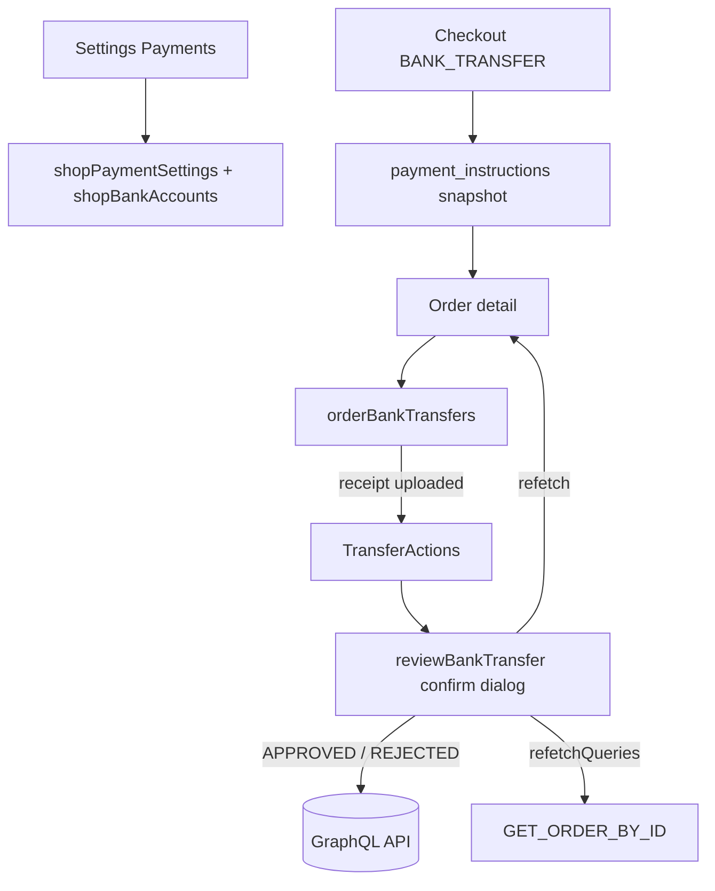

# Bank transfers

**Last updated:** 2026-09-17 — **Feature:** `src/features/bank-transfers/`

## Overview

Bank transfer is a shop payment method: merchants add Saudi receiving accounts and toggle methods under Settings → Payments, and customers pay by transferring to an instructed IBAN then uploading a receipt. **Receipt review happens on the order detail page** — there is no standalone queue. Approve marks the order paid; reject returns a reason so the customer can resubmit. Both are confirm-dialog actions, not the contextual save bar.

## Screens / routes

| Route | Purpose |
|-------|---------|
| `/store/[shopSlug]/settings/payments` | Payment method toggles + Saudi bank accounts |
| `/store/[shopSlug]/orders/[id]` | Order detail: bank-transfer card with receipt view and approve/reject |
| `/store/[shopSlug]/orders/bank-transfers` | Redirects to the orders list (legacy bookmarks) |

## How it works

## Components

| Component | Role |
|-----------|------|
| `PaymentsSettings` | Settings pane: COD / card / bank toggles and account list |
| `BankAccountDialog` | Create/edit a Saudi receiving account (save bar on the settings form) |
| `OrderBankTransfersCard` | Order-detail panel: instructed IBAN, waiting state, or submitted transfer(s) |
| `TransferActions` / `TransferReviewDialog` | View receipt; approve or reject behind a confirm dialog |
| `ReceiptDialog` | Authenticated receipt fetch (blob URL); image or PDF download |
| `TransferDetails` / `TransferStatusBadge` | Shared transfer summary and status pill |

## State & forms

Payment settings and bank accounts stage behind the global unsaved bar (`bankTransfers.unsavedChanges`). Transfer review does **not** — Approve / Reject open `TransferReviewDialog`, call `reviewBankTransfer`, then refetch `orderBankTransfers` and `GET_ORDER_BY_ID`.

## GraphQL operations

| Operation | Type | Purpose |
|-----------|------|---------|
| `VendorPaymentSettings` | Query | Banks catalog, shop payment settings, bank accounts |
| `VendorUpdatePaymentSettings` | Mutation | Toggle COD / card / bank transfer |
| `VendorCreateBankAccount` / `Update` / `Delete` | Mutation | Manage receiving accounts |
| `VendorOrderBankTransfers` | Query | Transfers for one order (`order_id`) |
| `VendorReviewBankTransfer` | Mutation | Approve or reject a pending transfer |

The shop-wide `bankTransfers` list query remains on the API but is unused in this app.

## Validation

`lib/validation.ts`: Saudi IBAN check digit, account form Zod schema, `canReviewTransfer` (PENDING + `can_review`), rejection reason length 3–500.

## Main files

- `api.ts` — payment settings + order transfers + review mutation
- `components/order-bank-transfers-card.tsx` — order-detail review panel
- `components/transfer-review.tsx` — status, details, approve/reject dialog
- `components/payments-settings.tsx` — Settings → Payments
- `lib/receipt.ts` — authenticated receipt URL fetch
- `lib/validation.ts` — IBAN and review helpers

## Notes

- Receipt bytes are never a public CDN URL; `ReceiptDialog` uses a short-lived blob (raw `` for blobs, not `app-image`).
- Sidebar **Orders → Bank transfers** was removed; old URLs redirect to `/orders`.
