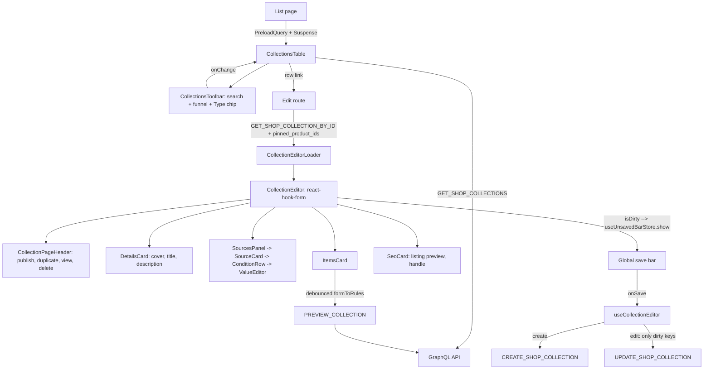

# Collections

**Last updated:** 2026-10-05 - **Feature:** `src/features/collections/` — a Sidekick handoff marks the fields it filled

## Overview

The screen where a vendor curates a group of products. It is built around **sources** rather than a manual/smart mode: a Products source selects by condition and takes hand-picked additions, a Collections source pulls in the members of other collections, and each source carries its own exclusions. The items panel is a live preview - `previewCollection` runs the staged rules against the catalogue on every edit, so a condition can be judged before it is saved. Create and edit are the same screen; the global save bar is the only commit point.

## Screens / routes

| Route | Purpose |
|---|---|
| `/store/[shopSlug]/products/collections` | List all collections (`CollectionsTable`) |
| `/store/[shopSlug]/products/collections/new` | New collection (`CollectionEditor`) |
| `/store/[shopSlug]/products/collections/[collectionId]` | Edit (`CollectionEditorLoader` -> `CollectionEditor`) |

The row-actions menu and the name cell both link to the edit route; there is no edit dialog. Publishing is reachable from both ends: the list shows a Status column and a Publish/Unpublish row action (an immediate write, since it is one boolean with nothing to stage), and the editor's header menu stages the same field into the form.

## How it works

## Components

**`components/editor/`**

| Component | Purpose |
|---|---|
| `CollectionEditor` | Root. Owns the form, the save bar, the item-removal rule (un-pin vs exclude), and the two shortcuts the empty items panel offers (add a condition to the first products source, open the hand-picked set) |
| `CollectionEditorLoader` | Edit route's data half; suspends on the collection query |
| `CollectionPageHeader` | Breadcrumb, the publish pill, and the page's own actions: Duplicate, View, and a More-actions menu (Publish/Unpublish, Copy link, Delete) |
| `DetailsCard` | Cover (via the shared `MediaLibraryPicker`) with its alt-text input, and the borderless title/description, which edit whichever locale the form's EN/AR pill is on. It carries no publish control |
| `ItemsCard` | Live preview. The card header (title, count, hint) sits on the card surface and everything that operates on the items - grid/list toggle, column-count menu, sort menu with a chip for a non-default sort, paging, per-item remove - sits below it on a recessed `bg-muted` panel, so controls read as one thing and the collection they describe as another. Its empty state is the animated skeleton itself, so empty and first paint render the same thing; hovering it fades the middle of the grid and reveals Add condition / Add products |
| `SourcesPanel` | The source list, the add-source button, and the condition count once it is within ten of the API's 60-condition budget - red at the cap, where every card's Add condition (and the exclude menu's Condition) is disabled |
| `SourceCard` | One source: kind, match mode, conditions, hand-picked products, exclusions |
| `ConditionRow` | Attribute + operator + values; changing the attribute resets both of the others |
| `AttributePicker` | Searchable attribute popover |
| `ValueEditor` | Operand editor per value kind: chips OR-ed for text/enum/category, number, money, min-max range, or nothing for presence operators |
| `ProductPickerDialog` / `CollectionPickerDialog` | Staged multi-select for picks and exclusions |
| `SeoCard` | Search-engine listing preview with the overrides and the handle behind Edit. The overrides edit the pill's locale, and the preview reads that locale first with the other as fallback |
| `use-collection-preview.ts` | Debounced `previewCollection` against the staged rules |
| `use-collection-editor.ts` | Submit: create in full, edit as a dirty-key patch |
| `use-category-options.ts` / `use-collection-options.ts` | Labels for category and collection ids |

**`components/collection-create-dialog.tsx`** - `CollectionCreateDialog`, the "Add collection" drawer used from outside this feature (today: the product form's collections picker). It is a drawer rather than a route because its caller is mid-edit on another form, and all it owns is the shell, the header and the way out - the form inside it is `CollectionEditor` itself, so the dialog stays in step with the route for free.

`CollectionEditor`'s `embedded` prop is what makes that work, and it changes four things that all follow from not owning the page. The **header** comes from the host, because this one's carries a breadcrumb out of the dialog and three actions (Duplicate, View, Delete) that are dead on a collection that does not exist yet. The **global save bar** is left alone, because the host's form is already using it - two screens driving one bar means one screen's Save discards the other's. The sources column's **sticky offset** (`stickyTop`) comes from the host, because inside the drawer the scrolling element and the header the column pins under are both the host's; without one the column stays in flow, and the route keeps its own `lg:top-20` (the site header plus 16px). And the **root is a `div`, not a `form`**: a dialog portals to the body, but React events still travel the React tree, so a nested `form` would fire the host form's `onSubmit` on the way past. `useCollectionEditor`'s matching `onCreated` hands the new collection back instead of navigating to it, and keeps failures out of that borrowed save bar.

Because that save bar is borrowed, its Discard is not watching this form - so the drawer guards its own close. `embedded.onDirtyChange` mirrors the editor's `isDirty` into the dialog, and every close path (the header's Discard, Escape, a backdrop press) routes through one confirm (`shared/components/confirm-dialog.tsx`) while it is true; the dismissal paths reach it through the Drawer's `onOpenChange`, where `eventDetails.cancel()` stops Base UI closing underneath the confirm. The confirm is rendered inside `DrawerContent` so Base UI's context-based nesting applies - an outside press that lands in it is not an outside press for the drawer, and Escape closes only the innermost. A successful create skips the guard: `useCollectionEditor` resets the form before it calls `onCreated`, so that close is never a discard.

**`components/list/`** - `CollectionsTable` (holds the filter chips plus the rest of the TanStack Table state), `CollectionsHeader`, `CollectionsToolbar` (quiet chrome: compact search, funnel, column picker; a Type chip on the second row; Clear empties chips and search together), `CollectionsEmpty`, `CollectionsRowActions` (Edit, Publish/Unpublish, Delete), `DeleteCollectionDialog` (takes an optional `onDeleted`, which the editor uses to return to the list), `collections-columns.tsx` (Status column).

## State & forms

`react-hook-form` + `zodResolver(collectionFormSchema(t))`. The form mirrors the API's rules v2 shape one for one - `sources[].conditions[].values[]` - so saving is a coercion pass, not a translation layer. Every control stages through `setValue(..., { shouldDirty: true })`; nothing fires a mutation on change.

`isDirty` drives `useUnsavedBarStore`. Create mode keeps the bar available from the start (there is nothing to go back to) with `discardHref` to the list; edit mode is dirty-gated and Discard resets to the server snapshot. On save, **create** sends everything and **edit** sends only the keys whose `dirtyFields` moved - `product_ids` especially, because the API treats it as a whole-set replace and sending it untouched would drop a product pinned elsewhere while the screen was open.

The EN/AR switch is the product form's `LocaleProvider` + `LangTabsBar` (`features/products/components/form/ui/lang-tabs.tsx`), which `CollectionEditor` mounts on its own route only. Embedded in the product form's create drawer it mounts neither: the drawer is rendered inside the host's provider (context crosses the portal), so the host's pill already drives these inputs, and a second pill would be two answers to "which language". Switching the pill is not an edit - only the typed locale lands in `dirtyFields`, and `formToInput` drops an empty locale rather than sending `""`.

Removing an item does the thing that actually keeps it out: un-picks a hand-picked product, and adds an exclusion for one a condition matched. Optional AI prefill (`useVendorAgentPrefill("collection_create")`) is merged into the create-mode defaults by `mergePrefill` (`shared/lib/merge-prefill.ts`): one level deep, except `COLLECTION_TRANSLATABLE_FIELDS` (`name`, `description`, `seo_title`, `seo_description`), which merge per locale, so a name the assistant gave in one language leaves the other as it was. On the create screen those fields carry a "Filled by Sidekick" mark (`AiPrefillProvider` + `proposedFromPrefill`) while they still hold what the assistant proposed, including a later `patch_form`, and that screen registers the handoff as the live form (`useLiveForm`). The edit screen and the product-form drawer do neither, and the drawer does not inherit the product form's marks.

**The list screen** keeps its filters in the shared `FilterBar`. The chips are the state - a `Filter[]` in `useState` - and `columnFilters` is a `useMemo` view of them through `toColumnFilters`, never the reverse: a chip that has just been added holds no values, and reading the bar back out of the applied filters would drop it in the render it appeared in. `lib/list/filters.tsx` declares the one field, Type, from `COLLECTION_TYPE_OPTIONS`, with a single `is` operator over one value - the `type` column declares no `filterFn`, so TanStack resolves `includesString`, which stringifies what it is given: `["MANUAL"]` reads as `MANUAL` and matches, `["MANUAL", "AUTOMATED"]` reads as the literal `MANUAL,AUTOMATED` and matches nothing, so the bar offers only what the column can answer. `toFilters` is the way back, because the toolbar's Reset still clears through `table.resetColumnFilters()` - that one press empties the bar and the search box together, which the bar's own Clear does not.

## GraphQL operations

| Operation | Type | Purpose |
|---|---|---|
| `ShopCollections` | Query | Paginated list (`page`, `limit`, `search`); also backs the collection picker |
| `ShopCollection` | Query | Single collection plus `pinned_product_ids`, for the edit route |
| `CollectionItems` | Query | A saved collection's members in its own sort order |
| `PreviewCollection` | Query | What the staged rules would select; writes nothing |
| `CreateCollection` / `UpdateCollection` / `DeleteCollection` | Mutation | Save and soft-delete |
| `ReorderCollectionProducts` | Mutation | Manual ordering (defined; no drag affordance yet) |

## Validation

`collectionFormSchema(t)` (`validations/shop-collection.ts`) is built from a `collections.validation` translator, so every message below follows the dashboard language (`TITLE_REQUIRED_MESSAGE`, the English title literal, is gone): at least one non-empty `name` locale; `slug` optional and `[a-z0-9-]*` (empty lets the API transliterate the title); at least one source; a Collections source needs at least one collection; every condition needs a value unless its operator is `IS_SET` / `IS_NOT_SET`; `BETWEEN` needs both ends; an `attribute` condition needs its key; at most 60 conditions across sources and exclusions (`MAX_TOTAL_CONDITIONS` / `countConditions`, mirroring the API's evaluator, with the issue on `sources` so it reaches the save bar). The cap is also gated on screen because the same check runs on `previewCollection`, whose error the items panel does not surface - one row over, the preview would freeze on its last result and the refusal would only appear at Save.

`lib/rules.ts` holds the catalogue and the mapping: `OPERATORS_BY_FIELD`, `EXCLUSION_FIELDS`, `ENUM_VALUES`, `valueKindOf`, `formToRules` / `rulesToForm` (money scaled between cents and major units, legacy `IN` folded into multi-value `EQ`), `collectionToForm`, `formToInput`, `slugify`. `IN` / `NOT_IN` are not offered in the UI - a condition already holds several OR-ed values and the compiler treats both spellings identically.

## Main files

- `src/features/collections/lib/rules.ts` - condition catalogue and the form/wire mapping
- `src/features/collections/validations/shop-collection.ts` - the form schema
- `src/features/collections/components/editor/collection-editor.tsx` - editor root and save-bar wiring
- `src/features/collections/components/editor/source-card.tsx` - the sources panel's working part
- `src/features/collections/components/editor/use-collection-preview.ts` - the live preview
- `src/features/collections/api/` - queries and mutations
- `src/features/collections/components/list/collections-table.tsx` - list page root: holds the chips, derives `columnFilters`
- `src/features/collections/lib/list/filters.tsx` - the Type field and the chip/`columnFilters` mapping
- `src/features/collections/components/collection-create-dialog.tsx` - the create drawer other features open
- `src/features/collections/lib/list/constants.ts` - page size, the status pill's tones, `COLLECTION_TYPE_OPTIONS` (the vocabulary the filter field is built from), and `COLLECTIONS_PICKER_VARIABLES` (the list query every picker reuses, so it reads the table's cached page instead of fetching the same rows again)

## Notes

- Every string on the list and the editor reads `collections.*` (en + ar): header, empty card, columns (`buildCollectionColumns(shopSlug, t)`), table, toolbar, row actions and the delete dialog (`collections.deleteDialog`). The Type column shows `collections.type.*` (Manual / Automated) rather than the lowercased enum.
- Hand-picked products are one set per collection, so the "Add products" button lives on the first Products source rather than on every card.
- Title conditions are case-sensitive (a Postgres JSON filter has no case-insensitive mode); the row says so under the input.
- The SEO card previews the full URL on the storefront origin (`NEXT_PUBLIC_STOREFRONT_URL`, default `http://localhost:3003`) as `/{shopSlug}/collections/{handle}`. "View" and "Copy link" build from the same origin, but nothing on the storefront routes by collection handle, so they link to the catalogue filtered by id: `/{shopSlug}/products?collections={id}`.
- Duplicate creates a new collection from the *staged* form values with `(copy)` appended to the title and no handle, so the API derives a free one, then routes to the copy. It is an immediate write, not something the save bar commits.
- The cover's alt-text input renders only while a cover is set: `formToInput` drops the alt when there is no URL to attach it to, so an input without an image would stage a value that never reaches the API. Removing the cover clears both fields.
