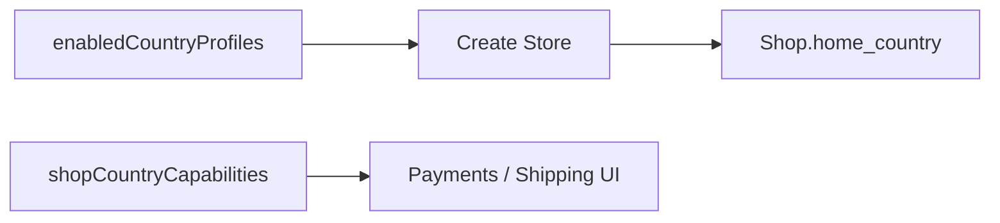

# Country profiles (vendor)

**Last updated:** 2026-10-07 — **Feature:** shops / signup / shipping / bank-transfers

## Overview

Create Store asks for a declared business country from `enabledCountryProfiles`. That becomes `Shop.home_country`. Settings screens read `shopCountryCapabilities` to hide payment methods and carrier delivery the platform does not allow. Shipping zones use city codes when `shipping_match` is `CITY` (Palestine).

## Screens/routes

| Route | Role |
|---|---|
| `/create-store` | Country step, then store types |
| `/register` (store pane) | Same country step; soft-preselect from phone dial when enabled |
| Settings → Shipping | City multi-select for PS; carrier UI hidden when not allowed |
| Settings → Payments | Method switches by `allowed_payments`; FREEFORM bank form when mode says so |

## How it works

## Components

- `create-store-screen.tsx` / `store-step.tsx` — country picker then types
- `zone-form-dialog.tsx` — `cityMatch` + Palestine cities
- `delivery-channels-card.tsx` — `carrierAllowed`
- `payments-settings.tsx` / `bank-account-dialog.tsx` — caps + FREEFORM vs SAUDI_IBAN

## GraphQL operations

`enabledCountryProfiles`, `shopCountryCapabilities`, `palestineCities`, `createShop(home_country)`.

## Main files

- `features/shops/api/country-profiles.ts`
- `features/shops/components/create-store-screen.tsx`
- `features/shipping/components/zone-form-dialog.tsx`

## Notes

Backend docs: `back-end/docs/features/country-profiles.md`. Admin toggles `enabled` at `/settings/country-profiles`.
