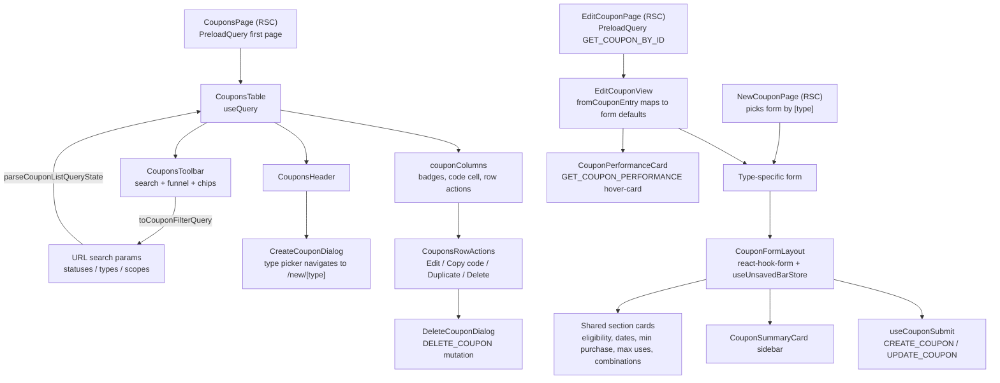

# Coupons

**Last updated:** 2026-10-05 - **Feature:** `src/features/coupons/` — a Sidekick handoff registers the form as live

## Overview

Merchants create, browse, edit, and delete discount coupons for their shop. Four coupon types are supported: amount off products, amount off order, buy X get Y (BOGO), and free shipping. The list page lets merchants filter and paginate all coupons; the edit page reuses the same form components in edit mode and surfaces a live performance hover-card.

## Screens / routes

| Route | Purpose |
|-------|---------|
| `dashboard/[shopSlug]/coupons/page.tsx` | Paginated list with search and filters |
| `dashboard/[shopSlug]/coupons/new/[type]/page.tsx` | Create form -- `[type]` is one of the four `CouponType` values. `?from=<id>` seeds a duplicate (new code, create not update) |
| `dashboard/[shopSlug]/coupons/[id]/edit/page.tsx` | Edit form with performance card |

## How it works

## Components

**List** (`components/list/`): `CouponsTable` (fetches, owns the URL state and the filter chips, wires TanStack Table), `CouponsHeader` (the title and the Create coupon button, nothing else -- there is no overflow menu because the API has no coupon CSV export or import; only products have one), `CouponsToolbar` (quiet chrome: code search, funnel, column picker; FilterBar chips for Status, Type and Scope on a second row; Clear resets chips and search), `couponColumns` (code, badges, usage, expiry, actions), `CouponCodeCell`, `CouponBadges`, `CouponsRowActions`, `CreateCouponDialog`, `DeleteCouponDialog`, `CouponsEmpty`.

Every string on the list and the forms reads the top-level **`coupons`** namespace (en + ar): `coupons.title`, `coupons.create`, `coupons.kinds.*`, `coupons.empty.*`, and a sub-namespace per form card. The type picker's rows are keyed by the enum -- `coupons.kinds.amount_off_products.label` and its `description` -- which mirrors the products kind picker exactly, so the two stay mirrors; `COUPON_TYPE_META` is left holding only the order and the icon, and `COUPON_TYPE_LABEL` is gone. What is built outside a component takes the translator: `couponColumns(t, locale)`, `couponFilterFields(t, operators)`, `couponValue(coupon, t)` and `couponScopeLabel(coupon, t, locale)`; the bar's options resolve the same keys the list's badges read. Cancel comes from `common.cancel`.

**New/Edit** (`components/new/`): `CouponFormLayout` (two-column grid, save bar), `CouponSummaryCard`, `coupon-base-fields.tsx`, shared cards (active-dates, eligibility, minimum-purchase, maximum-uses, combinations, advanced), type forms (amount-off-order, amount-off-products, bogo, free-shipping), `ScopePreview` (the picker summary box; `kind: "products" | "collections"` picks its plural count message and empty state), and modal pickers: `ProductPickerDialog`, `CategoryPickerDialog`, `CustomerPickerDialog`, `SegmentPickerDialog`, `CountriesPickerDialog`.

**Edit-only** (`components/edit/`): `EditCouponView` (maps entry via `fromCouponEntry`), `CouponPerformanceCard` (hover-card showing redemptions, discount given, revenue, avg order value, first/last used).

## State & forms

**react-hook-form** drives every form with Zod `zodResolver` and a per-type schema. `isDirty` is the dirty signal. `CouponFormLayout` registers `useUnsavedBarStore` when `isDirty` is true; `onSave` calls `form.handleSubmit` -> `useCouponSubmit`; discard navigates back to the list. Mutation errors are surfaced back into the bar via `setError`. No Zustand editor store -- all draft state lives in react-hook-form. URL query state (`lib/list/query-state.ts`) encodes page, search, statuses, types, and scopes as search params.

**The list's filters** are the shared **`FilterBar`** (`shared/components/filter-bar.tsx`), and `lib/list/filters.tsx` is the seam between its chips and that URL. `couponFilterFields(t, operators)` declares Status, Type and Scope, each with one multi-value `is any of` operator, since the query takes a list per field, and each field's `id` is the query-state key it writes (`statuses`, not `status`), so no lookup table sits in between. `toCouponFilterQuery` unions the values of every chip on a field, validates them against the same lists the URL parser accepts, and always returns all three keys, because `updateQuery` decides what to write with `key in patch` and an omitted key would leave the last value in the URL. The chips are held in state rather than derived from the URL on every render -- a chip that has just been added carries no values and deriving would drop it before one could be picked -- and the two are reconciled by `couponFilterSignature`. That rebuild is skipped while a `router.replace` is in flight (`useSearchReplace`): changing a chip's field clears its values, so the derived URL has no `?statuses=`, and reading the still-committed URL would restore or drop the chip and look like a reload. The list fetches with `useQuery` (previous page kept on screen) so a filter change does not suspend the table. Reset clears the chips outright and drops the search term with them, since a valueless chip writes nothing to the URL for that reconciliation to notice.

## GraphQL operations

| Operation | Type | Purpose |
|-----------|------|---------|
| `GET_COUPONS` | Query | Paginated list with search/status/type/scope filters |
| `GET_COUPON_BY_ID` | Query | Full detail for edit form (products, customers, segments) |
| `GET_COUPON_PERFORMANCE` | Query | Redemptions, discount given, revenue, avg order value, first/last used |
| `GET_SHOP_CUSTOMERS_FOR_COUPON` | Query | `shopCustomers(search, page, limit)`: the shop's customers for the Specific-customers picker, searched server-side (name, email, or the digits of a number) behind a 250ms debounce. A coupon's `customer_ids` are these `customers.id`s; the back-end refuses any other. A customer with no name is labelled by their number |
| `CREATE_COUPON` | Mutation | Create coupon from typed form |
| `UPDATE_COUPON` | Mutation | Save edits; refetches active queries on success |
| `DELETE_COUPON` | Mutation | Hard-delete by ID |
| `VERIFY_COUPON` | Mutation | Validate code against a cart; returns `discount_preview` and `conflicts_with`; storefront use only, not called from management screens |

## Validation

Four Zod schema factories in `validations/coupon.ts`, one per type, each built from a `coupons.validation` translator and all extending `baseCouponShape(t)`:

- **`amountOffProductsCouponSchema(t)`** -- positive amount (max 100 if percentage), at least one product or collection.
- **`amountOffOrderCouponSchema(t)`** -- same amount rules; no product scope required.
- **`freeShippingCouponSchema(t)`** -- amount defaults to 0; if `countries_mode === "selected"`, at least one country required; optional `exclude_shipping_rates_over` cap.
- **`buyXGetYCouponSchema(t)`** -- buy quantity/amount, get quantity/discount (percent, amount, or free); shared or separate buy/get pools.

Shared `baseCouponShape(t)` refinements: code required (min 2 chars, `[A-Z0-9_-]`) when `method === "code"`; end date must be after start; minimum amount/quantity validated only when the corresponding mode is active; `max_uses` validated only when `limit_uses` is true; customer/segment arrays validated only when the matching eligibility mode is active. Percentage amounts are stored as basis points (`percent_bps`; 1500 = 15.00%) on the wire; `transform-coupon-input.ts` handles the conversion. zod's own messages -- a check with no custom text, such as `.positive()` on `max_uses` -- follow the dashboard language through `ZodLocale` (`src/shared/i18n/zod-locale.tsx`, mounted once in the root layout).

## Main files

- `vendor/src/features/coupons/api/` -- `queries.ts` (all four queries) and `mutations.ts` (create, update, delete, verify)
- `vendor/src/features/coupons/lib/list/filters.tsx` -- the three filter fields and the chip/query-state mapping (`toCouponFilterQuery`, `toCouponFilters`, `couponFilterSignature`)
- `vendor/src/features/coupons/validations/coupon.ts` -- four Zod schema factories and shared refinements
- `vendor/src/features/coupons/components/new/coupon-form-layout.tsx` -- shared layout and save-bar wiring
- `vendor/src/features/coupons/components/new/use-coupon-submit.ts` -- create/edit mutation handler
- `vendor/src/features/coupons/components/edit/edit-coupon-view.tsx` -- edit entry point using `fromCouponEntry`
- `vendor/src/features/coupons/lib/new/transform-coupon-input.ts` -- maps form output to `CreateCouponInput` / `UpdateCouponInput`

## Notes

A form opened from a Sidekick handoff registers through `useCouponLiveForm` (`lib/live-form.ts`) under that ticket, on create and on edit. Chat then carries the form's values, and a `patch_form` result is staged dirty until Save. A form the merchant opened themselves does not register.

- `_data/countries.ts` holds ISO2 codes only. Names come from `countryLabel(code, locale)`: the shared `regionName` (`src/shared/lib/country-name.ts`, `Intl.DisplayNames`), then the shared geo table, then the code, so PS reads "Palestine" / «فلسطين». `countriesFor(locale)` keeps the pinned MENA/GCC block first and sorts the rest by their name in the active language. Submitted values stay ISO2.
- Lists (scope summaries, "combines with", country names) join through `lib/format-list.ts` (`Intl.ListFormat`), so Arabic gets its own separators. The date field shows dates with date-fns' Arabic locale in Arabic; the stored value stays `yyyy-MM-dd`.
