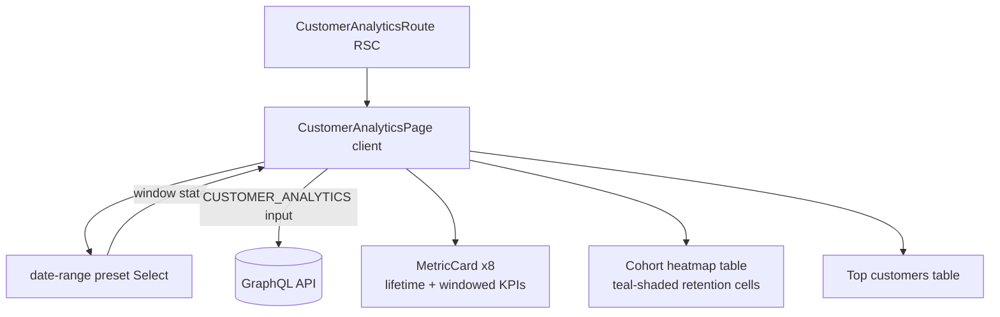

# Customer Analytics

**Last updated:** 2026-09-26 — **Feature:** `src/features/customer-analytics/`

## Overview

A read-only insights page showing who the shop's customers are and how well it keeps them. It presents lifetime KPIs (total customers, repeat rate, average lifetime value, average orders per customer), a windowed row (new / returning / active customers and period revenue for the selected date range), a **cohort-retention heatmap** (each row is a first-purchase month; each cell is the share of that cohort still ordering N months later, shaded teal by strength), and a **top-customers** table by lifetime spend. Money renders in the shop's currency from the payload; a date-range preset drives the windowed metrics.

## Screens / routes

| Route | Purpose |
|-------|---------|
| `/store/[shopSlug]/analytics/customers` | Customer insights (KPIs, cohort heatmap, top customers) |

## How it works

## Components

| Component | What it shows |
|-----------|--------------|
| `CustomerAnalyticsPage` | Root island. Owns the `preset` state, derives the ISO window, runs one query, and lays out the KPIs, cohort heatmap, and top-customers table. |

Reuses `MetricCard` from the analytics feature for the KPI tiles.

## State & forms

Read-only — no forms, no save bar. One local `preset` state; changing it recomputes the `[start, end)` window (`rangeForPreset`) and Apollo re-fetches with `fetchPolicy: "cache-and-network"`. Shop scope rides the `X-SHOP` header from the Apollo link.

## GraphQL operations

| Operation | Type | Purpose |
|-----------|------|---------|
| `AnalyticsCustomers` | Query | `customerAnalytics(input)` — summary + cohort matrix + top customers. |

## Validation

None client-side; the back-end validates `CustomerAnalyticsInput` (`cohortMonths` 1–24, `topLimit` 1–50).

## Main files

- `src/features/customer-analytics/api/queries.ts` — the `CUSTOMER_ANALYTICS` query.
- `src/features/customer-analytics/types.ts` — response/summary/cohort/top interfaces.
- `src/features/customer-analytics/lib/cohort.ts` — `cohortCellStyle` teal heat scale.
- `src/features/customer-analytics/components/customer-analytics-page.tsx` — layout, heatmap, tables.

## Notes

- Money arrives as integer cents (`formatMoneyCents` with the payload `currency`); `repeat_rate_bps`/retention are basis points (`bpsToPercent`), and `avg_orders_per_customer_x100` is divided by 100 for display.
- The cohort heatmap is a plain HTML table (not recharts) with inline teal `rgba` backgrounds scaled by retention; it scrolls horizontally on small screens.
- Rows show newest cohort first; the column count follows the oldest (longest) cohort.
- Loading states are `<Bones>` (`shared/components/bones.tsx`), captured from the real DOM by `npm run bones` — there is no hand-written skeleton on this screen; a name with no committed capture shows nothing on the very first load and then measures itself, so every later load draws real bones. Bone names: `customer-analytics-cohorts`, `customer-analytics-top`, plus `analytics-kpi-figure` shared by its KPI row. See [02_build_startup](../02_build_startup/README.md).
- The date-range `SelectValue` renders `analytics.ranges.*` rather than the raw preset enum.
