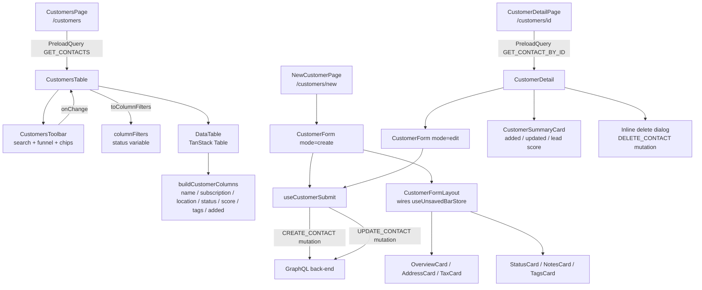

# Customers

**Last updated:** 2026-09-28 - **Feature:** `src/features/customers/`

## Overview

The customers feature lets shop staff create, view, edit, and delete customer records (called "contacts" in the API). Each customer holds a name, phone number, email, and a JSON `meta` blob that carries extras: first/last name split, default address, marketing consent flags, language preference, tax setting, and tags. The list screen supports search, status filtering, sorting, and pagination; the detail/edit screen uses the global contextual save bar so changes are only committed when the user clicks Save.

## Screens / routes

| Route | Purpose |
|---|---|
| `/store/[shopSlug]/customers` | Paginated, searchable customer list |
| `/store/[shopSlug]/customers/new` | Create a new customer |
| `/store/[shopSlug]/customers/[id]` | View and edit an existing customer |

## How it works

## Components

| Component | What it shows |
|---|---|
| `CustomersTable` | Fetches contacts a page at a time, owns the filter chips plus sorting, pagination and row selection, renders toolbar and data table |
| `CustomersHeader` | Page title and "Add customer" button |
| `CustomersToolbar` | Quiet chrome row: compact search, funnel, column picker; FilterBar chips (Status, Subscription) on a second row; Clear empties chips and search together; hides when rows are selected, replaced by a selection count + clear button |
| `CustomersEmpty` | Empty state for no-customers and no-results-after-filter cases |
| `buildCustomerColumns` | Column definitions: select checkbox, name+avatar, email subscription badge, location, status badge, lead score bar, tags, date added, row actions |
| `CustomersRowActions` | Per-row dropdown: Edit, Copy email, Copy phone, and Delete actions |
| `CustomerStatusBadge` | Small coloured pill for active / inactive status |
| `DeleteCustomerDialog` | Reusable confirmation dialog used from the row actions menu; fires `DELETE_CONTACT` and refetches the list |
| `CustomerDetail` | Detail page shell: loads contact by ID, renders `CustomerForm` in edit mode with a Delete header button and an inline delete confirmation dialog; passes `CustomerSummaryCard` as extra sidebar content |
| `CustomerSummaryCard` | Read-only sidebar card showing created date, last updated date, and averaged lead score |
| `CustomerForm` | Entry point for create and edit pages; instantiates react-hook-form and wires it to `CustomerFormLayout` and `useCustomerSubmit` |
| `CustomerFormLayout` | Two-column scaffold (main content + 320 px sidebar); connects `isDirty` to `useUnsavedBarStore` for the global save bar |
| `OverviewCard` | Name (first + last), email, phone, language, marketing consent toggles |
| `AddressCard` | Default address: address lines, city, region, postal code, country, company |
| `TaxCard` | Tax setting selector: collect / don't collect / exempt |
| `NotesCard` | Free-text notes field |
| `TagsCard` | Tag array input |
| `StatusCard` | Active / inactive toggle |

## State & forms

**react-hook-form** is used on both the create and edit screens via `CustomerForm`. The form is initialised with `zodResolver(customerFormSchema)`. On edit, `contactToFormValues(contact)` converts the server `Contact` into form defaults; `isDirty` drives the contextual save bar.

**Contextual save bar:** `CustomerFormLayout` reads `isDirty` from `useFormState` and calls `useUnsavedBarStore().show(...)` in a dependency-free `useEffect` (runs on every render). Discarding navigates back to the list via `discardHref`. Saving calls `form.handleSubmit(onValid)` which fires `useCustomerSubmit`. On success the form is reset via `router.refresh()` (edit) or navigation to the new detail page (create). Errors are piped to `useUnsavedBarStore().setError(message)`.

**List filters** are the shared **`FilterBar`** (`shared/components/filter-bar.tsx`). The chips are the state the list holds — a `Filter[]` in `useState` — and TanStack's `columnFilters` is derived from them through `toColumnFilters`, not held beside them: a chip that has just been added carries no values, so a bar read back out of the applied filters would disappear before its value could be picked. `CustomersTable` passes no `onColumnFiltersChange` for the same reason — the bar is the only thing that writes filters, and the table is handed the result to read. `lib/filters.tsx` holds the rest: `CUSTOMER_FILTER_FIELDS` declares Status and Subscription, both with a single `is` operator over one value, because `contacts` takes one `status` string and an "is any of" would let a merchant pick two statuses while only the first ever reached the server. Options come from `CONTACT_STATUS_OPTIONS` / `SUBSCRIPTION_OPTIONS`, the lists the matching columns render. `toColumnFilters` skips a chip with no values and merges two chips on one field; `filterQueryKey` summarises what would actually be sent, so the list returns to page one only when that changes rather than on every edit to the bar. The toolbar's Reset clears the chips and the search box together, which the bar's own Clear does not.

No Zustand store is used for customer-specific state; all transient state lives in react-hook-form and TanStack Table local state.

## GraphQL operations

| Operation | Type | Purpose |
|---|---|---|
| `Contacts` (`GET_CONTACTS`) | Query | Fetch contact list; accepts `page`, `limit`, `status`, `search` |
| `Contact` (`GET_CONTACT_BY_ID`) | Query | Fetch a single contact by `id` |
| `CreateContact` (`CREATE_CONTACT`) | Mutation | Create a new contact from `CreateContactInput` |
| `UpdateContact` (`UPDATE_CONTACT`) | Mutation | Update an existing contact via `UpdateContactInput` (includes `id`) |
| `DeleteContact` (`DELETE_CONTACT`) | Mutation | Delete a contact by `id`; returns `{ success }` |

All mutations refetch `GET_CONTACTS` with `{ page: 1, limit: 50 }` to keep the list in sync.

## Validation

`customerFormSchema(t)` (zod, `validations/customer.ts`) is built from a `customers.validation` translator, so its messages follow the dashboard language:

- At least one of `first_name`, `last_name`, `email`, or `phone_number` must be non-empty (cross-field `.refine`).
- `email`, when provided, must be a valid email address.
- `tax_setting` must be one of `collect | dont_collect | exempt`; defaults to `"collect"`.
- `status` must be `active | inactive`; defaults to `"active"`.
- `accepts_marketing` and `accepts_sms_marketing` are booleans, default `false`.
- `tags` is an array of non-empty trimmed strings, default `[]`.
- All address fields (`addressSchema`) are optional strings.

## Main files

- `src/features/customers/api/queries.ts` — `GET_CONTACTS`, `GET_CONTACT_BY_ID`
- `src/features/customers/api/mutations.ts` — `CREATE_CONTACT`, `UPDATE_CONTACT`, `DELETE_CONTACT`
- `src/features/customers/validations/customer.ts` — `customerFormSchema`, `addressSchema`, `TAX_SETTING_VALUES`
- `src/features/customers/types.ts` — `Contact`, `ContactMeta`, `ContactAddress`, `ContactOverallScore` and all response types
- `src/features/customers/lib/helpers.ts` — `buildContactMutationInput`, `contactToFormValues`, meta read helpers, `averageScore`
- `src/features/customers/lib/filters.tsx` — `CUSTOMER_FILTER_FIELDS` and the chip/`columnFilters` mapping (`toColumnFilters`, `toFilters`, `filterQueryKey`; unit-tested in `lib/__tests__/filters.test.ts`)
- `src/features/customers/components/form/use-customer-submit.ts` — mutation hook; handles create-then-redirect and edit-then-refresh flows

## Notes

- Every string on these screens reads `customers.*` (en + ar). Country names come from `Intl.DisplayNames` in the active language (`countryName()`, over `COUNTRY_CODES`), not from a list of English names. The status, tax, language and country selects render words through the `items` render pattern — Base UI's `SelectValue` prints the stored value ("collect", "SA") without one. The tags card also splits on the Arabic comma "،". A failed save shows the translated "Please try again" rather than the mutation's own English. Language options come from `customerLanguageOptions(t)`; the English-only `CUSTOMER_LANGUAGE_OPTIONS` is gone.
- The backend `Contact` model stores `name`, `phone_number`, `email`, `notes`, `description`, and `status` as first-class fields. Everything else lives in the opaque `meta` JSON blob. The frontend owns this schema.
- **Email is read from the column and written through `meta`.** `ContactFields` selects `email` (trimmed and lowercased by the server, null for no address), and `contactEmail` reads it for the list's secondary line, the row menu's Copy email, the edit form's defaults (`contactToFormValues`) and the draft-order customer picker. A save still sends the address only as `meta.email` (`buildContactMutationInput`); the server copies it into the column. An address typed in mixed case therefore reads back lowercased. The segment preview still reads `meta.email`, because `SegmentPreviewContact` has no `email` field.
- `name` is composed from `first_name + last_name` at save time by `buildContactMutationInput`; falls back to email, then phone, then `"Unnamed customer"`.
- The list is paged and filtered on the server (`manualPagination`, `manualFiltering`): `GET_CONTACTS` is re-run with `page`, `limit` (`PAGE_SIZE` is 10), the status chip's value, and the trimmed search term.
- The Subscription chip writes a `subscription` column filter but narrows nothing today: `contacts` takes no subscription argument and the table does no client-side filtering, so the chip only makes the list count itself as filtered. The field is kept because the `subscription` column derives the same two ids.
- A link indicator ("A customer of your shop") appears on a row when `contact.customer_id` is set (`hasLinkedCustomer`): the contact is one of the shop's customers — somebody who proved a phone number in a chat or shopped on the storefront. The back-end links a contact to a customer only by that customer's proven number, never by email, and a `customer_id` it is sent must be this shop's customer.
