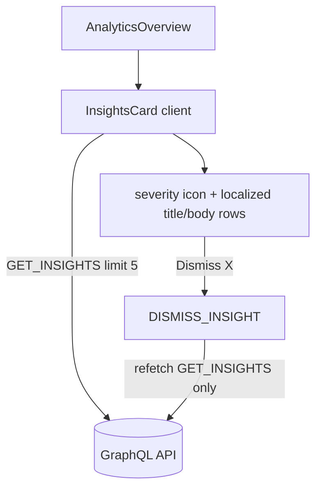

# Insights

**Last updated:** 2026-07-07 — **Feature:** `src/features/insights/`

## Overview

Proactive AI insights surfaced on the analytics overview — the "here's what changed" panel (Shopify-style). The back-end detector engine writes severity-tagged cards (low stock, sales drop, trending product) with a localized `{ en, ar }` title/body already rendered in the shop's currency; this feature reads them, renders a compact list with a severity icon, and lets the merchant dismiss one. It renders nothing when there are no active insights, so the panel only appears once the engine has flagged something for the shop.

## Screens / routes

Not a route of its own — the `InsightsCard` is embedded in `/store/[shopSlug]/analytics` (the analytics feature) between the KPI row and the targets section.

## How it works

## Components

| Component | What it shows |
|-----------|--------------|
| `InsightsCard` | Fetches the shop's active insights, renders each as a bordered row (severity icon + current-locale title/body), with a dismiss button. Hidden when the list is empty. |

## State & forms

No forms and no contextual save bar. Local state is only Apollo's cache: the query runs `cache-and-network`; dismiss fires `DISMISS_INSIGHT` and refetches `GET_INSIGHTS` **only** (never `"active"`, which would re-run the page's heavy analytics aggregations). Title/body are picked for the active `useLocale()` value, falling back to `en`/`ar`. The `X-SHOP` header (Apollo link) scopes every request; no shop id is passed.

## GraphQL operations

| Operation | Type | Purpose |
|-----------|------|---------|
| `AnalyticsInsights` | Query | List active (unread-first, non-dismissed, unexpired) insights for the shop |
| `AnalyticsDismissInsight` | Mutation | Hide one insight (shop-scoped on the server) |
| `AnalyticsMarkInsightRead` | Mutation | Mark one insight read (exported; not yet wired to a UI action) |

## Validation

None on the client — the server validates ownership and re-scopes every mutation to the resolved shop (a dismiss of another shop's insight returns not-found).

## Main files

- `src/features/insights/api/queries.ts` — the three `gql` operations
- `src/features/insights/types.ts` — `AiInsight`, response interfaces
- `src/features/insights/components/insights-card.tsx` — the card + locale picker + dismiss
- `src/features/insights/index.ts` — barrel

## Notes

- Insights are written by a back-end BullMQ dispatcher at each shop's local 06:00; the card just reads whatever the detector engine has produced. See back-end `docs/features/insights.md`.
- `markInsightRead` is exported for a future "opened" affordance; today the card only dismisses.
