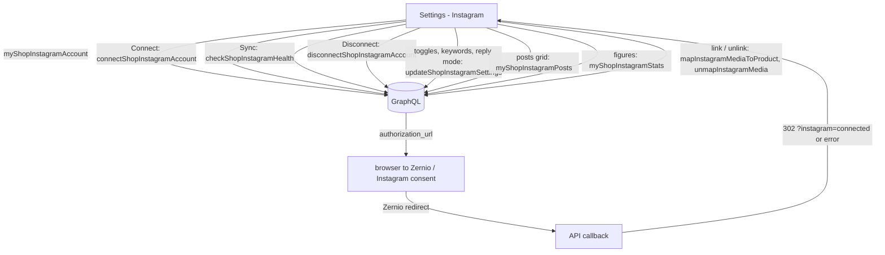

# Instagram

**Last updated:** 2026-10-14 - **Feature:** `src/features/instagram/`

## Overview

Settings → Instagram: connect the shop's Instagram Business or Creator account through **Zernio**, then choose how the shop's assistant answers direct messages and comments. The merchant never sees or pastes a credential: Connect asks the server for Zernio's authorization URL and sends the browser there, and Instagram's consent screen is the only step. The server — not the browser — receives Zernio's redirect, verifies it, and sends the merchant back here with `?instagram=connected` or `?instagram=error&reason=<code>`.

**The screen shows only the server's verdict.** `connected` comes from `myShopInstagramAccount`; there is no client-side "demo connected" state, so a connect that failed never looks connected. A row Instagram asked to be reconnected reads **Action required** with a Reconnect button and a line saying nothing is answered until then.

**The posts and figures are real.** The posts grid is the account's 25 latest posts and Reels, read live from Instagram by the server (`myShopInstagramPosts`), and each one's product link is the server's row: linking or unlinking saves first and then reads the posts back, so a refused link never looks linked. The four figures are the last 30 days counted from the server's delivery ledger (`myShopInstagramStats`); nothing on the cards is estimated, and a figure the server cannot know — orders placed after a link — is not shown. The product picker offers only the shop's own products.

## Screens / routes

| Route | What |
|---|---|
| `/store/[shopSlug]/settings/instagram` | `InstagramPane` → `InstagramSection` |

## Diagram

## Components

- `instagram-section.tsx` — the screen: status, Connect / Reconnect, Sync (health check), Disconnect (confirm dialog), the notice line for the connect result.
- `instagram-smart-selling-card.tsx` — the assistant switches, the comment reply mode (private, public, both, none) and the comment keywords.
- `instagram-posts-hub.tsx`, `instagram-product-picker-dialog.tsx`, `instagram-advanced-mapping.tsx` — the live posts grid and linking a post to a product.
- `instagram-assistant-card.tsx` — the merchant's instructions for the assistant on Instagram (up to 1,000 characters) and whether a reply typed in the Instagram app pauses the assistant in that thread.
- `instagram-kpi-stats.tsx` — the four 30-day figures; `instagram-setup-stepper.tsx` — presentational.

## State & forms

The connect result is read once from the query string into component state, and the query is then removed with `router.replace`, so a reload does not repeat the notice. A refusal with a known `reason` (`instagram_in_use`, `account_in_use`, `oauth_denied`, `invalid_state`) gets its own sentence from `notice.reasons.*`; any other code falls back to the generic line with the code in it. Switches and keywords call `updateShopInstagramSettings` as they change. The assistant card follows the save-bar rule instead: its two fields are held locally, compared by value with the server's, saved once from the global bar (sending only the keys that changed), and leaving the Instagram section with an edit pending asks first.

## GraphQL operations

`api.ts`: `MyShopInstagramAccount`, `ConnectShopInstagramAccount` (no variables), `DisconnectShopInstagramAccount`, `CheckShopInstagramHealth`, `UpdateShopInstagramSettings`, `MapInstagramMediaToProduct`, `UnmapInstagramMedia`, `MyShopInstagramPosts`, `MyShopInstagramStats` (the last two skipped until an account is connected), sharing the `ShopInstagramAccountFields` fragment. None takes a shop, an account or a redirect URL; the shop is `X-SHOP`. Contract: [back-end api/instagram.md](../../../../back-end/docs/features/api/instagram.md).

## Validation

The server is the authority (`UpdateShopInstagramSettingsInput`): up to 50 keywords of up to 60 characters, instructions up to 1,000 characters, a known reply mode. The assistant card also counts the instructions and refuses to save past 1,000 characters, so the limit shows before the request rather than as a failed save.

## Main files

- `src/features/instagram/components/instagram-section.tsx`
- `src/features/instagram/api.ts`
- `src/features/instagram/types.ts`
- `src/app/store/[shopSlug]/settings/instagram/page.tsx`

## Notes

- **Not yet implemented:** the contextual save bar for the switches, the reply mode and the keywords (they still save as they change); posts older than the latest 25.
- Instagram threads appear in the shared inbox with the WhatsApp and Telegram ones; a reply there goes out through Zernio, and is refused when the customer last wrote more than 24 hours ago.
