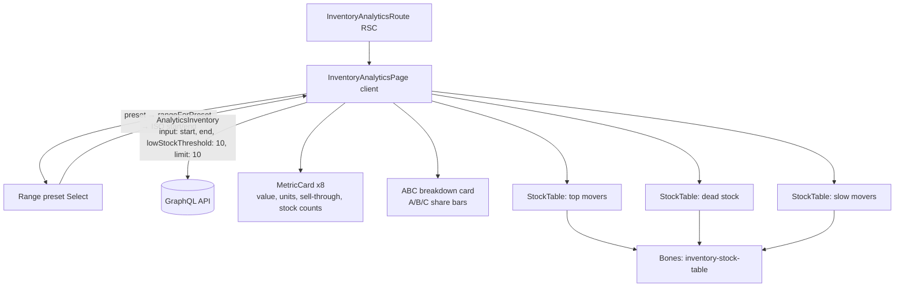

# Inventory analytics

**Last updated:** 2026-09-28 — **Feature:** `src/features/inventory-analytics/`

## Overview

The stock-health report: what the shop's inventory is worth, how fast it is moving, and which products are not moving at all. One read-only screen driven by a single `inventoryAnalytics` query over a date window the vendor picks. Eight KPIs across two rows (inventory value at cost and at retail, total units on hand, sell-through rate, units sold in the window, and counts of out-of-stock / low-stock / dead-stock products), an **ABC breakdown** ranking products into A/B/C revenue classes with share bars, and three stock tables — top movers, dead stock, slow movers — that share one component and one set of columns.

It is a sibling of the `analytics` feature rather than part of it, but deliberately reuses that feature's pieces: `MetricCard` for all eight KPIs and `rangeForPreset` / `RANGE_PRESETS` for the window, with the range labels read from the `analytics` i18n namespace. Everything is read-only — there is no mutation and no save bar.

## Screens / routes

| Route | Purpose |
|-------|---------|
| `/store/[shopSlug]/analytics/inventory` | The whole report (KPIs, ABC breakdown, three stock tables) |

## How it works

## Components

| Component | What it shows |
|-----------|--------------|
| `InventoryAnalyticsPage` | Root client island. Owns the range preset, derives the ISO window, runs the one query, and lays out the header, the two KPI rows, the ABC card and the three tables. |
| `StockTable` | One product table — name/SKU, quantity, units sold, sell-through, days of inventory, ABC badge, inventory cost. Rendered three times with different rows and empty labels. |
| `MetricCard` | Reused from the `analytics` feature. All eight KPIs here use its default shared bone name. See [analytics.md](analytics.md). |

## State & forms

A single `useState` holds the `RangePreset` (default `last_30_days`); the ISO `[start, end)` window is derived from it with `useMemo` so the query variables keep a stable identity between renders. `fetchPolicy: "cache-and-network"` means the previous figures stay on screen while a new window loads. `lowStockThreshold` and `limit` are hardcoded to 10 — neither is exposed. No forms, no mutations, no unsaved bar. Shop scope rides the `X-SHOP` header injected by the Apollo link, so no shop id is passed.

## GraphQL operations

| Operation | Type | Purpose |
|-----------|------|---------|
| `AnalyticsInventory` | Query | One round trip resolving `inventoryAnalytics(input:)` → `summary`, `abc`, `top_movers`, `dead_stock`, `slow_movers`, `currency`. The three row lists share the `StockRowFields` fragment. |

Note this feature's operations use the plain `@apollo/client` `gql` tag, not the codegen tag, so its response is typed by hand in `types.ts` rather than generated.

## Validation

None client-side. The window comes from a fixed preset list and the two numeric inputs are constants, so nothing user-entered reaches the query; the back-end validates `InventoryAnalyticsInput`.

## Main files

- `src/features/inventory-analytics/api/queries.ts` — the `AnalyticsInventory` query + `StockRowFields` fragment
- `src/features/inventory-analytics/types.ts` — hand-written response types (`StockRow`, `InventorySummary`, `AbcBreakdown`, …)
- `src/features/inventory-analytics/lib/inventory.ts` — `abcBadgeClass`, the A/B/C badge skins
- `src/features/inventory-analytics/components/inventory-analytics-page.tsx` — orchestrator + KPIs + ABC card
- `src/features/inventory-analytics/components/stock-table.tsx` — the shared product table
- `src/app/store/[shopSlug]/analytics/inventory/page.tsx` — the route

## Notes

- The page and `StockTable` read `inventoryAnalytics.*` (en + ar), with the range labels from `analytics`. Before 2026-09-28 that namespace existed in neither catalogue, so every label read from it rendered as its raw key path.
- **All money is integer cents** (`inventory_cost_cents`, `revenue_cents`, …) rendered through `formatMoneyCents` in the currency the payload echoes; `sell_through_bps` is basis points via `bpsToPercent`. `SAR` is only the pre-load fallback.
- `days_of_inventory` is nullable — a product with no sales in the window has no meaningful figure, and the table shows a dash rather than a zero, which would read as "sells out today".
- **The three tables share one bone name** (`inventory-stock-table`) because they render identical columns and differ only in rows. See [analytics.md](analytics.md) for how `Bones` works and why an uncaptured name draws nothing on a first-ever paint.
- The ABC share bars are plain CSS with concrete hex colours (`ABC_COLORS`), not a chart library — three bars did not justify one, and the badge colours in `lib/inventory.ts` are Tailwind classes for the same three classes, so the two lists must be kept in step.
- `sell_through_bps` appears twice with different meanings: once shop-wide in `summary` and once per product on each `StockRow`. They are not comparable — the KPI is the aggregate for the window, the column is that product's own rate.
