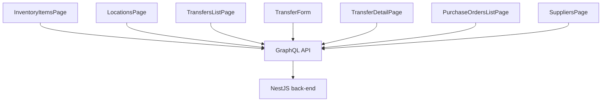

# Inventory

**Last updated:** 2026-09-28 - **Feature:** `src/features/inventory/` — every screen follows the locale cookie

## Overview

Lets shop owners view and adjust stock levels across warehouse locations, track incoming transfers, manage purchase orders from external suppliers, and maintain a supplier directory.

## Screens / routes

All routes live under `/store/[shopSlug]/products/inventory/`.

| Route | Component |
|-------|-----------|
| `/products/inventory` | `InventoryItemsPage` |
| `/products/inventory/locations` | `LocationsPage` |
| `/products/inventory/bulk` | `BulkInventoryEditor` |
| `/products/inventory/transfers` | `TransfersListPage` |
| `/products/inventory/transfers/new` | `TransferForm (mode=create)` |
| `/products/inventory/transfers/[id]` | `TransferDetailPage` |
| `/products/inventory/transfers/[id]/edit` | `TransferForm (mode=edit)` |
| `/products/inventory/suppliers` | `SuppliersPage` |
| `/products/inventory/purchase-orders` | `PurchaseOrdersListPage` |
| `/products/inventory/purchase-orders/new` | `PurchaseOrderNewPage` |
| `/products/inventory/purchase-orders/[id]` | `PurchaseOrderDetailPage` |

## How it works

Pages query their data on mount and submit mutations on user action. Transfer and detail pages wire the global save bar (`useUnsavedBarStore`) while changes are pending.

## Components

| Component | Purpose |
|-----------|---------|
| `items/inventory-items-page.tsx` | Paginated stock table; inline `StockEditor` popover stages edits locally; navbar contextual save bar batch-saves via `EditInventoryStock`. |
| `locations/locations-page.tsx` | Card list of warehouse locations with inline create/edit dialogs. |
| `bulk/bulk-inventory-editor.tsx` | Spreadsheet-style view across all products and locations. |
| `transfers/transfers-list-page.tsx` | Paginated list with status filter, search, 30-day KPI carousel. |
| `transfers/transfer-form.tsx` | Create/edit form with origin/destination pickers and per-line quantities. |
| `transfers/transfer-detail-page.tsx` | Full transfer view; status-aware primary action with secondary dropdown. |
| `suppliers/suppliers-page.tsx` | Supplier CRUD list with inline search and create/edit dialog. |
| `purchase-orders/purchase-orders-list-page.tsx` | Paginated PO list with status filter. |
| `purchase-orders/purchase-order-detail-page.tsx` | PO detail with lifecycle actions (Order, Receive, Close). |

## State & forms

**Global save bar (`useUnsavedBarStore`):** `TransferForm`, `TransferDetailPage`, and `InventoryItemsPage` register the navbar save bar while changes are pending and tear it down on unmount.

- `TransferForm`: dirty is computed by JSON-comparing a `snapshot` of local state against an `initialSnapshot` fixed at mount. Bar is always visible in create mode; appears only when dirty in edit mode.
- `TransferDetailPage`: uses react-hook-form `defaultValues` from `buildDefaults`. `formState.isDirty` drives the bar; `reset()` implements Discard; a `serverSig` effect re-syncs after save.
- `InventoryItemsPage`: stages edits locally in `pending: Record<string, PendingEdit>` and registers the global save bar while `pendingCount > 0`.

## GraphQL operations

**Queries:** `InventoryLocations`, `InventoryItems`, `InventoryLevels`, `InventoryHistory`, `InventoryTransfers`, `InventoryTransfer`, `InventoryTransferStats`, `InventoryTransferTimeline`, `Suppliers`, `PurchaseOrders`, `PurchaseOrder`

**Mutations:** `CreateInventoryLocation`, `UpdateInventoryLocation`, `DeleteInventoryLocation`, `SetInventoryAvailable`, `AdjustInventory`, `EditInventoryStock`, `TransferInventory`, `CreateInventoryTransfer`, `UpdateInventoryTransfer`, `DuplicateInventoryTransfer`, `DeleteInventoryTransfer`, `MarkTransferReadyToShip`, `SendInventoryTransfer`, `ManageReceivedItems`, `ReceiveInventoryTransfer`, `MarkTransferTransferred`, `CancelInventoryTransfer`, `AddInventoryTransferComment`, `CreateSupplier`, `UpdateSupplier`, `DeleteSupplier`, `CreatePurchaseOrder`, `UpdatePurchaseOrder`, `OrderPurchaseOrder`, `ReceivePurchaseOrder`, `ClosePurchaseOrder`, `DeletePurchaseOrder`

## Validation

No Zod schemas exist in a `validations/` directory. Client-side checks are inline (source must differ from destination, at least one line required) using `sileo.error()` toasts.

## Main files

- `src/features/inventory/api/queries.ts`
- `src/features/inventory/api/mutations.ts`
- `src/features/inventory/components/items/inventory-items-page.tsx`
- `src/features/inventory/components/transfers/transfer-form.tsx`
- `src/features/inventory/components/transfers/transfer-detail-page.tsx`
- `src/features/inventory/components/transfers/transfers-list-page.tsx`
- `src/features/inventory/components/suppliers/suppliers-page.tsx`

## Notes

- Every screen here reads `inventory.*` (items, bulk editor, locations, the national-address field, purchase orders new / detail / list, suppliers), and transfers read `transfers.*`. Status filter values stay `DRAFT` / `ORDERED` / `PARTIAL` / `RECEIVED` / `CLOSED`. English is the original literal; Arabic uses مخزون / أمر شراء / موقع تخزين.
- An adjustment's reason is written to the history row as its note **in the merchant's language** ("Correction" in English, its Arabic label in Arabic). Rows written before 2026-09-28 are English. The reason ids behind the picker are camelCase message keys, not the stored text.
- Product and variant names on the items page, the bulk editor and the new-PO picker show in the active locale, as the transfers screens already did.
- This feature is not the only place stock is edited. The product form's variants table carries its own location picker (`features/products/.../variants-table.tsx`) and reads `InventoryLevels` with `include_variations: true` — one request for a whole VARIABLE product rather than one per variant. It stages its edits on the form and flushes them through `SetInventoryAvailable` after the product saves, so the contextual save bar owns them; nothing there writes on blur.
- A product's opening stock is never placed from the product form. `createProduct` seeds it at the shop's default location, and moving it elsewhere is a transfer — the same two steps a vendor takes by hand.
- The bulk editor and transfer form/detail tables sit on the same white card as the list screens (`ring-1 ring-foreground/10`), not the old bordered wrap.
